# Iron: EOS reconstruction reports

<!-- Generated by scripts.generate_reconstruction_reports; edit EOSMAT instead. -->

[All reconstruction reports](index.md) · [Material and EOS parameters](../material-summaries/iron.md)

These reports explain the assessments already stored in EOSMAT. Generating
this page does not refit observations, change classifications or replace source coefficients.

Use [scientific label definitions](../eos-labels.md) to distinguish coefficient
agreement, source verification, author-workflow reproduction and recommendation for use.

| EOS record | Recorded outcome | Coefficient comparison |
| --- | --- | --- |
| [Sakai et al. (2025), Fe-hcp generalized Rydberg-Stacey scale](#record-iron_sakai_2025_rydberg_stacey_1) | Complete independent refit unavailable | No numeric coefficient pair recorded |
| [(hcp phase -- 19.2 GPa modified to P=0) (JCPDS 34-529 ) EOS from Mao et al 90](#record-iron_mao_1990_bm3_1) | Numerically similar, with qualifications | Graph and table |
| [Shen and Smith (2026), Cu-referenced Vinet](#record-iron_shen_2026_vinet_2) | Coefficient parity achieved | Graph and table |
| [Dewaele (2019), Fe MAO-scale Vinet](#record-iron_dewaele_2019_mao_vinet) | Numerically similar, with qualifications | Graph and table |
| [Dewaele (2019), Fe DOR-scale Vinet](#record-iron_dewaele_2019_dor_vinet) | Numerically similar, with qualifications | Graph and table |
| [Zhang et al. (2025), hcp-Fe Fit #1 BM3+MGD](#record-iron_zhang_2025_fit1_birch_murnaghan_3_mgd) | Coefficient parity achieved | Graph and table |
| [Zhang et al. (2025), hcp-Fe Fit #2 BM3+MGD](#record-iron_zhang_2025_fit2_birch_murnaghan_3_mgd) | Coefficient parity achieved | Graph and table |
| [Zhang et al. (2025), hcp-Fe Fit #5 Vinet+MGD](#record-iron_zhang_2025_fit5_vinet_mgd) | Coefficient parity achieved | Graph and table |
| [Dewaele et al. (2006), hcp-Fe Vinet thermal pressure scale](#record-iron_dewaele_2006_vinet_thermal) | Complete independent refit unavailable | No numeric coefficient pair recorded |
| [Fei et al. (2016), preferred fixed-density 300 K BM3](#record-iron_fei_2016_bm3) | Complete independent refit unavailable | No numeric coefficient pair recorded |
| [Fei et al. (2016), free-density 300 K BM3 alternative](#record-iron_fei_2016_free_density_bm3) | Complete independent refit unavailable | No numeric coefficient pair recorded |
| [Fei et al. (2016), preferred BM3 + Debye and electronic/anharmonic thermal pressure](#record-iron_fei_2016_bm3_debye_quadratic) | Complete independent refit unavailable | No numeric coefficient pair recorded |
| [Sakai et al. (2014), p1\_bm3](#record-iron_sakai_2014_p1_bm3) | Parity not achieved for this comparison | Graph and table |
| [Sakai et al. (2014), p1\_vinet](#record-iron_sakai_2014_p1_vinet) | Numerically similar, with qualifications | Graph and table |
| [Sakai et al. (2014), p1\_v0\_mao\_bm3](#record-iron_sakai_2014_p1_v0_mao_bm3) | Parity not achieved for this comparison | Graph and table |
| [Sakai et al. (2014), p1\_v0\_mao\_vinet](#record-iron_sakai_2014_p1_v0_mao_vinet) | Parity not achieved for this comparison | Graph and table |
| [Sakai et al. (2014), p1\_v0\_dewaele\_bm3](#record-iron_sakai_2014_p1_v0_dewaele_bm3) | Parity not achieved for this comparison | Graph and table |
| [Sakai et al. (2014), p1\_v0\_dewaele\_vinet](#record-iron_sakai_2014_p1_v0_dewaele_vinet) | Parity not achieved for this comparison | Graph and table |
| [Sakai et al. (2014), p2\_bm3](#record-iron_sakai_2014_p2_bm3) | Complete independent refit unavailable | No numeric coefficient pair recorded |
| [Sakai et al. (2014), p2\_vinet](#record-iron_sakai_2014_p2_vinet) | Complete independent refit unavailable | No numeric coefficient pair recorded |
| [Sakai et al. (2014), p3\_bm3](#record-iron_sakai_2014_p3_bm3) | Complete independent refit unavailable | No numeric coefficient pair recorded |
| [Sakai et al. (2014), p3\_vinet](#record-iron_sakai_2014_p3_vinet) | Complete independent refit unavailable | No numeric coefficient pair recorded |
| [Sakai et al. (2014), p4\_bm3](#record-iron_sakai_2014_p4_bm3) | Parity not achieved for this comparison | Graph and table |
| [Sakai et al. (2014), p4\_vinet](#record-iron_sakai_2014_p4_vinet) | Numerically similar, with qualifications | Graph and table |
| [Sakai et al. (2014), p5\_bm3](#record-iron_sakai_2014_p5_bm3) | Numerically similar, with qualifications | Graph and table |
| [Sakai et al. (2014), p5\_vinet](#record-iron_sakai_2014_p5_vinet) | Numerically similar, with qualifications | Graph and table |
| [Sakai et al. (2014), p6\_bm3](#record-iron_sakai_2014_p6_bm3) | Parity not achieved for this comparison | Graph and table |
| [Sakai et al. (2014), p6\_vinet](#record-iron_sakai_2014_p6_vinet) | Numerically similar, with qualifications | Graph and table |
| [Yamazaki et al. (2012), bm3\_thermal](#record-iron_yamazaki_2012_bm3_thermal) | Parity not achieved for this comparison | Graph and table |
| [Yamazaki et al. (2012), vinet\_thermal](#record-iron_yamazaki_2012_vinet_thermal) | Parity not achieved for this comparison | Graph and table |
| [Dubrovinsky et al. (2000), bm3\_thermal](#record-iron_dubrovinsky_2000_bm3_thermal) | Complete independent refit unavailable | No numeric coefficient pair recorded |
| [Dewaele et al. (2006), bm3](#record-iron_dewaele_2006_bm3) | Numerically similar, with qualifications | Graph and table |
| [Brown et al. (2000), nominal-iron steel linear Hugoniot, solid subset](#record-iron_brown_2000_linear_hugoniot) | Coefficient parity achieved | Graph and table |
| [Miozzi et al. (2020), 300 K BM3 (not reproduced)](#record-iron_miozzi_2020_bm3) | Parity not achieved for this comparison | Graph and table |
| [Miozzi et al. (2020), 300 K Vinet (not reproduced)](#record-iron_miozzi_2020_vinet) | Parity not achieved for this comparison | Graph and table |
| [Miozzi et al. (2020), published BM3–MGD — author-reported n=2](#record-iron_miozzi_2020_bm3_mgd) | Parity not achieved for this comparison | Graph and table |
| [Peritheos refit of Miozzi (2020) hcp-Fe — Tange (2009) MgO pressures, equal weights](#record-iron_miozzi_2020_tange_2009_bm3_mgd_refit) | Coefficient parity achieved | Graph and table |
| [Peritheos refit of Miozzi (2020) hcp-Fe — Speziale (2001) variable-q MgO, n=1](#record-iron_miozzi_2020_speziale_2001_bm3_mgd_refit) | Coefficient parity achieved | Graph and table |

## Sakai et al. (2025), Fe-hcp generalized Rydberg-Stacey scale

Record: `iron_sakai_2025_rydberg_stacey_1` · Model: `RydbergStacey`

**Outcome: Complete independent refit unavailable.**

**Scope:** Comparison with the source parameterization.
**Comparison basis:** The bundled grid is calculated from the reported coefficients. Raw simultaneous-volume observations exist in Tables S1-S8, but the multi-stage fit also incorporates earlier studies and does not publish one flat pressure-volume regression table or covariance.

[Stored EOS coefficients and source](../material-summaries/iron.md#record-iron_sakai_2025_rydberg_stacey_1)

### What this result establishes

**Separate source-review status:** primary\_source\_validated.
**Usage recommendation:** See the stored EOS qualifications; no recommendation is inferred here.

- This named numerical assessment alone does not establish author-workflow reproduction, physical accuracy or recommendation for use.
- No reconstructed coefficient table is recorded for this assessment; no missing values have been inferred.

### Data and reconstruction method

- **Dataset identifiers:** None declared
- **Fixed parameters:** K\_infinity\_prime

Unspecified selections, weights, fixed values or error conventions remain unknown; they have not been inferred for this report.

### Why no coefficient graph is shown

No numeric source/reconstruction pair is recorded for this assessment. A graph would require information that is not available here; no values or observations have been invented.

### Detailed evidence and existing plots

- [Record-by-record numerical ledger](../primary-eos-refits.md#records).
- [Source-audit reports](../source-audits.md).

Observation curves and residual plots are provided by the supporting reports where available. Their absence is not filled by a reconstructed curve presented as measured data.

[Machine-readable comparison ledger](https://github.com/CPrescher/peritheos/blob/main/docs/data/primary-eos-refits.json) — look up `iron_sakai_2025_rydberg_stacey_1`.
[Complete native EOSMAT file](https://github.com/CPrescher/peritheos/blob/main/peritheos/data/materials/iron.eosmat).

## (hcp phase -- 19.2 GPa modified to P=0) (JCPDS 34-529 ) EOS from Mao et al 90

Record: `iron_mao_1990_bm3_1` · Model: `BM3`

**Outcome: Numerically similar, with qualifications.**

**Scope:** Comparison with the source parameterization.
**Comparison basis:** Every compared free coefficient meets either the recorded combined-two-sigma comparison or parameter-specific numerical similarity screen; the audit does not classify the complete comparison as parity.

[Stored EOS coefficients and source](../material-summaries/iron.md#record-iron_mao_1990_bm3_1)

### What this result establishes

**Separate source-review status:** primary\_source\_validated.
**Usage recommendation:** See the stored EOS qualifications; no recommendation is inferred here.

- This named numerical assessment alone does not establish author-workflow reproduction, physical accuracy or recommendation for use.

### Data and reconstruction method

- **Dataset identifiers:** iron\_mao\_1990\_table1\_compression
- **Observations:** 32
- **Fit kind:** isothermal\_pv
- **Selection:** all rows
- **Objective:** errors\_in\_variables
- **Absolute sigma:** True
- **Free parameters:** V0; K0; K0\_prime
- **Fixed parameters:** None declared

Unspecified selections, weights, fixed values or error conventions remain unknown; they have not been inferred for this report.

### Source versus reconstruction

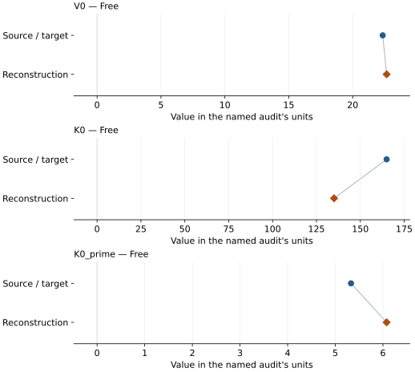

This is a **coefficient comparison**, not an observation or residual plot.
Each panel uses its coefficient's audit units and includes zero. Markers show
stored central values only. Error widths are retained in the table below;
no confidence interval or uncertainty band is inferred. Fixed/adopted values are constraints.

| Parameter | Source / target | Source error | Reconstruction | Reconstruction error | Fit role |
| --- | --- | --- | --- | --- | --- |
| V0 | 22.35 | 0.03 | 22.65735076467185 | 0.527513535242103 | Free |
| K0 | 165.0 | 4.0 | 135.03184905276527 | 34.755451612951475 | Free |
| K0\_prime | 5.33 | 0.09 | 6.0778904081761125 | 0.819840323475182 | Free |

Values and reported errors are copied without rounding or conversion from the named audit. Missing errors mean unknown, not zero. Parameter names and volume conventions follow that audit; error widths do not imply a confidence convention.

Recorded diagnostics, covariance and additional protocol

- **Columns:**
    - **Pressure:** pressure\_gpa
    - **Temperature:** Not specified
    - **Volume:** volume\_a3\_conventional\_cell
- **Observed pressure range gpa:** \[34.8, 304.1\]
- **Observed temperature range k:** Not specified
- **Observed volume range:** \[13.6131, 19.3021\]
- **Degrees of freedom:** 29
- **Solver success:** True
- **Solver message:** \`ftol\` termination condition is satisfied.
- **Rmse gpa:** 4.531865161777986
- **Published rmse gpa:** 5.845915768922167
- **Reduced chi square:** 0.7937858828277482

### Detailed evidence and existing plots

- [Earlier detailed record investigation](../primary-eos-refits.md#investigation-iron_mao_1990_bm3_1).
- [Record-by-record numerical ledger](../primary-eos-refits.md#records).
- [Source-audit reports](../source-audits.md).

Observation curves and residual plots are provided by the supporting reports where available. Their absence is not filled by a reconstructed curve presented as measured data.

[Machine-readable comparison ledger](https://github.com/CPrescher/peritheos/blob/main/docs/data/primary-eos-refits.json) — look up `iron_mao_1990_bm3_1`.
[Complete native EOSMAT file](https://github.com/CPrescher/peritheos/blob/main/peritheos/data/materials/iron.eosmat).

## Shen and Smith (2026), Cu-referenced Vinet

Record: `iron_shen_2026_vinet_2` · Model: `Vinet`

**Outcome: Coefficient parity achieved.**

**Scope:** Comparison with the source parameterization.
**Comparison basis:** Every compared free coefficient meets both the recorded combined-two-sigma comparison and parameter-specific numerical similarity screen. Error conventions and fit qualifications remain applicable.

[Stored EOS coefficients and source](../material-summaries/iron.md#record-iron_shen_2026_vinet_2)

### What this result establishes

**Separate source-review status:** primary\_source\_validated.
**Usage recommendation:** See the stored EOS qualifications; no recommendation is inferred here.

- Direct reconstruction from source observations: each Table S1 phase volume is paired with its simultaneous Cu volume, pressure is evaluated from Fratanduono et al.'s analytic third-order 298 K Vinet fit, and K0 and K0\_prime are fitted with Shen and Smith's fixed V0 and stated run selection. The source publishes no pressure weights, residual covariance, or weighting protocol, so the reproduction uses unweighted pressure residuals and does not infer any of them.
- This named numerical assessment alone does not establish author-workflow reproduction, physical accuracy or recommendation for use.

### Data and reconstruction method

- **Dataset identifiers:** shen\_smith\_2026\_table\_s1\_simultaneous\_volumes
- **Observations:** 380
- **Fit kind:** fixed\_v0\_vinet\_with\_reconstructed\_cu\_pressure
- **Selection:** hcp-Fe; DAC-1 and DAC-2
- **Objective:** unweighted\_pressure\_residuals
- **Absolute sigma:** False
- **Free parameters:** K0; K0\_prime
- **Fixed parameters:** V0

Unspecified selections, weights, fixed values or error conventions remain unknown; they have not been inferred for this report.

### Source versus reconstruction

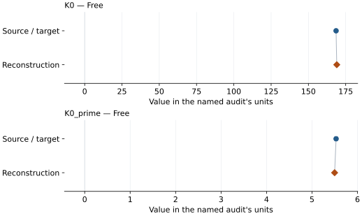

This is a **coefficient comparison**, not an observation or residual plot.
Each panel uses its coefficient's audit units and includes zero. Markers show
stored central values only. Error widths are retained in the table below;
no confidence interval or uncertainty band is inferred. Fixed/adopted values are constraints.

| Parameter | Source / target | Source error | Reconstruction | Reconstruction error | Fit role |
| --- | --- | --- | --- | --- | --- |
| K0 | 168.55 | 0.6 | 169.01143018703257 | 0.4681771067924645 | Free |
| K0\_prime | 5.53 | 0.03 | 5.497551612943147 | 0.021421011176361592 | Free |

Values and reported errors are copied without rounding or conversion from the named audit. Missing errors mean unknown, not zero. Parameter names and volume conventions follow that audit; error widths do not imply a confidence convention.

Recorded diagnostics, covariance and additional protocol

- **Columns:**
    - **Pressure:** Fratanduono-2020 298 K Cu pressure reconstructed per run
    - **Temperature:** Not specified
    - **Volume:** unit\_cell\_volume\_a3
- **Observed pressure range gpa:** \[15.36098269129744, 136.62217040703038\]
- **Observed temperature range k:** Not specified
- **Observed volume range:** \[15.9849, 20.76078\]
- **Degrees of freedom:** 378
- **Solver success:** True
- **Solver message:** \`ftol\` termination condition is satisfied.
- **Rmse gpa:** 0.7273663608984583
- **Published rmse gpa:** 0.7370080313201411
- **Reduced chi square:** 0.5318610918712517
- **Pressure reconstruction:**
    - **Density0 g cm3:** 8.939
    - **DOI:** 10.1103/PhysRevLett.124.015701
    - **Model:** vinet\_3
    - **Pairing:** Each phase volume uses the single Cu volume with the same experiment and run number; both source-labeled Pt first/last measurements are retained when the run is selected.
    - **Parameters:**
        - **K0 gpa:** 133.6
        - **Beta:** 2.06
        - **Eta:** 6.29
        - **Psi:** 1.65
    - **Reference:** Fratanduono et al. (2020)
    - **Reference eos record:** copper\_fratanduono\_2020\_vinet3\_298k
    - **Reference unit cell volume a3:** 47.218085048721
    - **Source locations:** main article Table I, 298 K isotherm row; Supplemental Material Eq. (2), Section S4

### Detailed evidence and existing plots

- [Record-by-record numerical ledger](../primary-eos-refits.md#records).
- [Source-audit reports](../source-audits.md).

Observation curves and residual plots are provided by the supporting reports where available. Their absence is not filled by a reconstructed curve presented as measured data.

[Machine-readable comparison ledger](https://github.com/CPrescher/peritheos/blob/main/docs/data/primary-eos-refits.json) — look up `iron_shen_2026_vinet_2`.
[Complete native EOSMAT file](https://github.com/CPrescher/peritheos/blob/main/peritheos/data/materials/iron.eosmat).

## Dewaele (2019), Fe MAO-scale Vinet

Record: `iron_dewaele_2019_mao_vinet` · Model: `Vinet`

**Outcome: Numerically similar, with qualifications.**

**Scope:** Comparison with the source parameterization.
**Comparison basis:** Every compared free coefficient meets either the recorded combined-two-sigma comparison or parameter-specific numerical similarity screen; the audit does not classify the complete comparison as parity.

[Stored EOS coefficients and source](../material-summaries/iron.md#record-iron_dewaele_2019_mao_vinet)

### What this result establishes

**Separate source-review status:** primary\_source\_validated.
**Usage recommendation:** See the stored EOS qualifications; no recommendation is inferred here.

- Complete source rows for this material are bundled and the dedicated two-ruby-scale refit recovers every coefficient within the published 95% interval. The common ledger classifies the result as similar, not strict parity, because the dedicated audit does not infer a refit covariance from rounded source rows.
- This named numerical assessment alone does not establish author-workflow reproduction, physical accuracy or recommendation for use.

### Data and reconstruction method

- **Dataset identifiers:** iron\_dewaele\_2006\_epaps\_compression
- **Observations:** 53
- **Fit kind:** static\_vinet\_with\_explicit\_ruby\_scale\_conversion
- **Selection:** complete 53-row hcp selection; reported pressure is the source's ruby-linked effective pressure for both ruby and W-gauge rows
- **Objective:** unweighted pressure residuals
- **Free parameters:** V0; K0; K0\_prime
- **Fixed parameters:** None declared

Unspecified selections, weights, fixed values or error conventions remain unknown; they have not been inferred for this report.

### Source versus reconstruction

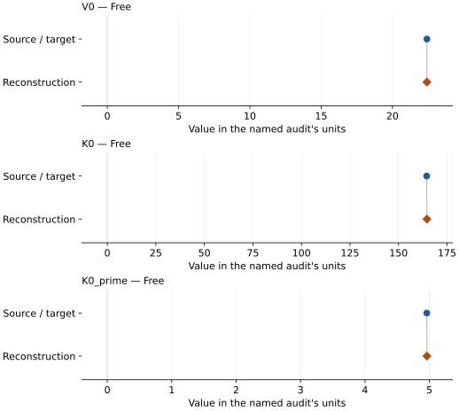

This is a **coefficient comparison**, not an observation or residual plot.
Each panel uses its coefficient's audit units and includes zero. Markers show
stored central values only. Error widths are retained in the table below;
no confidence interval or uncertainty band is inferred. Fixed/adopted values are constraints.

| Parameter | Source / target | Source error | Reconstruction | Reconstruction error | Fit role |
| --- | --- | --- | --- | --- | --- |
| V0 | 22.418 | 0.1 | 22.41601892438253 | Not specified | Free |
| K0 | 164.5 | 7.9 | 164.63787370785175 | Not specified | Free |
| K0\_prime | 4.96 | 0.16 | 4.96211213243947 | Not specified | Free |

Values and reported errors are copied without rounding or conversion from the named audit. Missing errors mean unknown, not zero. Parameter names and volume conventions follow that audit; error widths do not imply a confidence convention.

Recorded diagnostics, covariance and additional protocol

- **Observed pressure range gpa:** \[17.565721133297988, 188.868464368615\]
- **Solver success:** True
- **Solver message:** dedicated Dewaele (2019) refit completed
- **Rmse gpa:** 0.8193781791012171

### Detailed evidence and existing plots

- [Earlier detailed record investigation](../primary-eos-refits.md#investigation-iron_dewaele_2019_mao_vinet).
- [Record-by-record numerical ledger](../primary-eos-refits.md#records).
- [Source-audit reports](../source-audits.md).

Observation curves and residual plots are provided by the supporting reports where available. Their absence is not filled by a reconstructed curve presented as measured data.

[Machine-readable comparison ledger](https://github.com/CPrescher/peritheos/blob/main/docs/data/primary-eos-refits.json) — look up `iron_dewaele_2019_mao_vinet`.
[Complete native EOSMAT file](https://github.com/CPrescher/peritheos/blob/main/peritheos/data/materials/iron.eosmat).

## Dewaele (2019), Fe DOR-scale Vinet

Record: `iron_dewaele_2019_dor_vinet` · Model: `Vinet`

**Outcome: Numerically similar, with qualifications.**

**Scope:** Comparison with the source parameterization.
**Comparison basis:** Every compared free coefficient meets either the recorded combined-two-sigma comparison or parameter-specific numerical similarity screen; the audit does not classify the complete comparison as parity.

[Stored EOS coefficients and source](../material-summaries/iron.md#record-iron_dewaele_2019_dor_vinet)

### What this result establishes

**Separate source-review status:** primary\_source\_validated.
**Usage recommendation:** See the stored EOS qualifications; no recommendation is inferred here.

- Complete source rows for this material are bundled and the dedicated two-ruby-scale refit recovers every coefficient within the published 95% interval. The common ledger classifies the result as similar, not strict parity, because the dedicated audit does not infer a refit covariance from rounded source rows.
- This named numerical assessment alone does not establish author-workflow reproduction, physical accuracy or recommendation for use.

### Data and reconstruction method

- **Dataset identifiers:** iron\_dewaele\_2006\_epaps\_compression
- **Observations:** 53
- **Fit kind:** static\_vinet\_with\_explicit\_ruby\_scale\_conversion
- **Selection:** complete 53-row hcp selection; reported pressure is the source's ruby-linked effective pressure for both ruby and W-gauge rows
- **Objective:** unweighted pressure residuals
- **Free parameters:** V0; K0; K0\_prime
- **Fixed parameters:** None declared

Unspecified selections, weights, fixed values or error conventions remain unknown; they have not been inferred for this report.

### Source versus reconstruction

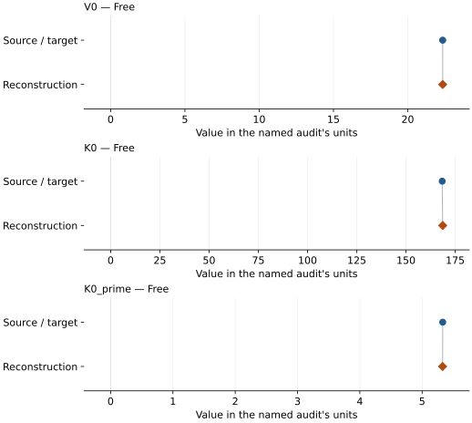

This is a **coefficient comparison**, not an observation or residual plot.
Each panel uses its coefficient's audit units and includes zero. Markers show
stored central values only. Error widths are retained in the table below;
no confidence interval or uncertainty band is inferred. Fixed/adopted values are constraints.

| Parameter | Source / target | Source error | Reconstruction | Reconstruction error | Fit role |
| --- | --- | --- | --- | --- | --- |
| V0 | 22.354 | 0.1 | 22.351988344307554 | Not specified | Free |
| K0 | 168.4 | 7.9 | 168.64954836915632 | Not specified | Free |
| K0\_prime | 5.33 | 0.16 | 5.328081486636549 | Not specified | Free |

Values and reported errors are copied without rounding or conversion from the named audit. Missing errors mean unknown, not zero. Parameter names and volume conventions follow that audit; error widths do not imply a confidence convention.

Recorded diagnostics, covariance and additional protocol

- **Observed pressure range gpa:** \[17.7, 205.0\]
- **Solver success:** True
- **Solver message:** dedicated Dewaele (2019) refit completed
- **Rmse gpa:** 0.9407258247416176

### Detailed evidence and existing plots

- [Earlier detailed record investigation](../primary-eos-refits.md#investigation-iron_dewaele_2019_dor_vinet).
- [Record-by-record numerical ledger](../primary-eos-refits.md#records).
- [Source-audit reports](../source-audits.md).

Observation curves and residual plots are provided by the supporting reports where available. Their absence is not filled by a reconstructed curve presented as measured data.

[Machine-readable comparison ledger](https://github.com/CPrescher/peritheos/blob/main/docs/data/primary-eos-refits.json) — look up `iron_dewaele_2019_dor_vinet`.
[Complete native EOSMAT file](https://github.com/CPrescher/peritheos/blob/main/peritheos/data/materials/iron.eosmat).

## Zhang et al. (2025), hcp-Fe Fit #1 BM3+MGD

Record: `iron_zhang_2025_fit1_birch_murnaghan_3_mgd` · Model: `BM3`

**Outcome: Coefficient parity achieved.**

**Scope:** Comparison with the source parameterization.
**Comparison basis:** Every compared free coefficient meets both the recorded combined-two-sigma comparison and parameter-specific numerical similarity screen. Error conventions and fit qualifications remain applicable.

[Stored EOS coefficients and source](../material-summaries/iron.md#record-iron_zhang_2025_fit1_birch_murnaghan_3_mgd)

### What this result establishes

**Separate source-review status:** primary\_source\_validated.
**Usage recommendation:** See the stored EOS qualifications; no recommendation is inferred here.

- Exact final-input reproduction, not a reconstruction of every upstream reduction: the supplement deposits the 1,313 fit rows, but omits the calibrant observations needed to recalculate 641 static pressures and the documented interpolation procedure for most model-assigned dynamic temperatures. Experimental P-V, derived temperatures, and ab-initio rows remain explicitly separated in the bundled dataset.
- This named numerical assessment alone does not establish author-workflow reproduction, physical accuracy or recommendation for use.

### Data and reconstruction method

- **Dataset identifiers:** iron\_zhang\_2025\_tables\_s1\_s3\_s4\_pvt
- **Observations:** 1313
- **Fit kind:** joint\_pvt
- **Selection:** all rows
- **Objective:** pressure\_residuals
- **Absolute sigma:** False
- **Free parameters:** rt\_eos.V0; rt\_eos.K0; rt\_eos.K0\_prime; theta0; gamma0; q
- **Fixed parameters:** Tr; n

Unspecified selections, weights, fixed values or error conventions remain unknown; they have not been inferred for this report.

### Source versus reconstruction

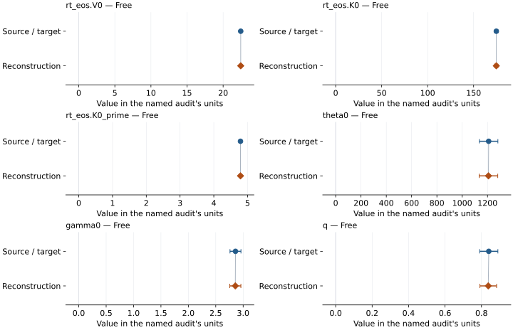

This is a **coefficient comparison**, not an observation or residual plot.
Each panel uses its coefficient's audit units and includes zero. Markers show
stored central values only. Error widths are retained in the table below;
no confidence interval or uncertainty band is inferred. Fixed/adopted values are constraints.

| Parameter | Source / target | Source error | Reconstruction | Reconstruction error | Fit role |
| --- | --- | --- | --- | --- | --- |
| rt\_eos.V0 | 22.43720387565302 | 0.033210781343476936 | 22.43641675940054 | 0.033155172876544535 | Free |
| rt\_eos.K0 | 174.7 | 1.7 | 174.66847107075807 | 1.7350063649295675 | Free |
| rt\_eos.K0\_prime | 4.79 | 0.014 | 4.790198306637055 | 0.014108705511705802 | Free |
| theta0 | 1209.0 | 73.0 | 1207.4662312512537 | 73.57440312727189 | Free |
| gamma0 | 2.86 | 0.1 | 2.8570331399747344 | 0.1014844851113758 | Free |
| q | 0.84 | 0.05 | 0.8372271178566878 | 0.04577351548849858 | Free |

Values and reported errors are copied without rounding or conversion from the named audit. Missing errors mean unknown, not zero. Parameter names and volume conventions follow that audit; error widths do not imply a confidence convention.

Recorded diagnostics, covariance and additional protocol

- **Columns:**
    - **Pressure:** pressure\_gpa\_fit
    - **Temperature:** temperature\_k
    - **Volume:** volume\_a3\_conventional\_cell
- **Observed pressure range gpa:** \[10.7212147810221, 1374.0\]
- **Observed temperature range k:** \[298.0, 12000.0\]
- **Observed volume range:** \[9.273280420632346, 21.646792228084685\]
- **Degrees of freedom:** 1307
- **Solver success:** True
- **Solver message:** \`ftol\` termination condition is satisfied.
- **Rmse gpa:** 4.5023256257902515
- **Published rmse gpa:** 4.502611079867821
- **Reduced chi square:** 20.363993130352156

### Detailed evidence and existing plots

- [Record-by-record numerical ledger](../primary-eos-refits.md#records).
- [Source-audit reports](../source-audits.md).

Observation curves and residual plots are provided by the supporting reports where available. Their absence is not filled by a reconstructed curve presented as measured data.

[Machine-readable comparison ledger](https://github.com/CPrescher/peritheos/blob/main/docs/data/primary-eos-refits.json) — look up `iron_zhang_2025_fit1_birch_murnaghan_3_mgd`.
[Complete native EOSMAT file](https://github.com/CPrescher/peritheos/blob/main/peritheos/data/materials/iron.eosmat).

## Zhang et al. (2025), hcp-Fe Fit #2 BM3+MGD

Record: `iron_zhang_2025_fit2_birch_murnaghan_3_mgd` · Model: `BM3`

**Outcome: Coefficient parity achieved.**

**Scope:** Comparison with the source parameterization.
**Comparison basis:** Every compared free coefficient meets both the recorded combined-two-sigma comparison and parameter-specific numerical similarity screen. Error conventions and fit qualifications remain applicable.

[Stored EOS coefficients and source](../material-summaries/iron.md#record-iron_zhang_2025_fit2_birch_murnaghan_3_mgd)

### What this result establishes

**Separate source-review status:** primary\_source\_validated.
**Usage recommendation:** See the stored EOS qualifications; no recommendation is inferred here.

- Exact final-input reproduction, not a reconstruction of every upstream reduction: the supplement deposits the 1,313 fit rows, but omits the calibrant observations needed to recalculate 641 static pressures and the documented interpolation procedure for most model-assigned dynamic temperatures. Experimental P-V, derived temperatures, and ab-initio rows remain explicitly separated in the bundled dataset.
- This named numerical assessment alone does not establish author-workflow reproduction, physical accuracy or recommendation for use.

### Data and reconstruction method

- **Dataset identifiers:** iron\_zhang\_2025\_tables\_s1\_s3\_s4\_pvt
- **Observations:** 1313
- **Fit kind:** joint\_pvt
- **Selection:** all rows
- **Objective:** pressure\_residuals
- **Absolute sigma:** False
- **Free parameters:** rt\_eos.K0; rt\_eos.K0\_prime; theta0; gamma0; q
- **Fixed parameters:** V0; Tr; n

Unspecified selections, weights, fixed values or error conventions remain unknown; they have not been inferred for this report.

### Source versus reconstruction

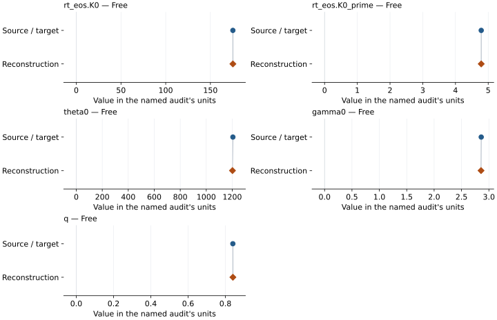

This is a **coefficient comparison**, not an observation or residual plot.
Each panel uses its coefficient's audit units and includes zero. Markers show
stored central values only. Error widths are retained in the table below;
no confidence interval or uncertainty band is inferred. Fixed/adopted values are constraints.

| Parameter | Source / target | Source error | Reconstruction | Reconstruction error | Fit role |
| --- | --- | --- | --- | --- | --- |
| rt\_eos.K0 | 175.1 | 0.5 | 175.1308648600323 | 0.4714074173074697 | Free |
| rt\_eos.K0\_prime | 4.787 | 0.009 | 4.787027560782262 | 0.008636184632305657 | Free |
| theta0 | 1205.0 | 73.0 | 1201.6311789740662 | 72.94589875786522 | Free |
| gamma0 | 2.86 | 0.1 | 2.8566368861828337 | 0.10086474687568657 | Free |
| q | 0.84 | 0.04 | 0.8402263116106476 | 0.04401753294024317 | Free |

Values and reported errors are copied without rounding or conversion from the named audit. Missing errors mean unknown, not zero. Parameter names and volume conventions follow that audit; error widths do not imply a confidence convention.

Recorded diagnostics, covariance and additional protocol

- **Columns:**
    - **Pressure:** pressure\_gpa\_fit
    - **Temperature:** temperature\_k
    - **Volume:** volume\_a3\_conventional\_cell
- **Observed pressure range gpa:** \[10.7212147810221, 1374.0\]
- **Observed temperature range k:** \[298.0, 12000.0\]
- **Observed volume range:** \[9.273280420632346, 21.646792228084685\]
- **Degrees of freedom:** 1308
- **Solver success:** True
- **Solver message:** \`ftol\` termination condition is satisfied.
- **Rmse gpa:** 4.502454985429984
- **Published rmse gpa:** 4.502703399004148
- **Reduced chi square:** 20.349593636250773

### Detailed evidence and existing plots

- [Record-by-record numerical ledger](../primary-eos-refits.md#records).
- [Source-audit reports](../source-audits.md).

Observation curves and residual plots are provided by the supporting reports where available. Their absence is not filled by a reconstructed curve presented as measured data.

[Machine-readable comparison ledger](https://github.com/CPrescher/peritheos/blob/main/docs/data/primary-eos-refits.json) — look up `iron_zhang_2025_fit2_birch_murnaghan_3_mgd`.
[Complete native EOSMAT file](https://github.com/CPrescher/peritheos/blob/main/peritheos/data/materials/iron.eosmat).

## Zhang et al. (2025), hcp-Fe Fit #5 Vinet+MGD

Record: `iron_zhang_2025_fit5_vinet_mgd` · Model: `Vinet`

**Outcome: Coefficient parity achieved.**

**Scope:** Comparison with the source parameterization.
**Comparison basis:** Every compared free coefficient meets both the recorded combined-two-sigma comparison and parameter-specific numerical similarity screen. Error conventions and fit qualifications remain applicable.

[Stored EOS coefficients and source](../material-summaries/iron.md#record-iron_zhang_2025_fit5_vinet_mgd)

### What this result establishes

**Separate source-review status:** primary\_source\_validated.
**Usage recommendation:** See the stored EOS qualifications; no recommendation is inferred here.

- Exact final-input reproduction, not a reconstruction of every upstream reduction: the supplement deposits the 1,313 fit rows, but omits the calibrant observations needed to recalculate 641 static pressures and the documented interpolation procedure for most model-assigned dynamic temperatures. Experimental P-V, derived temperatures, and ab-initio rows remain explicitly separated in the bundled dataset.
- This named numerical assessment alone does not establish author-workflow reproduction, physical accuracy or recommendation for use.

### Data and reconstruction method

- **Dataset identifiers:** iron\_zhang\_2025\_tables\_s1\_s3\_s4\_pvt
- **Observations:** 1313
- **Fit kind:** joint\_pvt
- **Selection:** all rows
- **Objective:** pressure\_residuals
- **Absolute sigma:** False
- **Free parameters:** rt\_eos.K0; rt\_eos.K0\_prime; theta0; gamma0; q
- **Fixed parameters:** V0; Tr; n

Unspecified selections, weights, fixed values or error conventions remain unknown; they have not been inferred for this report.

### Source versus reconstruction

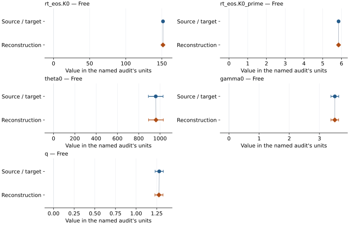

This is a **coefficient comparison**, not an observation or residual plot.
Each panel uses its coefficient's audit units and includes zero. Markers show
stored central values only. Error widths are retained in the table below;
no confidence interval or uncertainty band is inferred. Fixed/adopted values are constraints.

| Parameter | Source / target | Source error | Reconstruction | Reconstruction error | Fit role |
| --- | --- | --- | --- | --- | --- |
| rt\_eos.K0 | 151.6 | 0.5 | 151.56590524755248 | 0.47927415671706003 | Free |
| rt\_eos.K0\_prime | 5.845 | 0.01 | 5.844685173366984 | 0.010494020961744021 | Free |
| theta0 | 960.0 | 69.0 | 962.2936991497409 | 69.30893253324963 | Free |
| gamma0 | 3.51 | 0.13 | 3.508368540396044 | 0.12804400391883303 | Free |
| q | 1.28 | 0.05 | 1.2763737332860559 | 0.04898180214211243 | Free |

Values and reported errors are copied without rounding or conversion from the named audit. Missing errors mean unknown, not zero. Parameter names and volume conventions follow that audit; error widths do not imply a confidence convention.

Recorded diagnostics, covariance and additional protocol

- **Columns:**
    - **Pressure:** pressure\_gpa\_fit
    - **Temperature:** temperature\_k
    - **Volume:** volume\_a3\_conventional\_cell
- **Observed pressure range gpa:** \[10.7212147810221, 1374.0\]
- **Observed temperature range k:** \[298.0, 12000.0\]
- **Observed volume range:** \[9.273280420632346, 21.646792228084685\]
- **Degrees of freedom:** 1308
- **Solver success:** True
- **Solver message:** \`ftol\` termination condition is satisfied.
- **Rmse gpa:** 5.0824157967042725
- **Published rmse gpa:** 5.082886740455009
- **Reduced chi square:** 25.929692495461406

### Detailed evidence and existing plots

- [Record-by-record numerical ledger](../primary-eos-refits.md#records).
- [Source-audit reports](../source-audits.md).

Observation curves and residual plots are provided by the supporting reports where available. Their absence is not filled by a reconstructed curve presented as measured data.

[Machine-readable comparison ledger](https://github.com/CPrescher/peritheos/blob/main/docs/data/primary-eos-refits.json) — look up `iron_zhang_2025_fit5_vinet_mgd`.
[Complete native EOSMAT file](https://github.com/CPrescher/peritheos/blob/main/peritheos/data/materials/iron.eosmat).

## Dewaele et al. (2006), hcp-Fe Vinet thermal pressure scale

Record: `iron_dewaele_2006_vinet_thermal` · Model: `Vinet`

**Outcome: Complete independent refit unavailable.**

**Scope:** Comparison with the source parameterization.
**Comparison basis:** The bundled EPAPS rows constrain the near-room-temperature Vinet reference isotherm. The high-temperature Gruneisen coefficients were determined with separate shock-wave data and the anharmonic/electronic terms with ab-initio pressures, so the complete thermal fit input is not available for an independent joint refit.

[Stored EOS coefficients and source](../material-summaries/iron.md#record-iron_dewaele_2006_vinet_thermal)

### What this result establishes

**Separate source-review status:** primary\_source\_validated.
**Usage recommendation:** See the stored EOS qualifications; no recommendation is inferred here.

- This named numerical assessment alone does not establish author-workflow reproduction, physical accuracy or recommendation for use.
- No reconstructed coefficient table is recorded for this assessment; no missing values have been inferred.

### Data and reconstruction method

- **Dataset identifiers:** iron\_dewaele\_2006\_epaps\_compression
- **Fixed parameters:** Tr; theta0; beta; anharmonic\_a; anharmonic\_m; electronic\_e; electronic\_g; n

Unspecified selections, weights, fixed values or error conventions remain unknown; they have not been inferred for this report.

### Why no coefficient graph is shown

No numeric source/reconstruction pair is recorded for this assessment. A graph would require information that is not available here; no values or observations have been invented.

### Detailed evidence and existing plots

- [Record-by-record numerical ledger](../primary-eos-refits.md#records).
- [Source-audit reports](../source-audits.md).

Observation curves and residual plots are provided by the supporting reports where available. Their absence is not filled by a reconstructed curve presented as measured data.

[Machine-readable comparison ledger](https://github.com/CPrescher/peritheos/blob/main/docs/data/primary-eos-refits.json) — look up `iron_dewaele_2006_vinet_thermal`.
[Complete native EOSMAT file](https://github.com/CPrescher/peritheos/blob/main/peritheos/data/materials/iron.eosmat).

## Fei et al. (2016), preferred fixed-density 300 K BM3

Record: `iron_fei_2016_bm3` · Model: `BM3`

**Outcome: Complete independent refit unavailable.**

**Scope:** Comparison with the source parameterization.
**Comparison basis:** Partial supplementary-data diagnostics, not the published combined fits. Prior-study 300 K rows and shock P-V-T reductions/weights are not supplied by these supplements. No diagnostic coefficients replace published records. Independent equation and partial-data checks: \[Fei 2016 audit\](literature-reproductions/fei-2016-iron.md).

[Stored EOS coefficients and source](../material-summaries/iron.md#record-iron_fei_2016_bm3)

### What this result establishes

**Separate source-review status:** primary\_source\_validated.
**Usage recommendation:** See the stored EOS qualifications; no recommendation is inferred here.

- This named numerical assessment alone does not establish author-workflow reproduction, physical accuracy or recommendation for use.
- No reconstructed coefficient table is recorded for this assessment; no missing values have been inferred.

### Data and reconstruction method

- **Dataset identifiers:** iron\_fei\_2016\_table\_s1
- **Fixed parameters:** V0

Unspecified selections, weights, fixed values or error conventions remain unknown; they have not been inferred for this report.

### Why no coefficient graph is shown

No numeric source/reconstruction pair is recorded for this assessment. A graph would require information that is not available here; no values or observations have been invented.

### Detailed evidence and existing plots

- [Supporting source report: fei-2016-iron](../literature-reproductions/fei-2016-iron.md).
- [Record-by-record numerical ledger](../primary-eos-refits.md#records).
- [Source-audit reports](../source-audits.md).

Observation curves and residual plots are provided by the supporting reports where available. Their absence is not filled by a reconstructed curve presented as measured data.

[Machine-readable comparison ledger](https://github.com/CPrescher/peritheos/blob/main/docs/data/primary-eos-refits.json) — look up `iron_fei_2016_bm3`.
[Complete native EOSMAT file](https://github.com/CPrescher/peritheos/blob/main/peritheos/data/materials/iron.eosmat).

## Fei et al. (2016), free-density 300 K BM3 alternative

Record: `iron_fei_2016_free_density_bm3` · Model: `BM3`

**Outcome: Complete independent refit unavailable.**

**Scope:** Comparison with the source parameterization.
**Comparison basis:** Partial supplementary-data diagnostics, not the published combined fits. Prior-study 300 K rows and shock P-V-T reductions/weights are not supplied by these supplements. No diagnostic coefficients replace published records. Independent equation and partial-data checks: \[Fei 2016 audit\](literature-reproductions/fei-2016-iron.md).

[Stored EOS coefficients and source](../material-summaries/iron.md#record-iron_fei_2016_free_density_bm3)

### What this result establishes

**Separate source-review status:** primary\_source\_validated.
**Usage recommendation:** See the stored EOS qualifications; no recommendation is inferred here.

- This named numerical assessment alone does not establish author-workflow reproduction, physical accuracy or recommendation for use.
- No reconstructed coefficient table is recorded for this assessment; no missing values have been inferred.

### Data and reconstruction method

- **Dataset identifiers:** iron\_fei\_2016\_table\_s1
- **Fixed parameters:** None declared

Unspecified selections, weights, fixed values or error conventions remain unknown; they have not been inferred for this report.

### Why no coefficient graph is shown

No numeric source/reconstruction pair is recorded for this assessment. A graph would require information that is not available here; no values or observations have been invented.

### Detailed evidence and existing plots

- [Supporting source report: fei-2016-iron](../literature-reproductions/fei-2016-iron.md).
- [Record-by-record numerical ledger](../primary-eos-refits.md#records).
- [Source-audit reports](../source-audits.md).

Observation curves and residual plots are provided by the supporting reports where available. Their absence is not filled by a reconstructed curve presented as measured data.

[Machine-readable comparison ledger](https://github.com/CPrescher/peritheos/blob/main/docs/data/primary-eos-refits.json) — look up `iron_fei_2016_free_density_bm3`.
[Complete native EOSMAT file](https://github.com/CPrescher/peritheos/blob/main/peritheos/data/materials/iron.eosmat).

## Fei et al. (2016), preferred BM3 + Debye and electronic/anharmonic thermal pressure

Record: `iron_fei_2016_bm3_debye_quadratic` · Model: `BM3`

**Outcome: Complete independent refit unavailable.**

**Scope:** Comparison with the source parameterization.
**Comparison basis:** Partial supplementary-data diagnostics, not the published combined fits. Prior-study 300 K rows and shock P-V-T reductions/weights are not supplied by these supplements. No diagnostic coefficients replace published records. Independent equation and partial-data checks: \[Fei 2016 audit\](literature-reproductions/fei-2016-iron.md).

[Stored EOS coefficients and source](../material-summaries/iron.md#record-iron_fei_2016_bm3_debye_quadratic)

### What this result establishes

**Separate source-review status:** primary\_source\_validated.
**Usage recommendation:** See the stored EOS qualifications; no recommendation is inferred here.

- This named numerical assessment alone does not establish author-workflow reproduction, physical accuracy or recommendation for use.
- No reconstructed coefficient table is recorded for this assessment; no missing values have been inferred.

### Data and reconstruction method

- **Dataset identifiers:** iron\_fei\_2016\_table\_s1; iron\_fei\_2016\_table\_s2
- **Fixed parameters:** V0; Tr; theta0; gamma0; q; n

Unspecified selections, weights, fixed values or error conventions remain unknown; they have not been inferred for this report.

### Why no coefficient graph is shown

No numeric source/reconstruction pair is recorded for this assessment. A graph would require information that is not available here; no values or observations have been invented.

### Detailed evidence and existing plots

- [Supporting source report: fei-2016-iron](../literature-reproductions/fei-2016-iron.md).
- [Record-by-record numerical ledger](../primary-eos-refits.md#records).
- [Source-audit reports](../source-audits.md).

Observation curves and residual plots are provided by the supporting reports where available. Their absence is not filled by a reconstructed curve presented as measured data.

[Machine-readable comparison ledger](https://github.com/CPrescher/peritheos/blob/main/docs/data/primary-eos-refits.json) — look up `iron_fei_2016_bm3_debye_quadratic`.
[Complete native EOSMAT file](https://github.com/CPrescher/peritheos/blob/main/peritheos/data/materials/iron.eosmat).

## Sakai et al. (2014), p1\_bm3

Record: `iron_sakai_2014_p1_bm3` · Model: `BM3`

**Outcome: Parity not achieved for this comparison.**

**Scope:** Comparison with the source parameterization.
**Comparison basis:** Conditional independent refit; matching within printed errors is similarity, not reproduction of the original statistical procedure. V0 preliminary g-G fit not repeated.

[Stored EOS coefficients and source](../material-summaries/iron.md#record-iron_sakai_2014_p1_bm3)

### What this result establishes

**Separate source-review status:** primary\_source\_validated.
**Usage recommendation:** See the stored EOS qualifications; no recommendation is inferred here.

- This named numerical assessment alone does not establish author-workflow reproduction, physical accuracy or recommendation for use.

### Data and reconstruction method

- **Dataset identifiers:** sakai\_2014\_table2\_pvt
- **Observations:** 27
- **Objective:** Unweighted vertical pressure residuals; conditional on published reference/fixed coefficients. Source weights and covariance are not given.
- **Weighting:** unweighted; published coefficient constraints retained
- **Free parameters:** K0; K0\_prime
- **Fixed parameters:** V0

Unspecified selections, weights, fixed values or error conventions remain unknown; they have not been inferred for this report.

### Source versus reconstruction

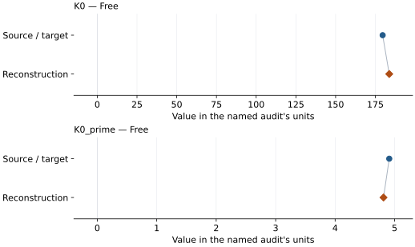

This is a **coefficient comparison**, not an observation or residual plot.
Each panel uses its coefficient's audit units and includes zero. Markers show
stored central values only. Error widths are retained in the table below;
no confidence interval or uncertainty band is inferred. Fixed/adopted values are constraints.

| Parameter | Source / target | Source error | Reconstruction | Reconstruction error | Fit role |
| --- | --- | --- | --- | --- | --- |
| K0 | 179.6 | 2.2 | 183.7430703138515 | Not specified | Free |
| K0\_prime | 4.91 | 0.12 | 4.8136997880750005 | Not specified | Free |

Values and reported errors are copied without rounding or conversion from the named audit. Missing errors mean unknown, not zero. Parameter names and volume conventions follow that audit; error widths do not imply a confidence convention.

Recorded diagnostics, covariance and additional protocol

- **Tied parameters:**
- **Solver success:** True
- **Rmse gpa:** 1.5711439530612383
- **Published rmse gpa:** 1.7307881094324227
- **Published pressure rmse gpa:** 1.7307881094324227
- **Refitted pressure rmse gpa:** 1.5711439530612383
- **Rmse shock velocity km s:** Not specified
- **Parameter covariance:** Not specified

### Detailed evidence and existing plots

- [Earlier detailed record investigation](../primary-eos-refits.md#investigation-iron_sakai_2014_p1_bm3).
- [Record-by-record numerical ledger](../primary-eos-refits.md#records).
- [Source-audit reports](../source-audits.md).

Observation curves and residual plots are provided by the supporting reports where available. Their absence is not filled by a reconstructed curve presented as measured data.

[Machine-readable comparison ledger](https://github.com/CPrescher/peritheos/blob/main/docs/data/primary-eos-refits.json) — look up `iron_sakai_2014_p1_bm3`.
[Complete native EOSMAT file](https://github.com/CPrescher/peritheos/blob/main/peritheos/data/materials/iron.eosmat).

## Sakai et al. (2014), p1\_vinet

Record: `iron_sakai_2014_p1_vinet` · Model: `Vinet`

**Outcome: Numerically similar, with qualifications.**

**Scope:** Comparison with the source parameterization.
**Comparison basis:** Every compared free coefficient meets either the recorded combined-two-sigma comparison or parameter-specific numerical similarity screen; the audit does not classify the complete comparison as parity.

[Stored EOS coefficients and source](../material-summaries/iron.md#record-iron_sakai_2014_p1_vinet)

### What this result establishes

**Separate source-review status:** primary\_source\_validated.
**Usage recommendation:** See the stored EOS qualifications; no recommendation is inferred here.

- Conditional independent refit; matching within printed errors is similarity, not reproduction of the original statistical procedure. V0 preliminary g-G fit not repeated.
- This named numerical assessment alone does not establish author-workflow reproduction, physical accuracy or recommendation for use.

### Data and reconstruction method

- **Dataset identifiers:** sakai\_2014\_table2\_pvt
- **Observations:** 27
- **Objective:** Unweighted vertical pressure residuals; conditional on published reference/fixed coefficients. Source weights and covariance are not given.
- **Weighting:** unweighted; published coefficient constraints retained
- **Free parameters:** K0; K0\_prime
- **Fixed parameters:** V0

Unspecified selections, weights, fixed values or error conventions remain unknown; they have not been inferred for this report.

### Source versus reconstruction

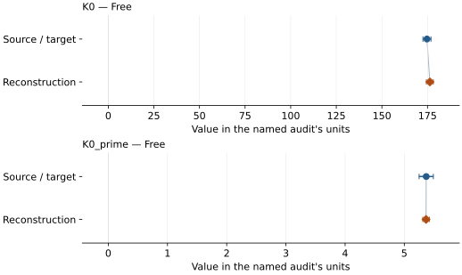

This is a **coefficient comparison**, not an observation or residual plot.
Each panel uses its coefficient's audit units and includes zero. Markers show
stored central values only. Error widths are retained in the table below;
no confidence interval or uncertainty band is inferred. Fixed/adopted values are constraints.

| Parameter | Source / target | Source error | Reconstruction | Reconstruction error | Fit role |
| --- | --- | --- | --- | --- | --- |
| K0 | 174.7 | 2.2 | 176.29992899255143 | Not specified | Free |
| K0\_prime | 5.37 | 0.12 | 5.367133648243373 | Not specified | Free |

Values and reported errors are copied without rounding or conversion from the named audit. Missing errors mean unknown, not zero. Parameter names and volume conventions follow that audit; error widths do not imply a confidence convention.

Recorded diagnostics, covariance and additional protocol

- **Tied parameters:**
- **Solver success:** True
- **Rmse gpa:** 1.358138963628398
- **Published rmse gpa:** 1.8007981676460239
- **Published pressure rmse gpa:** 1.8007981676460239
- **Refitted pressure rmse gpa:** 1.358138963628398
- **Rmse shock velocity km s:** Not specified
- **Parameter covariance:** Not specified

### Detailed evidence and existing plots

- [Earlier detailed record investigation](../primary-eos-refits.md#investigation-iron_sakai_2014_p1_vinet).
- [Record-by-record numerical ledger](../primary-eos-refits.md#records).
- [Source-audit reports](../source-audits.md).

Observation curves and residual plots are provided by the supporting reports where available. Their absence is not filled by a reconstructed curve presented as measured data.

[Machine-readable comparison ledger](https://github.com/CPrescher/peritheos/blob/main/docs/data/primary-eos-refits.json) — look up `iron_sakai_2014_p1_vinet`.
[Complete native EOSMAT file](https://github.com/CPrescher/peritheos/blob/main/peritheos/data/materials/iron.eosmat).

## Sakai et al. (2014), p1\_v0\_mao\_bm3

Record: `iron_sakai_2014_p1_v0_mao_bm3` · Model: `BM3`

**Outcome: Parity not achieved for this comparison.**

**Scope:** Comparison with the source parameterization.
**Comparison basis:** Conditional independent refit; matching within printed errors is similarity, not reproduction of the original statistical procedure. V0 preliminary g-G fit not repeated.

[Stored EOS coefficients and source](../material-summaries/iron.md#record-iron_sakai_2014_p1_v0_mao_bm3)

### What this result establishes

**Separate source-review status:** primary\_source\_validated.
**Usage recommendation:** See the stored EOS qualifications; no recommendation is inferred here.

- This named numerical assessment alone does not establish author-workflow reproduction, physical accuracy or recommendation for use.

### Data and reconstruction method

- **Dataset identifiers:** sakai\_2014\_table2\_pvt
- **Observations:** 27
- **Objective:** Unweighted vertical pressure residuals; conditional on published reference/fixed coefficients. Source weights and covariance are not given.
- **Weighting:** unweighted; published coefficient constraints retained
- **Free parameters:** K0; K0\_prime
- **Fixed parameters:** V0

Unspecified selections, weights, fixed values or error conventions remain unknown; they have not been inferred for this report.

### Source versus reconstruction

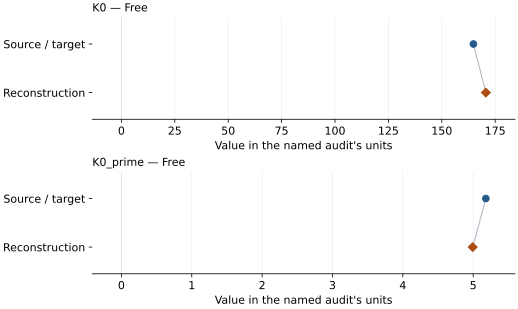

This is a **coefficient comparison**, not an observation or residual plot.
Each panel uses its coefficient's audit units and includes zero. Markers show
stored central values only. Error widths are retained in the table below;
no confidence interval or uncertainty band is inferred. Fixed/adopted values are constraints.

| Parameter | Source / target | Source error | Reconstruction | Reconstruction error | Fit role |
| --- | --- | --- | --- | --- | --- |
| K0 | 164.8 | 2.2 | 170.62875234628973 | Not specified | Free |
| K0\_prime | 5.18 | 0.13 | 4.993222409895087 | Not specified | Free |

Values and reported errors are copied without rounding or conversion from the named audit. Missing errors mean unknown, not zero. Parameter names and volume conventions follow that audit; error widths do not imply a confidence convention.

Recorded diagnostics, covariance and additional protocol

- **Tied parameters:**
- **Solver success:** True
- **Rmse gpa:** 1.6883813707746107
- **Published rmse gpa:** 1.911797510138902
- **Published pressure rmse gpa:** 1.911797510138902
- **Refitted pressure rmse gpa:** 1.6883813707746107
- **Rmse shock velocity km s:** Not specified
- **Parameter covariance:** Not specified

### Detailed evidence and existing plots

- [Earlier detailed record investigation](../primary-eos-refits.md#investigation-iron_sakai_2014_p1_v0_mao_bm3).
- [Record-by-record numerical ledger](../primary-eos-refits.md#records).
- [Source-audit reports](../source-audits.md).

Observation curves and residual plots are provided by the supporting reports where available. Their absence is not filled by a reconstructed curve presented as measured data.

[Machine-readable comparison ledger](https://github.com/CPrescher/peritheos/blob/main/docs/data/primary-eos-refits.json) — look up `iron_sakai_2014_p1_v0_mao_bm3`.
[Complete native EOSMAT file](https://github.com/CPrescher/peritheos/blob/main/peritheos/data/materials/iron.eosmat).

## Sakai et al. (2014), p1\_v0\_mao\_vinet

Record: `iron_sakai_2014_p1_v0_mao_vinet` · Model: `Vinet`

**Outcome: Parity not achieved for this comparison.**

**Scope:** Comparison with the source parameterization.
**Comparison basis:** Conditional independent refit; matching within printed errors is similarity, not reproduction of the original statistical procedure. V0 preliminary g-G fit not repeated.

[Stored EOS coefficients and source](../material-summaries/iron.md#record-iron_sakai_2014_p1_v0_mao_vinet)

### What this result establishes

**Separate source-review status:** primary\_source\_validated.
**Usage recommendation:** See the stored EOS qualifications; no recommendation is inferred here.

- This named numerical assessment alone does not establish author-workflow reproduction, physical accuracy or recommendation for use.

### Data and reconstruction method

- **Dataset identifiers:** sakai\_2014\_table2\_pvt
- **Observations:** 27
- **Objective:** Unweighted vertical pressure residuals; conditional on published reference/fixed coefficients. Source weights and covariance are not given.
- **Weighting:** unweighted; published coefficient constraints retained
- **Free parameters:** K0; K0\_prime
- **Fixed parameters:** V0

Unspecified selections, weights, fixed values or error conventions remain unknown; they have not been inferred for this report.

### Source versus reconstruction

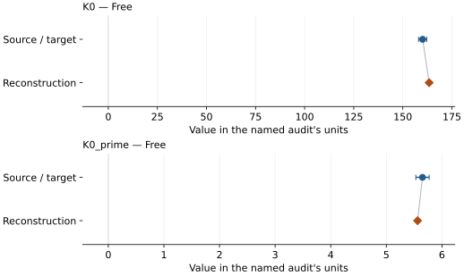

This is a **coefficient comparison**, not an observation or residual plot.
Each panel uses its coefficient's audit units and includes zero. Markers show
stored central values only. Error widths are retained in the table below;
no confidence interval or uncertainty band is inferred. Fixed/adopted values are constraints.

| Parameter | Source / target | Source error | Reconstruction | Reconstruction error | Fit role |
| --- | --- | --- | --- | --- | --- |
| K0 | 160.1 | 2.1 | 163.40443698422803 | Not specified | Free |
| K0\_prime | 5.65 | 0.12 | 5.561500151346458 | Not specified | Free |

Values and reported errors are copied without rounding or conversion from the named audit. Missing errors mean unknown, not zero. Parameter names and volume conventions follow that audit; error widths do not imply a confidence convention.

Recorded diagnostics, covariance and additional protocol

- **Tied parameters:**
- **Solver success:** True
- **Rmse gpa:** 1.4170194246654098
- **Published rmse gpa:** 1.5444637280380096
- **Published pressure rmse gpa:** 1.5444637280380096
- **Refitted pressure rmse gpa:** 1.4170194246654098
- **Rmse shock velocity km s:** Not specified
- **Parameter covariance:** Not specified

### Detailed evidence and existing plots

- [Earlier detailed record investigation](../primary-eos-refits.md#investigation-iron_sakai_2014_p1_v0_mao_vinet).
- [Record-by-record numerical ledger](../primary-eos-refits.md#records).
- [Source-audit reports](../source-audits.md).

Observation curves and residual plots are provided by the supporting reports where available. Their absence is not filled by a reconstructed curve presented as measured data.

[Machine-readable comparison ledger](https://github.com/CPrescher/peritheos/blob/main/docs/data/primary-eos-refits.json) — look up `iron_sakai_2014_p1_v0_mao_vinet`.
[Complete native EOSMAT file](https://github.com/CPrescher/peritheos/blob/main/peritheos/data/materials/iron.eosmat).

## Sakai et al. (2014), p1\_v0\_dewaele\_bm3

Record: `iron_sakai_2014_p1_v0_dewaele_bm3` · Model: `BM3`

**Outcome: Parity not achieved for this comparison.**

**Scope:** Comparison with the source parameterization.
**Comparison basis:** Conditional independent refit; matching within printed errors is similarity, not reproduction of the original statistical procedure. V0 preliminary g-G fit not repeated.

[Stored EOS coefficients and source](../material-summaries/iron.md#record-iron_sakai_2014_p1_v0_dewaele_bm3)

### What this result establishes

**Separate source-review status:** primary\_source\_validated.
**Usage recommendation:** See the stored EOS qualifications; no recommendation is inferred here.

- This named numerical assessment alone does not establish author-workflow reproduction, physical accuracy or recommendation for use.

### Data and reconstruction method

- **Dataset identifiers:** sakai\_2014\_table2\_pvt
- **Observations:** 27
- **Objective:** Unweighted vertical pressure residuals; conditional on published reference/fixed coefficients. Source weights and covariance are not given.
- **Weighting:** unweighted; published coefficient constraints retained
- **Free parameters:** V0; K0\_prime
- **Fixed parameters:** K0

Unspecified selections, weights, fixed values or error conventions remain unknown; they have not been inferred for this report.

### Source versus reconstruction

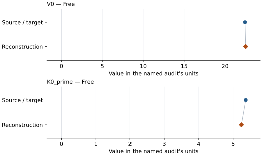

This is a **coefficient comparison**, not an observation or residual plot.
Each panel uses its coefficient's audit units and includes zero. Markers show
stored central values only. Error widths are retained in the table below;
no confidence interval or uncertainty band is inferred. Fixed/adopted values are constraints.

| Parameter | Source / target | Source error | Reconstruction | Reconstruction error | Fit role |
| --- | --- | --- | --- | --- | --- |
| V0 | 22.468 | Not specified | 22.551682860811145 | Not specified | Free |
| K0\_prime | 5.37 | 0.14 | 5.2436319663787385 | Not specified | Free |

Values and reported errors are copied without rounding or conversion from the named audit. Missing errors mean unknown, not zero. Parameter names and volume conventions follow that audit; error widths do not imply a confidence convention.

Recorded diagnostics, covariance and additional protocol

- **Tied parameters:**
- **Solver success:** True
- **Rmse gpa:** 1.8680023527394627
- **Published rmse gpa:** 2.193247101360098
- **Published pressure rmse gpa:** 2.193247101360098
- **Refitted pressure rmse gpa:** 1.8680023527394627
- **Rmse shock velocity km s:** Not specified
- **Parameter covariance:** Not specified

### Detailed evidence and existing plots

- [Earlier detailed record investigation](../primary-eos-refits.md#investigation-iron_sakai_2014_p1_v0_dewaele_bm3).
- [Record-by-record numerical ledger](../primary-eos-refits.md#records).
- [Source-audit reports](../source-audits.md).

Observation curves and residual plots are provided by the supporting reports where available. Their absence is not filled by a reconstructed curve presented as measured data.

[Machine-readable comparison ledger](https://github.com/CPrescher/peritheos/blob/main/docs/data/primary-eos-refits.json) — look up `iron_sakai_2014_p1_v0_dewaele_bm3`.
[Complete native EOSMAT file](https://github.com/CPrescher/peritheos/blob/main/peritheos/data/materials/iron.eosmat).

## Sakai et al. (2014), p1\_v0\_dewaele\_vinet

Record: `iron_sakai_2014_p1_v0_dewaele_vinet` · Model: `Vinet`

**Outcome: Parity not achieved for this comparison.**

**Scope:** Comparison with the source parameterization.
**Comparison basis:** Conditional independent refit; matching within printed errors is similarity, not reproduction of the original statistical procedure. V0 preliminary g-G fit not repeated.

[Stored EOS coefficients and source](../material-summaries/iron.md#record-iron_sakai_2014_p1_v0_dewaele_vinet)

### What this result establishes

**Separate source-review status:** primary\_source\_validated.
**Usage recommendation:** See the stored EOS qualifications; no recommendation is inferred here.

- This named numerical assessment alone does not establish author-workflow reproduction, physical accuracy or recommendation for use.

### Data and reconstruction method

- **Dataset identifiers:** sakai\_2014\_table2\_pvt
- **Observations:** 27
- **Objective:** Unweighted vertical pressure residuals; conditional on published reference/fixed coefficients. Source weights and covariance are not given.
- **Weighting:** unweighted; published coefficient constraints retained
- **Free parameters:** V0; K0\_prime
- **Fixed parameters:** K0

Unspecified selections, weights, fixed values or error conventions remain unknown; they have not been inferred for this report.

### Source versus reconstruction

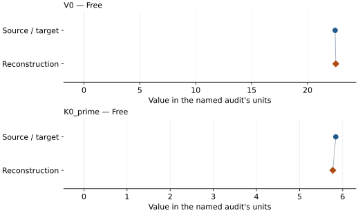

This is a **coefficient comparison**, not an observation or residual plot.
Each panel uses its coefficient's audit units and includes zero. Markers show
stored central values only. Error widths are retained in the table below;
no confidence interval or uncertainty band is inferred. Fixed/adopted values are constraints.

| Parameter | Source / target | Source error | Reconstruction | Reconstruction error | Fit role |
| --- | --- | --- | --- | --- | --- |
| V0 | 22.468 | Not specified | 22.523026081405707 | Not specified | Free |
| K0\_prime | 5.84 | 0.12 | 5.770688407870286 | Not specified | Free |

Values and reported errors are copied without rounding or conversion from the named audit. Missing errors mean unknown, not zero. Parameter names and volume conventions follow that audit; error widths do not imply a confidence convention.

Recorded diagnostics, covariance and additional protocol

- **Tied parameters:**
- **Solver success:** True
- **Rmse gpa:** 1.5325591600243258
- **Published rmse gpa:** 1.6698163274157354
- **Published pressure rmse gpa:** 1.6698163274157354
- **Refitted pressure rmse gpa:** 1.5325591600243258
- **Rmse shock velocity km s:** Not specified
- **Parameter covariance:** Not specified

### Detailed evidence and existing plots

- [Earlier detailed record investigation](../primary-eos-refits.md#investigation-iron_sakai_2014_p1_v0_dewaele_vinet).
- [Record-by-record numerical ledger](../primary-eos-refits.md#records).
- [Source-audit reports](../source-audits.md).

Observation curves and residual plots are provided by the supporting reports where available. Their absence is not filled by a reconstructed curve presented as measured data.

[Machine-readable comparison ledger](https://github.com/CPrescher/peritheos/blob/main/docs/data/primary-eos-refits.json) — look up `iron_sakai_2014_p1_v0_dewaele_vinet`.
[Complete native EOSMAT file](https://github.com/CPrescher/peritheos/blob/main/peritheos/data/materials/iron.eosmat).

## Sakai et al. (2014), p2\_bm3

Record: `iron_sakai_2014_p2_bm3` · Model: `BM3`

**Outcome: Complete independent refit unavailable.**

**Scope:** Comparison with the source parameterization.
**Comparison basis:** Table 2 does not tabulate P2 pressures. Complete scale re-reduction and source g-G V0 regression remain unavailable.

[Stored EOS coefficients and source](../material-summaries/iron.md#record-iron_sakai_2014_p2_bm3)

### What this result establishes

**Separate source-review status:** primary\_source\_validated.
**Usage recommendation:** See the stored EOS qualifications; no recommendation is inferred here.

- This named numerical assessment alone does not establish author-workflow reproduction, physical accuracy or recommendation for use.
- No reconstructed coefficient table is recorded for this assessment; no missing values have been inferred.

### Data and reconstruction method

- **Dataset identifiers:** sakai\_2014\_table2\_pvt
- **Observations:** 0
- **Weighting:** unweighted; published coefficient constraints retained
- **Free parameters:** None declared
- **Fixed parameters:** V0

Unspecified selections, weights, fixed values or error conventions remain unknown; they have not been inferred for this report.

### Why no coefficient graph is shown

No numeric source/reconstruction pair is recorded for this assessment. A graph would require information that is not available here; no values or observations have been invented.

Recorded diagnostics, covariance and additional protocol

- **Tied parameters:**
- **Rmse gpa:** Not specified
- **Published rmse gpa:** Not specified
- **Rmse shock velocity km s:** Not specified
- **Parameter covariance:** Not specified

### Detailed evidence and existing plots

- [Record-by-record numerical ledger](../primary-eos-refits.md#records).
- [Source-audit reports](../source-audits.md).

Observation curves and residual plots are provided by the supporting reports where available. Their absence is not filled by a reconstructed curve presented as measured data.

[Machine-readable comparison ledger](https://github.com/CPrescher/peritheos/blob/main/docs/data/primary-eos-refits.json) — look up `iron_sakai_2014_p2_bm3`.
[Complete native EOSMAT file](https://github.com/CPrescher/peritheos/blob/main/peritheos/data/materials/iron.eosmat).

## Sakai et al. (2014), p2\_vinet

Record: `iron_sakai_2014_p2_vinet` · Model: `Vinet`

**Outcome: Complete independent refit unavailable.**

**Scope:** Comparison with the source parameterization.
**Comparison basis:** Table 2 does not tabulate P2 pressures. Complete scale re-reduction and source g-G V0 regression remain unavailable.

[Stored EOS coefficients and source](../material-summaries/iron.md#record-iron_sakai_2014_p2_vinet)

### What this result establishes

**Separate source-review status:** primary\_source\_validated.
**Usage recommendation:** See the stored EOS qualifications; no recommendation is inferred here.

- This named numerical assessment alone does not establish author-workflow reproduction, physical accuracy or recommendation for use.
- No reconstructed coefficient table is recorded for this assessment; no missing values have been inferred.

### Data and reconstruction method

- **Dataset identifiers:** sakai\_2014\_table2\_pvt
- **Observations:** 0
- **Weighting:** unweighted; published coefficient constraints retained
- **Free parameters:** None declared
- **Fixed parameters:** V0

Unspecified selections, weights, fixed values or error conventions remain unknown; they have not been inferred for this report.

### Why no coefficient graph is shown

No numeric source/reconstruction pair is recorded for this assessment. A graph would require information that is not available here; no values or observations have been invented.

Recorded diagnostics, covariance and additional protocol

- **Tied parameters:**
- **Rmse gpa:** Not specified
- **Published rmse gpa:** Not specified
- **Rmse shock velocity km s:** Not specified
- **Parameter covariance:** Not specified

### Detailed evidence and existing plots

- [Record-by-record numerical ledger](../primary-eos-refits.md#records).
- [Source-audit reports](../source-audits.md).

Observation curves and residual plots are provided by the supporting reports where available. Their absence is not filled by a reconstructed curve presented as measured data.

[Machine-readable comparison ledger](https://github.com/CPrescher/peritheos/blob/main/docs/data/primary-eos-refits.json) — look up `iron_sakai_2014_p2_vinet`.
[Complete native EOSMAT file](https://github.com/CPrescher/peritheos/blob/main/peritheos/data/materials/iron.eosmat).

## Sakai et al. (2014), p3\_bm3

Record: `iron_sakai_2014_p3_bm3` · Model: `BM3`

**Outcome: Complete independent refit unavailable.**

**Scope:** Comparison with the source parameterization.
**Comparison basis:** Table 2 does not tabulate P3 pressures. Complete scale re-reduction and source g-G V0 regression remain unavailable.

[Stored EOS coefficients and source](../material-summaries/iron.md#record-iron_sakai_2014_p3_bm3)

### What this result establishes

**Separate source-review status:** primary\_source\_validated.
**Usage recommendation:** See the stored EOS qualifications; no recommendation is inferred here.

- This named numerical assessment alone does not establish author-workflow reproduction, physical accuracy or recommendation for use.
- No reconstructed coefficient table is recorded for this assessment; no missing values have been inferred.

### Data and reconstruction method

- **Dataset identifiers:** sakai\_2014\_table2\_pvt
- **Observations:** 0
- **Weighting:** unweighted; published coefficient constraints retained
- **Free parameters:** None declared
- **Fixed parameters:** V0

Unspecified selections, weights, fixed values or error conventions remain unknown; they have not been inferred for this report.

### Why no coefficient graph is shown

No numeric source/reconstruction pair is recorded for this assessment. A graph would require information that is not available here; no values or observations have been invented.

Recorded diagnostics, covariance and additional protocol

- **Tied parameters:**
- **Rmse gpa:** Not specified
- **Published rmse gpa:** Not specified
- **Rmse shock velocity km s:** Not specified
- **Parameter covariance:** Not specified

### Detailed evidence and existing plots

- [Record-by-record numerical ledger](../primary-eos-refits.md#records).
- [Source-audit reports](../source-audits.md).

Observation curves and residual plots are provided by the supporting reports where available. Their absence is not filled by a reconstructed curve presented as measured data.

[Machine-readable comparison ledger](https://github.com/CPrescher/peritheos/blob/main/docs/data/primary-eos-refits.json) — look up `iron_sakai_2014_p3_bm3`.
[Complete native EOSMAT file](https://github.com/CPrescher/peritheos/blob/main/peritheos/data/materials/iron.eosmat).

## Sakai et al. (2014), p3\_vinet

Record: `iron_sakai_2014_p3_vinet` · Model: `Vinet`

**Outcome: Complete independent refit unavailable.**

**Scope:** Comparison with the source parameterization.
**Comparison basis:** Table 2 does not tabulate P3 pressures. Complete scale re-reduction and source g-G V0 regression remain unavailable.

[Stored EOS coefficients and source](../material-summaries/iron.md#record-iron_sakai_2014_p3_vinet)

### What this result establishes

**Separate source-review status:** primary\_source\_validated.
**Usage recommendation:** See the stored EOS qualifications; no recommendation is inferred here.

- This named numerical assessment alone does not establish author-workflow reproduction, physical accuracy or recommendation for use.
- No reconstructed coefficient table is recorded for this assessment; no missing values have been inferred.

### Data and reconstruction method

- **Dataset identifiers:** sakai\_2014\_table2\_pvt
- **Observations:** 0
- **Weighting:** unweighted; published coefficient constraints retained
- **Free parameters:** None declared
- **Fixed parameters:** V0

Unspecified selections, weights, fixed values or error conventions remain unknown; they have not been inferred for this report.

### Why no coefficient graph is shown

No numeric source/reconstruction pair is recorded for this assessment. A graph would require information that is not available here; no values or observations have been invented.

Recorded diagnostics, covariance and additional protocol

- **Tied parameters:**
- **Rmse gpa:** Not specified
- **Published rmse gpa:** Not specified
- **Rmse shock velocity km s:** Not specified
- **Parameter covariance:** Not specified

### Detailed evidence and existing plots

- [Record-by-record numerical ledger](../primary-eos-refits.md#records).
- [Source-audit reports](../source-audits.md).

Observation curves and residual plots are provided by the supporting reports where available. Their absence is not filled by a reconstructed curve presented as measured data.

[Machine-readable comparison ledger](https://github.com/CPrescher/peritheos/blob/main/docs/data/primary-eos-refits.json) — look up `iron_sakai_2014_p3_vinet`.
[Complete native EOSMAT file](https://github.com/CPrescher/peritheos/blob/main/peritheos/data/materials/iron.eosmat).

## Sakai et al. (2014), p4\_bm3

Record: `iron_sakai_2014_p4_bm3` · Model: `BM3`

**Outcome: Parity not achieved for this comparison.**

**Scope:** Comparison with the source parameterization.
**Comparison basis:** Conditional independent refit; matching within printed errors is similarity, not reproduction of the original statistical procedure. V0 preliminary g-G fit not repeated.

[Stored EOS coefficients and source](../material-summaries/iron.md#record-iron_sakai_2014_p4_bm3)

### What this result establishes

**Separate source-review status:** primary\_source\_validated.
**Usage recommendation:** See the stored EOS qualifications; no recommendation is inferred here.

- This named numerical assessment alone does not establish author-workflow reproduction, physical accuracy or recommendation for use.

### Data and reconstruction method

- **Dataset identifiers:** sakai\_2014\_table2\_pvt
- **Observations:** 27
- **Objective:** Unweighted vertical pressure residuals; conditional on published reference/fixed coefficients. Source weights and covariance are not given.
- **Weighting:** unweighted; published coefficient constraints retained
- **Free parameters:** K0; K0\_prime
- **Fixed parameters:** V0

Unspecified selections, weights, fixed values or error conventions remain unknown; they have not been inferred for this report.

### Source versus reconstruction

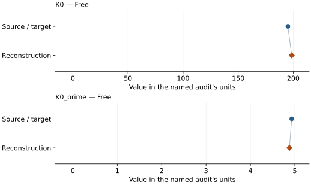

This is a **coefficient comparison**, not an observation or residual plot.
Each panel uses its coefficient's audit units and includes zero. Markers show
stored central values only. Error widths are retained in the table below;
no confidence interval or uncertainty band is inferred. Fixed/adopted values are constraints.

| Parameter | Source / target | Source error | Reconstruction | Reconstruction error | Fit role |
| --- | --- | --- | --- | --- | --- |
| K0 | 195.1 | 2.4 | 198.5892355539972 | Not specified | Free |
| K0\_prime | 4.93 | 0.12 | 4.87872890169641 | Not specified | Free |

Values and reported errors are copied without rounding or conversion from the named audit. Missing errors mean unknown, not zero. Parameter names and volume conventions follow that audit; error widths do not imply a confidence convention.

Recorded diagnostics, covariance and additional protocol

- **Tied parameters:**
- **Solver success:** True
- **Rmse gpa:** 1.7603743392994244
- **Published rmse gpa:** 2.121546909125323
- **Published pressure rmse gpa:** 2.121546909125323
- **Refitted pressure rmse gpa:** 1.7603743392994244
- **Rmse shock velocity km s:** Not specified
- **Parameter covariance:** Not specified

### Detailed evidence and existing plots

- [Earlier detailed record investigation](../primary-eos-refits.md#investigation-iron_sakai_2014_p4_bm3).
- [Record-by-record numerical ledger](../primary-eos-refits.md#records).
- [Source-audit reports](../source-audits.md).

Observation curves and residual plots are provided by the supporting reports where available. Their absence is not filled by a reconstructed curve presented as measured data.

[Machine-readable comparison ledger](https://github.com/CPrescher/peritheos/blob/main/docs/data/primary-eos-refits.json) — look up `iron_sakai_2014_p4_bm3`.
[Complete native EOSMAT file](https://github.com/CPrescher/peritheos/blob/main/peritheos/data/materials/iron.eosmat).

## Sakai et al. (2014), p4\_vinet

Record: `iron_sakai_2014_p4_vinet` · Model: `Vinet`

**Outcome: Numerically similar, with qualifications.**

**Scope:** Comparison with the source parameterization.
**Comparison basis:** Every compared free coefficient meets either the recorded combined-two-sigma comparison or parameter-specific numerical similarity screen; the audit does not classify the complete comparison as parity.

[Stored EOS coefficients and source](../material-summaries/iron.md#record-iron_sakai_2014_p4_vinet)

### What this result establishes

**Separate source-review status:** primary\_source\_validated.
**Usage recommendation:** See the stored EOS qualifications; no recommendation is inferred here.

- Conditional independent refit; matching within printed errors is similarity, not reproduction of the original statistical procedure. V0 preliminary g-G fit not repeated.
- This named numerical assessment alone does not establish author-workflow reproduction, physical accuracy or recommendation for use.

### Data and reconstruction method

- **Dataset identifiers:** sakai\_2014\_table2\_pvt
- **Observations:** 27
- **Objective:** Unweighted vertical pressure residuals; conditional on published reference/fixed coefficients. Source weights and covariance are not given.
- **Weighting:** unweighted; published coefficient constraints retained
- **Free parameters:** K0; K0\_prime
- **Fixed parameters:** V0

Unspecified selections, weights, fixed values or error conventions remain unknown; they have not been inferred for this report.

### Source versus reconstruction

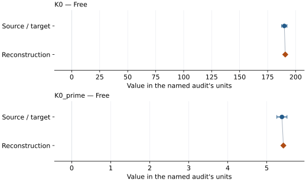

This is a **coefficient comparison**, not an observation or residual plot.
Each panel uses its coefficient's audit units and includes zero. Markers show
stored central values only. Error widths are retained in the table below;
no confidence interval or uncertainty band is inferred. Fixed/adopted values are constraints.

| Parameter | Source / target | Source error | Reconstruction | Reconstruction error | Fit role |
| --- | --- | --- | --- | --- | --- |
| K0 | 189.9 | 2.4 | 190.73051850431446 | Not specified | Free |
| K0\_prime | 5.39 | 0.13 | 5.427273335806416 | Not specified | Free |

Values and reported errors are copied without rounding or conversion from the named audit. Missing errors mean unknown, not zero. Parameter names and volume conventions follow that audit; error widths do not imply a confidence convention.

Recorded diagnostics, covariance and additional protocol

- **Tied parameters:**
- **Solver success:** True
- **Rmse gpa:** 1.5287773767443562
- **Published rmse gpa:** 2.284198696173876
- **Published pressure rmse gpa:** 2.284198696173876
- **Refitted pressure rmse gpa:** 1.5287773767443562
- **Rmse shock velocity km s:** Not specified
- **Parameter covariance:** Not specified

### Detailed evidence and existing plots

- [Earlier detailed record investigation](../primary-eos-refits.md#investigation-iron_sakai_2014_p4_vinet).
- [Record-by-record numerical ledger](../primary-eos-refits.md#records).
- [Source-audit reports](../source-audits.md).

Observation curves and residual plots are provided by the supporting reports where available. Their absence is not filled by a reconstructed curve presented as measured data.

[Machine-readable comparison ledger](https://github.com/CPrescher/peritheos/blob/main/docs/data/primary-eos-refits.json) — look up `iron_sakai_2014_p4_vinet`.
[Complete native EOSMAT file](https://github.com/CPrescher/peritheos/blob/main/peritheos/data/materials/iron.eosmat).

## Sakai et al. (2014), p5\_bm3

Record: `iron_sakai_2014_p5_bm3` · Model: `BM3`

**Outcome: Numerically similar, with qualifications.**

**Scope:** Comparison with the source parameterization.
**Comparison basis:** Every compared free coefficient meets either the recorded combined-two-sigma comparison or parameter-specific numerical similarity screen; the audit does not classify the complete comparison as parity.

[Stored EOS coefficients and source](../material-summaries/iron.md#record-iron_sakai_2014_p5_bm3)

### What this result establishes

**Separate source-review status:** primary\_source\_validated.
**Usage recommendation:** See the stored EOS qualifications; no recommendation is inferred here.

- Conditional independent refit; matching within printed errors is similarity, not reproduction of the original statistical procedure. V0 preliminary g-G fit not repeated. P5 pressures independently reconstructed from the printed new NaCl-B2 BM3 coefficients and Table 2 NaCl volumes; B1 rows retain Brown (1999) pressures.
- This named numerical assessment alone does not establish author-workflow reproduction, physical accuracy or recommendation for use.

### Data and reconstruction method

- **Dataset identifiers:** sakai\_2014\_table2\_pvt
- **Observations:** 27
- **Objective:** Unweighted vertical pressure residuals; conditional on published reference/fixed coefficients. Source weights and covariance are not given.
- **Weighting:** unweighted; published coefficient constraints retained
- **Free parameters:** K0; K0\_prime
- **Fixed parameters:** V0

Unspecified selections, weights, fixed values or error conventions remain unknown; they have not been inferred for this report.

### Source versus reconstruction

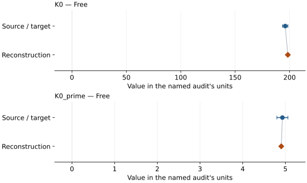

This is a **coefficient comparison**, not an observation or residual plot.
Each panel uses its coefficient's audit units and includes zero. Markers show
stored central values only. Error widths are retained in the table below;
no confidence interval or uncertainty band is inferred. Fixed/adopted values are constraints.

| Parameter | Source / target | Source error | Reconstruction | Reconstruction error | Fit role |
| --- | --- | --- | --- | --- | --- |
| K0 | 196.0 | 2.5 | 198.38428747634123 | Not specified | Free |
| K0\_prime | 4.93 | 0.13 | 4.9035472009677825 | Not specified | Free |

Values and reported errors are copied without rounding or conversion from the named audit. Missing errors mean unknown, not zero. Parameter names and volume conventions follow that audit; error widths do not imply a confidence convention.

Recorded diagnostics, covariance and additional protocol

- **Tied parameters:**
- **Solver success:** True
- **Rmse gpa:** 1.493582371073135
- **Published rmse gpa:** 1.8254949981537465
- **Published pressure rmse gpa:** 1.8254949981537465
- **Refitted pressure rmse gpa:** 1.493582371073135
- **Rmse shock velocity km s:** Not specified
- **Parameter covariance:** Not specified

### Detailed evidence and existing plots

- [Earlier detailed record investigation](../primary-eos-refits.md#investigation-iron_sakai_2014_p5_bm3).
- [Record-by-record numerical ledger](../primary-eos-refits.md#records).
- [Source-audit reports](../source-audits.md).

Observation curves and residual plots are provided by the supporting reports where available. Their absence is not filled by a reconstructed curve presented as measured data.

[Machine-readable comparison ledger](https://github.com/CPrescher/peritheos/blob/main/docs/data/primary-eos-refits.json) — look up `iron_sakai_2014_p5_bm3`.
[Complete native EOSMAT file](https://github.com/CPrescher/peritheos/blob/main/peritheos/data/materials/iron.eosmat).

## Sakai et al. (2014), p5\_vinet

Record: `iron_sakai_2014_p5_vinet` · Model: `Vinet`

**Outcome: Numerically similar, with qualifications.**

**Scope:** Comparison with the source parameterization.
**Comparison basis:** Every compared free coefficient meets either the recorded combined-two-sigma comparison or parameter-specific numerical similarity screen; the audit does not classify the complete comparison as parity.

[Stored EOS coefficients and source](../material-summaries/iron.md#record-iron_sakai_2014_p5_vinet)

### What this result establishes

**Separate source-review status:** primary\_source\_validated.
**Usage recommendation:** See the stored EOS qualifications; no recommendation is inferred here.

- Conditional independent refit; matching within printed errors is similarity, not reproduction of the original statistical procedure. V0 preliminary g-G fit not repeated. P5 pressures independently reconstructed from the printed new NaCl-B2 BM3 coefficients and Table 2 NaCl volumes; B1 rows retain Brown (1999) pressures.
- This named numerical assessment alone does not establish author-workflow reproduction, physical accuracy or recommendation for use.

### Data and reconstruction method

- **Dataset identifiers:** sakai\_2014\_table2\_pvt
- **Observations:** 27
- **Objective:** Unweighted vertical pressure residuals; conditional on published reference/fixed coefficients. Source weights and covariance are not given.
- **Weighting:** unweighted; published coefficient constraints retained
- **Free parameters:** K0; K0\_prime
- **Fixed parameters:** V0

Unspecified selections, weights, fixed values or error conventions remain unknown; they have not been inferred for this report.

### Source versus reconstruction

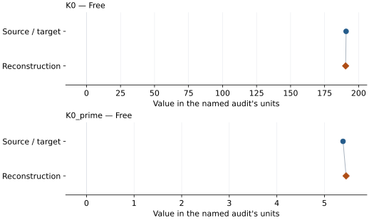

This is a **coefficient comparison**, not an observation or residual plot.
Each panel uses its coefficient's audit units and includes zero. Markers show
stored central values only. Error widths are retained in the table below;
no confidence interval or uncertainty band is inferred. Fixed/adopted values are constraints.

| Parameter | Source / target | Source error | Reconstruction | Reconstruction error | Fit role |
| --- | --- | --- | --- | --- | --- |
| K0 | 190.8 | 2.4 | 190.47003910439446 | Not specified | Free |
| K0\_prime | 5.39 | 0.13 | 5.454658336009669 | Not specified | Free |

Values and reported errors are copied without rounding or conversion from the named audit. Missing errors mean unknown, not zero. Parameter names and volume conventions follow that audit; error widths do not imply a confidence convention.

Recorded diagnostics, covariance and additional protocol

- **Tied parameters:**
- **Solver success:** True
- **Rmse gpa:** 1.289893293024698
- **Published rmse gpa:** 2.067085332582555
- **Published pressure rmse gpa:** 2.067085332582555
- **Refitted pressure rmse gpa:** 1.289893293024698
- **Rmse shock velocity km s:** Not specified
- **Parameter covariance:** Not specified

### Detailed evidence and existing plots

- [Earlier detailed record investigation](../primary-eos-refits.md#investigation-iron_sakai_2014_p5_vinet).
- [Record-by-record numerical ledger](../primary-eos-refits.md#records).
- [Source-audit reports](../source-audits.md).

Observation curves and residual plots are provided by the supporting reports where available. Their absence is not filled by a reconstructed curve presented as measured data.

[Machine-readable comparison ledger](https://github.com/CPrescher/peritheos/blob/main/docs/data/primary-eos-refits.json) — look up `iron_sakai_2014_p5_vinet`.
[Complete native EOSMAT file](https://github.com/CPrescher/peritheos/blob/main/peritheos/data/materials/iron.eosmat).

## Sakai et al. (2014), p6\_bm3

Record: `iron_sakai_2014_p6_bm3` · Model: `BM3`

**Outcome: Parity not achieved for this comparison.**

**Scope:** Comparison with the source parameterization.
**Comparison basis:** Conditional independent refit; matching within printed errors is similarity, not reproduction of the original statistical procedure. V0 preliminary g-G fit not repeated.

[Stored EOS coefficients and source](../material-summaries/iron.md#record-iron_sakai_2014_p6_bm3)

### What this result establishes

**Separate source-review status:** primary\_source\_validated.
**Usage recommendation:** See the stored EOS qualifications; no recommendation is inferred here.

- This named numerical assessment alone does not establish author-workflow reproduction, physical accuracy or recommendation for use.

### Data and reconstruction method

- **Dataset identifiers:** sakai\_2014\_table2\_pvt
- **Observations:** 27
- **Objective:** Unweighted vertical pressure residuals; conditional on published reference/fixed coefficients. Source weights and covariance are not given.
- **Weighting:** unweighted; published coefficient constraints retained
- **Free parameters:** K0; K0\_prime
- **Fixed parameters:** V0

Unspecified selections, weights, fixed values or error conventions remain unknown; they have not been inferred for this report.

### Source versus reconstruction

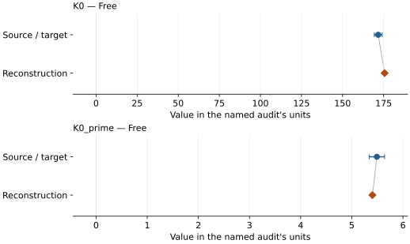

This is a **coefficient comparison**, not an observation or residual plot.
Each panel uses its coefficient's audit units and includes zero. Markers show
stored central values only. Error widths are retained in the table below;
no confidence interval or uncertainty band is inferred. Fixed/adopted values are constraints.

| Parameter | Source / target | Source error | Reconstruction | Reconstruction error | Fit role |
| --- | --- | --- | --- | --- | --- |
| K0 | 171.7 | 2.4 | 175.55058789267716 | Not specified | Free |
| K0\_prime | 5.49 | 0.15 | 5.402254168779792 | Not specified | Free |

Values and reported errors are copied without rounding or conversion from the named audit. Missing errors mean unknown, not zero. Parameter names and volume conventions follow that audit; error widths do not imply a confidence convention.

Recorded diagnostics, covariance and additional protocol

- **Tied parameters:**
- **Solver success:** True
- **Rmse gpa:** 1.6935672966558224
- **Published rmse gpa:** 1.9954203475455305
- **Published pressure rmse gpa:** 1.9954203475455305
- **Refitted pressure rmse gpa:** 1.6935672966558224
- **Rmse shock velocity km s:** Not specified
- **Parameter covariance:** Not specified

### Detailed evidence and existing plots

- [Earlier detailed record investigation](../primary-eos-refits.md#investigation-iron_sakai_2014_p6_bm3).
- [Record-by-record numerical ledger](../primary-eos-refits.md#records).
- [Source-audit reports](../source-audits.md).

Observation curves and residual plots are provided by the supporting reports where available. Their absence is not filled by a reconstructed curve presented as measured data.

[Machine-readable comparison ledger](https://github.com/CPrescher/peritheos/blob/main/docs/data/primary-eos-refits.json) — look up `iron_sakai_2014_p6_bm3`.
[Complete native EOSMAT file](https://github.com/CPrescher/peritheos/blob/main/peritheos/data/materials/iron.eosmat).

## Sakai et al. (2014), p6\_vinet

Record: `iron_sakai_2014_p6_vinet` · Model: `Vinet`

**Outcome: Numerically similar, with qualifications.**

**Scope:** Comparison with the source parameterization.
**Comparison basis:** Every compared free coefficient meets either the recorded combined-two-sigma comparison or parameter-specific numerical similarity screen; the audit does not classify the complete comparison as parity.

[Stored EOS coefficients and source](../material-summaries/iron.md#record-iron_sakai_2014_p6_vinet)

### What this result establishes

**Separate source-review status:** primary\_source\_validated.
**Usage recommendation:** See the stored EOS qualifications; no recommendation is inferred here.

- Conditional independent refit; matching within printed errors is similarity, not reproduction of the original statistical procedure. V0 preliminary g-G fit not repeated.
- This named numerical assessment alone does not establish author-workflow reproduction, physical accuracy or recommendation for use.

### Data and reconstruction method

- **Dataset identifiers:** sakai\_2014\_table2\_pvt
- **Observations:** 27
- **Objective:** Unweighted vertical pressure residuals; conditional on published reference/fixed coefficients. Source weights and covariance are not given.
- **Weighting:** unweighted; published coefficient constraints retained
- **Free parameters:** K0; K0\_prime
- **Fixed parameters:** V0

Unspecified selections, weights, fixed values or error conventions remain unknown; they have not been inferred for this report.

### Source versus reconstruction

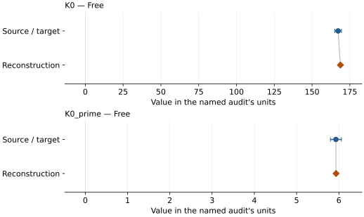

This is a **coefficient comparison**, not an observation or residual plot.
Each panel uses its coefficient's audit units and includes zero. Markers show
stored central values only. Error widths are retained in the table below;
no confidence interval or uncertainty band is inferred. Fixed/adopted values are constraints.

| Parameter | Source / target | Source error | Reconstruction | Reconstruction error | Fit role |
| --- | --- | --- | --- | --- | --- |
| K0 | 167.2 | 2.2 | 168.72864642874438 | Not specified | Free |
| K0\_prime | 5.93 | 0.13 | 5.93273298928715 | Not specified | Free |

Values and reported errors are copied without rounding or conversion from the named audit. Missing errors mean unknown, not zero. Parameter names and volume conventions follow that audit; error widths do not imply a confidence convention.

Recorded diagnostics, covariance and additional protocol

- **Tied parameters:**
- **Solver success:** True
- **Rmse gpa:** 1.4729392562563048
- **Published rmse gpa:** 2.051779033190769
- **Published pressure rmse gpa:** 2.051779033190769
- **Refitted pressure rmse gpa:** 1.4729392562563048
- **Rmse shock velocity km s:** Not specified
- **Parameter covariance:** Not specified

### Detailed evidence and existing plots

- [Earlier detailed record investigation](../primary-eos-refits.md#investigation-iron_sakai_2014_p6_vinet).
- [Record-by-record numerical ledger](../primary-eos-refits.md#records).
- [Source-audit reports](../source-audits.md).

Observation curves and residual plots are provided by the supporting reports where available. Their absence is not filled by a reconstructed curve presented as measured data.

[Machine-readable comparison ledger](https://github.com/CPrescher/peritheos/blob/main/docs/data/primary-eos-refits.json) — look up `iron_sakai_2014_p6_vinet`.
[Complete native EOSMAT file](https://github.com/CPrescher/peritheos/blob/main/peritheos/data/materials/iron.eosmat).

## Yamazaki et al. (2012), bm3\_thermal

Record: `iron_yamazaki_2012_bm3_thermal` · Model: `BM3`

**Outcome: Parity not achieved for this comparison.**

**Scope:** Comparison with the source parameterization.
**Comparison basis:** All 207 primary rows on original Tsuchiya Au scale. Unweighted P residuals do not assert the unavailable original weighting.

[Stored EOS coefficients and source](../material-summaries/iron.md#record-iron_yamazaki_2012_bm3_thermal)

### What this result establishes

**Separate source-review status:** primary\_source\_validated.
**Usage recommendation:** See the stored EOS qualifications; no recommendation is inferred here.

- This named numerical assessment alone does not establish author-workflow reproduction, physical accuracy or recommendation for use.

### Data and reconstruction method

- **Dataset identifiers:** iron\_yamazaki\_2012\_table\_s1
- **Observations:** 207
- **Objective:** Unweighted vertical pressure residuals; conditional on published reference/fixed coefficients. Source weights and covariance are not given.
- **Weighting:** unweighted; published coefficient constraints retained
- **Free parameters:** V0; K0; K0\_prime; gamma0; beta; theta0
- **Fixed parameters:** Tr; gamma\_inf; anharmonic\_a; anharmonic\_m; electronic\_e; electronic\_g; n

Unspecified selections, weights, fixed values or error conventions remain unknown; they have not been inferred for this report.

### Source versus reconstruction

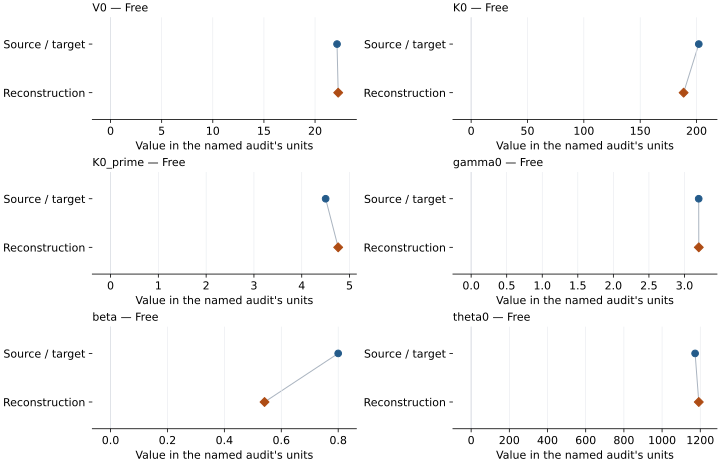

This is a **coefficient comparison**, not an observation or residual plot.
Each panel uses its coefficient's audit units and includes zero. Markers show
stored central values only. Error widths are retained in the table below;
no confidence interval or uncertainty band is inferred. Fixed/adopted values are constraints.

| Parameter | Source / target | Source error | Reconstruction | Reconstruction error | Fit role |
| --- | --- | --- | --- | --- | --- |
| V0 | 22.15 | 0.05 | 22.262702726843035 | Not specified | Free |
| K0 | 202 | 7 | 188.53636992247536 | Not specified | Free |
| K0\_prime | 4.5 | 0.2 | 4.762525357038585 | Not specified | Free |
| gamma0 | 3.2 | 0.2 | 3.201215447243429 | Not specified | Free |
| beta | 0.8 | 0.3 | 0.5411775000825946 | Not specified | Free |
| theta0 | 1173 | 62 | 1192.271070046367 | Not specified | Free |

Values and reported errors are copied without rounding or conversion from the named audit. Missing errors mean unknown, not zero. Parameter names and volume conventions follow that audit; error widths do not imply a confidence convention.

Recorded diagnostics, covariance and additional protocol

- **Tied parameters:**
- **Solver success:** True
- **Rmse gpa:** 0.6219909101294726
- **Published rmse gpa:** 0.6607481174454006
- **Published pressure rmse gpa:** 0.6607481174454006
- **Refitted pressure rmse gpa:** 0.6219909101294726
- **Rmse shock velocity km s:** Not specified
- **Parameter covariance:** Not specified

### Detailed evidence and existing plots

- [Earlier detailed record investigation](../primary-eos-refits.md#investigation-iron_yamazaki_2012_bm3_thermal).
- [Record-by-record numerical ledger](../primary-eos-refits.md#records).
- [Source-audit reports](../source-audits.md).

Observation curves and residual plots are provided by the supporting reports where available. Their absence is not filled by a reconstructed curve presented as measured data.

[Machine-readable comparison ledger](https://github.com/CPrescher/peritheos/blob/main/docs/data/primary-eos-refits.json) — look up `iron_yamazaki_2012_bm3_thermal`.
[Complete native EOSMAT file](https://github.com/CPrescher/peritheos/blob/main/peritheos/data/materials/iron.eosmat).

## Yamazaki et al. (2012), vinet\_thermal

Record: `iron_yamazaki_2012_vinet_thermal` · Model: `Vinet`

**Outcome: Parity not achieved for this comparison.**

**Scope:** Comparison with the source parameterization.
**Comparison basis:** All 207 primary rows on original Tsuchiya Au scale. Unweighted P residuals do not assert the unavailable original weighting.

[Stored EOS coefficients and source](../material-summaries/iron.md#record-iron_yamazaki_2012_vinet_thermal)

### What this result establishes

**Separate source-review status:** primary\_source\_validated.
**Usage recommendation:** See the stored EOS qualifications; no recommendation is inferred here.

- This named numerical assessment alone does not establish author-workflow reproduction, physical accuracy or recommendation for use.

### Data and reconstruction method

- **Dataset identifiers:** iron\_yamazaki\_2012\_table\_s1
- **Observations:** 207
- **Objective:** Unweighted vertical pressure residuals; conditional on published reference/fixed coefficients. Source weights and covariance are not given.
- **Weighting:** unweighted; published coefficient constraints retained
- **Free parameters:** V0; K0; K0\_prime; gamma0; beta; theta0
- **Fixed parameters:** Tr; gamma\_inf; anharmonic\_a; anharmonic\_m; electronic\_e; electronic\_g; n

Unspecified selections, weights, fixed values or error conventions remain unknown; they have not been inferred for this report.

### Source versus reconstruction

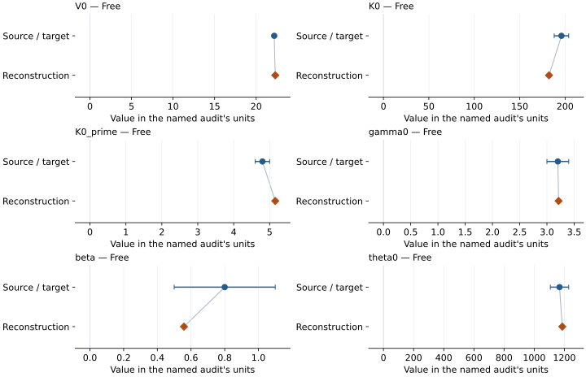

This is a **coefficient comparison**, not an observation or residual plot.
Each panel uses its coefficient's audit units and includes zero. Markers show
stored central values only. Error widths are retained in the table below;
no confidence interval or uncertainty band is inferred. Fixed/adopted values are constraints.

| Parameter | Source / target | Source error | Reconstruction | Reconstruction error | Fit role |
| --- | --- | --- | --- | --- | --- |
| V0 | 22.17 | 0.06 | 22.294840414369773 | Not specified | Free |
| K0 | 196 | 8 | 182.3016080828161 | Not specified | Free |
| K0\_prime | 4.8 | 0.2 | 5.156187606210009 | Not specified | Free |
| gamma0 | 3.2 | 0.2 | 3.214351673223089 | Not specified | Free |
| beta | 0.8 | 0.3 | 0.5578584611036544 | Not specified | Free |
| theta0 | 1168 | 61 | 1186.3796635597148 | Not specified | Free |

Values and reported errors are copied without rounding or conversion from the named audit. Missing errors mean unknown, not zero. Parameter names and volume conventions follow that audit; error widths do not imply a confidence convention.

Recorded diagnostics, covariance and additional protocol

- **Tied parameters:**
- **Solver success:** True
- **Rmse gpa:** 0.6202628351531172
- **Published rmse gpa:** 0.689629909873565
- **Published pressure rmse gpa:** 0.689629909873565
- **Refitted pressure rmse gpa:** 0.6202628351531172
- **Rmse shock velocity km s:** Not specified
- **Parameter covariance:** Not specified

### Detailed evidence and existing plots

- [Earlier detailed record investigation](../primary-eos-refits.md#investigation-iron_yamazaki_2012_vinet_thermal).
- [Record-by-record numerical ledger](../primary-eos-refits.md#records).
- [Source-audit reports](../source-audits.md).

Observation curves and residual plots are provided by the supporting reports where available. Their absence is not filled by a reconstructed curve presented as measured data.

[Machine-readable comparison ledger](https://github.com/CPrescher/peritheos/blob/main/docs/data/primary-eos-refits.json) — look up `iron_yamazaki_2012_vinet_thermal`.
[Complete native EOSMAT file](https://github.com/CPrescher/peritheos/blob/main/peritheos/data/materials/iron.eosmat).

## Dubrovinsky et al. (2000), bm3\_thermal

Record: `iron_dubrovinsky_2000_bm3_thermal` · Model: `BM3`

**Outcome: Complete independent refit unavailable.**

**Scope:** Comparison with the source parameterization.
**Comparison basis:** The 188 input P-V-T points are not tabulated in the attached publication.

[Stored EOS coefficients and source](../material-summaries/iron.md#record-iron_dubrovinsky_2000_bm3_thermal)

### What this result establishes

**Separate source-review status:** primary\_source\_validated.
**Usage recommendation:** See the stored EOS qualifications; no recommendation is inferred here.

- This named numerical assessment alone does not establish author-workflow reproduction, physical accuracy or recommendation for use.
- No reconstructed coefficient table is recorded for this assessment; no missing values have been inferred.

### Data and reconstruction method

- **Dataset identifiers:** None declared
- **Fixed parameters:** Tr; dK\_dT; beta3

Unspecified selections, weights, fixed values or error conventions remain unknown; they have not been inferred for this report.

### Why no coefficient graph is shown

No numeric source/reconstruction pair is recorded for this assessment. A graph would require information that is not available here; no values or observations have been invented.

### Detailed evidence and existing plots

- [Record-by-record numerical ledger](../primary-eos-refits.md#records).
- [Source-audit reports](../source-audits.md).

Observation curves and residual plots are provided by the supporting reports where available. Their absence is not filled by a reconstructed curve presented as measured data.

[Machine-readable comparison ledger](https://github.com/CPrescher/peritheos/blob/main/docs/data/primary-eos-refits.json) — look up `iron_dubrovinsky_2000_bm3_thermal`.
[Complete native EOSMAT file](https://github.com/CPrescher/peritheos/blob/main/peritheos/data/materials/iron.eosmat).

## Dewaele et al. (2006), bm3

Record: `iron_dewaele_2006_bm3` · Model: `BM3`

**Outcome: Numerically similar, with qualifications.**

**Scope:** Comparison with the source parameterization.
**Comparison basis:** Every compared free coefficient meets either the recorded combined-two-sigma comparison or parameter-specific numerical similarity screen; the audit does not classify the complete comparison as parity.

[Stored EOS coefficients and source](../material-summaries/iron.md#record-iron_dewaele_2006_bm3)

### What this result establishes

**Separate source-review status:** primary\_source\_validated.
**Usage recommendation:** See the stored EOS qualifications; no recommendation is inferred here.

- 37 helium hcp rows selected by the existing original-2006 flag; K0 fixed at 165 GPa. Original weighting is unavailable.
- This named numerical assessment alone does not establish author-workflow reproduction, physical accuracy or recommendation for use.

### Data and reconstruction method

- **Dataset identifiers:** iron\_dewaele\_2006\_epaps\_compression
- **Observations:** 37
- **Objective:** Unweighted vertical pressure residuals; conditional on published reference/fixed coefficients. Source weights and covariance are not given.
- **Weighting:** unweighted; published coefficient constraints retained
- **Free parameters:** V0; K0\_prime
- **Fixed parameters:** K0

Unspecified selections, weights, fixed values or error conventions remain unknown; they have not been inferred for this report.

### Source versus reconstruction

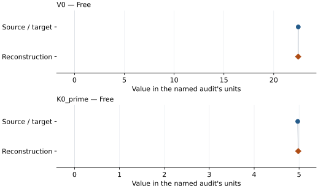

This is a **coefficient comparison**, not an observation or residual plot.
Each panel uses its coefficient's audit units and includes zero. Markers show
stored central values only. Error widths are retained in the table below;
no confidence interval or uncertainty band is inferred. Fixed/adopted values are constraints.

| Parameter | Source / target | Source error | Reconstruction | Reconstruction error | Fit role |
| --- | --- | --- | --- | --- | --- |
| V0 | 22.468 | 0.024 | 22.46074432737452 | Not specified | Free |
| K0\_prime | 4.97 | 0.04 | 4.981797926203559 | Not specified | Free |

Values and reported errors are copied without rounding or conversion from the named audit. Missing errors mean unknown, not zero. Parameter names and volume conventions follow that audit; error widths do not imply a confidence convention.

Recorded diagnostics, covariance and additional protocol

- **Tied parameters:**
- **Solver success:** True
- **Rmse gpa:** 0.7261679624581039
- **Published rmse gpa:** 0.7294835765688166
- **Published pressure rmse gpa:** 0.7294835765688166
- **Refitted pressure rmse gpa:** 0.7261679624581039
- **Rmse shock velocity km s:** Not specified
- **Parameter covariance:** Not specified

### Detailed evidence and existing plots

- [Earlier detailed record investigation](../primary-eos-refits.md#investigation-iron_dewaele_2006_bm3).
- [Record-by-record numerical ledger](../primary-eos-refits.md#records).
- [Source-audit reports](../source-audits.md).

Observation curves and residual plots are provided by the supporting reports where available. Their absence is not filled by a reconstructed curve presented as measured data.

[Machine-readable comparison ledger](https://github.com/CPrescher/peritheos/blob/main/docs/data/primary-eos-refits.json) — look up `iron_dewaele_2006_bm3`.
[Complete native EOSMAT file](https://github.com/CPrescher/peritheos/blob/main/peritheos/data/materials/iron.eosmat).

## Brown et al. (2000), nominal-iron steel linear Hugoniot, solid subset

Record: `iron_brown_2000_linear_hugoniot` · Model: `LinearUsUpHugoniot`

**Outcome: Coefficient parity achieved.**

**Scope:** Comparison with the source parameterization.
**Comparison basis:** Agreement at the source's printed decimal precision.

[Stored EOS coefficients and source](../material-summaries/iron.md#record-iron_brown_2000_linear_hugoniot)

### What this result establishes

**Separate source-review status:** primary\_source\_validated.
**Usage recommendation:** See the stored EOS qualifications; no recommendation is inferred here.

- All fitted polynomial coefficients agree at printed precision. Linear RMS uses N=37 (60.8 m/s); using N-2 gives 62.5 m/s, near printed 62 m/s. No Hugoniot temperatures recovered.
- This named numerical assessment alone does not establish author-workflow reproduction, physical accuracy or recommendation for use.

### Data and reconstruction method

- **Dataset identifiers:** iron\_brown\_2000\_tables\_i\_ii
- **Observations:** 37
- **Objective:** Unweighted vertical Us residuals; all 37 Table I–II points.
- **Weighting:** unweighted; published coefficient constraints retained
- **Free parameters:** c0; s
- **Fixed parameters:** V0; rho0; P0

Unspecified selections, weights, fixed values or error conventions remain unknown; they have not been inferred for this report.

### Source versus reconstruction

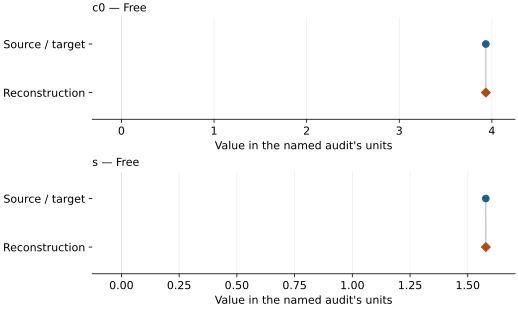

This is a **coefficient comparison**, not an observation or residual plot.
Each panel uses its coefficient's audit units and includes zero. Markers show
stored central values only. Error widths are retained in the table below;
no confidence interval or uncertainty band is inferred. Fixed/adopted values are constraints.

| Parameter | Source / target | Source error | Reconstruction | Reconstruction error | Fit role |
| --- | --- | --- | --- | --- | --- |
| c0 | 3.935 | Not specified | 3.935012740892783 | Not specified | Free |
| s | 1.578 | Not specified | 1.57824296271126 | Not specified | Free |

Values and reported errors are copied without rounding or conversion from the named audit. Missing errors mean unknown, not zero. Parameter names and volume conventions follow that audit; error widths do not imply a confidence convention.

Recorded diagnostics, covariance and additional protocol

- **Tied parameters:**
- **Rmse gpa:** Not specified
- **Published rmse gpa:** Not specified
- **Rmse shock velocity km s:** 0.06078458507838442
- **Parameter covariance:** Not specified

### Detailed evidence and existing plots

- [Record-by-record numerical ledger](../primary-eos-refits.md#records).
- [Source-audit reports](../source-audits.md).

Observation curves and residual plots are provided by the supporting reports where available. Their absence is not filled by a reconstructed curve presented as measured data.

[Machine-readable comparison ledger](https://github.com/CPrescher/peritheos/blob/main/docs/data/primary-eos-refits.json) — look up `iron_brown_2000_linear_hugoniot`.
[Complete native EOSMAT file](https://github.com/CPrescher/peritheos/blob/main/peritheos/data/materials/iron.eosmat).

## Miozzi et al. (2020), 300 K BM3 (not reproduced)

Record: `iron_miozzi_2020_bm3` · Model: `BM3`

**Outcome: Parity not achieved for this comparison.**

**Scope:** Comparison with the source parameterization.
**Comparison basis:** Conditional diagnostic, not the original EosFit-7c objective: the source does not specify its numerical weights, covariance, iteration settings, or handling of blank/zero coordinate errors. Missing errors contribute no term to diagnostic variance; one cold row with no positive effective error is excluded only from that diagnostic. Printed errors are provisionally treated as standard deviations solely for this diagnostic. Published coefficients remain unchanged. Thermal V0=22.81 A^3 follows Section 3.3; Table 1 instead gives 22.80(2) A^3 and the printed molar value converts to 22.81581 A^3. The thermal source replay now uses n=2 with volume per mole Fe, as confirmed in user-relayed personal communication with Miozzi, recorded 2026-10-03. This diagnostic fixes V0 even though the author clarified that V0 was free in the final stage. See literature-reproductions/miozzi-2020-iron.md.

[Stored EOS coefficients and source](../material-summaries/iron.md#record-iron_miozzi_2020_bm3)

### What this result establishes

**Separate source-review status:** not\_reproduced.
**Usage recommendation:** Published coefficients are preserved, but the supplied primary observations are not reproduced under the standard equation mapping. This is an unresolved source/reduction discrepancy, not proof of an error in the authors’ experiments. Do not use for pressure calibration or core-condition prediction until resolved. See docs/literature-reproductions/miozzi-2020-iron.md.

- Usage recommendation: Published coefficients are preserved, but the supplied primary observations are not reproduced under the standard equation mapping. This is an unresolved source/reduction discrepancy, not proof of an error in the authors’ experiments. Do not use for pressure calibration or core-condition prediction until resolved. See docs/literature-reproductions/miozzi-2020-iron.md.
- Published coefficients are preserved, but the supplied primary observations are not reproduced under the standard equation mapping. This is an unresolved source/reduction discrepancy, not proof of an error in the authors’ experiments. Do not use for pressure calibration or core-condition prediction until resolved. See docs/literature-reproductions/miozzi-2020-iron.md.
- This named numerical assessment alone does not establish author-workflow reproduction, physical accuracy or recommendation for use.

### Data and reconstruction method

- **Dataset identifiers:** iron\_miozzi\_2020\_he\_pvt; iron\_miozzi\_2020\_mgo\_pvt
- **Observations:** 35
- **Fit kind:** conditional\_effective\_coordinate\_errors
- **Selection:** All 131 rows for thermal; 35 of 36 room-temperature rows for the effective-error isothermal diagnostic (one lacks positive effective error).
- **Fixed parameters:** None declared

Unspecified selections, weights, fixed values or error conventions remain unknown; they have not been inferred for this report.

### Source versus reconstruction

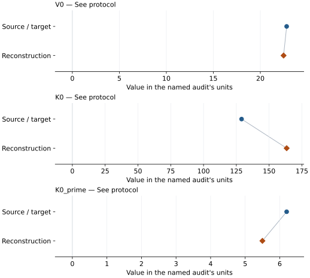

This is a **coefficient comparison**, not an observation or residual plot.
Each panel uses its coefficient's audit units and includes zero. Markers show
stored central values only. Error widths are retained in the table below;
no confidence interval or uncertainty band is inferred. Fixed/adopted values are constraints.

| Parameter | Source / target | Source error | Reconstruction | Reconstruction error | Fit role |
| --- | --- | --- | --- | --- | --- |
| V0 | 22.8 | 0.02 | 22.471548782131517 | 0.15771533565922902 | See protocol |
| K0 | 129.0 | 6 | 163.35711117068155 | 14.434520085191155 | See protocol |
| K0\_prime | 6.2 | 0.2 | 5.498690139773811 | 0.3526624514676353 | See protocol |

Values and reported errors are copied without rounding or conversion from the named audit. Missing errors mean unknown, not zero. Parameter names and volume conventions follow that audit; error widths do not imply a confidence convention.

Recorded diagnostics, covariance and additional protocol

- **Solver success:** True

### Detailed evidence and existing plots

- [Earlier detailed record investigation](../primary-eos-refits.md#investigation-iron_miozzi_2020_bm3).
- [Supporting source report: miozzi-2020-iron](../literature-reproductions/miozzi-2020-iron.md).
- [Record-by-record numerical ledger](../primary-eos-refits.md#records).
- [Source-audit reports](../source-audits.md).

Observation curves and residual plots are provided by the supporting reports where available. Their absence is not filled by a reconstructed curve presented as measured data.

[Machine-readable comparison ledger](https://github.com/CPrescher/peritheos/blob/main/docs/data/primary-eos-refits.json) — look up `iron_miozzi_2020_bm3`.
[Complete native EOSMAT file](https://github.com/CPrescher/peritheos/blob/main/peritheos/data/materials/iron.eosmat).

## Miozzi et al. (2020), 300 K Vinet (not reproduced)

Record: `iron_miozzi_2020_vinet` · Model: `Vinet`

**Outcome: Parity not achieved for this comparison.**

**Scope:** Comparison with the source parameterization.
**Comparison basis:** Conditional diagnostic, not the original EosFit-7c objective: the source does not specify its numerical weights, covariance, iteration settings, or handling of blank/zero coordinate errors. Missing errors contribute no term to diagnostic variance; one cold row with no positive effective error is excluded only from that diagnostic. Printed errors are provisionally treated as standard deviations solely for this diagnostic. Published coefficients remain unchanged. Thermal V0=22.81 A^3 follows Section 3.3; Table 1 instead gives 22.80(2) A^3 and the printed molar value converts to 22.81581 A^3. The thermal source replay now uses n=2 with volume per mole Fe, as confirmed in user-relayed personal communication with Miozzi, recorded 2026-10-03. This diagnostic fixes V0 even though the author clarified that V0 was free in the final stage. See literature-reproductions/miozzi-2020-iron.md.

[Stored EOS coefficients and source](../material-summaries/iron.md#record-iron_miozzi_2020_vinet)

### What this result establishes

**Separate source-review status:** not\_reproduced.
**Usage recommendation:** Published coefficients are preserved, but the supplied primary observations are not reproduced under the standard equation mapping. This is an unresolved source/reduction discrepancy, not proof of an error in the authors’ experiments. Do not use for pressure calibration or core-condition prediction until resolved. See docs/literature-reproductions/miozzi-2020-iron.md.

- Usage recommendation: Published coefficients are preserved, but the supplied primary observations are not reproduced under the standard equation mapping. This is an unresolved source/reduction discrepancy, not proof of an error in the authors’ experiments. Do not use for pressure calibration or core-condition prediction until resolved. See docs/literature-reproductions/miozzi-2020-iron.md.
- Published coefficients are preserved, but the supplied primary observations are not reproduced under the standard equation mapping. This is an unresolved source/reduction discrepancy, not proof of an error in the authors’ experiments. Do not use for pressure calibration or core-condition prediction until resolved. See docs/literature-reproductions/miozzi-2020-iron.md.
- This named numerical assessment alone does not establish author-workflow reproduction, physical accuracy or recommendation for use.

### Data and reconstruction method

- **Dataset identifiers:** iron\_miozzi\_2020\_he\_pvt; iron\_miozzi\_2020\_mgo\_pvt
- **Observations:** 35
- **Fit kind:** conditional\_effective\_coordinate\_errors
- **Selection:** All 131 rows for thermal; 35 of 36 room-temperature rows for the effective-error isothermal diagnostic (one lacks positive effective error).
- **Fixed parameters:** None declared

Unspecified selections, weights, fixed values or error conventions remain unknown; they have not been inferred for this report.

### Source versus reconstruction

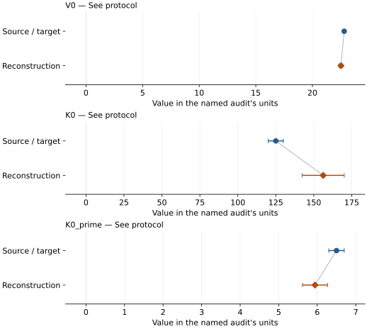

This is a **coefficient comparison**, not an observation or residual plot.
Each panel uses its coefficient's audit units and includes zero. Markers show
stored central values only. Error widths are retained in the table below;
no confidence interval or uncertainty band is inferred. Fixed/adopted values are constraints.

| Parameter | Source / target | Source error | Reconstruction | Reconstruction error | Fit role |
| --- | --- | --- | --- | --- | --- |
| V0 | 22.81 | Not specified | 22.51847239335071 | 0.16092869275010824 | See protocol |
| K0 | 125.0 | 5 | 156.19310777182258 | 13.869114709590853 | See protocol |
| K0\_prime | 6.5 | 0.2 | 5.942915914496525 | 0.32514944746177216 | See protocol |

Values and reported errors are copied without rounding or conversion from the named audit. Missing errors mean unknown, not zero. Parameter names and volume conventions follow that audit; error widths do not imply a confidence convention.

Recorded diagnostics, covariance and additional protocol

- **Solver success:** True

### Detailed evidence and existing plots

- [Earlier detailed record investigation](../primary-eos-refits.md#investigation-iron_miozzi_2020_vinet).
- [Supporting source report: miozzi-2020-iron](../literature-reproductions/miozzi-2020-iron.md).
- [Record-by-record numerical ledger](../primary-eos-refits.md#records).
- [Source-audit reports](../source-audits.md).

Observation curves and residual plots are provided by the supporting reports where available. Their absence is not filled by a reconstructed curve presented as measured data.

[Machine-readable comparison ledger](https://github.com/CPrescher/peritheos/blob/main/docs/data/primary-eos-refits.json) — look up `iron_miozzi_2020_vinet`.
[Complete native EOSMAT file](https://github.com/CPrescher/peritheos/blob/main/peritheos/data/materials/iron.eosmat).

## Miozzi et al. (2020), published BM3–MGD — author-reported n=2

Record: `iron_miozzi_2020_bm3_mgd` · Model: `BM3`

**Outcome: Parity not achieved for this comparison.**

**Scope:** Comparison with the source parameterization.
**Comparison basis:** Conditional diagnostic, not the original EosFit-7c objective: the source does not specify its numerical weights, covariance, iteration settings, or handling of blank/zero coordinate errors. Missing errors contribute no term to diagnostic variance; one cold row with no positive effective error is excluded only from that diagnostic. Printed errors are provisionally treated as standard deviations solely for this diagnostic. Published coefficients remain unchanged. Thermal V0=22.81 A^3 follows Section 3.3; Table 1 instead gives 22.80(2) A^3 and the printed molar value converts to 22.81581 A^3. The thermal source replay now uses n=2 with volume per mole Fe, as confirmed in user-relayed personal communication with Miozzi, recorded 2026-10-03. This diagnostic fixes V0 even though the author clarified that V0 was free in the final stage. See literature-reproductions/miozzi-2020-iron.md.

[Stored EOS coefficients and source](../material-summaries/iron.md#record-iron_miozzi_2020_bm3_mgd)

### What this result establishes

**Separate source-review status:** not\_reproduced.
**Usage recommendation:** Published coefficients retained with full MGD n=2 at the per-mole-Fe volume (~6.87 cm3/mol), as used in the paper according to personal communication with Miozzi et al. relayed by the user and recorded 2026-10-03. This source-reproduction setting differs from physical per-Fe normalization (n=1). Unchanged coefficients give RMS 2.49886 GPa on the 131 printed-pressure observations; exact author inputs, weights and full source-fit reproduction remain unresolved.

- Usage recommendation: Published coefficients retained with full MGD n=2 at the per-mole-Fe volume (~6.87 cm3/mol), as used in the paper according to personal communication with Miozzi et al. relayed by the user and recorded 2026-10-03. This source-reproduction setting differs from physical per-Fe normalization (n=1). Unchanged coefficients give RMS 2.49886 GPa on the 131 printed-pressure observations; exact author inputs, weights and full source-fit reproduction remain unresolved.
- Published coefficients retained with full MGD n=2 at the per-mole-Fe volume (~6.87 cm3/mol), as used in the paper according to personal communication with Miozzi et al. relayed by the user and recorded 2026-10-03. This source-reproduction setting differs from physical per-Fe normalization (n=1). Unchanged coefficients give RMS 2.49886 GPa on the 131 printed-pressure observations; exact author inputs, weights and full source-fit reproduction remain unresolved.
- This named numerical assessment alone does not establish author-workflow reproduction, physical accuracy or recommendation for use.

### Data and reconstruction method

- **Dataset identifiers:** iron\_miozzi\_2020\_he\_pvt; iron\_miozzi\_2020\_mgo\_pvt
- **Observations:** 131
- **Fit kind:** conditional\_effective\_coordinate\_errors
- **Selection:** All 131 rows for thermal; 35 of 36 room-temperature rows for the effective-error isothermal diagnostic (one lacks positive effective error).
- **Fixed parameters:** Tr; theta0; n

Unspecified selections, weights, fixed values or error conventions remain unknown; they have not been inferred for this report.

### Source versus reconstruction

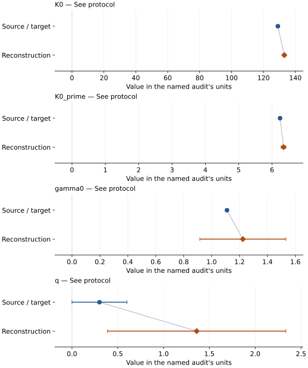

This is a **coefficient comparison**, not an observation or residual plot.
Each panel uses its coefficient's audit units and includes zero. Markers show
stored central values only. Error widths are retained in the table below;
no confidence interval or uncertainty band is inferred. Fixed/adopted values are constraints.

| Parameter | Source / target | Source error | Reconstruction | Reconstruction error | Fit role |
| --- | --- | --- | --- | --- | --- |
| K0 | 129.0 | 1 | 133.04067473727414 | 0.9837200969774551 | See protocol |
| K0\_prime | 6.24 | 0.04 | 6.345365320603753 | 0.06932060134337106 | See protocol |
| gamma0 | 1.11 | 0.01 | 1.2237382632160247 | 0.30817605012538957 | See protocol |
| q | 0.3 | 0.3 | 1.361264413996994 | 0.9734404073480587 | See protocol |

Values and reported errors are copied without rounding or conversion from the named audit. Missing errors mean unknown, not zero. Parameter names and volume conventions follow that audit; error widths do not imply a confidence convention.

Recorded diagnostics, covariance and additional protocol

- **Solver success:** True

### Detailed evidence and existing plots

- [Earlier detailed record investigation](../primary-eos-refits.md#investigation-iron_miozzi_2020_bm3_mgd).
- [Supporting source report: miozzi-2020-iron](../literature-reproductions/miozzi-2020-iron.md).
- [Record-by-record numerical ledger](../primary-eos-refits.md#records).
- [Source-audit reports](../source-audits.md).

Observation curves and residual plots are provided by the supporting reports where available. Their absence is not filled by a reconstructed curve presented as measured data.

[Machine-readable comparison ledger](https://github.com/CPrescher/peritheos/blob/main/docs/data/primary-eos-refits.json) — look up `iron_miozzi_2020_bm3_mgd`.
[Complete native EOSMAT file](https://github.com/CPrescher/peritheos/blob/main/peritheos/data/materials/iron.eosmat).

## Peritheos refit of Miozzi (2020) hcp-Fe — Tange (2009) MgO pressures, equal weights

Record: `iron_miozzi_2020_tange_2009_bm3_mgd_refit` · Model: `BM3`

**Outcome: Coefficient parity achieved.**

**Scope:** Reproduction of a stored independent Peritheos refit.
**Comparison basis:** Reproduction of the registered Peritheos refit's stored coefficients under its declared protocol.

[Stored EOS coefficients and source](../material-summaries/iron.md#record-iron_miozzi_2020_tange_2009_bm3_mgd_refit)

### What this result establishes

**Separate source-review status:** primary\_source\_validated.
**Usage recommendation:** See the stored EOS qualifications; no recommendation is inferred here.

- This comparison concerns the stored independent Peritheos refit, not recovery of the original publication's coefficients or author workflow.
- Independent Peritheos equal-pressure-weight refit of all 131 Miozzi (2020) Fe observations; 116 pressures recalculated from paired MgO V,T using Tange (2009) Fit3-Vinet and 15 He pressures unchanged. This is not Miozzi's published EOS or a reproduction/correction of the original fit. V0,K0,K0\_prime,gamma0,q fitted jointly; theta0=420 K, Tr=300 K, n=1 and two Fe atoms/cell fixed. Errors/covariance are conditional local standard errors using RSS/(131-5), assuming independent equal-variance pressure residuals. Calibrant systematics, shared/run correlations, predictor errors, fixed-theta uncertainty and model discrepancy are not included. Measured coverage is a marginal envelope, not a rectangular stability domain or validation for core-condition extrapolation.
- Original publication reproduction status: not\_reproduced

### Data and reconstruction method

The source/target column below is the stored **Peritheos refit**. Agreement with it does not reproduce the original publication's coefficients.

- **Dataset identifiers:** iron\_miozzi\_2020\_tange\_2009\_vinet\_pvt
- **Observations:** 131
- **Fit kind:** stored\_refit\_reproduction
- **Selection:** All 131 source observations; 116 Tange Fit3-Vinet MgO pressures plus 15 unchanged He pressures
- **Objective:** equal\_weight\_pressure\_residuals
- **Absolute sigma:** False
- **Free parameters:** V0; K0; K0\_prime; gamma0; q
- **Fixed parameters:** Tr; theta0; n

Unspecified selections, weights, fixed values or error conventions remain unknown; they have not been inferred for this report.

### Source versus reconstruction

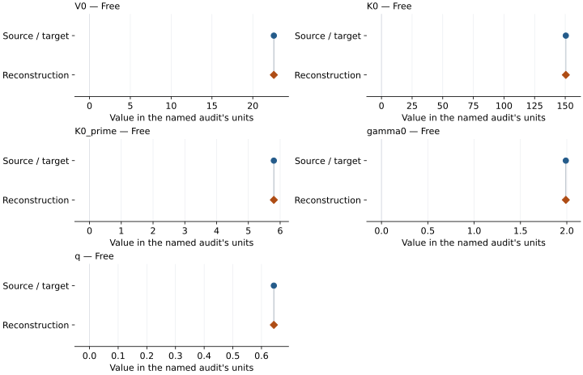

This is a **coefficient comparison**, not an observation or residual plot.
Each panel uses its coefficient's audit units and includes zero. Markers show
stored central values only. Error widths are retained in the table below;
no confidence interval or uncertainty band is inferred. Fixed/adopted values are constraints.

| Parameter | Source / target | Source error | Reconstruction | Reconstruction error | Fit role |
| --- | --- | --- | --- | --- | --- |
| V0 | 22.57831922472848 | 0.09211600958124483 | 22.57831922472848 | 0.09211600958124483 | Free |
| K0 | 150.48486842978744 | 8.628764287974398 | 150.48486842978744 | 8.628764287974398 | Free |
| K0\_prime | 5.801500847494674 | 0.26640528345081493 | 5.801500847494674 | 0.26640528345081493 | Free |
| gamma0 | 1.9893449948870714 | 0.12330521239761179 | 1.9893449948870714 | 0.12330521239761179 | Free |
| q | 0.6430853066402854 | 0.23798323515133402 | 0.6430853066402854 | 0.23798323515133402 | Free |

Values and reported errors are copied without rounding or conversion from the named audit. Missing errors mean unknown, not zero. Parameter names and volume conventions follow that audit; error widths do not imply a confidence convention.

Recorded diagnostics, covariance and additional protocol

- **Degrees of freedom:** 126
- **Solver success:** True
- **Rmse gpa:** 0.9844675646202123

### Detailed evidence and existing plots

- [Supporting source report: miozzi-2020-iron](../literature-reproductions/miozzi-2020-iron.md).
- [Record-by-record numerical ledger](../primary-eos-refits.md#records).
- [Source-audit reports](../source-audits.md).

Observation curves and residual plots are provided by the supporting reports where available. Their absence is not filled by a reconstructed curve presented as measured data.

[Machine-readable comparison ledger](https://github.com/CPrescher/peritheos/blob/main/docs/data/primary-eos-refits.json) — look up `iron_miozzi_2020_tange_2009_bm3_mgd_refit`.
[Complete native EOSMAT file](https://github.com/CPrescher/peritheos/blob/main/peritheos/data/materials/iron.eosmat).

## Peritheos refit of Miozzi (2020) hcp-Fe — Speziale (2001) variable-q MgO, n=1

Record: `iron_miozzi_2020_speziale_2001_bm3_mgd_refit` · Model: `BM3`

**Outcome: Coefficient parity achieved.**

**Scope:** Reproduction of a stored independent Peritheos refit.
**Comparison basis:** Reproduction of the registered Peritheos refit's stored coefficients under its declared protocol.

[Stored EOS coefficients and source](../material-summaries/iron.md#record-iron_miozzi_2020_speziale_2001_bm3_mgd_refit)

### What this result establishes

**Separate source-review status:** primary\_source\_validated.
**Usage recommendation:** See the stored EOS qualifications; no recommendation is inferred here.

- This comparison concerns the stored independent Peritheos refit, not recovery of the original publication's coefficients or author workflow.
- Independent Peritheos refit, not Miozzi's published coefficients. All 116 MgO-series pressures are recalculated with the Speziale (2001) variable-q Debye model; the 15 He pressures remain unchanged. Equal pressure-residual weights; 36 RT rows first, all rows with cold coefficients fixed second, then V0,K0,K0\_prime,gamma0,q free. theta0=420 K, Tr=300 K, n=1 per mole Fe fixed. Local errors/covariance are conditional on this calibration, objective and fixed parameters, excluding calibrant systematics, predictor and inter-row covariance and fixed-theta uncertainty. Original author weights and exact pressure reduction remain unavailable; numerical reproducibility does not establish independent physical accuracy.
- Original publication reproduction status: not\_reproduced

### Data and reconstruction method

The source/target column below is the stored **Peritheos refit**. Agreement with it does not reproduce the original publication's coefficients.

- **Dataset identifiers:** iron\_miozzi\_2020\_speziale\_2001\_variable\_q\_pvt
- **Observations:** 131
- **Fit kind:** stored\_refit\_reproduction
- **Selection:** All 131 observations; 116 Speziale variable-q Debye MgO pressures plus 15 source He pressures
- **Objective:** equal\_weight\_pressure\_residuals
- **Absolute sigma:** False
- **Free parameters:** V0; K0; K0\_prime; gamma0; q
- **Fixed parameters:** Tr; theta0; n

Unspecified selections, weights, fixed values or error conventions remain unknown; they have not been inferred for this report.

### Source versus reconstruction

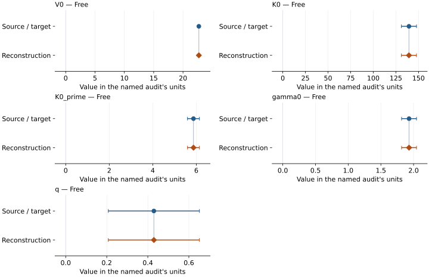

This is a **coefficient comparison**, not an observation or residual plot.
Each panel uses its coefficient's audit units and includes zero. Markers show
stored central values only. Error widths are retained in the table below;
no confidence interval or uncertainty band is inferred. Fixed/adopted values are constraints.

| Parameter | Source / target | Source error | Reconstruction | Reconstruction error | Fit role |
| --- | --- | --- | --- | --- | --- |
| V0 | 22.703126324406085 | 0.09841980257431894 | 22.703126324406085 | 0.09841980257431894 | Free |
| K0 | 139.41957474644457 | 8.365236896636842 | 139.41957474644457 | 8.365236896636842 | Free |
| K0\_prime | 5.86995978066269 | 0.27378034810130303 | 5.86995978066269 | 0.27378034810130303 | Free |
| gamma0 | 1.9305668593396799 | 0.11426240645782772 | 1.9305668593396799 | 0.11426240645782772 | Free |
| q | 0.42955380447424246 | 0.22194307545579658 | 0.42955380447424246 | 0.22194307545579658 | Free |

Values and reported errors are copied without rounding or conversion from the named audit. Missing errors mean unknown, not zero. Parameter names and volume conventions follow that audit; error widths do not imply a confidence convention.

Recorded diagnostics, covariance and additional protocol

- **Degrees of freedom:** 126
- **Solver success:** True
- **Rmse gpa:** 0.9281271723722807

### Detailed evidence and existing plots

- [Supporting source report: miozzi-2020-iron](../literature-reproductions/miozzi-2020-iron.md).
- [Record-by-record numerical ledger](../primary-eos-refits.md#records).
- [Source-audit reports](../source-audits.md).

Observation curves and residual plots are provided by the supporting reports where available. Their absence is not filled by a reconstructed curve presented as measured data.

[Machine-readable comparison ledger](https://github.com/CPrescher/peritheos/blob/main/docs/data/primary-eos-refits.json) — look up `iron_miozzi_2020_speziale_2001_bm3_mgd_refit`.
[Complete native EOSMAT file](https://github.com/CPrescher/peritheos/blob/main/peritheos/data/materials/iron.eosmat).
