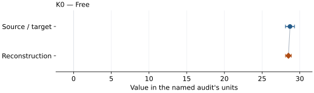
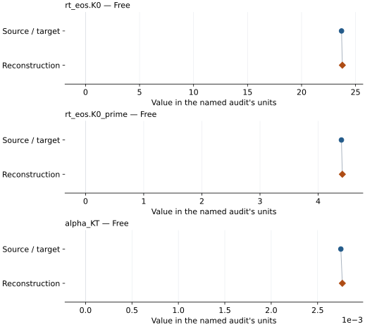
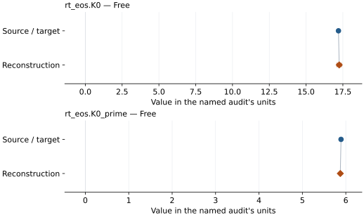
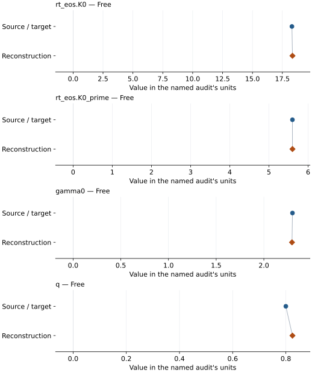
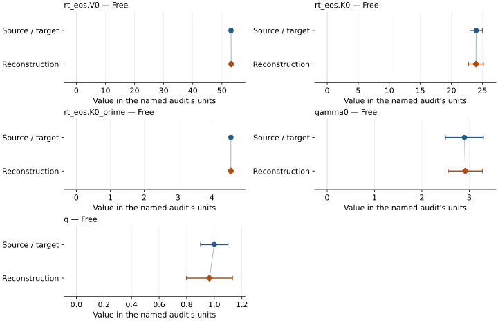
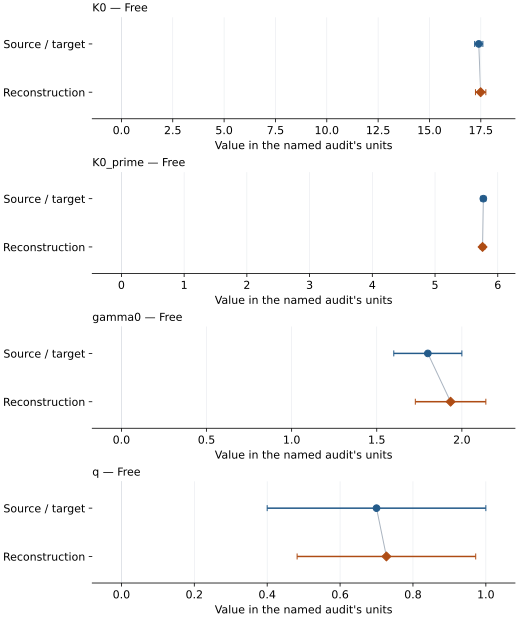
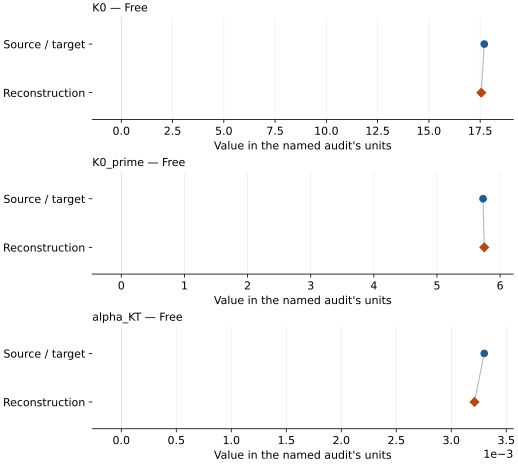
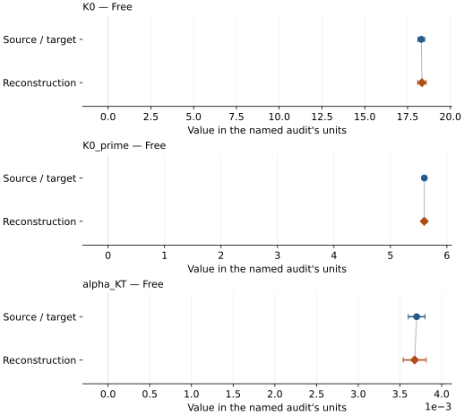
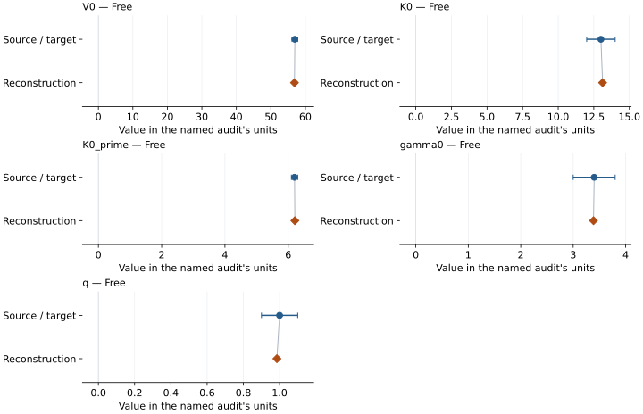
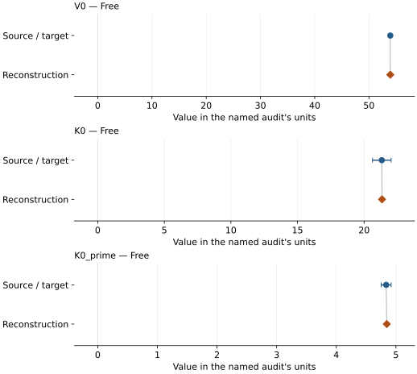

# Potassium chloride (B2): EOS reconstruction reports

<!-- Generated by scripts.generate_reconstruction_reports; edit EOSMAT instead. -->

[All reconstruction reports](index.md) · [Material and EOS parameters](../material-summaries/kcl.md)

These reports explain the assessments already stored in EOSMAT. Generating
this page does not refit observations, change classifications or replace source coefficients.

Use [scientific label definitions](../eos-labels.md) to distinguish coefficient
agreement, source verification, author-workflow reproduction and recommendation for use.

| EOS record | Recorded outcome | Coefficient comparison |
| --- | --- | --- |
| [Campbell and Heinz (1991) + Dewaele et al. (2012), B2 BM2 composite](#record-kcl_campbell_1991_bm2_1) | Coefficient parity achieved | Graph and table |
| [Walker et al. (2002), B2 thermal Birch](#record-kcl_walker_2002_bm3_2) | Numerically similar, with qualifications | Graph and table |
| [Dewaele et al. (2012), B2 P-V-T pressure calibration](#record-kcl_b2_dewaele_2012_vinet_3) | Numerically similar, with qualifications | Graph and table |
| [Tateno et al. (2019), B2 Vinet + MGD on Sokolova Pt](#record-kcl_b2_tateno_2019_vinet_4) | Coefficient parity achieved | Graph and table |
| [Chidester et al. (2021), B2 BM3 + MGD on Dorogokupets-Oganov Pt](#record-kcl_b2_chidester_2021_bm3_5) | Coefficient parity achieved | Graph and table |
| [Tateno et al. (2019), B2 Vinet + MGD on Holmes Pt](#record-kcl_b2_tateno_2019_holmes_vinet_mgd) | Numerically similar, with qualifications | Graph and table |
| [Tateno et al. (2019), B2 Vinet + linear thermal pressure on Holmes Pt](#record-kcl_b2_tateno_2019_holmes_vinet_linear_thermal) | Numerically similar, with qualifications | Graph and table |
| [Tateno et al. (2019), B2 Vinet + linear thermal pressure on Sokolova Pt](#record-kcl_b2_tateno_2019_sokolova_vinet_linear_thermal) | Numerically similar, with qualifications | Graph and table |
| [Chidester et al. (2021), B2 Vinet + MGD on Dorogokupets-Oganov Pt](#record-kcl_b2_chidester_2021_vinet_mgd) | Numerically similar, with qualifications | Graph and table |
| [Ma, Sumita and Murakami (2024), B2 primary BM3 + MGD](#record-kcl_b2_ma_2024_bm3_mgd) | Numerically similar, with qualifications | Graph and table |

## Campbell and Heinz (1991) + Dewaele et al. (2012), B2 BM2 composite

Record: `kcl_campbell_1991_bm2_1` · Model: `BM2`

**Outcome: Coefficient parity achieved.**

**Scope:** Comparison with the source parameterization.
**Comparison basis:** Every compared free coefficient meets both the recorded combined-two-sigma comparison and parameter-specific numerical similarity screen. Error conventions and fit qualifications remain applicable.

[Stored EOS coefficients and source](../material-summaries/kcl.md#record-kcl_campbell_1991_bm2_1)

### What this result establishes

**Separate source-review status:** primary\_source\_validated.
**Usage recommendation:** See the stored EOS qualifications; no recommendation is inferred here.

- This named numerical assessment alone does not establish author-workflow reproduction, physical accuracy or recommendation for use.

### Data and reconstruction method

- **Dataset identifiers:** kcl\_campbell\_1991\_table1\_compression
- **Observations:** 14
- **Fit kind:** isothermal\_pv
- **Selection:** all rows
- **Objective:** errors\_in\_variables
- **Absolute sigma:** True
- **Free parameters:** K0
- **Fixed parameters:** V0

Unspecified selections, weights, fixed values or error conventions remain unknown; they have not been inferred for this report.

### Source versus reconstruction

This is a **coefficient comparison**, not an observation or residual plot.
Each panel uses its coefficient's audit units and includes zero. Markers show
stored central values only. Error widths are retained in the table below;
no confidence interval or uncertainty band is inferred. Fixed/adopted values are constraints.

| Parameter | Source / target | Source error | Reconstruction | Reconstruction error | Fit role |
| --- | --- | --- | --- | --- | --- |
| K0 | 28.7 | 0.6 | 28.49539593040696 | 0.38721809130151125 | Free |

Values and reported errors are copied without rounding or conversion from the named audit. Missing errors mean unknown, not zero. Parameter names and volume conventions follow that audit; error widths do not imply a confidence convention.

Recorded diagnostics, covariance and additional protocol

- **Columns:**
    - **Pressure:** pressure\_gpa
    - **Temperature:** Not specified
    - **Volume:** normalized\_volume
- **Observed pressure range gpa:** \[2.26, 55.8\]
- **Observed temperature range k:** Not specified
- **Observed volume range:** \[29.776899999999998, 49.195804\]
- **Degrees of freedom:** 13
- **Solver success:** True
- **Solver message:** Both \`ftol\` and \`xtol\` termination conditions are satisfied.
- **Rmse gpa:** 1.4241782847617535
- **Published rmse gpa:** 1.5436731689425238
- **Reduced chi square:** 1.834900744397524

### Detailed evidence and existing plots

- [Record-by-record numerical ledger](../primary-eos-refits.md#records).
- [Source-audit reports](../source-audits.md).

Observation curves and residual plots are provided by the supporting reports where available. Their absence is not filled by a reconstructed curve presented as measured data.

[Machine-readable comparison ledger](https://github.com/CPrescher/peritheos/blob/main/docs/data/primary-eos-refits.json) — look up `kcl_campbell_1991_bm2_1`.
[Complete native EOSMAT file](https://github.com/CPrescher/peritheos/blob/main/peritheos/data/materials/kcl.eosmat).

## Walker et al. (2002), B2 thermal Birch

Record: `kcl_walker_2002_bm3_2` · Model: `BM3`

**Outcome: Numerically similar, with qualifications.**

**Scope:** Comparison with the source parameterization.
**Comparison basis:** Every compared free coefficient meets either the recorded combined-two-sigma comparison or parameter-specific numerical similarity screen; the audit does not classify the complete comparison as parity.

[Stored EOS coefficients and source](../material-summaries/kcl.md#record-kcl_walker_2002_bm3_2)

### What this result establishes

**Separate source-review status:** primary\_source\_validated.
**Usage recommendation:** See the stored EOS qualifications; no recommendation is inferred here.

- Source-protocol reproduction: the preferred bold Table 3 result is staged, not a simultaneous four-parameter fit. V0 is held at the published fictive reference, K0 and K0' are fitted to the eight 23-24 degC rows, and alpha\_KT is then fitted to all 39 P-V-T rows.
- This named numerical assessment alone does not establish author-workflow reproduction, physical accuracy or recommendation for use.

### Data and reconstruction method

- **Dataset identifiers:** kcl\_walker\_2002\_table2\_pvt
- **Observations:** 39
- **Fit kind:** staged\_reference\_isotherm\_then\_thermal\_pressure
- **Selection:** eight 23-24 degC rows for K0 and K0'; all 39 rows for alpha\_KT
- **Objective:** unweighted pressure residuals in two source-stated stages
- **Absolute sigma:** False
- **Free parameters:** rt\_eos.K0; rt\_eos.K0\_prime; alpha\_KT
- **Fixed parameters:** V0; Tr

Unspecified selections, weights, fixed values or error conventions remain unknown; they have not been inferred for this report.

### Source versus reconstruction

This is a **coefficient comparison**, not an observation or residual plot.
Each panel uses its coefficient's audit units and includes zero. Markers show
stored central values only. Error widths are retained in the table below;
no confidence interval or uncertainty band is inferred. Fixed/adopted values are constraints.

| Parameter | Source / target | Source error | Reconstruction | Reconstruction error | Fit role |
| --- | --- | --- | --- | --- | --- |
| rt\_eos.K0 | 23.7 | Not specified | 23.775397840489667 | 0.2594338360674082 | Free |
| rt\_eos.K0\_prime | 4.4 | Not specified | 4.4158737620085144 | 0.11471257449556843 | Free |
| alpha\_KT | 0.00275 | 9e-05 | 0.00276624568787038 | 5.184245631446523e-05 | Free |

Values and reported errors are copied without rounding or conversion from the named audit. Missing errors mean unknown, not zero. Parameter names and volume conventions follow that audit; error widths do not imply a confidence convention.

Recorded diagnostics, covariance and additional protocol

- **Columns:**
    - **Pressure:** pressure\_kbar
    - **Temperature:** temperature\_celsius
    - **Volume:** b2\_kcl\_cell\_volume\_a3
- **Observed pressure range gpa:** \[3.18, 8.14\]
- **Observed temperature range k:** \[296.15, 873.15\]
- **Observed volume range:** \[43.25, 50.51\]
- **Degrees of freedom:** 38
- **Solver success:** True
- **Solver message:** room-temperature BM3 and thermal-pressure stages completed
- **Rmse gpa:** 0.10347680223255967
- **Published rmse gpa:** 0.10458131660623424
- **Reduced chi square:** Not specified
- **Stages:**
    - **Fixed parameters:**
        - **V0:** 53.53
    - **Free parameters:** K0; K0\_prime
    - **Name:** reference\_isotherm
    - **Observations:** 8
    - **Parameters:**
        - **K0:** 23.775397840489667
        - **K0 prime:** 4.4158737620085144
    - **Rmse gpa:** 0.026107390261322076
    - **Temperature range k:** \[296.15, 297.15\]
    - **Fixed parameters:**
        - **K0:** 23.775397840489667
        - **K0 prime:** 4.4158737620085144
        - **V0:** 53.53
    - **Free parameters:** alpha\_KT
    - **Name:** thermal\_pressure
    - **Observations:** 39
    - **Parameters:**
        - **Alpha kt:** 0.00276624568787038
    - **Rmse gpa:** 0.10347680223255967

### Detailed evidence and existing plots

- [Earlier detailed record investigation](../primary-eos-refits.md#investigation-kcl_walker_2002_bm3_2).
- [Supporting source report: walker-2002-kcl](../literature-reproductions/walker-2002-kcl.md).
- [Record-by-record numerical ledger](../primary-eos-refits.md#records).
- [Source-audit reports](../source-audits.md).

Observation curves and residual plots are provided by the supporting reports where available. Their absence is not filled by a reconstructed curve presented as measured data.

[Machine-readable comparison ledger](https://github.com/CPrescher/peritheos/blob/main/docs/data/primary-eos-refits.json) — look up `kcl_walker_2002_bm3_2`.
[Complete native EOSMAT file](https://github.com/CPrescher/peritheos/blob/main/peritheos/data/materials/kcl.eosmat).

## Dewaele et al. (2012), B2 P-V-T pressure calibration

Record: `kcl_b2_dewaele_2012_vinet_3` · Model: `Vinet`

**Outcome: Numerically similar, with qualifications.**

**Scope:** Comparison with the source parameterization.
**Comparison basis:** Every compared free coefficient meets either the recorded combined-two-sigma comparison or parameter-specific numerical similarity screen; the audit does not classify the complete comparison as parity.

[Stored EOS coefficients and source](../material-summaries/kcl.md#record-kcl_b2_dewaele_2012_vinet_3)

### What this result establishes

**Separate source-review status:** primary\_source\_validated.
**Usage recommendation:** See the stored EOS qualifications; no recommendation is inferred here.

- This named numerical assessment alone does not establish author-workflow reproduction, physical accuracy or recommendation for use.

### Data and reconstruction method

- **Dataset identifiers:** kcl\_dewaele\_2012\_table1\_compression
- **Observations:** 123
- **Fit kind:** reference\_isotherm\_pv
- **Selection:** all rows
- **Objective:** pressure\_residuals
- **Absolute sigma:** True
- **Free parameters:** rt\_eos.K0; rt\_eos.K0\_prime
- **Fixed parameters:** V0; Tr

Unspecified selections, weights, fixed values or error conventions remain unknown; they have not been inferred for this report.

### Source versus reconstruction

This is a **coefficient comparison**, not an observation or residual plot.
Each panel uses its coefficient's audit units and includes zero. Markers show
stored central values only. Error widths are retained in the table below;
no confidence interval or uncertainty band is inferred. Fixed/adopted values are constraints.

| Parameter | Source / target | Source error | Reconstruction | Reconstruction error | Fit role |
| --- | --- | --- | --- | --- | --- |
| rt\_eos.K0 | 17.2 | Not specified | 17.249903560755182 | 0.14994843730718277 | Free |
| rt\_eos.K0\_prime | 5.89 | Not specified | 5.873103091636448 | 0.025474706881676697 | Free |

Values and reported errors are copied without rounding or conversion from the named audit. Missing errors mean unknown, not zero. Parameter names and volume conventions follow that audit; error widths do not imply a confidence convention.

Recorded diagnostics, covariance and additional protocol

- **Columns:**
    - **Pressure:** pressure\_gpa
    - **Temperature:** Not specified
    - **Volume:** volume\_a3\_per\_formula\_unit
- **Observed pressure range gpa:** \[2.56, 165.0\]
- **Observed temperature range k:** Not specified
- **Observed volume range:** \[22.065, 48.991\]
- **Degrees of freedom:** 121
- **Solver success:** True
- **Solver message:** \`ftol\` termination condition is satisfied.
- **Rmse gpa:** 0.8002532759167131
- **Published rmse gpa:** 0.819343989985368
- **Reduced chi square:** 0.6509905172784961

### Detailed evidence and existing plots

- [Earlier detailed record investigation](../primary-eos-refits.md#investigation-kcl_b2_dewaele_2012_vinet_3).
- [Record-by-record numerical ledger](../primary-eos-refits.md#records).
- [Source-audit reports](../source-audits.md).

Observation curves and residual plots are provided by the supporting reports where available. Their absence is not filled by a reconstructed curve presented as measured data.

[Machine-readable comparison ledger](https://github.com/CPrescher/peritheos/blob/main/docs/data/primary-eos-refits.json) — look up `kcl_b2_dewaele_2012_vinet_3`.
[Complete native EOSMAT file](https://github.com/CPrescher/peritheos/blob/main/peritheos/data/materials/kcl.eosmat).

## Tateno et al. (2019), B2 Vinet + MGD on Sokolova Pt

Record: `kcl_b2_tateno_2019_vinet_4` · Model: `Vinet`

**Outcome: Coefficient parity achieved.**

**Scope:** Comparison with the source parameterization.
**Comparison basis:** Every compared free coefficient meets both the recorded combined-two-sigma comparison and parameter-specific numerical similarity screen. Error conventions and fit qualifications remain applicable.

[Stored EOS coefficients and source](../material-summaries/kcl.md#record-kcl_b2_tateno_2019_vinet_4)

### What this result establishes

**Separate source-review status:** primary\_source\_validated.
**Usage recommendation:** See the stored EOS qualifications; no recommendation is inferred here.

- Corrected final-publication reproduction: the model uses the final gamma0=2.3 and q=0.8 coefficients, Equation 6's integrated-Gruneisen Debye law, and the correctly aligned official MSA Supplemental Table S1 workbook. See the \[dedicated Tateno reproduction\](literature-reproductions.md#kcl-tateno-2019).
- This named numerical assessment alone does not establish author-workflow reproduction, physical accuracy or recommendation for use.

### Data and reconstruction method

- **Dataset identifiers:** kcl\_tateno\_2019\_table\_s1\_pvt
- **Observations:** 39
- **Fit kind:** joint\_pvt
- **Selection:** all rows
- **Objective:** errors\_in\_variables
- **Absolute sigma:** True
- **Free parameters:** rt\_eos.K0; rt\_eos.K0\_prime; gamma0; q
- **Fixed parameters:** V0; Tr; theta0; n

Unspecified selections, weights, fixed values or error conventions remain unknown; they have not been inferred for this report.

### Source versus reconstruction

This is a **coefficient comparison**, not an observation or residual plot.
Each panel uses its coefficient's audit units and includes zero. Markers show
stored central values only. Error widths are retained in the table below;
no confidence interval or uncertainty band is inferred. Fixed/adopted values are constraints.

| Parameter | Source / target | Source error | Reconstruction | Reconstruction error | Fit role |
| --- | --- | --- | --- | --- | --- |
| rt\_eos.K0 | 18.3 | 0.3 | 18.34461638028911 | 0.36185145978054917 | Free |
| rt\_eos.K0\_prime | 5.6 | 0.03 | 5.6009551497183585 | 0.049193900034497126 | Free |
| gamma0 | 2.3 | 0.2 | 2.295185312787994 | 0.27799056486180646 | Free |
| q | 0.8 | 0.2 | 0.8248998436098376 | 0.28286530680347605 | Free |

Values and reported errors are copied without rounding or conversion from the named audit. Missing errors mean unknown, not zero. Parameter names and volume conventions follow that audit; error widths do not imply a confidence convention.

Recorded diagnostics, covariance and additional protocol

- **Columns:**
    - **Pressure:** pressure\_gpa
    - **Temperature:** temperature\_k
    - **Volume:** kcl\_unit\_cell\_volume\_a3
- **Observed pressure range gpa:** \[4.2, 228.6\]
- **Observed temperature range k:** \[300.0, 2560.0\]
- **Observed volume range:** \[19.6761, 47.4154\]
- **Degrees of freedom:** 35
- **Solver success:** True
- **Solver message:** \`ftol\` termination condition is satisfied.
- **Rmse gpa:** 0.5693967177861335
- **Published rmse gpa:** 0.7262295725671338
- **Reduced chi square:** 0.43053705237641693

### Detailed evidence and existing plots

- [Record-by-record numerical ledger](../primary-eos-refits.md#records).
- [Source-audit reports](../source-audits.md).

Observation curves and residual plots are provided by the supporting reports where available. Their absence is not filled by a reconstructed curve presented as measured data.

[Machine-readable comparison ledger](https://github.com/CPrescher/peritheos/blob/main/docs/data/primary-eos-refits.json) — look up `kcl_b2_tateno_2019_vinet_4`.
[Complete native EOSMAT file](https://github.com/CPrescher/peritheos/blob/main/peritheos/data/materials/kcl.eosmat).

## Chidester et al. (2021), B2 BM3 + MGD on Dorogokupets-Oganov Pt

Record: `kcl_b2_chidester_2021_bm3_5` · Model: `BM3`

**Outcome: Coefficient parity achieved.**

**Scope:** Comparison with the source parameterization.
**Comparison basis:** Every compared free coefficient meets both the recorded combined-two-sigma comparison and parameter-specific numerical similarity screen. Error conventions and fit qualifications remain applicable.

[Stored EOS coefficients and source](../material-summaries/kcl.md#record-kcl_b2_chidester_2021_bm3_5)

### What this result establishes

**Separate source-review status:** primary\_source\_validated.
**Usage recommendation:** See the stored EOS qualifications; no recommendation is inferred here.

- Corrected source-scope reproduction: Chidester et al. fitted the 155 new high-temperature rows simultaneously with all 123 Dewaele et al. (2012) room-temperature B2 rows. The unweighted 278-row fit uses the thermodynamically integrated Gruneisen Debye-temperature law and recovers every published coefficient. See the \[dedicated Chidester reproduction\](literature-reproductions.md#kcl-chidester-2021).
- This named numerical assessment alone does not establish author-workflow reproduction, physical accuracy or recommendation for use.

### Data and reconstruction method

- **Dataset identifiers:** kcl\_dewaele\_2012\_table1\_compression; kcl\_chidester\_2021\_supplemental\_pvt
- **Observations:** 278
- **Fit kind:** joint\_pvt
- **Selection:** all 123 Dewaele 300 K rows and all 155 Chidester high-temperature rows
- **Objective:** pressure\_residuals
- **Absolute sigma:** False
- **Free parameters:** rt\_eos.V0; rt\_eos.K0; rt\_eos.K0\_prime; gamma0; q
- **Fixed parameters:** Tr; theta0; n

Unspecified selections, weights, fixed values or error conventions remain unknown; they have not been inferred for this report.

### Source versus reconstruction

This is a **coefficient comparison**, not an observation or residual plot.
Each panel uses its coefficient's audit units and includes zero. Markers show
stored central values only. Error widths are retained in the table below;
no confidence interval or uncertainty band is inferred. Fixed/adopted values are constraints.

| Parameter | Source / target | Source error | Reconstruction | Reconstruction error | Fit role |
| --- | --- | --- | --- | --- | --- |
| rt\_eos.V0 | 53.137250149563094 | 0.49816172015215404 | 53.20355249262952 | 0.47516564279861895 | Free |
| rt\_eos.K0 | 24.0 | 1.0 | 23.972142172881814 | 1.1960993650127787 | Free |
| rt\_eos.K0\_prime | 4.56 | 0.05 | 4.557980648641743 | 0.0469438086482736 | Free |
| gamma0 | 2.9 | 0.4 | 2.917136983191836 | 0.3601354227330655 | Free |
| q | 1.0 | 0.1 | 0.9652425440962868 | 0.16750530637726924 | Free |

Values and reported errors are copied without rounding or conversion from the named audit. Missing errors mean unknown, not zero. Parameter names and volume conventions follow that audit; error widths do not imply a confidence convention.

Recorded diagnostics, covariance and additional protocol

- **Columns:**
    - **Pressure:** pressure\_gpa + pt\_derived\_pressure\_gpa
    - **Temperature:** 300 K assigned + kcl\_temperature\_k
    - **Volume:** volume\_a3\_per\_formula\_unit + kcl\_molar\_volume\_cm3\_mol
- **Observed pressure range gpa:** \[2.56, 167.5198165\]
- **Observed temperature range k:** \[300.0, 2377.0\]
- **Observed volume range:** \[22.065, 48.991\]
- **Degrees of freedom:** 273
- **Solver success:** True
- **Solver message:** \`ftol\` termination condition is satisfied.
- **Rmse gpa:** 1.262783718301505
- **Published rmse gpa:** 1.302580446229172
- **Reduced chi square:** 1.6238282635152022

### Detailed evidence and existing plots

- [Record-by-record numerical ledger](../primary-eos-refits.md#records).
- [Source-audit reports](../source-audits.md).

Observation curves and residual plots are provided by the supporting reports where available. Their absence is not filled by a reconstructed curve presented as measured data.

[Machine-readable comparison ledger](https://github.com/CPrescher/peritheos/blob/main/docs/data/primary-eos-refits.json) — look up `kcl_b2_chidester_2021_bm3_5`.
[Complete native EOSMAT file](https://github.com/CPrescher/peritheos/blob/main/peritheos/data/materials/kcl.eosmat).

## Tateno et al. (2019), B2 Vinet + MGD on Holmes Pt

Record: `kcl_b2_tateno_2019_holmes_vinet_mgd` · Model: `Vinet`

**Outcome: Numerically similar, with qualifications.**

**Scope:** Comparison with the source parameterization.
**Comparison basis:** Every compared free coefficient meets either the recorded combined-two-sigma comparison or parameter-specific numerical similarity screen; the audit does not classify the complete comparison as parity.

[Stored EOS coefficients and source](../material-summaries/kcl.md#record-kcl_b2_tateno_2019_holmes_vinet_mgd)

### What this result establishes

**Separate source-review status:** primary\_source\_validated.
**Usage recommendation:** See the stored EOS qualifications; no recommendation is inferred here.

- Equal pressure weights; covariance and original objective details unavailable. Holmes-coordinate results are conditional: exact author rounding/thermal reduction is unspecified and Holmes's approximation is stated for T&lt;2000 K. No pressure-coordinate or statistical parity claimed; source parameter errors are widths of unknown confidence. Published coefficients remain unchanged.
- This named numerical assessment alone does not establish author-workflow reproduction, physical accuracy or recommendation for use.

### Data and reconstruction method

- **Dataset identifiers:** kcl\_tateno\_2019\_official\_table\_s1
- **Observations:** 39
- **Fit kind:** independent\_primary\_equation\_pressure\_fit
- **Selection:** all 39 correctly paired official Table S1 rows; no exclusions
- **Objective:** equal pressure weights
- **Free parameters:** K0; K0\_prime; gamma0; q
- **Fixed parameters:** V0; Tr; theta0; n

Unspecified selections, weights, fixed values or error conventions remain unknown; they have not been inferred for this report.

### Source versus reconstruction

This is a **coefficient comparison**, not an observation or residual plot.
Each panel uses its coefficient's audit units and includes zero. Markers show
stored central values only. Error widths are retained in the table below;
no confidence interval or uncertainty band is inferred. Fixed/adopted values are constraints.

| Parameter | Source / target | Source error | Reconstruction | Reconstruction error | Fit role |
| --- | --- | --- | --- | --- | --- |
| K0 | 17.4 | 0.2 | 17.492509471923285 | Not specified | Free |
| K0\_prime | 5.77 | 0.04 | 5.757586933659126 | Not specified | Free |
| gamma0 | 1.8 | 0.2 | 1.93368411891194 | Not specified | Free |
| q | 0.7 | 0.3 | 0.7271591265912735 | Not specified | Free |

Values and reported errors are copied without rounding or conversion from the named audit. Missing errors mean unknown, not zero. Parameter names and volume conventions follow that audit; error widths do not imply a confidence convention.

Recorded diagnostics, covariance and additional protocol

- **Solver success:** True
- **Rmse gpa:** 0.7329733701901231
- **Published rmse gpa:** 0.7767807095678241

### Detailed evidence and existing plots

- [Earlier detailed record investigation](../primary-eos-refits.md#investigation-kcl_b2_tateno_2019_holmes_vinet_mgd).
- [Record-by-record numerical ledger](../primary-eos-refits.md#records).
- [Source-audit reports](../source-audits.md).

Observation curves and residual plots are provided by the supporting reports where available. Their absence is not filled by a reconstructed curve presented as measured data.

[Machine-readable comparison ledger](https://github.com/CPrescher/peritheos/blob/main/docs/data/primary-eos-refits.json) — look up `kcl_b2_tateno_2019_holmes_vinet_mgd`.
[Complete native EOSMAT file](https://github.com/CPrescher/peritheos/blob/main/peritheos/data/materials/kcl.eosmat).

## Tateno et al. (2019), B2 Vinet + linear thermal pressure on Holmes Pt

Record: `kcl_b2_tateno_2019_holmes_vinet_linear_thermal` · Model: `Vinet`

**Outcome: Numerically similar, with qualifications.**

**Scope:** Comparison with the source parameterization.
**Comparison basis:** Every compared free coefficient meets either the recorded combined-two-sigma comparison or parameter-specific numerical similarity screen; the audit does not classify the complete comparison as parity.

[Stored EOS coefficients and source](../material-summaries/kcl.md#record-kcl_b2_tateno_2019_holmes_vinet_linear_thermal)

### What this result establishes

**Separate source-review status:** primary\_source\_validated.
**Usage recommendation:** See the stored EOS qualifications; no recommendation is inferred here.

- Equal pressure weights; covariance and original objective details unavailable. Holmes-coordinate results are conditional: exact author rounding/thermal reduction is unspecified and Holmes's approximation is stated for T&lt;2000 K. No pressure-coordinate or statistical parity claimed; source parameter errors are widths of unknown confidence. Published coefficients remain unchanged.
- This named numerical assessment alone does not establish author-workflow reproduction, physical accuracy or recommendation for use.

### Data and reconstruction method

- **Dataset identifiers:** kcl\_tateno\_2019\_official\_table\_s1
- **Observations:** 39
- **Fit kind:** independent\_primary\_equation\_pressure\_fit
- **Selection:** all 39 correctly paired official Table S1 rows; no exclusions
- **Objective:** equal pressure weights
- **Free parameters:** K0; K0\_prime; alpha\_KT
- **Fixed parameters:** V0; Tr

Unspecified selections, weights, fixed values or error conventions remain unknown; they have not been inferred for this report.

### Source versus reconstruction

This is a **coefficient comparison**, not an observation or residual plot.
Each panel uses its coefficient's audit units and includes zero. Markers show
stored central values only. Error widths are retained in the table below;
no confidence interval or uncertainty band is inferred. Fixed/adopted values are constraints.

| Parameter | Source / target | Source error | Reconstruction | Reconstruction error | Fit role |
| --- | --- | --- | --- | --- | --- |
| K0 | 17.7 | 0.3 | 17.554928390334098 | Not specified | Free |
| K0\_prime | 5.73 | 0.04 | 5.749003323377288 | Not specified | Free |
| alpha\_KT | 0.0033 | 0.0002 | 0.0032110148631012392 | Not specified | Free |

Values and reported errors are copied without rounding or conversion from the named audit. Missing errors mean unknown, not zero. Parameter names and volume conventions follow that audit; error widths do not imply a confidence convention.

Recorded diagnostics, covariance and additional protocol

- **Solver success:** True
- **Rmse gpa:** 0.7420058024099482
- **Published rmse gpa:** 0.7660035003577548

### Detailed evidence and existing plots

- [Earlier detailed record investigation](../primary-eos-refits.md#investigation-kcl_b2_tateno_2019_holmes_vinet_linear_thermal).
- [Record-by-record numerical ledger](../primary-eos-refits.md#records).
- [Source-audit reports](../source-audits.md).

Observation curves and residual plots are provided by the supporting reports where available. Their absence is not filled by a reconstructed curve presented as measured data.

[Machine-readable comparison ledger](https://github.com/CPrescher/peritheos/blob/main/docs/data/primary-eos-refits.json) — look up `kcl_b2_tateno_2019_holmes_vinet_linear_thermal`.
[Complete native EOSMAT file](https://github.com/CPrescher/peritheos/blob/main/peritheos/data/materials/kcl.eosmat).

## Tateno et al. (2019), B2 Vinet + linear thermal pressure on Sokolova Pt

Record: `kcl_b2_tateno_2019_sokolova_vinet_linear_thermal` · Model: `Vinet`

**Outcome: Numerically similar, with qualifications.**

**Scope:** Comparison with the source parameterization.
**Comparison basis:** Every compared free coefficient meets either the recorded combined-two-sigma comparison or parameter-specific numerical similarity screen; the audit does not classify the complete comparison as parity.

[Stored EOS coefficients and source](../material-summaries/kcl.md#record-kcl_b2_tateno_2019_sokolova_vinet_linear_thermal)

### What this result establishes

**Separate source-review status:** primary\_source\_validated.
**Usage recommendation:** See the stored EOS qualifications; no recommendation is inferred here.

- All 39 author-reported Sokolova-pressure observations. Equal pressure weights; covariance and original objective details unavailable. Coefficients agree within printed error widths of unknown confidence; no statistical parity claimed. Published coefficients remain unchanged.
- This named numerical assessment alone does not establish author-workflow reproduction, physical accuracy or recommendation for use.

### Data and reconstruction method

- **Dataset identifiers:** kcl\_tateno\_2019\_official\_table\_s1
- **Observations:** 39
- **Fit kind:** independent\_primary\_equation\_pressure\_fit
- **Selection:** all 39 correctly paired official Table S1 rows; no exclusions
- **Objective:** equal pressure weights
- **Free parameters:** K0; K0\_prime; alpha\_KT
- **Fixed parameters:** V0; Tr

Unspecified selections, weights, fixed values or error conventions remain unknown; they have not been inferred for this report.

### Source versus reconstruction

This is a **coefficient comparison**, not an observation or residual plot.
Each panel uses its coefficient's audit units and includes zero. Markers show
stored central values only. Error widths are retained in the table below;
no confidence interval or uncertainty band is inferred. Fixed/adopted values are constraints.

| Parameter | Source / target | Source error | Reconstruction | Reconstruction error | Fit role |
| --- | --- | --- | --- | --- | --- |
| K0 | 18.3 | 0.2 | 18.338636288275783 | Not specified | Free |
| K0\_prime | 5.6 | 0.03 | 5.5988178573924685 | Not specified | Free |
| alpha\_KT | 0.0037 | 0.0001 | 0.0036762573045795253 | Not specified | Free |

Values and reported errors are copied without rounding or conversion from the named audit. Missing errors mean unknown, not zero. Parameter names and volume conventions follow that audit; error widths do not imply a confidence convention.

Recorded diagnostics, covariance and additional protocol

- **Solver success:** True
- **Rmse gpa:** 0.7198692268373714
- **Published rmse gpa:** 0.7332862352372231

### Detailed evidence and existing plots

- [Earlier detailed record investigation](../primary-eos-refits.md#investigation-kcl_b2_tateno_2019_sokolova_vinet_linear_thermal).
- [Record-by-record numerical ledger](../primary-eos-refits.md#records).
- [Source-audit reports](../source-audits.md).

Observation curves and residual plots are provided by the supporting reports where available. Their absence is not filled by a reconstructed curve presented as measured data.

[Machine-readable comparison ledger](https://github.com/CPrescher/peritheos/blob/main/docs/data/primary-eos-refits.json) — look up `kcl_b2_tateno_2019_sokolova_vinet_linear_thermal`.
[Complete native EOSMAT file](https://github.com/CPrescher/peritheos/blob/main/peritheos/data/materials/kcl.eosmat).

## Chidester et al. (2021), B2 Vinet + MGD on Dorogokupets-Oganov Pt

Record: `kcl_b2_chidester_2021_vinet_mgd` · Model: `Vinet`

**Outcome: Numerically similar, with qualifications.**

**Scope:** Comparison with the source parameterization.
**Comparison basis:** Every compared free coefficient meets either the recorded combined-two-sigma comparison or parameter-specific numerical similarity screen; the audit does not classify the complete comparison as parity.

[Stored EOS coefficients and source](../material-summaries/kcl.md#record-kcl_b2_chidester_2021_vinet_mgd)

### What this result establishes

**Separate source-review status:** primary\_source\_validated.
**Usage recommendation:** See the stored EOS qualifications; no recommendation is inferred here.

- All five Table I coefficients are fitted, including q. Fixed theta0=235 K, Tr=300 K and n=2. Equal pressure weights; no original covariance or explicit row weights. Integrated-Gruneisen theta law is inferred by complete-data numerical reproduction; Equations 3-4 do not explicitly define theta(V). Dewaele 298 K measurements enter the source regression as its 300 K reference, preserving raw temperature provenance. High-temperature KCl temperatures are geometry-conditioned modeled effective temperatures. Cold ruby and high-T Pt calibration ancestry remain distinct.
- This named numerical assessment alone does not establish author-workflow reproduction, physical accuracy or recommendation for use.

### Data and reconstruction method

- **Dataset identifiers:** kcl\_dewaele\_2012\_table1\_compression; kcl\_chidester\_2021\_supplemental\_pvt
- **Observations:** 278
- **Fit kind:** independent\_primary\_equation\_pressure\_fit
- **Selection:** all 123 Dewaele room-temperature rows as 300 K source reference plus all 155 Chidester effective-temperature rows
- **Objective:** equal pressure weights
- **Free parameters:** V0; K0; K0\_prime; gamma0; q
- **Fixed parameters:** Tr; theta0; n

Unspecified selections, weights, fixed values or error conventions remain unknown; they have not been inferred for this report.

### Source versus reconstruction

This is a **coefficient comparison**, not an observation or residual plot.
Each panel uses its coefficient's audit units and includes zero. Markers show
stored central values only. Error widths are retained in the table below;
no confidence interval or uncertainty band is inferred. Fixed/adopted values are constraints.

| Parameter | Source / target | Source error | Reconstruction | Reconstruction error | Fit role |
| --- | --- | --- | --- | --- | --- |
| V0 | 56.956490004062935 | 0.8302695335869233 | 56.84322297072302 | Not specified | Free |
| K0 | 13.0 | 1.0 | 13.118956468473124 | Not specified | Free |
| K0\_prime | 6.2 | 0.1 | 6.209818047627718 | Not specified | Free |
| gamma0 | 3.4 | 0.4 | 3.38729525853543 | Not specified | Free |
| q | 1.0 | 0.1 | 0.9850809742161145 | Not specified | Free |

Values and reported errors are copied without rounding or conversion from the named audit. Missing errors mean unknown, not zero. Parameter names and volume conventions follow that audit; error widths do not imply a confidence convention.

Recorded diagnostics, covariance and additional protocol

- **Solver success:** True
- **Rmse gpa:** 1.2516022922765186
- **Published rmse gpa:** 1.3562798619878813

### Detailed evidence and existing plots

- [Earlier detailed record investigation](../primary-eos-refits.md#investigation-kcl_b2_chidester_2021_vinet_mgd).
- [Record-by-record numerical ledger](../primary-eos-refits.md#records).
- [Source-audit reports](../source-audits.md).

Observation curves and residual plots are provided by the supporting reports where available. Their absence is not filled by a reconstructed curve presented as measured data.

[Machine-readable comparison ledger](https://github.com/CPrescher/peritheos/blob/main/docs/data/primary-eos-refits.json) — look up `kcl_b2_chidester_2021_vinet_mgd`.
[Complete native EOSMAT file](https://github.com/CPrescher/peritheos/blob/main/peritheos/data/materials/kcl.eosmat).

## Ma, Sumita and Murakami (2024), B2 primary BM3 + MGD

Record: `kcl_b2_ma_2024_bm3_mgd` · Model: `BM3`

**Outcome: Numerically similar, with qualifications.**

**Scope:** Comparison with the source parameterization.
**Comparison basis:** Every compared free coefficient meets either the recorded combined-two-sigma comparison or parameter-specific numerical similarity screen; the audit does not classify the complete comparison as parity.

[Stored EOS coefficients and source](../material-summaries/kcl.md#record-kcl_b2_ma_2024_bm3_mgd)

### What this result establishes

**Separate source-review status:** primary\_source\_validated.
**Usage recommendation:** See the stored EOS qualifications; no recommendation is inferred here.

- All three BM3 coefficients lie within their published error widths, but unknown source weights/error confidence/covariance prevent strict statistical parity. Gamma0/theta0 receive a separate Eq 13 acoustic diagnostic; high-temperature use is modeled. Run-normalized upstream Walker recalibration is reproduced within printed-input precision; the exact algorithm and uncertainty propagation remain unverified. See the \[Ma audit\](literature-reproductions/ma-2024-kcl.md).
- This named numerical assessment alone does not establish author-workflow reproduction, physical accuracy or recommendation for use.

### Data and reconstruction method

- **Dataset identifiers:** kcl\_ma\_2024\_acoustic; kcl\_ma\_2024\_walker
- **Observations:** 19
- **Fit kind:** joint\_acoustic\_kt\_volume\_and\_recalibrated\_walker\_pv
- **Selection:** 11 measured acoustic-volume rows reduced to KT plus eight Matsui-2012-recalibrated Walker-2002 300 K P-V rows; S1 modeled pressures and S3-S4 grids excluded from all fits.
- **Objective:** KT and pressure residuals divided by deposited row error widths; all 19 rows, V0/K0/K0\_prime free
- **Absolute sigma:** False
- **Free parameters:** V0; K0; K0\_prime
- **Fixed parameters:** Tr; q; n

Unspecified selections, weights, fixed values or error conventions remain unknown; they have not been inferred for this report.

### Source versus reconstruction

This is a **coefficient comparison**, not an observation or residual plot.
Each panel uses its coefficient's audit units and includes zero. Markers show
stored central values only. Error widths are retained in the table below;
no confidence interval or uncertainty band is inferred. Fixed/adopted values are constraints.

| Parameter | Source / target | Source error | Reconstruction | Reconstruction error | Fit role |
| --- | --- | --- | --- | --- | --- |
| V0 | 53.93430890180654 | 0.14944851604564618 | 53.93326879574039 | Not specified | Free |
| K0 | 21.33 | 0.7 | 21.348727595446597 | Not specified | Free |
| K0\_prime | 4.836 | 0.083 | 4.846212436598056 | Not specified | Free |

Values and reported errors are copied without rounding or conversion from the named audit. Missing errors mean unknown, not zero. Parameter names and volume conventions follow that audit; error widths do not imply a confidence convention.

Recorded diagnostics, covariance and additional protocol

- **Solver success:** True
- **Solver message:** dedicated Ma acoustic/Walker diagnostic completed
- **Rmse gpa:** 0.028929592032841005

### Detailed evidence and existing plots

- [Earlier detailed record investigation](../primary-eos-refits.md#investigation-kcl_b2_ma_2024_bm3_mgd).
- [Supporting source report: ma-2024-kcl](../literature-reproductions/ma-2024-kcl.md).
- [Record-by-record numerical ledger](../primary-eos-refits.md#records).
- [Source-audit reports](../source-audits.md).

Observation curves and residual plots are provided by the supporting reports where available. Their absence is not filled by a reconstructed curve presented as measured data.

[Machine-readable comparison ledger](https://github.com/CPrescher/peritheos/blob/main/docs/data/primary-eos-refits.json) — look up `kcl_b2_ma_2024_bm3_mgd`.
[Complete native EOSMAT file](https://github.com/CPrescher/peritheos/blob/main/peritheos/data/materials/kcl.eosmat).
