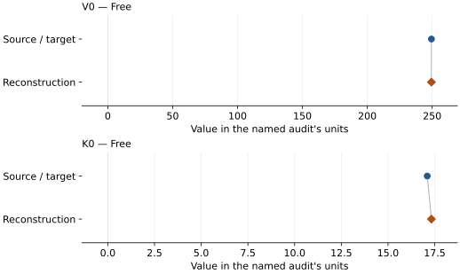
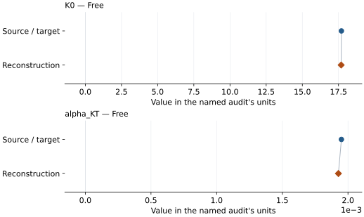

# Potassium chloride (B1): EOS reconstruction reports

<!-- Generated by scripts.generate_reconstruction_reports; edit EOSMAT instead. -->

[All reconstruction reports](index.md) · [Material and EOS parameters](../material-summaries/kcl_b1.md)

These reports explain the assessments already stored in EOSMAT. Generating
this page does not refit observations, change classifications or replace source coefficients.

Use [scientific label definitions](../eos-labels.md) to distinguish coefficient
agreement, source verification, author-workflow reproduction and recommendation for use.

| EOS record | Recorded outcome | Coefficient comparison |
| --- | --- | --- |
| [Dewaele et al. (2012), B1 Vinet](#record-kcl_b1_dewaele_2012_vinet_1) | Numerically similar, with qualifications | Graph and table |
| [Walker et al. (2002), B1 BM3 + linear thermal pressure](#record-kcl_b1_walker_2002_bm3_linear_thermal) | Numerically similar, with qualifications | Graph and table |

## Dewaele et al. (2012), B1 Vinet

Record: `kcl_b1_dewaele_2012_vinet_1` · Model: `Vinet`

**Outcome: Numerically similar, with qualifications.**

**Scope:** Comparison with the source parameterization.
**Comparison basis:** Every compared free coefficient meets either the recorded combined-two-sigma comparison or parameter-specific numerical similarity screen; the audit does not classify the complete comparison as parity.

[Stored EOS coefficients and source](../material-summaries/kcl_b1.md#record-kcl_b1_dewaele_2012_vinet_1)

### What this result establishes

**Separate source-review status:** primary\_source\_validated.
**Usage recommendation:** See the stored EOS qualifications; no recommendation is inferred here.

- This named numerical assessment alone does not establish author-workflow reproduction, physical accuracy or recommendation for use.

### Data and reconstruction method

- **Dataset identifiers:** kcl\_b1\_dewaele\_2012\_table2\_compression
- **Observations:** 30
- **Fit kind:** isothermal\_pv
- **Selection:** all rows
- **Objective:** pressure\_residuals
- **Absolute sigma:** True
- **Free parameters:** V0; K0
- **Fixed parameters:** K0\_prime

Unspecified selections, weights, fixed values or error conventions remain unknown; they have not been inferred for this report.

### Source versus reconstruction

This is a **coefficient comparison**, not an observation or residual plot.
Each panel uses its coefficient's audit units and includes zero. Markers show
stored central values only. Error widths are retained in the table below;
no confidence interval or uncertainty band is inferred. Fixed/adopted values are constraints.

| Parameter | Source / target | Source error | Reconstruction | Reconstruction error | Fit role |
| --- | --- | --- | --- | --- | --- |
| V0 | 249.44 | Not specified | 249.37909805826908 | 0.2885215905029003 | Free |
| K0 | 17.1 | Not specified | 17.325289887618375 | 0.31899418465200324 | Free |

Values and reported errors are copied without rounding or conversion from the named audit. Missing errors mean unknown, not zero. Parameter names and volume conventions follow that audit; error widths do not imply a confidence convention.

Recorded diagnostics, covariance and additional protocol

- **Columns:**
    - **Pressure:** pressure\_gpa
    - **Temperature:** Not specified
    - **Volume:** volume\_a3\_per\_formula\_unit
- **Observed pressure range gpa:** \[0.16, 2.56\]
- **Observed temperature range k:** Not specified
- **Observed volume range:** \[223.424, 246.816\]
- **Degrees of freedom:** 28
- **Solver success:** True
- **Solver message:** Both \`ftol\` and \`xtol\` termination conditions are satisfied.
- **Rmse gpa:** 0.053477743798609416
- **Published rmse gpa:** 0.055444925019129614
- **Reduced chi square:** 0.0030641454447746866

### Detailed evidence and existing plots

- [Earlier detailed record investigation](../primary-eos-refits.md#investigation-kcl_b1_dewaele_2012_vinet_1).
- [Record-by-record numerical ledger](../primary-eos-refits.md#records).
- [Source-audit reports](../source-audits.md).

Observation curves and residual plots are provided by the supporting reports where available. Their absence is not filled by a reconstructed curve presented as measured data.

[Machine-readable comparison ledger](https://github.com/CPrescher/peritheos/blob/main/docs/data/primary-eos-refits.json) — look up `kcl_b1_dewaele_2012_vinet_1`.
[Complete native EOSMAT file](https://github.com/CPrescher/peritheos/blob/main/peritheos/data/materials/kcl_b1.eosmat).

## Walker et al. (2002), B1 BM3 + linear thermal pressure

Record: `kcl_b1_walker_2002_bm3_linear_thermal` · Model: `BM3`

**Outcome: Numerically similar, with qualifications.**

**Scope:** Comparison with the source parameterization.
**Comparison basis:** Every compared free coefficient meets either the recorded combined-two-sigma comparison or parameter-specific numerical similarity screen; the audit does not classify the complete comparison as parity.

[Stored EOS coefficients and source](../material-summaries/kcl_b1.md#record-kcl_b1_walker_2002_bm3_linear_thermal)

### What this result establishes

**Separate source-review status:** primary\_source\_validated.
**Usage recommendation:** See the stored EOS qualifications; no recommendation is inferred here.

- Fixed Figure 1 V0=37.50 cm3/mol=249.0808601 conventional-cell A3 (Z=4); Tables 1/3 retain the conflicting 249.53 A3, K0 prime=5, Tr=296.15 K. Complete unweighted joint pressure fit per Walker page 808; exact author Solver inputs and constraints are unavailable. K0 rounds to 17.7 GPa; alpha\_KT differs by 1.17%, within its printed error width; strict coefficient/uncertainty parity is not established. Individual elastic errors and covariance are not published. The printed BE1 signs are inconsistent with its positive strain definition; the compression-positive BM3 convention used by the existing B2 audit is retained explicitly.
- This named numerical assessment alone does not establish author-workflow reproduction, physical accuracy or recommendation for use.

### Data and reconstruction method

- **Dataset identifiers:** kcl\_b1\_walker\_2002\_table1\_pvt
- **Observations:** 23
- **Fit kind:** independent\_primary\_equation\_pressure\_fit
- **Selection:** 23 measured Table 1 KCl states; exclude six NaCl-only checks and one derived V0 anchor
- **Objective:** equal pressure weights
- **Free parameters:** K0; alpha\_KT
- **Fixed parameters:** V0; K0\_prime; Tr

Unspecified selections, weights, fixed values or error conventions remain unknown; they have not been inferred for this report.

### Source versus reconstruction

This is a **coefficient comparison**, not an observation or residual plot.
Each panel uses its coefficient's audit units and includes zero. Markers show
stored central values only. Error widths are retained in the table below;
no confidence interval or uncertainty band is inferred. Fixed/adopted values are constraints.

| Parameter | Source / target | Source error | Reconstruction | Reconstruction error | Fit role |
| --- | --- | --- | --- | --- | --- |
| K0 | 17.7 | Not specified | 17.683421849750918 | Not specified | Free |
| alpha\_KT | 0.00195 | 5e-05 | 0.001927145871094727 | Not specified | Free |

Values and reported errors are copied without rounding or conversion from the named audit. Missing errors mean unknown, not zero. Parameter names and volume conventions follow that audit; error widths do not imply a confidence convention.

Recorded diagnostics, covariance and additional protocol

- **Solver success:** True
- **Rmse gpa:** 0.05382736372911785
- **Published rmse gpa:** 0.05443362976268607

### Detailed evidence and existing plots

- [Earlier detailed record investigation](../primary-eos-refits.md#investigation-kcl_b1_walker_2002_bm3_linear_thermal).
- [Supporting source report: walker-2002-kcl](../literature-reproductions/walker-2002-kcl.md).
- [Record-by-record numerical ledger](../primary-eos-refits.md#records).
- [Source-audit reports](../source-audits.md).

Observation curves and residual plots are provided by the supporting reports where available. Their absence is not filled by a reconstructed curve presented as measured data.

[Machine-readable comparison ledger](https://github.com/CPrescher/peritheos/blob/main/docs/data/primary-eos-refits.json) — look up `kcl_b1_walker_2002_bm3_linear_thermal`.
[Complete native EOSMAT file](https://github.com/CPrescher/peritheos/blob/main/peritheos/data/materials/kcl_b1.eosmat).
