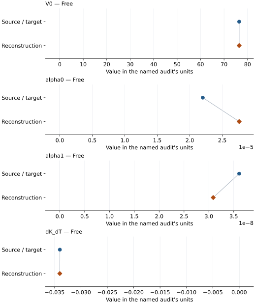
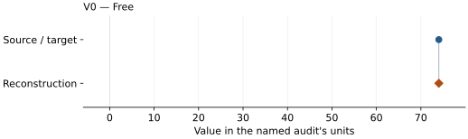

# KLB-1 ferropericlase: EOS reconstruction reports

<!-- Generated by scripts.generate_reconstruction_reports; edit EOSMAT instead. -->

[All reconstruction reports](index.md) · [Material and EOS parameters](../material-summaries/klb1_ferropericlase.md)

These reports explain the assessments already stored in EOSMAT. Generating
this page does not refit observations, change classifications or replace source coefficients.

Use [scientific label definitions](../eos-labels.md) to distinguish coefficient
agreement, source verification, author-workflow reproduction and recommendation for use.

| EOS record | Recorded outcome | Coefficient comparison |
| --- | --- | --- |
| [Ricolleau et al. (2009), KLB-1 high-spin ferropericlase thermal BM2](#record-klb1_ferropericlase_ricolleau_2009_high_spin_bm2_alphakt) | Numerically similar, with qualifications | Graph and table |
| [Ricolleau et al. (2009), KLB-1 low-spin ferropericlase 300 K BM2](#record-klb1_ferropericlase_ricolleau_2009_low_spin_300k_bm2) | Coefficient parity achieved | Graph and table |

## Ricolleau et al. (2009), KLB-1 high-spin ferropericlase thermal BM2

Record: `klb1_ferropericlase_ricolleau_2009_high_spin_bm2_alphakt` · Model: `BM2`

**Outcome: Numerically similar, with qualifications.**

**Scope:** Comparison with the source parameterization.
**Comparison basis:** Every compared free coefficient meets either the recorded combined-two-sigma comparison or parameter-specific numerical similarity screen; the audit does not classify the complete comparison as parity.

[Stored EOS coefficients and source](../material-summaries/klb1_ferropericlase.md#record-klb1_ferropericlase_ricolleau_2009_high_spin_bm2_alphakt)

### What this result establishes

**Separate source-review status:** primary\_source\_validated.
**Usage recommendation:** See the stored EOS qualifications; no recommendation is inferred here.

- The complete source table is bundled. Limiting ferropericlase spin branches reproduce the published V0 values and printed errors; exact thermal parity remains conditional because the source does not state row flags, weights, temperature-error treatment, or covariance scaling.
- This named numerical assessment alone does not establish author-workflow reproduction, physical accuracy or recommendation for use.

### Data and reconstruction method

- **Dataset identifiers:** klb1\_ricolleau\_2009\_table\_s1\_ferropericlase\_pvt
- **Observations:** 136
- **Fit kind:** staged\_source\_constrained\_thermal\_bm2\_odr
- **Selection:** V0 from the seven limiting high-spin 300 K rows; thermal coefficients from all 136 heated rows with published V0 and K0 fixed
- **Objective:** orthogonal distance regression using printed pressure and volume sigmas; temperature held fixed
- **Absolute sigma:** True
- **Free parameters:** V0; alpha0; alpha1; dK\_dT
- **Fixed parameters:** K0; Tr

Unspecified selections, weights, fixed values or error conventions remain unknown; they have not been inferred for this report.

### Source versus reconstruction

This is a **coefficient comparison**, not an observation or residual plot.
Each panel uses its coefficient's audit units and includes zero. Markers show
stored central values only. Error widths are retained in the table below;
no confidence interval or uncertainty band is inferred. Fixed/adopted values are constraints.

| Parameter | Source / target | Source error | Reconstruction | Reconstruction error | Fit role |
| --- | --- | --- | --- | --- | --- |
| V0 | 76.44 | 0.02 | 76.43827898867148 | 0.017711803853117408 | Free |
| alpha0 | 2.2e-05 | 2e-06 | 2.7597289976043394e-05 | 1.6321859181719822e-06 | Free |
| alpha1 | 3.61e-08 | 2.7e-09 | 3.087478002503601e-08 | 1.9536510121458086e-09 | Free |
| dK\_dT | -0.034 | 0.001 | -0.03401873114665049 | 0.0007067326783047755 | Free |

Values and reported errors are copied without rounding or conversion from the named audit. Missing errors mean unknown, not zero. Parameter names and volume conventions follow that audit; error widths do not imply a confidence convention.

Recorded diagnostics, covariance and additional protocol

- **Observed pressure range gpa:** \[27.56, 113.0\]
- **Solver success:** True
- **Solver message:** dedicated Ricolleau et al. (2009) audit completed
- **Rmse gpa:** 1.4791143041717107

### Detailed evidence and existing plots

- [Earlier detailed record investigation](../primary-eos-refits.md#investigation-klb1_ferropericlase_ricolleau_2009_high_spin_bm2_alphakt).
- [Record-by-record numerical ledger](../primary-eos-refits.md#records).
- [Source-audit reports](../source-audits.md).

Observation curves and residual plots are provided by the supporting reports where available. Their absence is not filled by a reconstructed curve presented as measured data.

[Machine-readable comparison ledger](https://github.com/CPrescher/peritheos/blob/main/docs/data/primary-eos-refits.json) — look up `klb1_ferropericlase_ricolleau_2009_high_spin_bm2_alphakt`.
[Complete native EOSMAT file](https://github.com/CPrescher/peritheos/blob/main/peritheos/data/materials/klb1_ferropericlase.eosmat).

## Ricolleau et al. (2009), KLB-1 low-spin ferropericlase 300 K BM2

Record: `klb1_ferropericlase_ricolleau_2009_low_spin_300k_bm2` · Model: `BM2`

**Outcome: Coefficient parity achieved.**

**Scope:** Comparison with the source parameterization.
**Comparison basis:** Every compared free coefficient meets both the recorded combined-two-sigma comparison and parameter-specific numerical similarity screen. Error conventions and fit qualifications remain applicable.

[Stored EOS coefficients and source](../material-summaries/klb1_ferropericlase.md#record-klb1_ferropericlase_ricolleau_2009_low_spin_300k_bm2)

### What this result establishes

**Separate source-review status:** primary\_source\_validated.
**Usage recommendation:** See the stored EOS qualifications; no recommendation is inferred here.

- The complete source table is bundled. Limiting ferropericlase spin branches reproduce the published V0 values and printed errors; exact thermal parity remains conditional because the source does not state row flags, weights, temperature-error treatment, or covariance scaling.
- This named numerical assessment alone does not establish author-workflow reproduction, physical accuracy or recommendation for use.

### Data and reconstruction method

- **Dataset identifiers:** klb1\_ricolleau\_2009\_table\_s1\_ferropericlase\_pvt
- **Observations:** 7
- **Fit kind:** staged\_source\_constrained\_thermal\_bm2\_odr
- **Selection:** seven limiting low-spin 300 K rows
- **Objective:** orthogonal distance regression using printed pressure and volume sigmas; temperature held fixed
- **Absolute sigma:** True
- **Free parameters:** V0
- **Fixed parameters:** K0

Unspecified selections, weights, fixed values or error conventions remain unknown; they have not been inferred for this report.

### Source versus reconstruction

This is a **coefficient comparison**, not an observation or residual plot.
Each panel uses its coefficient's audit units and includes zero. Markers show
stored central values only. Error widths are retained in the table below;
no confidence interval or uncertainty band is inferred. Fixed/adopted values are constraints.

| Parameter | Source / target | Source error | Reconstruction | Reconstruction error | Fit role |
| --- | --- | --- | --- | --- | --- |
| V0 | 74.04 | 0.02 | 74.04288033963479 | 0.02537519008226588 | Free |

Values and reported errors are copied without rounding or conversion from the named audit. Missing errors mean unknown, not zero. Parameter names and volume conventions follow that audit; error widths do not imply a confidence convention.

Recorded diagnostics, covariance and additional protocol

- **Observed pressure range gpa:** \[74.21, 98.36\]
- **Solver success:** True
- **Solver message:** dedicated Ricolleau et al. (2009) audit completed
- **Rmse gpa:** 1.5775129387527014

### Detailed evidence and existing plots

- [Record-by-record numerical ledger](../primary-eos-refits.md#records).
- [Source-audit reports](../source-audits.md).

Observation curves and residual plots are provided by the supporting reports where available. Their absence is not filled by a reconstructed curve presented as measured data.

[Machine-readable comparison ledger](https://github.com/CPrescher/peritheos/blob/main/docs/data/primary-eos-refits.json) — look up `klb1_ferropericlase_ricolleau_2009_low_spin_300k_bm2`.
[Complete native EOSMAT file](https://github.com/CPrescher/peritheos/blob/main/peritheos/data/materials/klb1_ferropericlase.eosmat).
