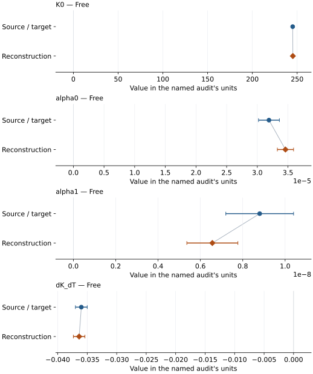

# KLB-1 Mg-perovskite: EOS reconstruction reports

<!-- Generated by scripts.generate_reconstruction_reports; edit EOSMAT instead. -->

[All reconstruction reports](index.md) · [Material and EOS parameters](../material-summaries/klb1_mg_perovskite.md)

These reports explain the assessments already stored in EOSMAT. Generating
this page does not refit observations, change classifications or replace source coefficients.

Use [scientific label definitions](../eos-labels.md) to distinguish coefficient
agreement, source verification, author-workflow reproduction and recommendation for use.

| EOS record | Recorded outcome | Coefficient comparison |
| --- | --- | --- |
| [Ricolleau et al. (2009), KLB-1 Mg-perovskite thermal BM2](#record-klb1_mg_perovskite_ricolleau_2009_bm2_alphakt) | Coefficient parity achieved | Graph and table |

## Ricolleau et al. (2009), KLB-1 Mg-perovskite thermal BM2

Record: `klb1_mg_perovskite_ricolleau_2009_bm2_alphakt` · Model: `BM2`

**Outcome: Coefficient parity achieved.**

**Scope:** Comparison with the source parameterization.
**Comparison basis:** Every compared free coefficient meets both the recorded combined-two-sigma comparison and parameter-specific numerical similarity screen. Error conventions and fit qualifications remain applicable.

[Stored EOS coefficients and source](../material-summaries/klb1_mg_perovskite.md#record-klb1_mg_perovskite_ricolleau_2009_bm2_alphakt)

### What this result establishes

**Separate source-review status:** primary\_source\_validated.
**Usage recommendation:** See the stored EOS qualifications; no recommendation is inferred here.

- The complete source table is bundled. Limiting ferropericlase spin branches reproduce the published V0 values and printed errors; exact thermal parity remains conditional because the source does not state row flags, weights, temperature-error treatment, or covariance scaling.
- This named numerical assessment alone does not establish author-workflow reproduction, physical accuracy or recommendation for use.

### Data and reconstruction method

- **Dataset identifiers:** klb1\_ricolleau\_2009\_table\_s1\_mg\_perovskite\_pvt
- **Observations:** 153
- **Fit kind:** staged\_source\_constrained\_thermal\_bm2\_odr
- **Selection:** all 153 Table S1 P-V-T rows
- **Objective:** orthogonal distance regression using printed pressure and volume sigmas; temperature held fixed
- **Absolute sigma:** True
- **Free parameters:** K0; alpha0; alpha1; dK\_dT
- **Fixed parameters:** V0; Tr

Unspecified selections, weights, fixed values or error conventions remain unknown; they have not been inferred for this report.

### Source versus reconstruction

This is a **coefficient comparison**, not an observation or residual plot.
Each panel uses its coefficient's audit units and includes zero. Markers show
stored central values only. Error widths are retained in the table below;
no confidence interval or uncertainty band is inferred. Fixed/adopted values are constraints.

| Parameter | Source / target | Source error | Reconstruction | Reconstruction error | Fit role |
| --- | --- | --- | --- | --- | --- |
| K0 | 245.0 | 1.0 | 245.19171711850413 | 0.22423728893259712 | Free |
| alpha0 | 3.19e-05 | 1.7e-06 | 3.459117081073104e-05 | 1.3225176625324402e-06 | Free |
| alpha1 | 8.8e-09 | 1.6e-09 | 6.564235547017396e-09 | 1.2050653705993899e-09 | Free |
| dK\_dT | -0.036 | 0.001 | -0.036371009636110355 | 0.0009805019747781865 | Free |

Values and reported errors are copied without rounding or conversion from the named audit. Missing errors mean unknown, not zero. Parameter names and volume conventions follow that audit; error widths do not imply a confidence convention.

Recorded diagnostics, covariance and additional protocol

- **Observed pressure range gpa:** \[27.56, 113.0\]
- **Solver success:** True
- **Solver message:** dedicated Ricolleau et al. (2009) audit completed
- **Rmse gpa:** 1.3064340234776401

### Detailed evidence and existing plots

- [Record-by-record numerical ledger](../primary-eos-refits.md#records).
- [Source-audit reports](../source-audits.md).

Observation curves and residual plots are provided by the supporting reports where available. Their absence is not filled by a reconstructed curve presented as measured data.

[Machine-readable comparison ledger](https://github.com/CPrescher/peritheos/blob/main/docs/data/primary-eos-refits.json) — look up `klb1_mg_perovskite_ricolleau_2009_bm2_alphakt`.
[Complete native EOSMAT file](https://github.com/CPrescher/peritheos/blob/main/peritheos/data/materials/klb1_mg_perovskite.eosmat).
