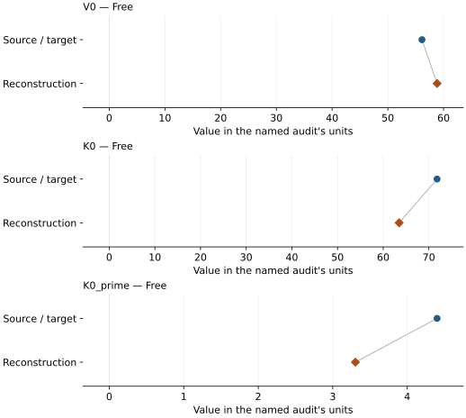
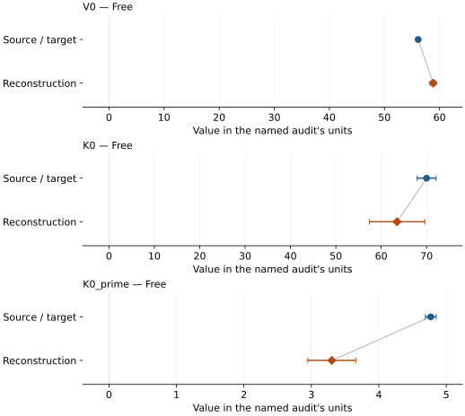

# Lead (hcp): EOS reconstruction reports

<!-- Generated by scripts.generate_reconstruction_reports; edit EOSMAT instead. -->

[All reconstruction reports](index.md) · [Material and EOS parameters](../material-summaries/lead_hcp.md)

These reports explain the assessments already stored in EOSMAT. Generating
this page does not refit observations, change classifications or replace source coefficients.

Use [scientific label definitions](../eos-labels.md) to distinguish coefficient
agreement, source verification, author-workflow reproduction and recommendation for use.

| EOS record | Recorded outcome | Coefficient comparison |
| --- | --- | --- |
| [Dewaele (2019), Pb MAO-scale Vinet](#record-lead_hcp_dewaele_2019_mao_vinet) | Parity not achieved for this comparison | Graph and table |
| [Dewaele (2019), Pb DOR-scale Vinet](#record-lead_hcp_dewaele_2019_dor_vinet) | Parity not achieved for this comparison | Graph and table |
| [Kuznetsov et al. (2002), 296 K hcp BM3 slice](#record-lead_hcp_kuznetsov_2002_bm3_3) | Complete independent refit unavailable | No numeric coefficient pair recorded |

## Dewaele (2019), Pb MAO-scale Vinet

Record: `lead_hcp_dewaele_2019_mao_vinet` · Model: `Vinet`

**Outcome: Parity not achieved for this comparison.**

**Scope:** Comparison with the source parameterization.
**Comparison basis:** The recorded parameter reconstruction did not meet the audit's agreement criterion; the parameter comparisons retain the actual reconstructed values.

[Stored EOS coefficients and source](../material-summaries/lead_hcp.md#record-lead_hcp_dewaele_2019_mao_vinet)

### What this result establishes

**Separate source-review status:** primary\_source\_validated.
**Usage recommendation:** See the stored EOS qualifications; no recommendation is inferred here.

- This named numerical assessment alone does not establish author-workflow reproduction, physical accuracy or recommendation for use.

### Data and reconstruction method

- **Dataset identifiers:** lead\_hcp\_kuznetsov\_2002\_figure3\_digitized
- **Observations:** 21
- **Fit kind:** isothermal\_pv
- **Selection:** all rows
- **Objective:** pressure\_residuals
- **Absolute sigma:** True
- **Free parameters:** V0; K0; K0\_prime
- **Fixed parameters:** None declared

Unspecified selections, weights, fixed values or error conventions remain unknown; they have not been inferred for this report.

### Source versus reconstruction

This is a **coefficient comparison**, not an observation or residual plot.
Each panel uses its coefficient's audit units and includes zero. Markers show
stored central values only. Error widths are retained in the table below;
no confidence interval or uncertainty band is inferred. Fixed/adopted values are constraints.

| Parameter | Source / target | Source error | Reconstruction | Reconstruction error | Fit role |
| --- | --- | --- | --- | --- | --- |
| V0 | 56.126 | 0.11 | 58.83765142086295 | 0.5423223682041958 | Free |
| K0 | 71.8 | 2.1 | 63.48664918864778 | 6.106967044629139 | Free |
| K0\_prime | 4.4 | 0.08 | 3.303771258364891 | 0.3569619004575568 | Free |

Values and reported errors are copied without rounding or conversion from the named audit. Missing errors mean unknown, not zero. Parameter names and volume conventions follow that audit; error widths do not imply a confidence convention.

Recorded diagnostics, covariance and additional protocol

- **Columns:**
    - **Pressure:** reduced\_pressure\_gpa
    - **Temperature:** Not specified
    - **Volume:** atomic\_volume\_a3\_per\_atom
- **Observed pressure range gpa:** \[10.527, 35.121\]
- **Observed temperature range k:** Not specified
- **Observed volume range:** \[42.3626, 51.3302\]
- **Degrees of freedom:** 18
- **Solver success:** True
- **Solver message:** \`ftol\` termination condition is satisfied.
- **Rmse gpa:** 0.60172036353428
- **Published rmse gpa:** 2.336133186552911
- **Reduced chi square:** 10.564031151343334

### Detailed evidence and existing plots

- [Earlier detailed record investigation](../primary-eos-refits.md#investigation-lead_hcp_dewaele_2019_mao_vinet).
- [Record-by-record numerical ledger](../primary-eos-refits.md#records).
- [Source-audit reports](../source-audits.md).

Observation curves and residual plots are provided by the supporting reports where available. Their absence is not filled by a reconstructed curve presented as measured data.

[Machine-readable comparison ledger](https://github.com/CPrescher/peritheos/blob/main/docs/data/primary-eos-refits.json) — look up `lead_hcp_dewaele_2019_mao_vinet`.
[Complete native EOSMAT file](https://github.com/CPrescher/peritheos/blob/main/peritheos/data/materials/lead_hcp.eosmat).

## Dewaele (2019), Pb DOR-scale Vinet

Record: `lead_hcp_dewaele_2019_dor_vinet` · Model: `Vinet`

**Outcome: Parity not achieved for this comparison.**

**Scope:** Comparison with the source parameterization.
**Comparison basis:** The recorded parameter reconstruction did not meet the audit's agreement criterion; the parameter comparisons retain the actual reconstructed values.

[Stored EOS coefficients and source](../material-summaries/lead_hcp.md#record-lead_hcp_dewaele_2019_dor_vinet)

### What this result establishes

**Separate source-review status:** primary\_source\_validated.
**Usage recommendation:** See the stored EOS qualifications; no recommendation is inferred here.

- This named numerical assessment alone does not establish author-workflow reproduction, physical accuracy or recommendation for use.

### Data and reconstruction method

- **Dataset identifiers:** lead\_hcp\_kuznetsov\_2002\_figure3\_digitized
- **Observations:** 21
- **Fit kind:** isothermal\_pv
- **Selection:** all rows
- **Objective:** pressure\_residuals
- **Absolute sigma:** True
- **Free parameters:** V0; K0; K0\_prime
- **Fixed parameters:** None declared

Unspecified selections, weights, fixed values or error conventions remain unknown; they have not been inferred for this report.

### Source versus reconstruction

This is a **coefficient comparison**, not an observation or residual plot.
Each panel uses its coefficient's audit units and includes zero. Markers show
stored central values only. Error widths are retained in the table below;
no confidence interval or uncertainty band is inferred. Fixed/adopted values are constraints.

| Parameter | Source / target | Source error | Reconstruction | Reconstruction error | Fit role |
| --- | --- | --- | --- | --- | --- |
| V0 | 56.116 | 0.11 | 58.83765340033019 | 0.5423226807534997 | Free |
| K0 | 70.0 | 2.1 | 63.48662685422268 | 6.10696777076789 | Free |
| K0\_prime | 4.77 | 0.08 | 3.3037725652189245 | 0.356961985762982 | Free |

Values and reported errors are copied without rounding or conversion from the named audit. Missing errors mean unknown, not zero. Parameter names and volume conventions follow that audit; error widths do not imply a confidence convention.

Recorded diagnostics, covariance and additional protocol

- **Columns:**
    - **Pressure:** reduced\_pressure\_gpa
    - **Temperature:** Not specified
    - **Volume:** atomic\_volume\_a3\_per\_atom
- **Observed pressure range gpa:** \[10.527, 35.121\]
- **Observed temperature range k:** Not specified
- **Observed volume range:** \[42.3626, 51.3302\]
- **Degrees of freedom:** 18
- **Solver success:** True
- **Solver message:** \`ftol\` termination condition is satisfied.
- **Rmse gpa:** 0.6017203646968212
- **Published rmse gpa:** 2.4014233818607034
- **Reduced chi square:** 10.564031151337183

### Detailed evidence and existing plots

- [Earlier detailed record investigation](../primary-eos-refits.md#investigation-lead_hcp_dewaele_2019_dor_vinet).
- [Record-by-record numerical ledger](../primary-eos-refits.md#records).
- [Source-audit reports](../source-audits.md).

Observation curves and residual plots are provided by the supporting reports where available. Their absence is not filled by a reconstructed curve presented as measured data.

[Machine-readable comparison ledger](https://github.com/CPrescher/peritheos/blob/main/docs/data/primary-eos-refits.json) — look up `lead_hcp_dewaele_2019_dor_vinet`.
[Complete native EOSMAT file](https://github.com/CPrescher/peritheos/blob/main/peritheos/data/materials/lead_hcp.eosmat).

## Kuznetsov et al. (2002), 296 K hcp BM3 slice

Record: `lead_hcp_kuznetsov_2002_bm3_3` · Model: `BM3`

**Outcome: Complete independent refit unavailable.**

**Scope:** Comparison with the source parameterization.
**Comparison basis:** The bundled Figure 3 coordinates are plot-digitized room-temperature and source-reduced markers, not the complete original P-V-T observations used to fit the nine-coefficient hcp thermal BM3 surface. The original rows, residual coordinate, weights, and covariance procedure are not published. See the \[dedicated Fortes/Kuznetsov audit\](literature-reproductions/fortes-2019-fcc-pb.md).

[Stored EOS coefficients and source](../material-summaries/lead_hcp.md#record-lead_hcp_kuznetsov_2002_bm3_3)

### What this result establishes

**Separate source-review status:** primary\_source\_validated.
**Usage recommendation:** See the stored EOS qualifications; no recommendation is inferred here.

- This named numerical assessment alone does not establish author-workflow reproduction, physical accuracy or recommendation for use.
- No reconstructed coefficient table is recorded for this assessment; no missing values have been inferred.

### Data and reconstruction method

- **Dataset identifiers:** lead\_hcp\_kuznetsov\_2002\_figure3\_digitized
- **Fixed parameters:** None declared

Unspecified selections, weights, fixed values or error conventions remain unknown; they have not been inferred for this report.

### Why no coefficient graph is shown

No numeric source/reconstruction pair is recorded for this assessment. A graph would require information that is not available here; no values or observations have been invented.

### Detailed evidence and existing plots

- [Supporting source report: fortes-2019-fcc-pb](../literature-reproductions/fortes-2019-fcc-pb.md).
- [Record-by-record numerical ledger](../primary-eos-refits.md#records).
- [Source-audit reports](../source-audits.md).

Observation curves and residual plots are provided by the supporting reports where available. Their absence is not filled by a reconstructed curve presented as measured data.

[Machine-readable comparison ledger](https://github.com/CPrescher/peritheos/blob/main/docs/data/primary-eos-refits.json) — look up `lead_hcp_kuznetsov_2002_bm3_3`.
[Complete native EOSMAT file](https://github.com/CPrescher/peritheos/blob/main/peritheos/data/materials/lead_hcp.eosmat).
