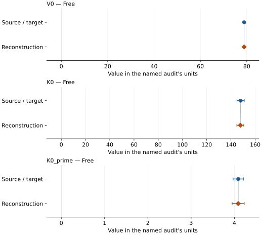
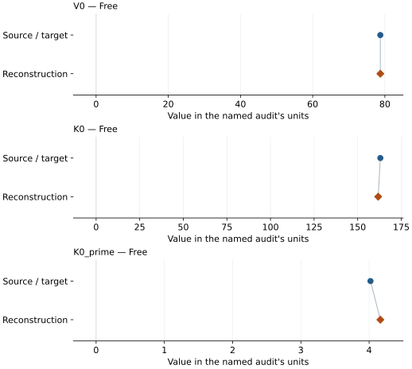

# Mw78 defect-bearing magnesiowustite: EOS reconstruction reports

<!-- Generated by scripts.generate_reconstruction_reports; edit EOSMAT instead. -->

[All reconstruction reports](index.md) · [Material and EOS parameters](../material-summaries/mg0215fe0762vac0023o_b1.md)

These reports explain the assessments already stored in EOSMAT. Generating
this page does not refit observations, change classifications or replace source coefficients.

Use [scientific label definitions](../eos-labels.md) to distinguish coefficient
agreement, source verification, author-workflow reproduction and recommendation for use.

| EOS record | Recorded outcome | Coefficient comparison |
| --- | --- | --- |
| [Finkelstein et al. (2017), Mw78 cubic helium BM3](#record-mg0215fe0762vac0023o_finkelstein_2017_bm3_helium_1) | Coefficient parity achieved | Graph and table |
| [Finkelstein et al. (2017), Mw78 low-pressure cubic neon BM3](#record-mg0215fe0762vac0023o_finkelstein_2017_bm3_neon_cubic_2) | Coefficient parity achieved | Graph and table |

## Finkelstein et al. (2017), Mw78 cubic helium BM3

Record: `mg0215fe0762vac0023o_finkelstein_2017_bm3_helium_1` · Model: `BM3`

**Outcome: Coefficient parity achieved.**

**Scope:** Comparison with the source parameterization.
**Comparison basis:** Every compared free coefficient meets both the recorded combined-two-sigma comparison and parameter-specific numerical similarity screen. Error conventions and fit qualifications remain applicable.

[Stored EOS coefficients and source](../material-summaries/mg0215fe0762vac0023o_b1.md#record-mg0215fe0762vac0023o_finkelstein_2017_bm3_helium_1)

### What this result establishes

**Separate source-review status:** primary\_source\_validated.
**Usage recommendation:** See the stored EOS qualifications; no recommendation is inferred here.

- Correct cubic sample volumes and source medium/phase fit mask. This diagnostic does not replay the ambient V0 prior or neon K0-prime prior, or the unpublished MINUTI P-V covariance treatment. Its coefficient comparison is conditional, not author-workflow parity. See literature-reproductions/finkelstein-2017-mw78.md for the prior-constrained source audit.
- This named numerical assessment alone does not establish author-workflow reproduction, physical accuracy or recommendation for use.

### Data and reconstruction method

- **Dataset identifiers:** magnesiowustite\_mw78\_finkelstein\_2017\_table2\_compression
- **Observations:** 17
- **Fit kind:** isothermal\_pv
- **Selection:** used\_in\_helium\_cubic\_fit=1
- **Objective:** errors\_in\_variables
- **Absolute sigma:** True
- **Free parameters:** V0; K0; K0\_prime
- **Fixed parameters:** None declared

Unspecified selections, weights, fixed values or error conventions remain unknown; they have not been inferred for this report.

### Source versus reconstruction

This is a **coefficient comparison**, not an observation or residual plot.
Each panel uses its coefficient's audit units and includes zero. Markers show
stored central values only. Error widths are retained in the table below;
no confidence interval or uncertainty band is inferred. Fixed/adopted values are constraints.

| Parameter | Source / target | Source error | Reconstruction | Reconstruction error | Fit role |
| --- | --- | --- | --- | --- | --- |
| V0 | 78.87 | 0.06 | 78.85314164125613 | 0.0705865614187149 | Free |
| K0 | 148.0 | 3.0 | 147.72606441163126 | 2.8733997810428007 | Free |
| K0\_prime | 4.09 | 0.12 | 4.088739860047382 | 0.1398876454257973 | Free |

Values and reported errors are copied without rounding or conversion from the named audit. Missing errors mean unknown, not zero. Parameter names and volume conventions follow that audit; error widths do not imply a confidence convention.

Recorded diagnostics, covariance and additional protocol

- **Columns:**
    - **Pressure:** pressure\_gpa
    - **Temperature:** Not specified
    - **Volume:** cubic\_volume\_a3
- **Observed pressure range gpa:** \[1.823, 55.542\]
- **Observed temperature range k:** Not specified
- **Observed volume range:** \[62.4, 77.87\]
- **Degrees of freedom:** 14
- **Solver success:** True
- **Solver message:** Both \`ftol\` and \`xtol\` termination conditions are satisfied.
- **Rmse gpa:** 0.03229434866087353
- **Published rmse gpa:** 0.2779224098597078
- **Reduced chi square:** 0.7368277272336742

### Detailed evidence and existing plots

- [Supporting source report: finkelstein-2017-mw78](../literature-reproductions/finkelstein-2017-mw78.md).
- [Record-by-record numerical ledger](../primary-eos-refits.md#records).
- [Source-audit reports](../source-audits.md).

Observation curves and residual plots are provided by the supporting reports where available. Their absence is not filled by a reconstructed curve presented as measured data.

[Machine-readable comparison ledger](https://github.com/CPrescher/peritheos/blob/main/docs/data/primary-eos-refits.json) — look up `mg0215fe0762vac0023o_finkelstein_2017_bm3_helium_1`.
[Complete native EOSMAT file](https://github.com/CPrescher/peritheos/blob/main/peritheos/data/materials/mg0215fe0762vac0023o_b1.eosmat).

## Finkelstein et al. (2017), Mw78 low-pressure cubic neon BM3

Record: `mg0215fe0762vac0023o_finkelstein_2017_bm3_neon_cubic_2` · Model: `BM3`

**Outcome: Coefficient parity achieved.**

**Scope:** Comparison with the source parameterization.
**Comparison basis:** Every compared free coefficient meets both the recorded combined-two-sigma comparison and parameter-specific numerical similarity screen. Error conventions and fit qualifications remain applicable.

[Stored EOS coefficients and source](../material-summaries/mg0215fe0762vac0023o_b1.md#record-mg0215fe0762vac0023o_finkelstein_2017_bm3_neon_cubic_2)

### What this result establishes

**Separate source-review status:** primary\_source\_validated.
**Usage recommendation:** See the stored EOS qualifications; no recommendation is inferred here.

- Correct cubic sample volumes and source medium/phase fit mask. This diagnostic does not replay the ambient V0 prior or neon K0-prime prior, or the unpublished MINUTI P-V covariance treatment. Its coefficient comparison is conditional, not author-workflow parity. See literature-reproductions/finkelstein-2017-mw78.md for the prior-constrained source audit.
- This named numerical assessment alone does not establish author-workflow reproduction, physical accuracy or recommendation for use.

### Data and reconstruction method

- **Dataset identifiers:** magnesiowustite\_mw78\_finkelstein\_2017\_table2\_compression
- **Observations:** 5
- **Fit kind:** isothermal\_pv
- **Selection:** used\_in\_neon\_cubic\_fit=1
- **Objective:** errors\_in\_variables
- **Absolute sigma:** True
- **Free parameters:** V0; K0; K0\_prime
- **Fixed parameters:** None declared

Unspecified selections, weights, fixed values or error conventions remain unknown; they have not been inferred for this report.

### Source versus reconstruction

This is a **coefficient comparison**, not an observation or residual plot.
Each panel uses its coefficient's audit units and includes zero. Markers show
stored central values only. Error widths are retained in the table below;
no confidence interval or uncertainty band is inferred. Fixed/adopted values are constraints.

| Parameter | Source / target | Source error | Reconstruction | Reconstruction error | Fit role |
| --- | --- | --- | --- | --- | --- |
| V0 | 78.742 | 0.014 | 78.75104668295108 | 0.623035262644541 | Free |
| K0 | 163.0 | 1.0 | 161.75412858859644 | 59.877002312442706 | Free |
| K0\_prime | 4.02 | 0.1 | 4.164434928652056 | 6.765151208001336 | Free |

Values and reported errors are copied without rounding or conversion from the named audit. Missing errors mean unknown, not zero. Parameter names and volume conventions follow that audit; error widths do not imply a confidence convention.

Recorded diagnostics, covariance and additional protocol

- **Columns:**
    - **Pressure:** pressure\_gpa
    - **Temperature:** Not specified
    - **Volume:** cubic\_volume\_a3
- **Observed pressure range gpa:** \[1.314, 19.244\]
- **Observed temperature range k:** Not specified
- **Observed volume range:** \[71.5, 78.12\]
- **Degrees of freedom:** 2
- **Solver success:** True
- **Solver message:** \`ftol\` termination condition is satisfied.
- **Rmse gpa:** 0.10073571217432044
- **Published rmse gpa:** 0.11825128942282512
- **Reduced chi square:** 0.02751642144773445

### Detailed evidence and existing plots

- [Supporting source report: finkelstein-2017-mw78](../literature-reproductions/finkelstein-2017-mw78.md).
- [Record-by-record numerical ledger](../primary-eos-refits.md#records).
- [Source-audit reports](../source-audits.md).

Observation curves and residual plots are provided by the supporting reports where available. Their absence is not filled by a reconstructed curve presented as measured data.

[Machine-readable comparison ledger](https://github.com/CPrescher/peritheos/blob/main/docs/data/primary-eos-refits.json) — look up `mg0215fe0762vac0023o_finkelstein_2017_bm3_neon_cubic_2`.
[Complete native EOSMAT file](https://github.com/CPrescher/peritheos/blob/main/peritheos/data/materials/mg0215fe0762vac0023o_b1.eosmat).
