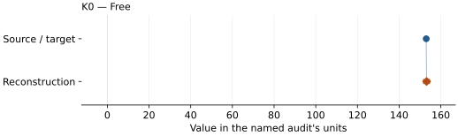

# (Mg0.42Fe0.58)O B1 magnesiowustite: EOS reconstruction reports

<!-- Generated by scripts.generate_reconstruction_reports; edit EOSMAT instead. -->

[All reconstruction reports](index.md) · [Material and EOS parameters](../material-summaries/mg042fe058o.md)

These reports explain the assessments already stored in EOSMAT. Generating
this page does not refit observations, change classifications or replace source coefficients.

Use [scientific label definitions](../eos-labels.md) to distinguish coefficient
agreement, source verification, author-workflow reproduction and recommendation for use.

| EOS record | Recorded outcome | Coefficient comparison |
| --- | --- | --- |
| [Fei et al. (2007), GRL, mg042fe058o high-spin B1 compression BM3](#record-mg042fe058o_fei_2007_hs_b1_bm3) | Numerically similar, with qualifications | Graph and table |

## Fei et al. (2007), GRL, mg042fe058o high-spin B1 compression BM3

Record: `mg042fe058o_fei_2007_hs_b1_bm3` · Model: `BM3`

**Outcome: Numerically similar, with qualifications.**

**Scope:** Comparison with the source parameterization.
**Comparison basis:** Every compared free coefficient meets either the recorded combined-two-sigma comparison or parameter-specific numerical similarity screen; the audit does not classify the complete comparison as parity.

[Stored EOS coefficients and source](../material-summaries/mg042fe058o.md#record-mg042fe058o_fei_2007_hs_b1_bm3)

### What this result establishes

**Separate source-review status:** primary\_source\_validated.
**Usage recommendation:** consult\_source\_audit\_before\_quantitative\_use

- Independent unweighted pressure-residual validation, not Fei's published regression or a new source-owned EOS. K0-prime is fixed at 4; HS V0 is held at the reported reference value as a validation choice. LS V0 and K0 are fitted. Exact source weights and row masks are unavailable. Printed zero/missing errors are not exact weights. Compression and decompression remain separate. Published coefficients are retained even where this validation disagrees.
- Usage recommendation: consult\_source\_audit\_before\_quantitative\_use
- This named numerical assessment alone does not establish author-workflow reproduction, physical accuracy or recommendation for use.

### Data and reconstruction method

- **Dataset identifiers:** mg042fe058o\_fei\_2007\_table\_s3\_pv
- **Observations:** 7
- **Fit kind:** independent\_validation\_refit
- **Selection:** Validation uses all seven compression rows through 42.75 GPa. As agreed with the user, assume the Figure 3 caption's approximate 42 GPa upper limit includes the tabulated 42.75 GPa B1 point. This is an explicit rounded-endpoint interpretation, not confirmation of the authors' exact row mask or weights. Rows at and above 44 GPa remain excluded because of the cubic-rhombohedral transition.
- **Objective:** pressure\_residuals
- **Absolute sigma:** False
- **Free parameters:** K0
- **Fixed parameters:** K0\_prime
- **Validation fixed parameters:**
    - **K0 prime:** 4.0
    - **V0:** 79.36

Unspecified selections, weights, fixed values or error conventions remain unknown; they have not been inferred for this report.

### Source versus reconstruction

This is a **coefficient comparison**, not an observation or residual plot.
Each panel uses its coefficient's audit units and includes zero. Markers show
stored central values only. Error widths are retained in the table below;
no confidence interval or uncertainty band is inferred. Fixed/adopted values are constraints.

| Parameter | Source / target | Source error | Reconstruction | Reconstruction error | Fit role |
| --- | --- | --- | --- | --- | --- |
| K0 | 153.0 | Not specified | 153.17737026377804 | 1.4284155273762704 | Free |

Values and reported errors are copied without rounding or conversion from the named audit. Missing errors mean unknown, not zero. Parameter names and volume conventions follow that audit; error widths do not imply a confidence convention.

Recorded diagnostics, covariance and additional protocol

- **Columns:**
    - **Pressure:** pressure\_gpa
    - **Temperature:** Not specified
    - **Volume:** volume\_a3\_conventional\_cell
- **Observed pressure range gpa:** \[9.37, 42.75\]
- **Observed temperature range k:** Not specified
- **Observed volume range:** \[65.4605720236, 75.2262680963\]
- **Degrees of freedom:** 6
- **Solver success:** True
- **Solver message:** Both \`ftol\` and \`xtol\` termination conditions are satisfied.
- **Rmse gpa:** 0.4872550028647513
- **Published rmse gpa:** 0.48788067826156556
- **Reduced chi square:** 0.2769870107861836

### Detailed evidence and existing plots

- [Earlier detailed record investigation](../primary-eos-refits.md#investigation-mg042fe058o_fei_2007_hs_b1_bm3).
- [Supporting source report: fei-2007-ferropericlase](../literature-reproductions/fei-2007-ferropericlase.md).
- [Record-by-record numerical ledger](../primary-eos-refits.md#records).
- [Source-audit reports](../source-audits.md).

Observation curves and residual plots are provided by the supporting reports where available. Their absence is not filled by a reconstructed curve presented as measured data.

[Machine-readable comparison ledger](https://github.com/CPrescher/peritheos/blob/main/docs/data/primary-eos-refits.json) — look up `mg042fe058o_fei_2007_hs_b1_bm3`.
[Complete native EOSMAT file](https://github.com/CPrescher/peritheos/blob/main/peritheos/data/materials/mg042fe058o.eosmat).
