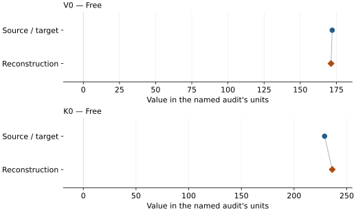
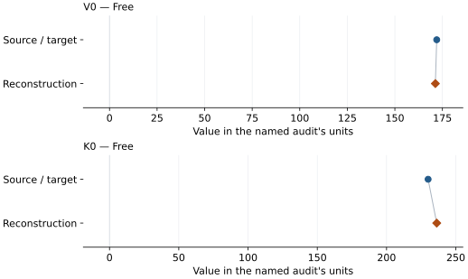
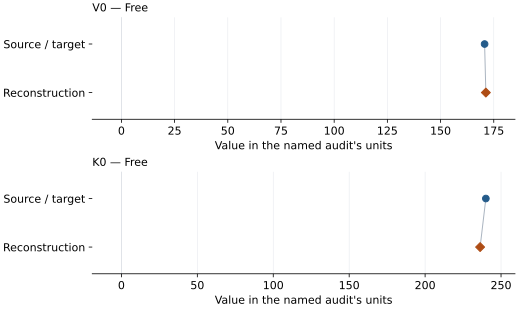
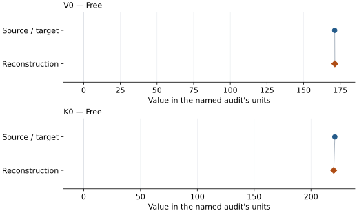

# FA50 bridgmanite: EOS reconstruction reports

<!-- Generated by scripts.generate_reconstruction_reports; edit EOSMAT instead. -->

[All reconstruction reports](index.md) · [Material and EOS parameters](../material-summaries/mg05fe05al05si05o3_bridgmanite.md)

These reports explain the assessments already stored in EOSMAT. Generating
this page does not refit observations, change classifications or replace source coefficients.

Use [scientific label definitions](../eos-labels.md) to distinguish coefficient
agreement, source verification, author-workflow reproduction and recommendation for use.

| EOS record | Recorded outcome | Coefficient comparison |
| --- | --- | --- |
| [Zhu et al. (2020), sample 1 preferred all-observation BM2](#record-mg05fe05al05si05o3_bridgmanite_zhu_2020_preferred_bm2_1) | Coefficient parity achieved | Graph and table |
| [Zhu et al. (2020), sample 1 after-current-step-anneal subset BM2](#record-mg05fe05al05si05o3_bridgmanite_zhu_2020_post_anneal_bm2_2) | Coefficient parity achieved | Graph and table |
| [Zhu et al. (2020), sample 2 cold-compressed BM2](#record-mg05fe05al05si05o3_bridgmanite_zhu_2020_cold_compressed_bm2_3) | Coefficient parity achieved | Graph and table |
| [Koemets et al. (2023) single-crystal Pnma perovskite BM2](#record-mg05fe05al05si05o3_bridgmanite_koemets_2023_bm2_4) | Coefficient parity achieved | Graph and table |

## Zhu et al. (2020), sample 1 preferred all-observation BM2

Record: `mg05fe05al05si05o3_bridgmanite_zhu_2020_preferred_bm2_1` · Model: `BM2`

**Outcome: Coefficient parity achieved.**

**Scope:** Comparison with the source parameterization.
**Comparison basis:** Every compared free coefficient meets both the recorded combined-two-sigma comparison and parameter-specific numerical similarity screen. Error conventions and fit qualifications remain applicable.

[Stored EOS coefficients and source](../material-summaries/mg05fe05al05si05o3_bridgmanite.md#record-mg05fe05al05si05o3_bridgmanite_zhu_2020_preferred_bm2_1)

### What this result establishes

**Separate source-review status:** primary\_source\_validated.
**Usage recommendation:** See the stored EOS qualifications; no recommendation is inferred here.

- This named numerical assessment alone does not establish author-workflow reproduction, physical accuracy or recommendation for use.

### Data and reconstruction method

- **Dataset identifiers:** mg05fe05al05si05o3\_bridgmanite\_zhu\_2020\_zenodo\_latticeparameters
- **Observations:** 44
- **Fit kind:** isothermal\_pv
- **Selection:** all rows
- **Objective:** errors\_in\_variables
- **Absolute sigma:** True
- **Free parameters:** V0; K0
- **Fixed parameters:** None declared

Unspecified selections, weights, fixed values or error conventions remain unknown; they have not been inferred for this report.

### Source versus reconstruction

This is a **coefficient comparison**, not an observation or residual plot.
Each panel uses its coefficient's audit units and includes zero. Markers show
stored central values only. Error widths are retained in the table below;
no confidence interval or uncertainty band is inferred. Fixed/adopted values are constraints.

| Parameter | Source / target | Source error | Reconstruction | Reconstruction error | Fit role |
| --- | --- | --- | --- | --- | --- |
| V0 | 172.1 | 0.4 | 171.28418830329534 | 0.31124211455285067 | Free |
| K0 | 229.0 | 4.0 | 236.21992008331335 | 3.7638034680956434 | Free |

Values and reported errors are copied without rounding or conversion from the named audit. Missing errors mean unknown, not zero. Parameter names and volume conventions follow that audit; error widths do not imply a confidence convention.

Recorded diagnostics, covariance and additional protocol

- **Columns:**
    - **Pressure:** pressure\_gpa
    - **Temperature:** Not specified
    - **Volume:** volume\_a3\_conventional\_cell
- **Observed pressure range gpa:** \[26.8, 103.6\]
- **Observed temperature range k:** Not specified
- **Observed volume range:** \[131.838315, 155.858292\]
- **Degrees of freedom:** 42
- **Solver success:** True
- **Solver message:** Both \`ftol\` and \`xtol\` termination conditions are satisfied.
- **Rmse gpa:** 0.005335239546325782
- **Published rmse gpa:** 0.9635059089773417
- **Reduced chi square:** 0.24752735805239015

### Detailed evidence and existing plots

- [Record-by-record numerical ledger](../primary-eos-refits.md#records).
- [Source-audit reports](../source-audits.md).

Observation curves and residual plots are provided by the supporting reports where available. Their absence is not filled by a reconstructed curve presented as measured data.

[Machine-readable comparison ledger](https://github.com/CPrescher/peritheos/blob/main/docs/data/primary-eos-refits.json) — look up `mg05fe05al05si05o3_bridgmanite_zhu_2020_preferred_bm2_1`.
[Complete native EOSMAT file](https://github.com/CPrescher/peritheos/blob/main/peritheos/data/materials/mg05fe05al05si05o3_bridgmanite.eosmat).

## Zhu et al. (2020), sample 1 after-current-step-anneal subset BM2

Record: `mg05fe05al05si05o3_bridgmanite_zhu_2020_post_anneal_bm2_2` · Model: `BM2`

**Outcome: Coefficient parity achieved.**

**Scope:** Comparison with the source parameterization.
**Comparison basis:** Every compared free coefficient meets both the recorded combined-two-sigma comparison and parameter-specific numerical similarity screen. Error conventions and fit qualifications remain applicable.

[Stored EOS coefficients and source](../material-summaries/mg05fe05al05si05o3_bridgmanite.md#record-mg05fe05al05si05o3_bridgmanite_zhu_2020_post_anneal_bm2_2)

### What this result establishes

**Separate source-review status:** primary\_source\_validated.
**Usage recommendation:** See the stored EOS qualifications; no recommendation is inferred here.

- This named numerical assessment alone does not establish author-workflow reproduction, physical accuracy or recommendation for use.

### Data and reconstruction method

- **Dataset identifiers:** mg05fe05al05si05o3\_bridgmanite\_zhu\_2020\_zenodo\_latticeparameters
- **Observations:** 44
- **Fit kind:** isothermal\_pv
- **Selection:** all rows
- **Objective:** errors\_in\_variables
- **Absolute sigma:** True
- **Free parameters:** V0; K0
- **Fixed parameters:** None declared

Unspecified selections, weights, fixed values or error conventions remain unknown; they have not been inferred for this report.

### Source versus reconstruction

This is a **coefficient comparison**, not an observation or residual plot.
Each panel uses its coefficient's audit units and includes zero. Markers show
stored central values only. Error widths are retained in the table below;
no confidence interval or uncertainty band is inferred. Fixed/adopted values are constraints.

| Parameter | Source / target | Source error | Reconstruction | Reconstruction error | Fit role |
| --- | --- | --- | --- | --- | --- |
| V0 | 172.0 | 0.7 | 171.28418824544406 | 0.3112421285583978 | Free |
| K0 | 230.0 | 6.0 | 236.21992080658242 | 3.7638036000632082 | Free |

Values and reported errors are copied without rounding or conversion from the named audit. Missing errors mean unknown, not zero. Parameter names and volume conventions follow that audit; error widths do not imply a confidence convention.

Recorded diagnostics, covariance and additional protocol

- **Columns:**
    - **Pressure:** pressure\_gpa
    - **Temperature:** Not specified
    - **Volume:** volume\_a3\_conventional\_cell
- **Observed pressure range gpa:** \[26.8, 103.6\]
- **Observed temperature range k:** Not specified
- **Observed volume range:** \[131.838315, 155.858292\]
- **Degrees of freedom:** 42
- **Solver success:** True
- **Solver message:** Both \`ftol\` and \`xtol\` termination conditions are satisfied.
- **Rmse gpa:** 0.005335237826584185
- **Published rmse gpa:** 0.9591587899297476
- **Reduced chi square:** 0.24752735805237686

### Detailed evidence and existing plots

- [Record-by-record numerical ledger](../primary-eos-refits.md#records).
- [Source-audit reports](../source-audits.md).

Observation curves and residual plots are provided by the supporting reports where available. Their absence is not filled by a reconstructed curve presented as measured data.

[Machine-readable comparison ledger](https://github.com/CPrescher/peritheos/blob/main/docs/data/primary-eos-refits.json) — look up `mg05fe05al05si05o3_bridgmanite_zhu_2020_post_anneal_bm2_2`.
[Complete native EOSMAT file](https://github.com/CPrescher/peritheos/blob/main/peritheos/data/materials/mg05fe05al05si05o3_bridgmanite.eosmat).

## Zhu et al. (2020), sample 2 cold-compressed BM2

Record: `mg05fe05al05si05o3_bridgmanite_zhu_2020_cold_compressed_bm2_3` · Model: `BM2`

**Outcome: Coefficient parity achieved.**

**Scope:** Comparison with the source parameterization.
**Comparison basis:** Every compared free coefficient meets both the recorded combined-two-sigma comparison and parameter-specific numerical similarity screen. Error conventions and fit qualifications remain applicable.

[Stored EOS coefficients and source](../material-summaries/mg05fe05al05si05o3_bridgmanite.md#record-mg05fe05al05si05o3_bridgmanite_zhu_2020_cold_compressed_bm2_3)

### What this result establishes

**Separate source-review status:** primary\_source\_validated.
**Usage recommendation:** See the stored EOS qualifications; no recommendation is inferred here.

- This named numerical assessment alone does not establish author-workflow reproduction, physical accuracy or recommendation for use.

### Data and reconstruction method

- **Dataset identifiers:** mg05fe05al05si05o3\_bridgmanite\_zhu\_2020\_zenodo\_latticeparameters
- **Observations:** 44
- **Fit kind:** isothermal\_pv
- **Selection:** all rows
- **Objective:** errors\_in\_variables
- **Absolute sigma:** True
- **Free parameters:** V0; K0
- **Fixed parameters:** None declared

Unspecified selections, weights, fixed values or error conventions remain unknown; they have not been inferred for this report.

### Source versus reconstruction

This is a **coefficient comparison**, not an observation or residual plot.
Each panel uses its coefficient's audit units and includes zero. Markers show
stored central values only. Error widths are retained in the table below;
no confidence interval or uncertainty band is inferred. Fixed/adopted values are constraints.

| Parameter | Source / target | Source error | Reconstruction | Reconstruction error | Fit role |
| --- | --- | --- | --- | --- | --- |
| V0 | 170.7 | 0.3 | 171.28418756588735 | 0.3112421182129479 | Free |
| K0 | 240.0 | 3.0 | 236.21992916274397 | 3.763803717773989 | Free |

Values and reported errors are copied without rounding or conversion from the named audit. Missing errors mean unknown, not zero. Parameter names and volume conventions follow that audit; error widths do not imply a confidence convention.

Recorded diagnostics, covariance and additional protocol

- **Columns:**
    - **Pressure:** pressure\_gpa
    - **Temperature:** Not specified
    - **Volume:** volume\_a3\_conventional\_cell
- **Observed pressure range gpa:** \[26.8, 103.6\]
- **Observed temperature range k:** Not specified
- **Observed volume range:** \[131.838315, 155.858292\]
- **Degrees of freedom:** 42
- **Solver success:** True
- **Solver message:** Both \`ftol\` and \`xtol\` termination conditions are satisfied.
- **Rmse gpa:** 0.005335219152781051
- **Published rmse gpa:** 1.078003543844502
- **Reduced chi square:** 0.24752735805235754

### Detailed evidence and existing plots

- [Record-by-record numerical ledger](../primary-eos-refits.md#records).
- [Source-audit reports](../source-audits.md).

Observation curves and residual plots are provided by the supporting reports where available. Their absence is not filled by a reconstructed curve presented as measured data.

[Machine-readable comparison ledger](https://github.com/CPrescher/peritheos/blob/main/docs/data/primary-eos-refits.json) — look up `mg05fe05al05si05o3_bridgmanite_zhu_2020_cold_compressed_bm2_3`.
[Complete native EOSMAT file](https://github.com/CPrescher/peritheos/blob/main/peritheos/data/materials/mg05fe05al05si05o3_bridgmanite.eosmat).

## Koemets et al. (2023) single-crystal Pnma perovskite BM2

Record: `mg05fe05al05si05o3_bridgmanite_koemets_2023_bm2_4` · Model: `BM2`

**Outcome: Coefficient parity achieved.**

**Scope:** Comparison with the source parameterization.
**Comparison basis:** Every compared free coefficient meets both the recorded combined-two-sigma comparison and parameter-specific numerical similarity screen. Error conventions and fit qualifications remain applicable.

[Stored EOS coefficients and source](../material-summaries/mg05fe05al05si05o3_bridgmanite.md#record-mg05fe05al05si05o3_bridgmanite_koemets_2023_bm2_4)

### What this result establishes

**Separate source-review status:** primary\_source\_validated.
**Usage recommendation:** See the stored EOS qualifications; no recommendation is inferred here.

- This named numerical assessment alone does not establish author-workflow reproduction, physical accuracy or recommendation for use.

### Data and reconstruction method

- **Dataset identifiers:** mg05fe05al05si05o3\_bridgmanite\_koemets\_2023\_table\_s3\_pv
- **Observations:** 16
- **Fit kind:** isothermal\_pv
- **Selection:** used\_in\_bm2\_fit=1; reference-T rows
- **Objective:** errors\_in\_variables
- **Absolute sigma:** True
- **Free parameters:** V0; K0
- **Fixed parameters:** None declared

Unspecified selections, weights, fixed values or error conventions remain unknown; they have not been inferred for this report.

### Source versus reconstruction

This is a **coefficient comparison**, not an observation or residual plot.
Each panel uses its coefficient's audit units and includes zero. Markers show
stored central values only. Error widths are retained in the table below;
no confidence interval or uncertainty band is inferred. Fixed/adopted values are constraints.

| Parameter | Source / target | Source error | Reconstruction | Reconstruction error | Fit role |
| --- | --- | --- | --- | --- | --- |
| V0 | 171.2 | 0.2 | 171.30694531122452 | 0.22168893936449124 | Free |
| K0 | 221.0 | 3.0 | 220.00830646002888 | 3.0285115729808005 | Free |

Values and reported errors are copied without rounding or conversion from the named audit. Missing errors mean unknown, not zero. Parameter names and volume conventions follow that audit; error widths do not imply a confidence convention.

Recorded diagnostics, covariance and additional protocol

- **Columns:**
    - **Pressure:** pressure\_gpa
    - **Temperature:** temperature\_k
    - **Volume:** volume\_a3\_conventional\_cell
- **Observed pressure range gpa:** \[10.8, 60.0\]
- **Observed temperature range k:** \[293.0, 293.0\]
- **Observed volume range:** \[142.2, 163.87\]
- **Degrees of freedom:** 14
- **Solver success:** True
- **Solver message:** Both \`ftol\` and \`xtol\` termination conditions are satisfied.
- **Rmse gpa:** 0.6443734730246198
- **Published rmse gpa:** 0.6776309819297365
- **Reduced chi square:** 1.3740327191068384

### Detailed evidence and existing plots

- [Record-by-record numerical ledger](../primary-eos-refits.md#records).
- [Source-audit reports](../source-audits.md).

Observation curves and residual plots are provided by the supporting reports where available. Their absence is not filled by a reconstructed curve presented as measured data.

[Machine-readable comparison ledger](https://github.com/CPrescher/peritheos/blob/main/docs/data/primary-eos-refits.json) — look up `mg05fe05al05si05o3_bridgmanite_koemets_2023_bm2_4`.
[Complete native EOSMAT file](https://github.com/CPrescher/peritheos/blob/main/peritheos/data/materials/mg05fe05al05si05o3_bridgmanite.eosmat).
