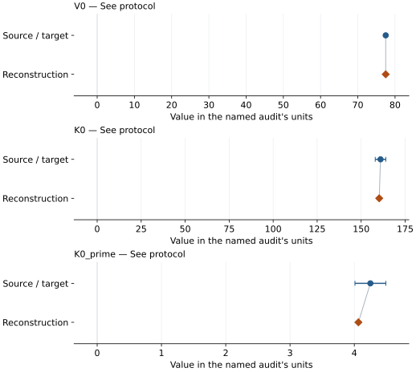
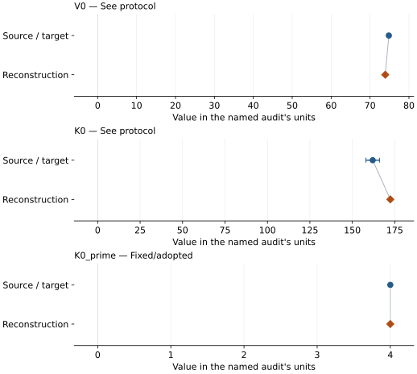
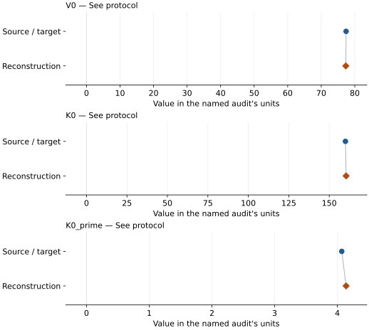
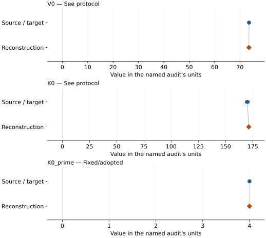
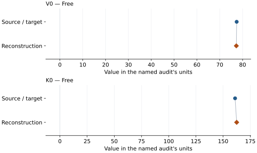
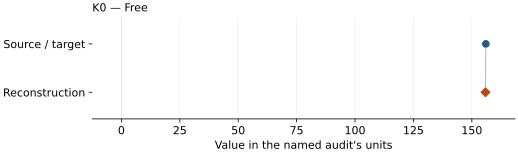
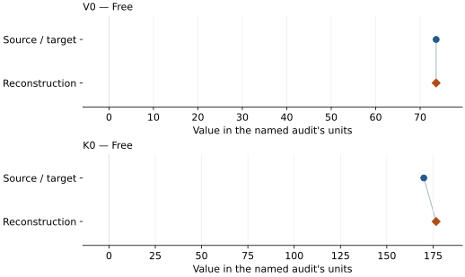

# (Mg0.61Fe0.39)O B1 ferropericlase: EOS reconstruction reports

<!-- Generated by scripts.generate_reconstruction_reports; edit EOSMAT instead. -->

[All reconstruction reports](index.md) · [Material and EOS parameters](../material-summaries/mg061fe039o.md)

These reports explain the assessments already stored in EOSMAT. Generating
this page does not refit observations, change classifications or replace source coefficients.

Use [scientific label definitions](../eos-labels.md) to distinguish coefficient
agreement, source verification, author-workflow reproduction and recommendation for use.

| EOS record | Recorded outcome | Coefficient comparison |
| --- | --- | --- |
| [Solomatova et al. (2016), fei hs BM3 reference branch](#record-mg061fe039o_solomatova_2016_fei_hs_bm3_reference_1) | Numerically similar, with qualifications | Graph and table |
| [Solomatova et al. (2016), fei ls BM3 reference branch](#record-mg061fe039o_solomatova_2016_fei_ls_bm3_reference_2) | Numerically similar, with qualifications | Graph and table |
| [Solomatova et al. (2016), zhuravlev hs BM3 reference branch](#record-mg061fe039o_solomatova_2016_zhuravlev_hs_bm3_reference_3) | Numerically similar, with qualifications | Graph and table |
| [Solomatova et al. (2016), zhuravlev ls BM3 reference branch](#record-mg061fe039o_solomatova_2016_zhuravlev_ls_bm3_reference_4) | Numerically similar, with qualifications | Graph and table |
| [Zhuravlev et al. (2010), high-spin BM2](#record-mg061fe039o_zhuravlev_2010_high_spin_bm2_5) | Coefficient parity achieved | Graph and table |
| [Fei et al. (2007), GRL, mg061fe039o high-spin B1 compression BM3](#record-mg061fe039o_fei_2007_hs_b1_bm3) | Coefficient parity achieved | Graph and table |
| [Fei et al. (2007), GRL, mg061fe039o low-spin B1 compression BM3](#record-mg061fe039o_fei_2007_ls_b1_bm3) | Coefficient parity achieved | Graph and table |

## Solomatova et al. (2016), fei hs BM3 reference branch

Record: `mg061fe039o_solomatova_2016_fei_hs_bm3_reference_1` · Model: `BM3`

**Outcome: Numerically similar, with qualifications.**

**Scope:** Comparison with the source parameterization.
**Comparison basis:** Every compared free coefficient meets either the recorded combined-two-sigma comparison or parameter-specific numerical similarity screen; the audit does not classify the complete comparison as parity.

[Stored EOS coefficients and source](../material-summaries/mg061fe039o.md#record-mg061fe039o_solomatova_2016_fei_hs_bm3_reference_1)

### What this result establishes

**Separate source-review status:** primary\_source\_validated.
**Usage recommendation:** See the stored EOS qualifications; no recommendation is inferred here.

- Coupled three-level spin-state reconstruction using the recovered earlier observations and Solomatova Table 2 priors. The original MINUTI input, row weights, residual definition, and covariance are unpublished, so this equal-weight approximate-volume fit tests numerical similarity rather than claiming an exact reproduction.
- This named numerical assessment alone does not establish author-workflow reproduction, physical accuracy or recommendation for use.

### Data and reconstruction method

- **Dataset identifiers:** mg061fe039o\_fei\_2007\_table\_s2\_pv
- **Observations:** 38
- **Fit kind:** coupled\_bm3\_three\_level\_spin\_crossover
- **Selection:** compression\_path=1
- **Objective:** equal-weight approximate volume residuals plus Table 2 priors
- **Free parameters:** V0\_HS; K0\_HS; K0\_prime\_HS; V0\_LS; K0\_LS; omega0
- **Fixed parameters:** None declared

Unspecified selections, weights, fixed values or error conventions remain unknown; they have not been inferred for this report.

### Source versus reconstruction

This is a **coefficient comparison**, not an observation or residual plot.
Each panel uses its coefficient's audit units and includes zero. Markers show
stored central values only. Error widths are retained in the table below;
no confidence interval or uncertainty band is inferred. Fixed/adopted values are constraints.

| Parameter | Source / target | Source error | Reconstruction | Reconstruction error | Fit role |
| --- | --- | --- | --- | --- | --- |
| V0 | 77.49 | 0.03 | 77.4915781521927 | Not specified | See protocol |
| K0 | 161.0 | 3 | 160.2555876526297 | Not specified | See protocol |
| K0\_prime | 4.25 | 0.24 | 4.063494833000203 | Not specified | See protocol |

Values and reported errors are copied without rounding or conversion from the named audit. Missing errors mean unknown, not zero. Parameter names and volume conventions follow that audit; error widths do not imply a confidence convention.

Recorded diagnostics, covariance and additional protocol

- **Solver success:** True
- **Solver message:** dedicated Solomatova coupled reconstruction completed
- **Rmse volume a3:** 0.13681193441273581

### Detailed evidence and existing plots

- [Earlier detailed record investigation](../primary-eos-refits.md#investigation-mg061fe039o_solomatova_2016_fei_hs_bm3_reference_1).
- [Record-by-record numerical ledger](../primary-eos-refits.md#records).
- [Source-audit reports](../source-audits.md).

Observation curves and residual plots are provided by the supporting reports where available. Their absence is not filled by a reconstructed curve presented as measured data.

[Machine-readable comparison ledger](https://github.com/CPrescher/peritheos/blob/main/docs/data/primary-eos-refits.json) — look up `mg061fe039o_solomatova_2016_fei_hs_bm3_reference_1`.
[Complete native EOSMAT file](https://github.com/CPrescher/peritheos/blob/main/peritheos/data/materials/mg061fe039o.eosmat).

## Solomatova et al. (2016), fei ls BM3 reference branch

Record: `mg061fe039o_solomatova_2016_fei_ls_bm3_reference_2` · Model: `BM3`

**Outcome: Numerically similar, with qualifications.**

**Scope:** Comparison with the source parameterization.
**Comparison basis:** Every compared free coefficient meets either the recorded combined-two-sigma comparison or parameter-specific numerical similarity screen; the audit does not classify the complete comparison as parity.

[Stored EOS coefficients and source](../material-summaries/mg061fe039o.md#record-mg061fe039o_solomatova_2016_fei_ls_bm3_reference_2)

### What this result establishes

**Separate source-review status:** primary\_source\_validated.
**Usage recommendation:** See the stored EOS qualifications; no recommendation is inferred here.

- Coupled three-level spin-state reconstruction using the recovered earlier observations and Solomatova Table 2 priors. The original MINUTI input, row weights, residual definition, and covariance are unpublished, so this equal-weight approximate-volume fit tests numerical similarity rather than claiming an exact reproduction.
- This named numerical assessment alone does not establish author-workflow reproduction, physical accuracy or recommendation for use.

### Data and reconstruction method

- **Dataset identifiers:** mg061fe039o\_fei\_2007\_table\_s2\_pv
- **Observations:** 38
- **Fit kind:** coupled\_bm3\_three\_level\_spin\_crossover
- **Selection:** compression\_path=1
- **Objective:** equal-weight approximate volume residuals plus Table 2 priors
- **Free parameters:** V0\_HS; K0\_HS; K0\_prime\_HS; V0\_LS; K0\_LS; omega0
- **Fixed parameters:** K0\_prime

Unspecified selections, weights, fixed values or error conventions remain unknown; they have not been inferred for this report.

### Source versus reconstruction

This is a **coefficient comparison**, not an observation or residual plot.
Each panel uses its coefficient's audit units and includes zero. Markers show
stored central values only. Error widths are retained in the table below;
no confidence interval or uncertainty band is inferred. Fixed/adopted values are constraints.

| Parameter | Source / target | Source error | Reconstruction | Reconstruction error | Fit role |
| --- | --- | --- | --- | --- | --- |
| V0 | 74.83 | 0.38 | 73.90710430010351 | Not specified | See protocol |
| K0 | 162.0 | 4 | 172.38356654401977 | Not specified | See protocol |
| K0\_prime | 4.0 | Not specified | 4.0 | Not specified | Fixed/adopted |

Values and reported errors are copied without rounding or conversion from the named audit. Missing errors mean unknown, not zero. Parameter names and volume conventions follow that audit; error widths do not imply a confidence convention.

Recorded diagnostics, covariance and additional protocol

- **Solver success:** True
- **Solver message:** dedicated Solomatova coupled reconstruction completed
- **Rmse volume a3:** 0.13681193441273581

### Detailed evidence and existing plots

- [Earlier detailed record investigation](../primary-eos-refits.md#investigation-mg061fe039o_solomatova_2016_fei_ls_bm3_reference_2).
- [Record-by-record numerical ledger](../primary-eos-refits.md#records).
- [Source-audit reports](../source-audits.md).

Observation curves and residual plots are provided by the supporting reports where available. Their absence is not filled by a reconstructed curve presented as measured data.

[Machine-readable comparison ledger](https://github.com/CPrescher/peritheos/blob/main/docs/data/primary-eos-refits.json) — look up `mg061fe039o_solomatova_2016_fei_ls_bm3_reference_2`.
[Complete native EOSMAT file](https://github.com/CPrescher/peritheos/blob/main/peritheos/data/materials/mg061fe039o.eosmat).

## Solomatova et al. (2016), zhuravlev hs BM3 reference branch

Record: `mg061fe039o_solomatova_2016_zhuravlev_hs_bm3_reference_3` · Model: `BM3`

**Outcome: Numerically similar, with qualifications.**

**Scope:** Comparison with the source parameterization.
**Comparison basis:** Every compared free coefficient meets either the recorded combined-two-sigma comparison or parameter-specific numerical similarity screen; the audit does not classify the complete comparison as parity.

[Stored EOS coefficients and source](../material-summaries/mg061fe039o.md#record-mg061fe039o_solomatova_2016_zhuravlev_hs_bm3_reference_3)

### What this result establishes

**Separate source-review status:** primary\_source\_validated.
**Usage recommendation:** See the stored EOS qualifications; no recommendation is inferred here.

- Coupled three-level spin-state reconstruction using the recovered earlier observations and Solomatova Table 2 priors. The original MINUTI input, row weights, residual definition, and covariance are unpublished, so this equal-weight approximate-volume fit tests numerical similarity rather than claiming an exact reproduction.
- This named numerical assessment alone does not establish author-workflow reproduction, physical accuracy or recommendation for use.

### Data and reconstruction method

- **Dataset identifiers:** mg061fe039o\_zhuravlev\_2010\_table5\_pv
- **Observations:** 54
- **Fit kind:** coupled\_bm3\_three\_level\_spin\_crossover
- **Selection:** used\_in\_solomatova\_2016\_fit=1
- **Objective:** equal-weight approximate volume residuals plus Table 2 priors
- **Free parameters:** V0\_HS; K0\_HS; K0\_prime\_HS; V0\_LS; K0\_LS; omega0
- **Fixed parameters:** None declared

Unspecified selections, weights, fixed values or error conventions remain unknown; they have not been inferred for this report.

### Source versus reconstruction

This is a **coefficient comparison**, not an observation or residual plot.
Each panel uses its coefficient's audit units and includes zero. Markers show
stored central values only. Error widths are retained in the table below;
no confidence interval or uncertainty band is inferred. Fixed/adopted values are constraints.

| Parameter | Source / target | Source error | Reconstruction | Reconstruction error | Fit role |
| --- | --- | --- | --- | --- | --- |
| V0 | 77.41 | 0.07 | 77.32448225206413 | Not specified | See protocol |
| K0 | 160.0 | 1 | 160.40439948422758 | Not specified | See protocol |
| K0\_prime | 4.07 | 0.05 | 4.139158005827329 | Not specified | See protocol |

Values and reported errors are copied without rounding or conversion from the named audit. Missing errors mean unknown, not zero. Parameter names and volume conventions follow that audit; error widths do not imply a confidence convention.

Recorded diagnostics, covariance and additional protocol

- **Solver success:** True
- **Solver message:** dedicated Solomatova coupled reconstruction completed
- **Rmse volume a3:** 0.19753949408156116

### Detailed evidence and existing plots

- [Earlier detailed record investigation](../primary-eos-refits.md#investigation-mg061fe039o_solomatova_2016_zhuravlev_hs_bm3_reference_3).
- [Record-by-record numerical ledger](../primary-eos-refits.md#records).
- [Source-audit reports](../source-audits.md).

Observation curves and residual plots are provided by the supporting reports where available. Their absence is not filled by a reconstructed curve presented as measured data.

[Machine-readable comparison ledger](https://github.com/CPrescher/peritheos/blob/main/docs/data/primary-eos-refits.json) — look up `mg061fe039o_solomatova_2016_zhuravlev_hs_bm3_reference_3`.
[Complete native EOSMAT file](https://github.com/CPrescher/peritheos/blob/main/peritheos/data/materials/mg061fe039o.eosmat).

## Solomatova et al. (2016), zhuravlev ls BM3 reference branch

Record: `mg061fe039o_solomatova_2016_zhuravlev_ls_bm3_reference_4` · Model: `BM3`

**Outcome: Numerically similar, with qualifications.**

**Scope:** Comparison with the source parameterization.
**Comparison basis:** Every compared free coefficient meets either the recorded combined-two-sigma comparison or parameter-specific numerical similarity screen; the audit does not classify the complete comparison as parity.

[Stored EOS coefficients and source](../material-summaries/mg061fe039o.md#record-mg061fe039o_solomatova_2016_zhuravlev_ls_bm3_reference_4)

### What this result establishes

**Separate source-review status:** primary\_source\_validated.
**Usage recommendation:** See the stored EOS qualifications; no recommendation is inferred here.

- Coupled three-level spin-state reconstruction using the recovered earlier observations and Solomatova Table 2 priors. The original MINUTI input, row weights, residual definition, and covariance are unpublished, so this equal-weight approximate-volume fit tests numerical similarity rather than claiming an exact reproduction.
- This named numerical assessment alone does not establish author-workflow reproduction, physical accuracy or recommendation for use.

### Data and reconstruction method

- **Dataset identifiers:** mg061fe039o\_zhuravlev\_2010\_table5\_pv
- **Observations:** 54
- **Fit kind:** coupled\_bm3\_three\_level\_spin\_crossover
- **Selection:** used\_in\_solomatova\_2016\_fit=1
- **Objective:** equal-weight approximate volume residuals plus Table 2 priors
- **Free parameters:** V0\_HS; K0\_HS; K0\_prime\_HS; V0\_LS; K0\_LS; omega0
- **Fixed parameters:** K0\_prime

Unspecified selections, weights, fixed values or error conventions remain unknown; they have not been inferred for this report.

### Source versus reconstruction

This is a **coefficient comparison**, not an observation or residual plot.
Each panel uses its coefficient's audit units and includes zero. Markers show
stored central values only. Error widths are retained in the table below;
no confidence interval or uncertainty band is inferred. Fixed/adopted values are constraints.

| Parameter | Source / target | Source error | Reconstruction | Reconstruction error | Fit role |
| --- | --- | --- | --- | --- | --- |
| V0 | 73.56 | 0.19 | 73.53140264506077 | Not specified | See protocol |
| K0 | 170.0 | 2 | 171.3166944022198 | Not specified | See protocol |
| K0\_prime | 4.0 | Not specified | 4.0 | Not specified | Fixed/adopted |

Values and reported errors are copied without rounding or conversion from the named audit. Missing errors mean unknown, not zero. Parameter names and volume conventions follow that audit; error widths do not imply a confidence convention.

Recorded diagnostics, covariance and additional protocol

- **Solver success:** True
- **Solver message:** dedicated Solomatova coupled reconstruction completed
- **Rmse volume a3:** 0.19753949408156116

### Detailed evidence and existing plots

- [Earlier detailed record investigation](../primary-eos-refits.md#investigation-mg061fe039o_solomatova_2016_zhuravlev_ls_bm3_reference_4).
- [Record-by-record numerical ledger](../primary-eos-refits.md#records).
- [Source-audit reports](../source-audits.md).

Observation curves and residual plots are provided by the supporting reports where available. Their absence is not filled by a reconstructed curve presented as measured data.

[Machine-readable comparison ledger](https://github.com/CPrescher/peritheos/blob/main/docs/data/primary-eos-refits.json) — look up `mg061fe039o_solomatova_2016_zhuravlev_ls_bm3_reference_4`.
[Complete native EOSMAT file](https://github.com/CPrescher/peritheos/blob/main/peritheos/data/materials/mg061fe039o.eosmat).

## Zhuravlev et al. (2010), high-spin BM2

Record: `mg061fe039o_zhuravlev_2010_high_spin_bm2_5` · Model: `BM2`

**Outcome: Coefficient parity achieved.**

**Scope:** Comparison with the source parameterization.
**Comparison basis:** Every compared free coefficient meets both the recorded combined-two-sigma comparison and parameter-specific numerical similarity screen. Error conventions and fit qualifications remain applicable.

[Stored EOS coefficients and source](../material-summaries/mg061fe039o.md#record-mg061fe039o_zhuravlev_2010_high_spin_bm2_5)

### What this result establishes

**Separate source-review status:** primary\_source\_validated.
**Usage recommendation:** See the stored EOS qualifications; no recommendation is inferred here.

- This named numerical assessment alone does not establish author-workflow reproduction, physical accuracy or recommendation for use.

### Data and reconstruction method

- **Dataset identifiers:** mg061fe039o\_zhuravlev\_2010\_table5\_pv
- **Observations:** 43
- **Fit kind:** isothermal\_pv
- **Selection:** compression\_path=compression, used\_in\_zhuravlev\_2010\_hs\_fit=1
- **Objective:** errors\_in\_variables
- **Absolute sigma:** True
- **Free parameters:** V0; K0
- **Fixed parameters:** None declared

Unspecified selections, weights, fixed values or error conventions remain unknown; they have not been inferred for this report.

### Source versus reconstruction

This is a **coefficient comparison**, not an observation or residual plot.
Each panel uses its coefficient's audit units and includes zero. Markers show
stored central values only. Error widths are retained in the table below;
no confidence interval or uncertainty band is inferred. Fixed/adopted values are constraints.

| Parameter | Source / target | Source error | Reconstruction | Reconstruction error | Fit role |
| --- | --- | --- | --- | --- | --- |
| V0 | 77.4 | 0.2 | 77.25108627601836 | 0.10690896122536361 | Free |
| K0 | 161.0 | 3.0 | 162.46055948379933 | 1.6097007529085465 | Free |

Values and reported errors are copied without rounding or conversion from the named audit. Missing errors mean unknown, not zero. Parameter names and volume conventions follow that audit; error widths do not imply a confidence convention.

Recorded diagnostics, covariance and additional protocol

- **Columns:**
    - **Pressure:** pressure\_gpa
    - **Temperature:** Not specified
    - **Volume:** volume\_a3\_conventional\_cell
- **Observed pressure range gpa:** \[15.5, 70.9\]
- **Observed temperature range k:** Not specified
- **Observed volume range:** \[59.461, 70.722\]
- **Degrees of freedom:** 41
- **Solver success:** True
- **Solver message:** Both \`ftol\` and \`xtol\` termination conditions are satisfied.
- **Rmse gpa:** 0.42447018802619474
- **Published rmse gpa:** 0.964976661377963
- **Reduced chi square:** 3.381459033269873

### Detailed evidence and existing plots

- [Record-by-record numerical ledger](../primary-eos-refits.md#records).
- [Source-audit reports](../source-audits.md).

Observation curves and residual plots are provided by the supporting reports where available. Their absence is not filled by a reconstructed curve presented as measured data.

[Machine-readable comparison ledger](https://github.com/CPrescher/peritheos/blob/main/docs/data/primary-eos-refits.json) — look up `mg061fe039o_zhuravlev_2010_high_spin_bm2_5`.
[Complete native EOSMAT file](https://github.com/CPrescher/peritheos/blob/main/peritheos/data/materials/mg061fe039o.eosmat).

## Fei et al. (2007), GRL, mg061fe039o high-spin B1 compression BM3

Record: `mg061fe039o_fei_2007_hs_b1_bm3` · Model: `BM3`

**Outcome: Coefficient parity achieved.**

**Scope:** Comparison with the source parameterization.
**Comparison basis:** Every compared free coefficient meets both the recorded combined-two-sigma comparison and parameter-specific numerical similarity screen. Error conventions and fit qualifications remain applicable.

[Stored EOS coefficients and source](../material-summaries/mg061fe039o.md#record-mg061fe039o_fei_2007_hs_b1_bm3)

### What this result establishes

**Separate source-review status:** primary\_source\_validated.
**Usage recommendation:** consult\_source\_audit\_before\_quantitative\_use

- Independent unweighted pressure-residual validation, not Fei's published regression or a new source-owned EOS. K0-prime is fixed at 4; HS V0 is held at the reported reference value as a validation choice. LS V0 and K0 are fitted. Exact source weights and row masks are unavailable. Printed zero/missing errors are not exact weights. Compression and decompression remain separate. Published coefficients are retained even where this validation disagrees.
- Usage recommendation: consult\_source\_audit\_before\_quantitative\_use
- This named numerical assessment alone does not establish author-workflow reproduction, physical accuracy or recommendation for use.

### Data and reconstruction method

- **Dataset identifiers:** mg061fe039o\_fei\_2007\_table\_s2\_pv
- **Observations:** 13
- **Fit kind:** independent\_validation\_refit
- **Selection:** Validation only: compression rows with -0.1 &lt;= P &lt;= 55 GPa, using the published approximate 0-55 GPa branch interval. Exact source row masks and least-squares weights are not published.
- **Objective:** pressure\_residuals
- **Absolute sigma:** False
- **Free parameters:** K0
- **Fixed parameters:** K0\_prime
- **Validation fixed parameters:**
    - **K0 prime:** 4.0
    - **V0:** 77.48

Unspecified selections, weights, fixed values or error conventions remain unknown; they have not been inferred for this report.

### Source versus reconstruction

This is a **coefficient comparison**, not an observation or residual plot.
Each panel uses its coefficient's audit units and includes zero. Markers show
stored central values only. Error widths are retained in the table below;
no confidence interval or uncertainty band is inferred. Fixed/adopted values are constraints.

| Parameter | Source / target | Source error | Reconstruction | Reconstruction error | Fit role |
| --- | --- | --- | --- | --- | --- |
| K0 | 156.0 | 2.0 | 155.83273248067616 | 1.3806094377988103 | Free |

Values and reported errors are copied without rounding or conversion from the named audit. Missing errors mean unknown, not zero. Parameter names and volume conventions follow that audit; error widths do not imply a confidence convention.

Recorded diagnostics, covariance and additional protocol

- **Columns:**
    - **Pressure:** pressure\_gpa
    - **Temperature:** Not specified
    - **Volume:** volume\_a3\_conventional\_cell
- **Observed pressure range gpa:** \[-0.1, 51.44\]
- **Observed temperature range k:** Not specified
- **Observed volume range:** \[62.3157935581, 77.4940292961\]
- **Degrees of freedom:** 12
- **Solver success:** True
- **Solver message:** Both \`ftol\` and \`xtol\` termination conditions are satisfied.
- **Rmse gpa:** 0.9364900522442662
- **Published rmse gpa:** 0.9370626385443614
- **Reduced chi square:** 0.9500980861151742

### Detailed evidence and existing plots

- [Supporting source report: fei-2007-ferropericlase](../literature-reproductions/fei-2007-ferropericlase.md).
- [Record-by-record numerical ledger](../primary-eos-refits.md#records).
- [Source-audit reports](../source-audits.md).

Observation curves and residual plots are provided by the supporting reports where available. Their absence is not filled by a reconstructed curve presented as measured data.

[Machine-readable comparison ledger](https://github.com/CPrescher/peritheos/blob/main/docs/data/primary-eos-refits.json) — look up `mg061fe039o_fei_2007_hs_b1_bm3`.
[Complete native EOSMAT file](https://github.com/CPrescher/peritheos/blob/main/peritheos/data/materials/mg061fe039o.eosmat).

## Fei et al. (2007), GRL, mg061fe039o low-spin B1 compression BM3

Record: `mg061fe039o_fei_2007_ls_b1_bm3` · Model: `BM3`

**Outcome: Coefficient parity achieved.**

**Scope:** Comparison with the source parameterization.
**Comparison basis:** Every compared free coefficient meets both the recorded combined-two-sigma comparison and parameter-specific numerical similarity screen. Error conventions and fit qualifications remain applicable.

[Stored EOS coefficients and source](../material-summaries/mg061fe039o.md#record-mg061fe039o_fei_2007_ls_b1_bm3)

### What this result establishes

**Separate source-review status:** primary\_source\_validated.
**Usage recommendation:** consult\_source\_audit\_before\_quantitative\_use

- Independent unweighted pressure-residual validation, not Fei's published regression or a new source-owned EOS. K0-prime is fixed at 4; HS V0 is held at the reported reference value as a validation choice. LS V0 and K0 are fitted. Exact source weights and row masks are unavailable. Printed zero/missing errors are not exact weights. Compression and decompression remain separate. Published coefficients are retained even where this validation disagrees.
- Usage recommendation: consult\_source\_audit\_before\_quantitative\_use
- This named numerical assessment alone does not establish author-workflow reproduction, physical accuracy or recommendation for use.

### Data and reconstruction method

- **Dataset identifiers:** mg061fe039o\_fei\_2007\_table\_s2\_pv
- **Observations:** 24
- **Fit kind:** independent\_validation\_refit
- **Selection:** Validation only: compression rows with 60 &lt;= P &lt;= 148 GPa, using the published approximate 60-148 GPa branch interval. Exact source row masks and least-squares weights are not published.
- **Objective:** pressure\_residuals
- **Absolute sigma:** False
- **Free parameters:** V0; K0
- **Fixed parameters:** K0\_prime
- **Validation fixed parameters:**
    - **K0 prime:** 4.0

Unspecified selections, weights, fixed values or error conventions remain unknown; they have not been inferred for this report.

### Source versus reconstruction

This is a **coefficient comparison**, not an observation or residual plot.
Each panel uses its coefficient's audit units and includes zero. Markers show
stored central values only. Error widths are retained in the table below;
no confidence interval or uncertainty band is inferred. Fixed/adopted values are constraints.

| Parameter | Source / target | Source error | Reconstruction | Reconstruction error | Fit role |
| --- | --- | --- | --- | --- | --- |
| V0 | 73.6 | 0.1 | 73.59345159236615 | 0.3389615298146553 | Free |
| K0 | 170.0 | 3.0 | 176.65344049426835 | 4.176091177795574 | Free |

Values and reported errors are copied without rounding or conversion from the named audit. Missing errors mean unknown, not zero. Parameter names and volume conventions follow that audit; error widths do not imply a confidence convention.

Recorded diagnostics, covariance and additional protocol

- **Columns:**
    - **Pressure:** pressure\_gpa
    - **Temperature:** Not specified
    - **Volume:** volume\_a3\_conventional\_cell
- **Observed pressure range gpa:** \[65.84, 147.77\]
- **Observed temperature range k:** Not specified
- **Observed volume range:** \[50.0557409639, 58.2125791852\]
- **Degrees of freedom:** 22
- **Solver success:** True
- **Solver message:** \`ftol\` termination condition is satisfied.
- **Rmse gpa:** 0.9664278984827623
- **Published rmse gpa:** 4.047495658376884
- **Reduced chi square:** 1.0188904177808817

### Detailed evidence and existing plots

- [Supporting source report: fei-2007-ferropericlase](../literature-reproductions/fei-2007-ferropericlase.md).
- [Record-by-record numerical ledger](../primary-eos-refits.md#records).
- [Source-audit reports](../source-audits.md).

Observation curves and residual plots are provided by the supporting reports where available. Their absence is not filled by a reconstructed curve presented as measured data.

[Machine-readable comparison ledger](https://github.com/CPrescher/peritheos/blob/main/docs/data/primary-eos-refits.json) — look up `mg061fe039o_fei_2007_ls_b1_bm3`.
[Complete native EOSMAT file](https://github.com/CPrescher/peritheos/blob/main/peritheos/data/materials/mg061fe039o.eosmat).
