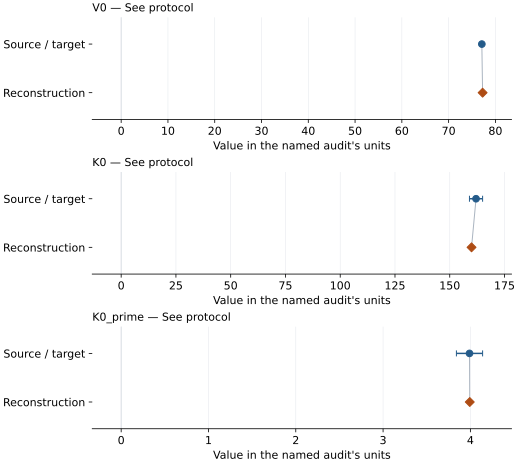
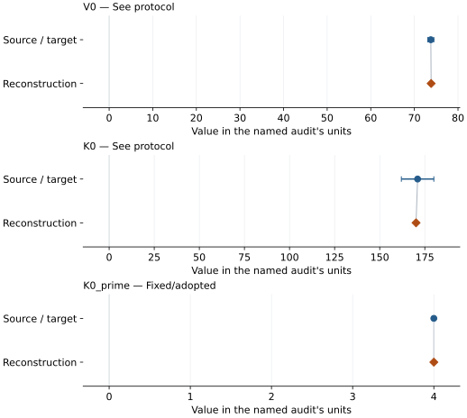

# (Mg0.65Fe0.35)O B1 ferropericlase: EOS reconstruction reports

<!-- Generated by scripts.generate_reconstruction_reports; edit EOSMAT instead. -->

[All reconstruction reports](index.md) · [Material and EOS parameters](../material-summaries/mg065fe035o.md)

These reports explain the assessments already stored in EOSMAT. Generating
this page does not refit observations, change classifications or replace source coefficients.

Use [scientific label definitions](../eos-labels.md) to distinguish coefficient
agreement, source verification, author-workflow reproduction and recommendation for use.

| EOS record | Recorded outcome | Coefficient comparison |
| --- | --- | --- |
| [Solomatova et al. (2016), hs BM3 reference branch](#record-mg065fe035o_solomatova_2016_hs_bm3_reference_1) | Numerically similar, with qualifications | Graph and table |
| [Solomatova et al. (2016), ls BM3 reference branch](#record-mg065fe035o_solomatova_2016_ls_bm3_reference_2) | Numerically similar, with qualifications | Graph and table |

## Solomatova et al. (2016), hs BM3 reference branch

Record: `mg065fe035o_solomatova_2016_hs_bm3_reference_1` · Model: `BM3`

**Outcome: Numerically similar, with qualifications.**

**Scope:** Comparison with the source parameterization.
**Comparison basis:** Every compared free coefficient meets either the recorded combined-two-sigma comparison or parameter-specific numerical similarity screen; the audit does not classify the complete comparison as parity.

[Stored EOS coefficients and source](../material-summaries/mg065fe035o.md#record-mg065fe035o_solomatova_2016_hs_bm3_reference_1)

### What this result establishes

**Separate source-review status:** primary\_source\_validated.
**Usage recommendation:** See the stored EOS qualifications; no recommendation is inferred here.

- Coupled three-level spin-state reconstruction using the recovered earlier observations and Solomatova Table 2 priors. The original MINUTI input, row weights, residual definition, and covariance are unpublished, so this equal-weight approximate-volume fit tests numerical similarity rather than claiming an exact reproduction.
- This named numerical assessment alone does not establish author-workflow reproduction, physical accuracy or recommendation for use.

### Data and reconstruction method

- **Dataset identifiers:** mg065fe035o\_chen\_2012\_table1\_pv
- **Observations:** 36
- **Fit kind:** coupled\_bm3\_three\_level\_spin\_crossover
- **Selection:** used\_in\_solomatova\_2016\_fit=1
- **Objective:** equal-weight approximate volume residuals plus Table 2 priors
- **Free parameters:** V0\_HS; K0\_HS; K0\_prime\_HS; V0\_LS; K0\_LS; omega0
- **Fixed parameters:** None declared

Unspecified selections, weights, fixed values or error conventions remain unknown; they have not been inferred for this report.

### Source versus reconstruction

This is a **coefficient comparison**, not an observation or residual plot.
Each panel uses its coefficient's audit units and includes zero. Markers show
stored central values only. Error widths are retained in the table below;
no confidence interval or uncertainty band is inferred. Fixed/adopted values are constraints.

| Parameter | Source / target | Source error | Reconstruction | Reconstruction error | Fit role |
| --- | --- | --- | --- | --- | --- |
| V0 | 77.1 | 0.12 | 77.26373463936075 | Not specified | See protocol |
| K0 | 162.0 | 3 | 159.9457884664697 | Not specified | See protocol |
| K0\_prime | 3.99 | 0.15 | 3.9929807227183662 | Not specified | See protocol |

Values and reported errors are copied without rounding or conversion from the named audit. Missing errors mean unknown, not zero. Parameter names and volume conventions follow that audit; error widths do not imply a confidence convention.

Recorded diagnostics, covariance and additional protocol

- **Solver success:** True
- **Solver message:** dedicated Solomatova coupled reconstruction completed
- **Rmse volume a3:** 0.205907548920682

### Detailed evidence and existing plots

- [Earlier detailed record investigation](../primary-eos-refits.md#investigation-mg065fe035o_solomatova_2016_hs_bm3_reference_1).
- [Record-by-record numerical ledger](../primary-eos-refits.md#records).
- [Source-audit reports](../source-audits.md).

Observation curves and residual plots are provided by the supporting reports where available. Their absence is not filled by a reconstructed curve presented as measured data.

[Machine-readable comparison ledger](https://github.com/CPrescher/peritheos/blob/main/docs/data/primary-eos-refits.json) — look up `mg065fe035o_solomatova_2016_hs_bm3_reference_1`.
[Complete native EOSMAT file](https://github.com/CPrescher/peritheos/blob/main/peritheos/data/materials/mg065fe035o.eosmat).

## Solomatova et al. (2016), ls BM3 reference branch

Record: `mg065fe035o_solomatova_2016_ls_bm3_reference_2` · Model: `BM3`

**Outcome: Numerically similar, with qualifications.**

**Scope:** Comparison with the source parameterization.
**Comparison basis:** Every compared free coefficient meets either the recorded combined-two-sigma comparison or parameter-specific numerical similarity screen; the audit does not classify the complete comparison as parity.

[Stored EOS coefficients and source](../material-summaries/mg065fe035o.md#record-mg065fe035o_solomatova_2016_ls_bm3_reference_2)

### What this result establishes

**Separate source-review status:** primary\_source\_validated.
**Usage recommendation:** See the stored EOS qualifications; no recommendation is inferred here.

- Coupled three-level spin-state reconstruction using the recovered earlier observations and Solomatova Table 2 priors. The original MINUTI input, row weights, residual definition, and covariance are unpublished, so this equal-weight approximate-volume fit tests numerical similarity rather than claiming an exact reproduction.
- This named numerical assessment alone does not establish author-workflow reproduction, physical accuracy or recommendation for use.

### Data and reconstruction method

- **Dataset identifiers:** mg065fe035o\_chen\_2012\_table1\_pv
- **Observations:** 36
- **Fit kind:** coupled\_bm3\_three\_level\_spin\_crossover
- **Selection:** used\_in\_solomatova\_2016\_fit=1
- **Objective:** equal-weight approximate volume residuals plus Table 2 priors
- **Free parameters:** V0\_HS; K0\_HS; K0\_prime\_HS; V0\_LS; K0\_LS; omega0
- **Fixed parameters:** K0\_prime

Unspecified selections, weights, fixed values or error conventions remain unknown; they have not been inferred for this report.

### Source versus reconstruction

This is a **coefficient comparison**, not an observation or residual plot.
Each panel uses its coefficient's audit units and includes zero. Markers show
stored central values only. Error widths are retained in the table below;
no confidence interval or uncertainty band is inferred. Fixed/adopted values are constraints.

| Parameter | Source / target | Source error | Reconstruction | Reconstruction error | Fit role |
| --- | --- | --- | --- | --- | --- |
| V0 | 73.77 | 0.69 | 73.84088369198591 | Not specified | See protocol |
| K0 | 171.0 | 9 | 170.1407881118083 | Not specified | See protocol |
| K0\_prime | 4.0 | Not specified | 4.0 | Not specified | Fixed/adopted |

Values and reported errors are copied without rounding or conversion from the named audit. Missing errors mean unknown, not zero. Parameter names and volume conventions follow that audit; error widths do not imply a confidence convention.

Recorded diagnostics, covariance and additional protocol

- **Solver success:** True
- **Solver message:** dedicated Solomatova coupled reconstruction completed
- **Rmse volume a3:** 0.205907548920682

### Detailed evidence and existing plots

- [Earlier detailed record investigation](../primary-eos-refits.md#investigation-mg065fe035o_solomatova_2016_ls_bm3_reference_2).
- [Record-by-record numerical ledger](../primary-eos-refits.md#records).
- [Source-audit reports](../source-audits.md).

Observation curves and residual plots are provided by the supporting reports where available. Their absence is not filled by a reconstructed curve presented as measured data.

[Machine-readable comparison ledger](https://github.com/CPrescher/peritheos/blob/main/docs/data/primary-eos-refits.json) — look up `mg065fe035o_solomatova_2016_ls_bm3_reference_2`.
[Complete native EOSMAT file](https://github.com/CPrescher/peritheos/blob/main/peritheos/data/materials/mg065fe035o.eosmat).
