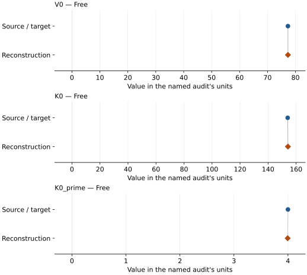

# (Mg0.73Fe0.27)O magnesiowustite: EOS reconstruction reports

<!-- Generated by scripts.generate_reconstruction_reports; edit EOSMAT instead. -->

[All reconstruction reports](index.md) · [Material and EOS parameters](../material-summaries/mg073fe027o.md)

These reports explain the assessments already stored in EOSMAT. Generating
this page does not refit observations, change classifications or replace source coefficients.

Use [scientific label definitions](../eos-labels.md) to distinguish coefficient
agreement, source verification, author-workflow reproduction and recommendation for use.

| EOS record | Recorded outcome | Coefficient comparison |
| --- | --- | --- |
| [Jacobsen et al. (2005), (Mg0.73Fe0.27)O BM3](#record-mg073fe027o_jacobsen_2005_bm3_1) | Coefficient parity achieved | Graph and table |

## Jacobsen et al. (2005), (Mg0.73Fe0.27)O BM3

Record: `mg073fe027o_jacobsen_2005_bm3_1` · Model: `BM3`

**Outcome: Coefficient parity achieved.**

**Scope:** Comparison with the source parameterization.
**Comparison basis:** Every compared free coefficient meets both the recorded combined-two-sigma comparison and parameter-specific numerical similarity screen. Error conventions and fit qualifications remain applicable.

[Stored EOS coefficients and source](../material-summaries/mg073fe027o.md#record-mg073fe027o_jacobsen_2005_bm3_1)

### What this result establishes

**Separate source-review status:** primary\_source\_validated.
**Usage recommendation:** See the stored EOS qualifications; no recommendation is inferred here.

- This named numerical assessment alone does not establish author-workflow reproduction, physical accuracy or recommendation for use.

### Data and reconstruction method

- **Dataset identifiers:** jacobsen\_2005\_table1\_compression
- **Observations:** 16
- **Fit kind:** isothermal\_pv
- **Selection:** mg073fe027o\_fit\_included=1
- **Objective:** errors\_in\_variables
- **Absolute sigma:** True
- **Free parameters:** V0; K0; K0\_prime
- **Fixed parameters:** None declared

Unspecified selections, weights, fixed values or error conventions remain unknown; they have not been inferred for this report.

### Source versus reconstruction

This is a **coefficient comparison**, not an observation or residual plot.
Each panel uses its coefficient's audit units and includes zero. Markers show
stored central values only. Error widths are retained in the table below;
no confidence interval or uncertainty band is inferred. Fixed/adopted values are constraints.

| Parameter | Source / target | Source error | Reconstruction | Reconstruction error | Fit role |
| --- | --- | --- | --- | --- | --- |
| V0 | 77.3 | 0.09 | 77.30314037763132 | 0.40735834370565643 | Free |
| K0 | 154.0 | 3.0 | 154.18965180594438 | 15.761195298086387 | Free |
| K0\_prime | 4.0 | 0.1 | 3.994193607998538 | 0.6848338020820797 | Free |

Values and reported errors are copied without rounding or conversion from the named audit. Missing errors mean unknown, not zero. Parameter names and volume conventions follow that audit; error widths do not imply a confidence convention.

Recorded diagnostics, covariance and additional protocol

- **Columns:**
    - **Pressure:** pressure\_gpa
    - **Temperature:** Not specified
    - **Volume:** mg073fe027o\_derived\_volume\_a3
- **Observed pressure range gpa:** \[0.0, 51.1\]
- **Observed temperature range k:** Not specified
- **Observed volume range:** \[62.292219, 77.303332\]
- **Degrees of freedom:** 13
- **Solver success:** True
- **Solver message:** \`ftol\` termination condition is satisfied.
- **Rmse gpa:** 0.1752415301662709
- **Published rmse gpa:** 0.19391116066080588
- **Reduced chi square:** 0.041334685496081436

### Detailed evidence and existing plots

- [Record-by-record numerical ledger](../primary-eos-refits.md#records).
- [Source-audit reports](../source-audits.md).

Observation curves and residual plots are provided by the supporting reports where available. Their absence is not filled by a reconstructed curve presented as measured data.

[Machine-readable comparison ledger](https://github.com/CPrescher/peritheos/blob/main/docs/data/primary-eos-refits.json) — look up `mg073fe027o_jacobsen_2005_bm3_1`.
[Complete native EOSMAT file](https://github.com/CPrescher/peritheos/blob/main/peritheos/data/materials/mg073fe027o.eosmat).
