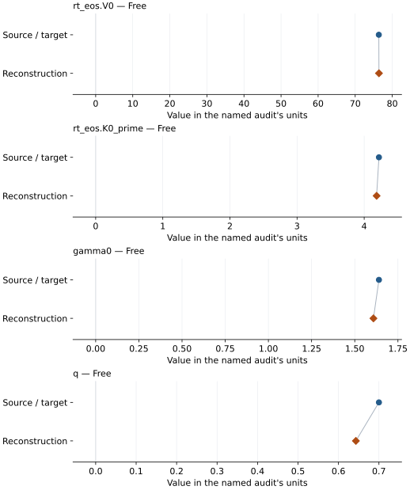
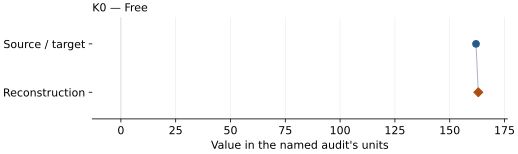
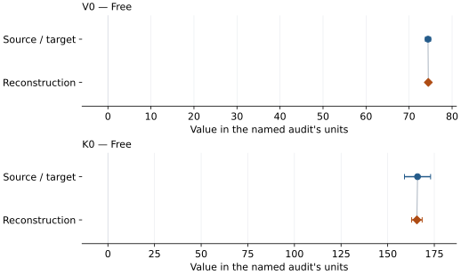
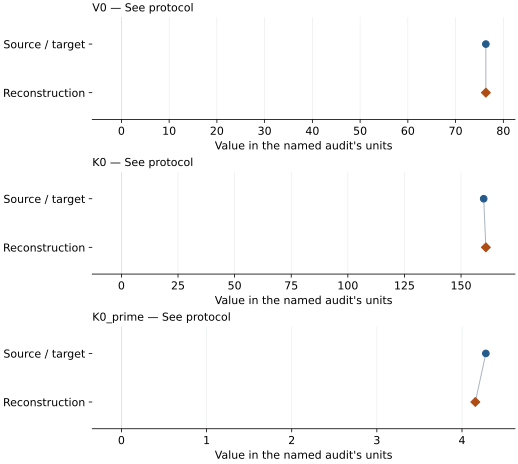
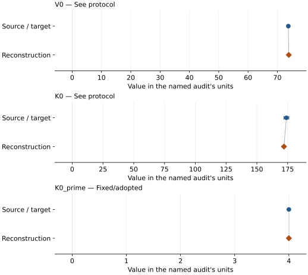

# (Mg0.75Fe0.25)O B1 ferropericlase: EOS reconstruction reports

<!-- Generated by scripts.generate_reconstruction_reports; edit EOSMAT instead. -->

[All reconstruction reports](index.md) · [Material and EOS parameters](../material-summaries/mg075fe025o.md)

These reports explain the assessments already stored in EOSMAT. Generating
this page does not refit observations, change classifications or replace source coefficients.

Use [scientific label definitions](../eos-labels.md) to distinguish coefficient
agreement, source verification, author-workflow reproduction and recommendation for use.

| EOS record | Recorded outcome | Coefficient comparison |
| --- | --- | --- |
| [Matsui et al. (2012), (Mg0.75Fe0.25)O high-spin BM3-MGD](#record-mg075fe025o_matsui_2012_bm3_mgd_1) | Coefficient parity achieved | Graph and table |
| [Mao et al. (2011), 300 K high-spin reference BM3](#record-mg075fe025o_mao_2011_high_spin_bm3_1) | Coefficient parity achieved | Graph and table |
| [Mao et al. (2011), 300 K low-spin reference BM3](#record-mg075fe025o_mao_2011_low_spin_bm3_1) | Coefficient parity achieved | Graph and table |
| [Leonov et al. (2017), Mg0.75Fe0.25O high-spin DFT+DMFT BM3](#record-mg075fe025o_leonov_2017_hs_bm3_1) | Complete independent refit unavailable | No numeric coefficient pair recorded |
| [Solomatova et al. (2016), Mao-data high-spin BM3 reference branch](#record-mg075fe025o_solomatova_2016_hs_bm3_reference_1) | Parity not achieved for this comparison | Graph and table |
| [Solomatova et al. (2016), Mao-data low-spin BM3 reference branch](#record-mg075fe025o_solomatova_2016_ls_bm3_reference_2) | Parity not achieved for this comparison | Graph and table |

## Matsui et al. (2012), (Mg0.75Fe0.25)O high-spin BM3-MGD

Record: `mg075fe025o_matsui_2012_bm3_mgd_1` · Model: `BM3`

**Outcome: Coefficient parity achieved.**

**Scope:** Comparison with the source parameterization.
**Comparison basis:** Every compared free coefficient meets both the recorded combined-two-sigma comparison and parameter-specific numerical similarity screen. Error conventions and fit qualifications remain applicable.

[Stored EOS coefficients and source](../material-summaries/mg075fe025o.md#record-mg075fe025o_matsui_2012_bm3_mgd_1)

### What this result establishes

**Separate source-review status:** primary\_source\_validated.
**Usage recommendation:** See the stored EOS qualifications; no recommendation is inferred here.

- This named numerical assessment alone does not establish author-workflow reproduction, physical accuracy or recommendation for use.

### Data and reconstruction method

- **Dataset identifiers:** mg075fe025o\_matsui\_2012\_table2\_pvt
- **Observations:** 30
- **Fit kind:** joint\_pvt
- **Selection:** fit\_included=1
- **Objective:** errors\_in\_variables
- **Absolute sigma:** True
- **Free parameters:** rt\_eos.V0; rt\_eos.K0\_prime; gamma0; q
- **Fixed parameters:** K0; Tr; theta0; n

Unspecified selections, weights, fixed values or error conventions remain unknown; they have not been inferred for this report.

### Source versus reconstruction

This is a **coefficient comparison**, not an observation or residual plot.
Each panel uses its coefficient's audit units and includes zero. Markers show
stored central values only. Error widths are retained in the table below;
no confidence interval or uncertainty band is inferred. Fixed/adopted values are constraints.

| Parameter | Source / target | Source error | Reconstruction | Reconstruction error | Fit role |
| --- | --- | --- | --- | --- | --- |
| rt\_eos.V0 | 76.372 | 0.016 | 76.40503582384734 | 0.18384579982614763 | Free |
| rt\_eos.K0\_prime | 4.22 | 0.03 | 4.185225919968749 | 0.2637882770525304 | Free |
| gamma0 | 1.64 | 0.04 | 1.608143663069842 | 0.35503142776374286 | Free |
| q | 0.7 | 0.2 | 0.6430431368213168 | 1.6984949199180004 | Free |

Values and reported errors are copied without rounding or conversion from the named audit. Missing errors mean unknown, not zero. Parameter names and volume conventions follow that audit; error widths do not imply a confidence convention.

Recorded diagnostics, covariance and additional protocol

- **Columns:**
    - **Pressure:** pressure\_gpa
    - **Temperature:** temperature\_k
    - **Volume:** cell\_volume\_a3
- **Observed pressure range gpa:** \[0.0, 46.21\]
- **Observed temperature range k:** \[300.0, 1100.0\]
- **Observed volume range:** \[63.411, 76.368\]
- **Degrees of freedom:** 26
- **Solver success:** True
- **Solver message:** \`ftol\` termination condition is satisfied.
- **Rmse gpa:** 0.13709017400991078
- **Published rmse gpa:** 0.14260978521533488
- **Reduced chi square:** 0.021797284416068916

### Detailed evidence and existing plots

- [Record-by-record numerical ledger](../primary-eos-refits.md#records).
- [Source-audit reports](../source-audits.md).

Observation curves and residual plots are provided by the supporting reports where available. Their absence is not filled by a reconstructed curve presented as measured data.

[Machine-readable comparison ledger](https://github.com/CPrescher/peritheos/blob/main/docs/data/primary-eos-refits.json) — look up `mg075fe025o_matsui_2012_bm3_mgd_1`.
[Complete native EOSMAT file](https://github.com/CPrescher/peritheos/blob/main/peritheos/data/materials/mg075fe025o.eosmat).

## Mao et al. (2011), 300 K high-spin reference BM3

Record: `mg075fe025o_mao_2011_high_spin_bm3_1` · Model: `BM3`

**Outcome: Coefficient parity achieved.**

**Scope:** Comparison with the source parameterization.
**Comparison basis:** Every compared free coefficient meets both the recorded combined-two-sigma comparison and parameter-specific numerical similarity screen. Error conventions and fit qualifications remain applicable.

[Stored EOS coefficients and source](../material-summaries/mg075fe025o.md#record-mg075fe025o_mao_2011_high_spin_bm3_1)

### What this result establishes

**Separate source-review status:** primary\_source\_validated.
**Usage recommendation:** See the stored EOS qualifications; no recommendation is inferred here.

- This named numerical assessment alone does not establish author-workflow reproduction, physical accuracy or recommendation for use.

### Data and reconstruction method

- **Dataset identifiers:** mg075fe025o\_mao\_2011\_figure1\_300k\_digitized
- **Observations:** 15
- **Fit kind:** isothermal\_pv
- **Selection:** used\_in\_high\_spin\_fit=1; reference-T rows
- **Objective:** pressure\_residuals
- **Absolute sigma:** True
- **Free parameters:** K0
- **Fixed parameters:** V0; K0\_prime

Unspecified selections, weights, fixed values or error conventions remain unknown; they have not been inferred for this report.

### Source versus reconstruction

This is a **coefficient comparison**, not an observation or residual plot.
Each panel uses its coefficient's audit units and includes zero. Markers show
stored central values only. Error widths are retained in the table below;
no confidence interval or uncertainty band is inferred. Fixed/adopted values are constraints.

| Parameter | Source / target | Source error | Reconstruction | Reconstruction error | Fit role |
| --- | --- | --- | --- | --- | --- |
| K0 | 162.0 | 1.0 | 163.04608344465686 | 0.20428211801495158 | Free |

Values and reported errors are copied without rounding or conversion from the named audit. Missing errors mean unknown, not zero. Parameter names and volume conventions follow that audit; error widths do not imply a confidence convention.

Recorded diagnostics, covariance and additional protocol

- **Columns:**
    - **Pressure:** pressure\_gpa
    - **Temperature:** temperature\_k
    - **Volume:** cell\_volume\_a3
- **Observed pressure range gpa:** \[0.0, 48.4\]
- **Observed temperature range k:** \[300.0, 300.0\]
- **Observed volume range:** \[62.56, 76.37\]
- **Degrees of freedom:** 14
- **Solver success:** True
- **Solver message:** Both \`ftol\` and \`xtol\` termination conditions are satisfied.
- **Rmse gpa:** 0.14700330649375848
- **Published rmse gpa:** 0.24917066963263618
- **Reduced chi square:** 0.02315354155724774

### Detailed evidence and existing plots

- [Record-by-record numerical ledger](../primary-eos-refits.md#records).
- [Source-audit reports](../source-audits.md).

Observation curves and residual plots are provided by the supporting reports where available. Their absence is not filled by a reconstructed curve presented as measured data.

[Machine-readable comparison ledger](https://github.com/CPrescher/peritheos/blob/main/docs/data/primary-eos-refits.json) — look up `mg075fe025o_mao_2011_high_spin_bm3_1`.
[Complete native EOSMAT file](https://github.com/CPrescher/peritheos/blob/main/peritheos/data/materials/mg075fe025o.eosmat).

## Mao et al. (2011), 300 K low-spin reference BM3

Record: `mg075fe025o_mao_2011_low_spin_bm3_1` · Model: `BM3`

**Outcome: Coefficient parity achieved.**

**Scope:** Comparison with the source parameterization.
**Comparison basis:** Every compared free coefficient meets both the recorded combined-two-sigma comparison and parameter-specific numerical similarity screen. Error conventions and fit qualifications remain applicable.

[Stored EOS coefficients and source](../material-summaries/mg075fe025o.md#record-mg075fe025o_mao_2011_low_spin_bm3_1)

### What this result establishes

**Separate source-review status:** primary\_source\_validated.
**Usage recommendation:** See the stored EOS qualifications; no recommendation is inferred here.

- This named numerical assessment alone does not establish author-workflow reproduction, physical accuracy or recommendation for use.

### Data and reconstruction method

- **Dataset identifiers:** mg075fe025o\_mao\_2011\_figure1\_300k\_digitized
- **Observations:** 18
- **Fit kind:** isothermal\_pv
- **Selection:** used\_in\_low\_spin\_fit=1; reference-T rows
- **Objective:** pressure\_residuals
- **Absolute sigma:** True
- **Free parameters:** V0; K0
- **Fixed parameters:** K0\_prime

Unspecified selections, weights, fixed values or error conventions remain unknown; they have not been inferred for this report.

### Source versus reconstruction

This is a **coefficient comparison**, not an observation or residual plot.
Each panel uses its coefficient's audit units and includes zero. Markers show
stored central values only. Error widths are retained in the table below;
no confidence interval or uncertainty band is inferred. Fixed/adopted values are constraints.

| Parameter | Source / target | Source error | Reconstruction | Reconstruction error | Fit role |
| --- | --- | --- | --- | --- | --- |
| V0 | 74.4 | 0.6 | 74.47146125145545 | 0.2505953853343565 | Free |
| K0 | 166.0 | 7.0 | 165.661876074916 | 2.8145952408916743 | Free |

Values and reported errors are copied without rounding or conversion from the named audit. Missing errors mean unknown, not zero. Parameter names and volume conventions follow that audit; error widths do not imply a confidence convention.

Recorded diagnostics, covariance and additional protocol

- **Columns:**
    - **Pressure:** pressure\_gpa
    - **Temperature:** temperature\_k
    - **Volume:** cell\_volume\_a3
- **Observed pressure range gpa:** \[76.1, 129.6\]
- **Observed temperature range k:** \[300.0, 300.0\]
- **Observed volume range:** \[51.42, 57.01\]
- **Degrees of freedom:** 16
- **Solver success:** True
- **Solver message:** Both \`ftol\` and \`xtol\` termination conditions are satisfied.
- **Rmse gpa:** 0.39706923036938496
- **Published rmse gpa:** 0.4942818332299435
- **Reduced chi square:** 0.1773719704194027

### Detailed evidence and existing plots

- [Record-by-record numerical ledger](../primary-eos-refits.md#records).
- [Source-audit reports](../source-audits.md).

Observation curves and residual plots are provided by the supporting reports where available. Their absence is not filled by a reconstructed curve presented as measured data.

[Machine-readable comparison ledger](https://github.com/CPrescher/peritheos/blob/main/docs/data/primary-eos-refits.json) — look up `mg075fe025o_mao_2011_low_spin_bm3_1`.
[Complete native EOSMAT file](https://github.com/CPrescher/peritheos/blob/main/peritheos/data/materials/mg075fe025o.eosmat).

## Leonov et al. (2017), Mg0.75Fe0.25O high-spin DFT+DMFT BM3

Record: `mg075fe025o_leonov_2017_hs_bm3_1` · Model: `BM3`

**Outcome: Complete independent refit unavailable.**

**Scope:** Comparison with the source parameterization.
**Comparison basis:** Independent checkpoints only; no grid deposited.

[Stored EOS coefficients and source](../material-summaries/mg075fe025o.md#record-mg075fe025o_leonov_2017_hs_bm3_1)

### What this result establishes

**Separate source-review status:** primary\_source\_validated.
**Usage recommendation:** See the stored EOS qualifications; no recommendation is inferred here.

- This named numerical assessment alone does not establish author-workflow reproduction, physical accuracy or recommendation for use.
- No reconstructed coefficient table is recorded for this assessment; no missing values have been inferred.

### Data and reconstruction method

- **Dataset identifiers:** None declared
- **Fixed parameters:** K0\_prime

Unspecified selections, weights, fixed values or error conventions remain unknown; they have not been inferred for this report.

### Why no coefficient graph is shown

No numeric source/reconstruction pair is recorded for this assessment. A graph would require information that is not available here; no values or observations have been invented.

### Detailed evidence and existing plots

- [Record-by-record numerical ledger](../primary-eos-refits.md#records).
- [Source-audit reports](../source-audits.md).

Observation curves and residual plots are provided by the supporting reports where available. Their absence is not filled by a reconstructed curve presented as measured data.

[Machine-readable comparison ledger](https://github.com/CPrescher/peritheos/blob/main/docs/data/primary-eos-refits.json) — look up `mg075fe025o_leonov_2017_hs_bm3_1`.
[Complete native EOSMAT file](https://github.com/CPrescher/peritheos/blob/main/peritheos/data/materials/mg075fe025o.eosmat).

## Solomatova et al. (2016), Mao-data high-spin BM3 reference branch

Record: `mg075fe025o_solomatova_2016_hs_bm3_reference_1` · Model: `BM3`

**Outcome: Parity not achieved for this comparison.**

**Scope:** Comparison with the source parameterization.
**Comparison basis:** Coupled three-level spin-state reconstruction using the recovered earlier observations and Solomatova Table 2 priors. The original MINUTI input, row weights, residual definition, and covariance are unpublished, so this equal-weight approximate-volume fit tests numerical similarity rather than claiming an exact reproduction. The source observations are plot-digitized and the reconstructed solution is retained as parity\_not\_achieved despite close point estimates because exact source-level parity is not supportable.

[Stored EOS coefficients and source](../material-summaries/mg075fe025o.md#record-mg075fe025o_solomatova_2016_hs_bm3_reference_1)

### What this result establishes

**Separate source-review status:** primary\_source\_validated.
**Usage recommendation:** See the stored EOS qualifications; no recommendation is inferred here.

- This named numerical assessment alone does not establish author-workflow reproduction, physical accuracy or recommendation for use.

### Data and reconstruction method

- **Dataset identifiers:** mg075fe025o\_mao\_2011\_figure1\_300k\_digitized
- **Observations:** 42
- **Fit kind:** coupled\_bm3\_three\_level\_spin\_crossover
- **Selection:** all observation rows
- **Objective:** equal-weight approximate volume residuals plus Table 2 priors
- **Free parameters:** V0\_HS; K0\_HS; K0\_prime\_HS; V0\_LS; K0\_LS; omega0
- **Fixed parameters:** None declared

Unspecified selections, weights, fixed values or error conventions remain unknown; they have not been inferred for this report.

### Source versus reconstruction

This is a **coefficient comparison**, not an observation or residual plot.
Each panel uses its coefficient's audit units and includes zero. Markers show
stored central values only. Error widths are retained in the table below;
no confidence interval or uncertainty band is inferred. Fixed/adopted values are constraints.

| Parameter | Source / target | Source error | Reconstruction | Reconstruction error | Fit role |
| --- | --- | --- | --- | --- | --- |
| V0 | 76.34 | 0 | 76.34 | Not specified | See protocol |
| K0 | 160.0 | 1 | 160.9539976776683 | Not specified | See protocol |
| K0\_prime | 4.28 | 0.06 | 4.156222322721853 | Not specified | See protocol |

Values and reported errors are copied without rounding or conversion from the named audit. Missing errors mean unknown, not zero. Parameter names and volume conventions follow that audit; error widths do not imply a confidence convention.

Recorded diagnostics, covariance and additional protocol

- **Solver success:** True
- **Solver message:** dedicated Solomatova coupled reconstruction completed
- **Rmse volume a3:** 0.07050722838979592

### Detailed evidence and existing plots

- [Earlier detailed record investigation](../primary-eos-refits.md#investigation-mg075fe025o_solomatova_2016_hs_bm3_reference_1).
- [Record-by-record numerical ledger](../primary-eos-refits.md#records).
- [Source-audit reports](../source-audits.md).

Observation curves and residual plots are provided by the supporting reports where available. Their absence is not filled by a reconstructed curve presented as measured data.

[Machine-readable comparison ledger](https://github.com/CPrescher/peritheos/blob/main/docs/data/primary-eos-refits.json) — look up `mg075fe025o_solomatova_2016_hs_bm3_reference_1`.
[Complete native EOSMAT file](https://github.com/CPrescher/peritheos/blob/main/peritheos/data/materials/mg075fe025o.eosmat).

## Solomatova et al. (2016), Mao-data low-spin BM3 reference branch

Record: `mg075fe025o_solomatova_2016_ls_bm3_reference_2` · Model: `BM3`

**Outcome: Parity not achieved for this comparison.**

**Scope:** Comparison with the source parameterization.
**Comparison basis:** Coupled three-level spin-state reconstruction using the recovered earlier observations and Solomatova Table 2 priors. The original MINUTI input, row weights, residual definition, and covariance are unpublished, so this equal-weight approximate-volume fit tests numerical similarity rather than claiming an exact reproduction. The source observations are plot-digitized and the reconstructed solution is retained as parity\_not\_achieved despite close point estimates because exact source-level parity is not supportable.

[Stored EOS coefficients and source](../material-summaries/mg075fe025o.md#record-mg075fe025o_solomatova_2016_ls_bm3_reference_2)

### What this result establishes

**Separate source-review status:** primary\_source\_validated.
**Usage recommendation:** See the stored EOS qualifications; no recommendation is inferred here.

- This named numerical assessment alone does not establish author-workflow reproduction, physical accuracy or recommendation for use.

### Data and reconstruction method

- **Dataset identifiers:** mg075fe025o\_mao\_2011\_figure1\_300k\_digitized
- **Observations:** 42
- **Fit kind:** coupled\_bm3\_three\_level\_spin\_crossover
- **Selection:** all observation rows
- **Objective:** equal-weight approximate volume residuals plus Table 2 priors
- **Free parameters:** V0\_HS; K0\_HS; K0\_prime\_HS; V0\_LS; K0\_LS; omega0
- **Fixed parameters:** K0\_prime

Unspecified selections, weights, fixed values or error conventions remain unknown; they have not been inferred for this report.

### Source versus reconstruction

This is a **coefficient comparison**, not an observation or residual plot.
Each panel uses its coefficient's audit units and includes zero. Markers show
stored central values only. Error widths are retained in the table below;
no confidence interval or uncertainty band is inferred. Fixed/adopted values are constraints.

| Parameter | Source / target | Source error | Reconstruction | Reconstruction error | Fit role |
| --- | --- | --- | --- | --- | --- |
| V0 | 73.74 | 0.19 | 73.88420741747102 | Not specified | See protocol |
| K0 | 174.0 | 2 | 171.98135643907105 | Not specified | See protocol |
| K0\_prime | 4.0 | Not specified | 4.0 | Not specified | Fixed/adopted |

Values and reported errors are copied without rounding or conversion from the named audit. Missing errors mean unknown, not zero. Parameter names and volume conventions follow that audit; error widths do not imply a confidence convention.

Recorded diagnostics, covariance and additional protocol

- **Solver success:** True
- **Solver message:** dedicated Solomatova coupled reconstruction completed
- **Rmse volume a3:** 0.07050722838979592

### Detailed evidence and existing plots

- [Earlier detailed record investigation](../primary-eos-refits.md#investigation-mg075fe025o_solomatova_2016_ls_bm3_reference_2).
- [Record-by-record numerical ledger](../primary-eos-refits.md#records).
- [Source-audit reports](../source-audits.md).

Observation curves and residual plots are provided by the supporting reports where available. Their absence is not filled by a reconstructed curve presented as measured data.

[Machine-readable comparison ledger](https://github.com/CPrescher/peritheos/blob/main/docs/data/primary-eos-refits.json) — look up `mg075fe025o_solomatova_2016_ls_bm3_reference_2`.
[Complete native EOSMAT file](https://github.com/CPrescher/peritheos/blob/main/peritheos/data/materials/mg075fe025o.eosmat).
