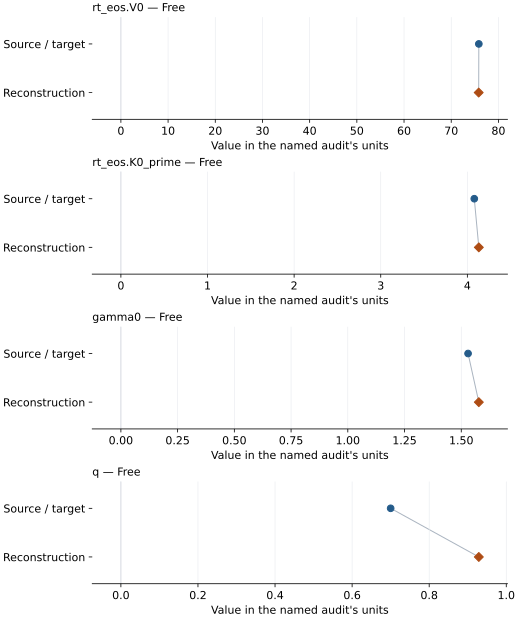

# (Mg0.83Fe0.17)O high-spin ferropericlase: EOS reconstruction reports

<!-- Generated by scripts.generate_reconstruction_reports; edit EOSMAT instead. -->

[All reconstruction reports](index.md) · [Material and EOS parameters](../material-summaries/mg083fe017o.md)

These reports explain the assessments already stored in EOSMAT. Generating
this page does not refit observations, change classifications or replace source coefficients.

Use [scientific label definitions](../eos-labels.md) to distinguish coefficient
agreement, source verification, author-workflow reproduction and recommendation for use.

| EOS record | Recorded outcome | Coefficient comparison |
| --- | --- | --- |
| [Matsui et al. (2012), (Mg0.83Fe0.17)O high-spin BM3-MGD](#record-mg083fe017o_matsui_2012_bm3_mgd_1) | Numerically similar, with qualifications | Graph and table |
| [Solomatova et al. (2016), Lin-data high-spin BM3 reference branch](#record-mg083fe017o_solomatova_2016_hs_bm3_reference_1) | Complete independent refit unavailable | No numeric coefficient pair recorded |
| [Solomatova et al. (2016), Lin-data low-spin BM3 reference branch](#record-mg083fe017o_solomatova_2016_ls_bm3_reference_2) | Complete independent refit unavailable | No numeric coefficient pair recorded |

## Matsui et al. (2012), (Mg0.83Fe0.17)O high-spin BM3-MGD

Record: `mg083fe017o_matsui_2012_bm3_mgd_1` · Model: `BM3`

**Outcome: Numerically similar, with qualifications.**

**Scope:** Comparison with the source parameterization.
**Comparison basis:** Every compared free coefficient meets either the recorded combined-two-sigma comparison or parameter-specific numerical similarity screen; the audit does not classify the complete comparison as parity.

[Stored EOS coefficients and source](../material-summaries/mg083fe017o.md#record-mg083fe017o_matsui_2012_bm3_mgd_1)

### What this result establishes

**Separate source-review status:** primary\_source\_validated.
**Usage recommendation:** See the stored EOS qualifications; no recommendation is inferred here.

- This named numerical assessment alone does not establish author-workflow reproduction, physical accuracy or recommendation for use.

### Data and reconstruction method

- **Dataset identifiers:** mg083fe017o\_matsui\_2012\_table1\_pvt
- **Observations:** 23
- **Fit kind:** joint\_pvt
- **Selection:** fit\_included=1
- **Objective:** errors\_in\_variables
- **Absolute sigma:** True
- **Free parameters:** rt\_eos.V0; rt\_eos.K0\_prime; gamma0; q
- **Fixed parameters:** K0; Tr; theta0; n

Unspecified selections, weights, fixed values or error conventions remain unknown; they have not been inferred for this report.

### Source versus reconstruction

This is a **coefficient comparison**, not an observation or residual plot.
Each panel uses its coefficient's audit units and includes zero. Markers show
stored central values only. Error widths are retained in the table below;
no confidence interval or uncertainty band is inferred. Fixed/adopted values are constraints.

| Parameter | Source / target | Source error | Reconstruction | Reconstruction error | Fit role |
| --- | --- | --- | --- | --- | --- |
| rt\_eos.V0 | 75.849 | 0.011 | 75.81792398973612 | 0.20549027792030766 | Free |
| rt\_eos.K0\_prime | 4.08 | 0.02 | 4.132394873642603 | 0.2684528087408027 | Free |
| gamma0 | 1.53 | 0.04 | 1.5774242742930678 | 0.4114402303137616 | Free |
| q | 0.7 | 0.2 | 0.9288051997567589 | 1.9007015786956152 | Free |

Values and reported errors are copied without rounding or conversion from the named audit. Missing errors mean unknown, not zero. Parameter names and volume conventions follow that audit; error widths do not imply a confidence convention.

Recorded diagnostics, covariance and additional protocol

- **Columns:**
    - **Pressure:** pressure\_gpa
    - **Temperature:** temperature\_k
    - **Volume:** cell\_volume\_a3
- **Observed pressure range gpa:** \[0.0, 46.39\]
- **Observed temperature range k:** \[300.0, 1100.0\]
- **Observed volume range:** \[62.442, 75.855\]
- **Degrees of freedom:** 19
- **Solver success:** True
- **Solver message:** \`ftol\` termination condition is satisfied.
- **Rmse gpa:** 0.11499064762558688
- **Published rmse gpa:** 0.12330274873545173
- **Reduced chi square:** 0.016072145120072365

### Detailed evidence and existing plots

- [Earlier detailed record investigation](../primary-eos-refits.md#investigation-mg083fe017o_matsui_2012_bm3_mgd_1).
- [Record-by-record numerical ledger](../primary-eos-refits.md#records).
- [Source-audit reports](../source-audits.md).

Observation curves and residual plots are provided by the supporting reports where available. Their absence is not filled by a reconstructed curve presented as measured data.

[Machine-readable comparison ledger](https://github.com/CPrescher/peritheos/blob/main/docs/data/primary-eos-refits.json) — look up `mg083fe017o_matsui_2012_bm3_mgd_1`.
[Complete native EOSMAT file](https://github.com/CPrescher/peritheos/blob/main/peritheos/data/materials/mg083fe017o.eosmat).

## Solomatova et al. (2016), Lin-data high-spin BM3 reference branch

Record: `mg083fe017o_solomatova_2016_hs_bm3_reference_1` · Model: `BM3`

**Outcome: Complete independent refit unavailable.**

**Scope:** Comparison with the source parameterization.
**Comparison basis:** The primary figure supplies 43 V/V0,HS observations but not the absolute V0,HS normalization, so all six absolute Table 7 coefficients are not independently identifiable.

[Stored EOS coefficients and source](../material-summaries/mg083fe017o.md#record-mg083fe017o_solomatova_2016_hs_bm3_reference_1)

### What this result establishes

**Separate source-review status:** primary\_source\_validated.
**Usage recommendation:** See the stored EOS qualifications; no recommendation is inferred here.

- This named numerical assessment alone does not establish author-workflow reproduction, physical accuracy or recommendation for use.
- No reconstructed coefficient table is recorded for this assessment; no missing values have been inferred.

### Data and reconstruction method

- **Dataset identifiers:** mg083fe017o\_lin\_2005\_figure2\_300k\_digitized
- **Observations:** 43
- **Fixed parameters:** None declared

Unspecified selections, weights, fixed values or error conventions remain unknown; they have not been inferred for this report.

### Why no coefficient graph is shown

No numeric source/reconstruction pair is recorded for this assessment. A graph would require information that is not available here; no values or observations have been invented.

### Detailed evidence and existing plots

- [Record-by-record numerical ledger](../primary-eos-refits.md#records).
- [Source-audit reports](../source-audits.md).

Observation curves and residual plots are provided by the supporting reports where available. Their absence is not filled by a reconstructed curve presented as measured data.

[Machine-readable comparison ledger](https://github.com/CPrescher/peritheos/blob/main/docs/data/primary-eos-refits.json) — look up `mg083fe017o_solomatova_2016_hs_bm3_reference_1`.
[Complete native EOSMAT file](https://github.com/CPrescher/peritheos/blob/main/peritheos/data/materials/mg083fe017o.eosmat).

## Solomatova et al. (2016), Lin-data low-spin BM3 reference branch

Record: `mg083fe017o_solomatova_2016_ls_bm3_reference_2` · Model: `BM3`

**Outcome: Complete independent refit unavailable.**

**Scope:** Comparison with the source parameterization.
**Comparison basis:** The primary figure supplies 43 V/V0,HS observations but not the absolute V0,HS normalization, so all six absolute Table 7 coefficients are not independently identifiable.

[Stored EOS coefficients and source](../material-summaries/mg083fe017o.md#record-mg083fe017o_solomatova_2016_ls_bm3_reference_2)

### What this result establishes

**Separate source-review status:** primary\_source\_validated.
**Usage recommendation:** See the stored EOS qualifications; no recommendation is inferred here.

- This named numerical assessment alone does not establish author-workflow reproduction, physical accuracy or recommendation for use.
- No reconstructed coefficient table is recorded for this assessment; no missing values have been inferred.

### Data and reconstruction method

- **Dataset identifiers:** mg083fe017o\_lin\_2005\_figure2\_300k\_digitized
- **Observations:** 43
- **Fixed parameters:** K0\_prime

Unspecified selections, weights, fixed values or error conventions remain unknown; they have not been inferred for this report.

### Why no coefficient graph is shown

No numeric source/reconstruction pair is recorded for this assessment. A graph would require information that is not available here; no values or observations have been invented.

### Detailed evidence and existing plots

- [Record-by-record numerical ledger](../primary-eos-refits.md#records).
- [Source-audit reports](../source-audits.md).

Observation curves and residual plots are provided by the supporting reports where available. Their absence is not filled by a reconstructed curve presented as measured data.

[Machine-readable comparison ledger](https://github.com/CPrescher/peritheos/blob/main/docs/data/primary-eos-refits.json) — look up `mg083fe017o_solomatova_2016_ls_bm3_reference_2`.
[Complete native EOSMAT file](https://github.com/CPrescher/peritheos/blob/main/peritheos/data/materials/mg083fe017o.eosmat).
