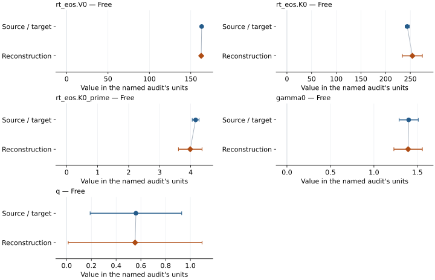

# 13% Fe-bearing bridgmanite: EOS reconstruction reports

<!-- Generated by scripts.generate_reconstruction_reports; edit EOSMAT instead. -->

[All reconstruction reports](index.md) · [Material and EOS parameters](../material-summaries/mg087fe013sio3_bridgmanite.md)

These reports explain the assessments already stored in EOSMAT. Generating
this page does not refit observations, change classifications or replace source coefficients.

Use [scientific label definitions](../eos-labels.md) to distinguish coefficient
agreement, source verification, author-workflow reproduction and recommendation for use.

| EOS record | Recorded outcome | Coefficient comparison |
| --- | --- | --- |
| [Wolf et al. (2015), 13% Fe bridgmanite Vinet-MGD](#record-mg087fe013sio3_bridgmanite_wolf_2015_vinet_mgd_1) | Coefficient parity achieved | Graph and table |

## Wolf et al. (2015), 13% Fe bridgmanite Vinet-MGD

Record: `mg087fe013sio3_bridgmanite_wolf_2015_vinet_mgd_1` · Model: `Vinet`

**Outcome: Coefficient parity achieved.**

**Scope:** Comparison with the source parameterization.
**Comparison basis:** Every compared free coefficient meets both the recorded combined-two-sigma comparison and parameter-specific numerical similarity screen. Error conventions and fit qualifications remain applicable.

[Stored EOS coefficients and source](../material-summaries/mg087fe013sio3_bridgmanite.md#record-mg087fe013sio3_bridgmanite_wolf_2015_vinet_mgd_1)

### What this result establishes

**Separate source-review status:** primary\_source\_validated.
**Usage recommendation:** See the stored EOS qualifications; no recommendation is inferred here.

- This named numerical assessment alone does not establish author-workflow reproduction, physical accuracy or recommendation for use.

### Data and reconstruction method

- **Dataset identifiers:** mg087fe013sio3\_bridgmanite\_wolf\_2015\_table1\_pvt
- **Observations:** 153
- **Fit kind:** joint\_pvt
- **Selection:** all rows
- **Objective:** errors\_in\_variables
- **Absolute sigma:** True
- **Free parameters:** rt\_eos.V0; rt\_eos.K0; rt\_eos.K0\_prime; gamma0; q
- **Fixed parameters:** Tr; theta0; n

Unspecified selections, weights, fixed values or error conventions remain unknown; they have not been inferred for this report.

### Source versus reconstruction

This is a **coefficient comparison**, not an observation or residual plot.
Each panel uses its coefficient's audit units and includes zero. Markers show
stored central values only. Error widths are retained in the table below;
no confidence interval or uncertainty band is inferred. Fixed/adopted values are constraints.

| Parameter | Source / target | Source error | Reconstruction | Reconstruction error | Fit role |
| --- | --- | --- | --- | --- | --- |
| rt\_eos.V0 | 163.16 | 0.19 | 162.60249726814212 | 0.9892223853928208 | Free |
| rt\_eos.K0 | 243.8 | 4.3 | 254.1786085606223 | 20.258233450273092 | Free |
| rt\_eos.K0\_prime | 4.16 | 0.11 | 3.9857458076163974 | 0.38012192157554864 | Free |
| gamma0 | 1.4 | 0.11 | 1.39320084076452 | 0.16372684916820773 | Free |
| q | 0.56 | 0.37 | 0.5535850391932572 | 0.5406059438791783 | Free |

Values and reported errors are copied without rounding or conversion from the named audit. Missing errors mean unknown, not zero. Parameter names and volume conventions follow that audit; error widths do not imply a confidence convention.

Recorded diagnostics, covariance and additional protocol

- **Columns:**
    - **Pressure:** pressure\_gpa
    - **Temperature:** temperature\_k
    - **Volume:** bridgmanite\_unit\_cell\_volume\_a3
- **Observed pressure range gpa:** \[33.15, 132.7\]
- **Observed temperature range k:** \[300.0, 2455.0\]
- **Observed volume range:** \[122.42, 146.59\]
- **Degrees of freedom:** 148
- **Solver success:** True
- **Solver message:** \`ftol\` termination condition is satisfied.
- **Rmse gpa:** 1.0712048891019135
- **Published rmse gpa:** 1.9496990046194926
- **Reduced chi square:** 0.613916105009841

### Detailed evidence and existing plots

- [Record-by-record numerical ledger](../primary-eos-refits.md#records).
- [Source-audit reports](../source-audits.md).

Observation curves and residual plots are provided by the supporting reports where available. Their absence is not filled by a reconstructed curve presented as measured data.

[Machine-readable comparison ledger](https://github.com/CPrescher/peritheos/blob/main/docs/data/primary-eos-refits.json) — look up `mg087fe013sio3_bridgmanite_wolf_2015_vinet_mgd_1`.
[Complete native EOSMAT file](https://github.com/CPrescher/peritheos/blob/main/peritheos/data/materials/mg087fe013sio3_bridgmanite.eosmat).
