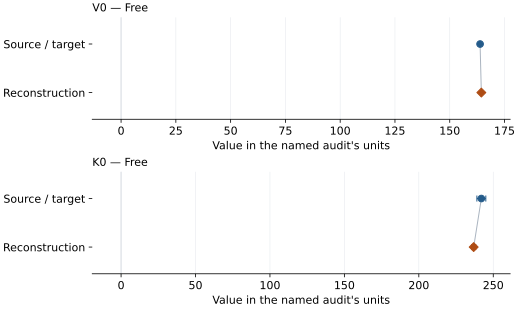
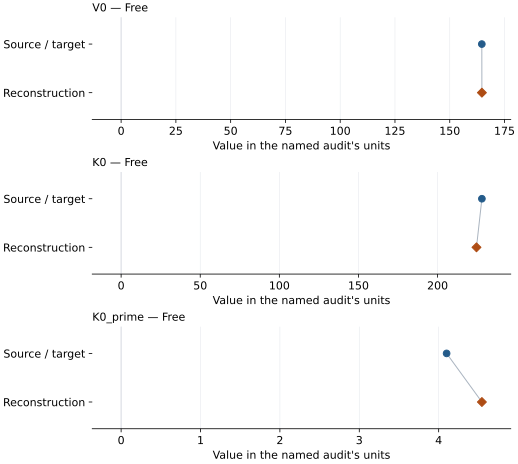
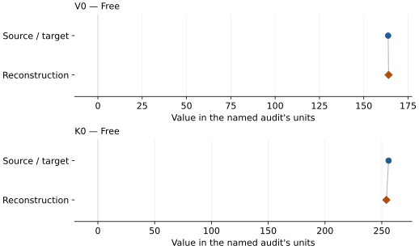
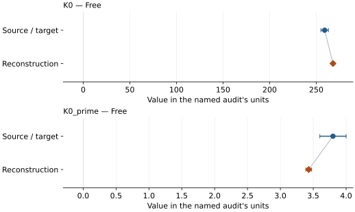

# Fe10-Al14 bridgmanite: EOS reconstruction reports

<!-- Generated by scripts.generate_reconstruction_reports; edit EOSMAT instead. -->

[All reconstruction reports](index.md) · [Material and EOS parameters](../material-summaries/mg088fe010al014si090o3_bridgmanite.md)

These reports explain the assessments already stored in EOSMAT. Generating
this page does not refit observations, change classifications or replace source coefficients.

Use [scientific label definitions](../eos-labels.md) to distinguish coefficient
agreement, source verification, author-workflow reproduction and recommendation for use.

| EOS record | Recorded outcome | Coefficient comparison |
| --- | --- | --- |
| [Fu et al. (2024), Fe10-Al14 bridgmanite BM2](#record-mg088fe010al014si090o3_bridgmanite_fu_2024_bm2_1) | Numerically similar, with qualifications | Graph and table |
| [Fu et al. (2024), Fe10-Al14 bridgmanite BM3](#record-mg088fe010al014si090o3_bridgmanite_fu_2024_bm3_2) | Coefficient parity achieved | Graph and table |
| [Fu et al. (2023), Fe10-Al14 bridgmanite BM2](#record-mg088fe010al014si090o3_bridgmanite_fu_2023_bm2) | Numerically similar, with qualifications | Graph and table |
| [Fu et al. (2023), Fe10-Al14 bridgmanite BM3 sensitivity fit](#record-mg088fe010al014si090o3_bridgmanite_fu_2023_bm3) | Numerically similar, with qualifications | Graph and table |

## Fu et al. (2024), Fe10-Al14 bridgmanite BM2

Record: `mg088fe010al014si090o3_bridgmanite_fu_2024_bm2_1` · Model: `BM2`

**Outcome: Numerically similar, with qualifications.**

**Scope:** Comparison with the source parameterization.
**Comparison basis:** Every compared free coefficient meets either the recorded combined-two-sigma comparison or parameter-specific numerical similarity screen; the audit does not classify the complete comparison as parity.

[Stored EOS coefficients and source](../material-summaries/mg088fe010al014si090o3_bridgmanite.md#record-mg088fe010al014si090o3_bridgmanite_fu_2024_bm2_1)

### What this result establishes

**Separate source-review status:** primary\_source\_validated.
**Usage recommendation:** See the stored EOS qualifications; no recommendation is inferred here.

- This named numerical assessment alone does not establish author-workflow reproduction, physical accuracy or recommendation for use.

### Data and reconstruction method

- **Dataset identifiers:** mg088fe010al014si090o3\_bridgmanite\_fu\_2024\_table\_s1\_cif\_pv
- **Observations:** 22
- **Fit kind:** isothermal\_pv
- **Selection:** all rows; reference-T rows
- **Objective:** errors\_in\_variables
- **Absolute sigma:** True
- **Free parameters:** V0; K0
- **Fixed parameters:** None declared

Unspecified selections, weights, fixed values or error conventions remain unknown; they have not been inferred for this report.

### Source versus reconstruction

This is a **coefficient comparison**, not an observation or residual plot.
Each panel uses its coefficient's audit units and includes zero. Markers show
stored central values only. Error widths are retained in the table below;
no confidence interval or uncertainty band is inferred. Fixed/adopted values are constraints.

| Parameter | Source / target | Source error | Reconstruction | Reconstruction error | Fit role |
| --- | --- | --- | --- | --- | --- |
| V0 | 163.85 | 0.07 | 164.42746280240823 | 0.07192661557636676 | Free |
| K0 | 242.0 | 3.0 | 236.84799025533596 | 1.386259172014844 | Free |

Values and reported errors are copied without rounding or conversion from the named audit. Missing errors mean unknown, not zero. Parameter names and volume conventions follow that audit; error widths do not imply a confidence convention.

Recorded diagnostics, covariance and additional protocol

- **Columns:**
    - **Pressure:** pressure\_gpa
    - **Temperature:** temperature\_k
    - **Volume:** cif\_volume\_a3\_conventional\_cell
- **Observed pressure range gpa:** \[4.2, 64.6\]
- **Observed temperature range k:** \[293.0, 293.0\]
- **Observed volume range:** \[136.29, 161.7\]
- **Degrees of freedom:** 20
- **Solver success:** True
- **Solver message:** \`xtol\` termination condition is satisfied.
- **Rmse gpa:** 0.32281215082456644
- **Published rmse gpa:** 0.7195012695517916
- **Reduced chi square:** 0.819611673797963

### Detailed evidence and existing plots

- [Earlier detailed record investigation](../primary-eos-refits.md#investigation-mg088fe010al014si090o3_bridgmanite_fu_2024_bm2_1).
- [Record-by-record numerical ledger](../primary-eos-refits.md#records).
- [Source-audit reports](../source-audits.md).

Observation curves and residual plots are provided by the supporting reports where available. Their absence is not filled by a reconstructed curve presented as measured data.

[Machine-readable comparison ledger](https://github.com/CPrescher/peritheos/blob/main/docs/data/primary-eos-refits.json) — look up `mg088fe010al014si090o3_bridgmanite_fu_2024_bm2_1`.
[Complete native EOSMAT file](https://github.com/CPrescher/peritheos/blob/main/peritheos/data/materials/mg088fe010al014si090o3_bridgmanite.eosmat).

## Fu et al. (2024), Fe10-Al14 bridgmanite BM3

Record: `mg088fe010al014si090o3_bridgmanite_fu_2024_bm3_2` · Model: `BM3`

**Outcome: Coefficient parity achieved.**

**Scope:** Comparison with the source parameterization.
**Comparison basis:** Every compared free coefficient meets both the recorded combined-two-sigma comparison and parameter-specific numerical similarity screen. Error conventions and fit qualifications remain applicable.

[Stored EOS coefficients and source](../material-summaries/mg088fe010al014si090o3_bridgmanite.md#record-mg088fe010al014si090o3_bridgmanite_fu_2024_bm3_2)

### What this result establishes

**Separate source-review status:** primary\_source\_validated.
**Usage recommendation:** See the stored EOS qualifications; no recommendation is inferred here.

- This named numerical assessment alone does not establish author-workflow reproduction, physical accuracy or recommendation for use.

### Data and reconstruction method

- **Dataset identifiers:** mg088fe010al014si090o3\_bridgmanite\_fu\_2024\_table\_s1\_cif\_pv
- **Observations:** 22
- **Fit kind:** isothermal\_pv
- **Selection:** all rows; reference-T rows
- **Objective:** errors\_in\_variables
- **Absolute sigma:** True
- **Free parameters:** V0; K0; K0\_prime
- **Fixed parameters:** None declared

Unspecified selections, weights, fixed values or error conventions remain unknown; they have not been inferred for this report.

### Source versus reconstruction

This is a **coefficient comparison**, not an observation or residual plot.
Each panel uses its coefficient's audit units and includes zero. Markers show
stored central values only. Error widths are retained in the table below;
no confidence interval or uncertainty band is inferred. Fixed/adopted values are constraints.

| Parameter | Source / target | Source error | Reconstruction | Reconstruction error | Fit role |
| --- | --- | --- | --- | --- | --- |
| V0 | 164.64 | 0.11 | 164.6760952521695 | 0.12458982170747895 | Free |
| K0 | 228.0 | 5.0 | 224.57925509814584 | 4.938155754753872 | Free |
| K0\_prime | 4.1 | 0.2 | 4.5444808875842755 | 0.21821952384614782 | Free |

Values and reported errors are copied without rounding or conversion from the named audit. Missing errors mean unknown, not zero. Parameter names and volume conventions follow that audit; error widths do not imply a confidence convention.

Recorded diagnostics, covariance and additional protocol

- **Columns:**
    - **Pressure:** pressure\_gpa
    - **Temperature:** temperature\_k
    - **Volume:** cif\_volume\_a3\_conventional\_cell
- **Observed pressure range gpa:** \[4.2, 64.6\]
- **Observed temperature range k:** \[293.0, 293.0\]
- **Observed volume range:** \[136.29, 161.7\]
- **Degrees of freedom:** 19
- **Solver success:** True
- **Solver message:** Both \`ftol\` and \`xtol\` termination conditions are satisfied.
- **Rmse gpa:** 0.2641406271767265
- **Published rmse gpa:** 0.929084820389755
- **Reduced chi square:** 0.5004008539633722

### Detailed evidence and existing plots

- [Record-by-record numerical ledger](../primary-eos-refits.md#records).
- [Source-audit reports](../source-audits.md).

Observation curves and residual plots are provided by the supporting reports where available. Their absence is not filled by a reconstructed curve presented as measured data.

[Machine-readable comparison ledger](https://github.com/CPrescher/peritheos/blob/main/docs/data/primary-eos-refits.json) — look up `mg088fe010al014si090o3_bridgmanite_fu_2024_bm3_2`.
[Complete native EOSMAT file](https://github.com/CPrescher/peritheos/blob/main/peritheos/data/materials/mg088fe010al014si090o3_bridgmanite.eosmat).

## Fu et al. (2023), Fe10-Al14 bridgmanite BM2

Record: `mg088fe010al014si090o3_bridgmanite_fu_2023_bm2` · Model: `BM2`

**Outcome: Numerically similar, with qualifications.**

**Scope:** Comparison with the source parameterization.
**Comparison basis:** Every compared free coefficient meets either the recorded combined-two-sigma comparison or parameter-specific numerical similarity screen; the audit does not classify the complete comparison as parity.

[Stored EOS coefficients and source](../material-summaries/mg088fe010al014si090o3_bridgmanite.md#record-mg088fe010al014si090o3_bridgmanite_fu_2023_bm2)

### What this result establishes

**Separate source-review status:** primary\_source\_validated.
**Usage recommendation:** See the stored EOS qualifications; no recommendation is inferred here.

- This named numerical assessment alone does not establish author-workflow reproduction, physical accuracy or recommendation for use.

### Data and reconstruction method

- **Dataset identifiers:** mg088fe010al014si090o3\_bridgmanite\_fu\_2023\_table\_s2\_pv
- **Observations:** 43
- **Fit kind:** isothermal\_pv
- **Selection:** all rows
- **Objective:** errors\_in\_variables
- **Absolute sigma:** True
- **Free parameters:** V0; K0
- **Fixed parameters:** None declared

Unspecified selections, weights, fixed values or error conventions remain unknown; they have not been inferred for this report.

### Source versus reconstruction

This is a **coefficient comparison**, not an observation or residual plot.
Each panel uses its coefficient's audit units and includes zero. Markers show
stored central values only. Error widths are retained in the table below;
no confidence interval or uncertainty band is inferred. Fixed/adopted values are constraints.

| Parameter | Source / target | Source error | Reconstruction | Reconstruction error | Fit role |
| --- | --- | --- | --- | --- | --- |
| V0 | 163.75 | Not specified | 164.00119340319102 | 0.03032198061370463 | Free |
| K0 | 256.0 | 2.0 | 254.07061857692923 | 0.6949767208406311 | Free |

Values and reported errors are copied without rounding or conversion from the named audit. Missing errors mean unknown, not zero. Parameter names and volume conventions follow that audit; error widths do not imply a confidence convention.

Recorded diagnostics, covariance and additional protocol

- **Columns:**
    - **Pressure:** pressure\_gpa
    - **Temperature:** Not specified
    - **Volume:** volume\_a3
- **Observed pressure range gpa:** \[4.3, 72.6\]
- **Observed temperature range k:** Not specified
- **Observed volume range:** \[134.78, 161.04\]
- **Degrees of freedom:** 41
- **Solver success:** True
- **Solver message:** Both \`ftol\` and \`xtol\` termination conditions are satisfied.
- **Rmse gpa:** 0.5462005867286057
- **Published rmse gpa:** 0.6643037959004271
- **Reduced chi square:** 9.636300376977069

### Detailed evidence and existing plots

- [Earlier detailed record investigation](../primary-eos-refits.md#investigation-mg088fe010al014si090o3_bridgmanite_fu_2023_bm2).
- [Record-by-record numerical ledger](../primary-eos-refits.md#records).
- [Source-audit reports](../source-audits.md).

Observation curves and residual plots are provided by the supporting reports where available. Their absence is not filled by a reconstructed curve presented as measured data.

[Machine-readable comparison ledger](https://github.com/CPrescher/peritheos/blob/main/docs/data/primary-eos-refits.json) — look up `mg088fe010al014si090o3_bridgmanite_fu_2023_bm2`.
[Complete native EOSMAT file](https://github.com/CPrescher/peritheos/blob/main/peritheos/data/materials/mg088fe010al014si090o3_bridgmanite.eosmat).

## Fu et al. (2023), Fe10-Al14 bridgmanite BM3 sensitivity fit

Record: `mg088fe010al014si090o3_bridgmanite_fu_2023_bm3` · Model: `BM3`

**Outcome: Numerically similar, with qualifications.**

**Scope:** Comparison with the source parameterization.
**Comparison basis:** Every compared free coefficient meets either the recorded combined-two-sigma comparison or parameter-specific numerical similarity screen; the audit does not classify the complete comparison as parity.

[Stored EOS coefficients and source](../material-summaries/mg088fe010al014si090o3_bridgmanite.md#record-mg088fe010al014si090o3_bridgmanite_fu_2023_bm3)

### What this result establishes

**Separate source-review status:** primary\_source\_validated.
**Usage recommendation:** See the stored EOS qualifications; no recommendation is inferred here.

- This named numerical assessment alone does not establish author-workflow reproduction, physical accuracy or recommendation for use.

### Data and reconstruction method

- **Dataset identifiers:** mg088fe010al014si090o3\_bridgmanite\_fu\_2023\_table\_s2\_pv
- **Observations:** 43
- **Fit kind:** isothermal\_pv
- **Selection:** all rows
- **Objective:** errors\_in\_variables
- **Absolute sigma:** True
- **Free parameters:** K0; K0\_prime
- **Fixed parameters:** V0

Unspecified selections, weights, fixed values or error conventions remain unknown; they have not been inferred for this report.

### Source versus reconstruction

This is a **coefficient comparison**, not an observation or residual plot.
Each panel uses its coefficient's audit units and includes zero. Markers show
stored central values only. Error widths are retained in the table below;
no confidence interval or uncertainty band is inferred. Fixed/adopted values are constraints.

| Parameter | Source / target | Source error | Reconstruction | Reconstruction error | Fit role |
| --- | --- | --- | --- | --- | --- |
| K0 | 259.0 | 4.0 | 267.9220317493287 | 0.7400102607042681 | Free |
| K0\_prime | 3.8 | 0.2 | 3.4306099277128705 | 0.04343520316190236 | Free |

Values and reported errors are copied without rounding or conversion from the named audit. Missing errors mean unknown, not zero. Parameter names and volume conventions follow that audit; error widths do not imply a confidence convention.

Recorded diagnostics, covariance and additional protocol

- **Columns:**
    - **Pressure:** pressure\_gpa
    - **Temperature:** Not specified
    - **Volume:** volume\_a3
- **Observed pressure range gpa:** \[4.3, 72.6\]
- **Observed temperature range k:** Not specified
- **Observed volume range:** \[134.78, 161.04\]
- **Degrees of freedom:** 41
- **Solver success:** True
- **Solver message:** Both \`ftol\` and \`xtol\` termination conditions are satisfied.
- **Rmse gpa:** 0.574843714450436
- **Published rmse gpa:** 0.6691388214459977
- **Reduced chi square:** 7.484728247934667

### Detailed evidence and existing plots

- [Earlier detailed record investigation](../primary-eos-refits.md#investigation-mg088fe010al014si090o3_bridgmanite_fu_2023_bm3).
- [Record-by-record numerical ledger](../primary-eos-refits.md#records).
- [Source-audit reports](../source-audits.md).

Observation curves and residual plots are provided by the supporting reports where available. Their absence is not filled by a reconstructed curve presented as measured data.

[Machine-readable comparison ledger](https://github.com/CPrescher/peritheos/blob/main/docs/data/primary-eos-refits.json) — look up `mg088fe010al014si090o3_bridgmanite_fu_2023_bm3`.
[Complete native EOSMAT file](https://github.com/CPrescher/peritheos/blob/main/peritheos/data/materials/mg088fe010al014si090o3_bridgmanite.eosmat).
