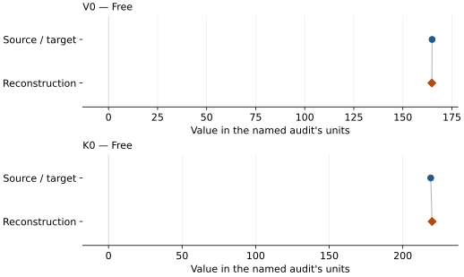
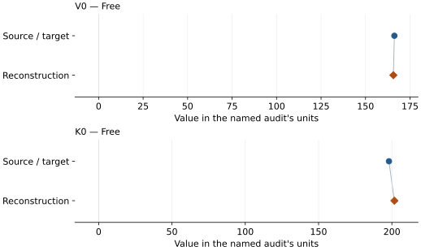

# Natural Fe9 post-perovskite: EOS reconstruction reports

<!-- Generated by scripts.generate_reconstruction_reports; edit EOSMAT instead. -->

[All reconstruction reports](index.md) · [Material and EOS parameters](../material-summaries/mg090fe009al0005ca0005sio3_post_perovskite.md)

These reports explain the assessments already stored in EOSMAT. Generating
this page does not refit observations, change classifications or replace source coefficients.

Use [scientific label definitions](../eos-labels.md) to distinguish coefficient
agreement, source verification, author-workflow reproduction and recommendation for use.

| EOS record | Recorded outcome | Coefficient comparison |
| --- | --- | --- |
| [Shieh et al. (2006), preferred second-order Eulerian finite-strain fit](#record-mg090fe009al0005ca0005sio3_post_perovskite_shieh_2006_bm2_1) | Coefficient parity achieved | Graph and table |
| [Shieh et al. (2006), K0'=4.4 sensitivity BM3](#record-mg090fe009al0005ca0005sio3_post_perovskite_shieh_2006_bm3_sensitivity_2) | Coefficient parity achieved | Graph and table |

## Shieh et al. (2006), preferred second-order Eulerian finite-strain fit

Record: `mg090fe009al0005ca0005sio3_post_perovskite_shieh_2006_bm2_1` · Model: `BM2`

**Outcome: Coefficient parity achieved.**

**Scope:** Comparison with the source parameterization.
**Comparison basis:** Every compared free coefficient meets both the recorded combined-two-sigma comparison and parameter-specific numerical similarity screen. Error conventions and fit qualifications remain applicable.

[Stored EOS coefficients and source](../material-summaries/mg090fe009al0005ca0005sio3_post_perovskite.md#record-mg090fe009al0005ca0005sio3_post_perovskite_shieh_2006_bm2_1)

### What this result establishes

**Separate source-review status:** primary\_source\_validated.
**Usage recommendation:** See the stored EOS qualifications; no recommendation is inferred here.

- This named numerical assessment alone does not establish author-workflow reproduction, physical accuracy or recommendation for use.

### Data and reconstruction method

- **Dataset identifiers:** mg090fe009al0005ca0005sio3\_shieh\_2006\_figure2\_ppv\_digitized
- **Observations:** 13
- **Fit kind:** isothermal\_pv
- **Selection:** all rows
- **Objective:** pressure\_residuals
- **Absolute sigma:** True
- **Free parameters:** V0; K0
- **Fixed parameters:** None declared

Unspecified selections, weights, fixed values or error conventions remain unknown; they have not been inferred for this report.

### Source versus reconstruction

This is a **coefficient comparison**, not an observation or residual plot.
Each panel uses its coefficient's audit units and includes zero. Markers show
stored central values only. Error widths are retained in the table below;
no confidence interval or uncertainty band is inferred. Fixed/adopted values are constraints.

| Parameter | Source / target | Source error | Reconstruction | Reconstruction error | Fit role |
| --- | --- | --- | --- | --- | --- |
| V0 | 164.9 | 0.6 | 164.78775196359328 | 0.7581354990969978 | Free |
| K0 | 219.0 | 5.0 | 219.92598731146165 | 6.163106533394408 | Free |

Values and reported errors are copied without rounding or conversion from the named audit. Missing errors mean unknown, not zero. Parameter names and volume conventions follow that audit; error widths do not imply a confidence convention.

Recorded diagnostics, covariance and additional protocol

- **Columns:**
    - **Pressure:** pressure\_gpa
    - **Temperature:** Not specified
    - **Volume:** volume\_a3\_conventional\_cell
- **Observed pressure range gpa:** \[12.07, 105.78\]
- **Observed temperature range k:** Not specified
- **Observed volume range:** \[124.506, 156.736\]
- **Degrees of freedom:** 11
- **Solver success:** True
- **Solver message:** \`ftol\` termination condition is satisfied.
- **Rmse gpa:** 1.2938218776500878
- **Published rmse gpa:** 1.2951501890077266
- **Reduced chi square:** 1.9783341512834531

### Detailed evidence and existing plots

- [Record-by-record numerical ledger](../primary-eos-refits.md#records).
- [Source-audit reports](../source-audits.md).

Observation curves and residual plots are provided by the supporting reports where available. Their absence is not filled by a reconstructed curve presented as measured data.

[Machine-readable comparison ledger](https://github.com/CPrescher/peritheos/blob/main/docs/data/primary-eos-refits.json) — look up `mg090fe009al0005ca0005sio3_post_perovskite_shieh_2006_bm2_1`.
[Complete native EOSMAT file](https://github.com/CPrescher/peritheos/blob/main/peritheos/data/materials/mg090fe009al0005ca0005sio3_post_perovskite.eosmat).

## Shieh et al. (2006), K0'=4.4 sensitivity BM3

Record: `mg090fe009al0005ca0005sio3_post_perovskite_shieh_2006_bm3_sensitivity_2` · Model: `BM3`

**Outcome: Coefficient parity achieved.**

**Scope:** Comparison with the source parameterization.
**Comparison basis:** Every compared free coefficient meets both the recorded combined-two-sigma comparison and parameter-specific numerical similarity screen. Error conventions and fit qualifications remain applicable.

[Stored EOS coefficients and source](../material-summaries/mg090fe009al0005ca0005sio3_post_perovskite.md#record-mg090fe009al0005ca0005sio3_post_perovskite_shieh_2006_bm3_sensitivity_2)

### What this result establishes

**Separate source-review status:** primary\_source\_validated.
**Usage recommendation:** See the stored EOS qualifications; no recommendation is inferred here.

- This named numerical assessment alone does not establish author-workflow reproduction, physical accuracy or recommendation for use.

### Data and reconstruction method

- **Dataset identifiers:** mg090fe009al0005ca0005sio3\_shieh\_2006\_figure2\_ppv\_digitized
- **Observations:** 13
- **Fit kind:** isothermal\_pv
- **Selection:** all rows
- **Objective:** pressure\_residuals
- **Absolute sigma:** True
- **Free parameters:** V0; K0
- **Fixed parameters:** K0\_prime

Unspecified selections, weights, fixed values or error conventions remain unknown; they have not been inferred for this report.

### Source versus reconstruction

This is a **coefficient comparison**, not an observation or residual plot.
Each panel uses its coefficient's audit units and includes zero. Markers show
stored central values only. Error widths are retained in the table below;
no confidence interval or uncertainty band is inferred. Fixed/adopted values are constraints.

| Parameter | Source / target | Source error | Reconstruction | Reconstruction error | Fit role |
| --- | --- | --- | --- | --- | --- |
| V0 | 166.2 | 0.7 | 165.64694850374673 | 0.850736323915289 | Free |
| K0 | 198.0 | 5.0 | 201.69342195393787 | 6.4394660855772585 | Free |

Values and reported errors are copied without rounding or conversion from the named audit. Missing errors mean unknown, not zero. Parameter names and volume conventions follow that audit; error widths do not imply a confidence convention.

Recorded diagnostics, covariance and additional protocol

- **Columns:**
    - **Pressure:** pressure\_gpa
    - **Temperature:** Not specified
    - **Volume:** volume\_a3\_conventional\_cell
- **Observed pressure range gpa:** \[12.07, 105.78\]
- **Observed temperature range k:** Not specified
- **Observed volume range:** \[124.506, 156.736\]
- **Degrees of freedom:** 11
- **Solver success:** True
- **Solver message:** Both \`ftol\` and \`xtol\` termination conditions are satisfied.
- **Rmse gpa:** 1.3341437910563283
- **Published rmse gpa:** 1.3684713055439075
- **Reduced chi square:** 2.1035650470712706

### Detailed evidence and existing plots

- [Record-by-record numerical ledger](../primary-eos-refits.md#records).
- [Source-audit reports](../source-audits.md).

Observation curves and residual plots are provided by the supporting reports where available. Their absence is not filled by a reconstructed curve presented as measured data.

[Machine-readable comparison ledger](https://github.com/CPrescher/peritheos/blob/main/docs/data/primary-eos-refits.json) — look up `mg090fe009al0005ca0005sio3_post_perovskite_shieh_2006_bm3_sensitivity_2`.
[Complete native EOSMAT file](https://github.com/CPrescher/peritheos/blob/main/peritheos/data/materials/mg090fe009al0005ca0005sio3_post_perovskite.eosmat).
