# (Mg0.90Fe0.10)O B1 ferropericlase: EOS reconstruction reports

<!-- Generated by scripts.generate_reconstruction_reports; edit EOSMAT instead. -->

[All reconstruction reports](index.md) · [Material and EOS parameters](../material-summaries/mg090fe010o.md)

These reports explain the assessments already stored in EOSMAT. Generating
this page does not refit observations, change classifications or replace source coefficients.

Use [scientific label definitions](../eos-labels.md) to distinguish coefficient
agreement, source verification, author-workflow reproduction and recommendation for use.

| EOS record | Recorded outcome | Coefficient comparison |
| --- | --- | --- |
| [Solomatova et al. (2016), hs BM3 reference branch](#record-mg090fe010o_solomatova_2016_hs_bm3_reference_1) | Numerically similar, with qualifications | Graph and table |
| [Solomatova et al. (2016), ls BM3 reference branch](#record-mg090fe010o_solomatova_2016_ls_bm3_reference_2) | Numerically similar, with qualifications | Graph and table |
| [Marquardt et al. (2009), EPSL high-spin BM3](#record-mg090fe010o_marquardt_2009b_hs_bm3) | Complete independent refit unavailable | No numeric coefficient pair recorded |
| [Marquardt et al. (2009), EPSL LS BM3 Table S1 row 1](#record-mg090fe010o_marquardt_2009b_ls_bm3_s1_01) | Numerically similar, with qualifications | Graph and table |
| [Marquardt et al. (2009), EPSL LS BM3 Table S1 row 2](#record-mg090fe010o_marquardt_2009b_ls_bm3_s1_02) | Numerically similar, with qualifications | Graph and table |
| [Marquardt et al. (2009), EPSL LS BM3 Table S1 row 3](#record-mg090fe010o_marquardt_2009b_ls_bm3_s1_03) | Numerically similar, with qualifications | Graph and table |
| [Marquardt et al. (2009), EPSL LS BM3 Table S1 row 4](#record-mg090fe010o_marquardt_2009b_ls_bm3_s1_04) | Numerically similar, with qualifications | Graph and table |
| [Marquardt et al. (2009), EPSL LS BM3 Table S1 row 5](#record-mg090fe010o_marquardt_2009b_ls_bm3_s1_05) | Numerically similar, with qualifications | Graph and table |
| [Marquardt et al. (2009), EPSL LS BM3 Table S1 row 6](#record-mg090fe010o_marquardt_2009b_ls_bm3_s1_06) | Numerically similar, with qualifications | Graph and table |
| [Marquardt et al. (2009), EPSL LS BM3 Table S1 row 7](#record-mg090fe010o_marquardt_2009b_ls_bm3_s1_07) | Numerically similar, with qualifications | Graph and table |
| [Marquardt et al. (2009), EPSL LS BM3 Table S1 row 8](#record-mg090fe010o_marquardt_2009b_ls_bm3_s1_08) | Numerically similar, with qualifications | Graph and table |
| [Marquardt et al. (2009), EPSL LS BM3 Table S1 row 9](#record-mg090fe010o_marquardt_2009b_ls_bm3_s1_09) | Numerically similar, with qualifications | Graph and table |
| [Marquardt et al. (2009), EPSL LS BM3 Table S1 row 10](#record-mg090fe010o_marquardt_2009b_ls_bm3_s1_10) | Numerically similar, with qualifications | Graph and table |
| [Marquardt et al. (2009), EPSL LS BM3 Table S1 row 11](#record-mg090fe010o_marquardt_2009b_ls_bm3_s1_11) | Numerically similar, with qualifications | Graph and table |
| [Marquardt et al. (2009), EPSL LS BM3 Table S1 row 12](#record-mg090fe010o_marquardt_2009b_ls_bm3_s1_12) | Numerically similar, with qualifications | Graph and table |

## Solomatova et al. (2016), hs BM3 reference branch

Record: `mg090fe010o_solomatova_2016_hs_bm3_reference_1` · Model: `BM3`

**Outcome: Numerically similar, with qualifications.**

**Scope:** Comparison with the source parameterization.
**Comparison basis:** Every compared free coefficient meets either the recorded combined-two-sigma comparison or parameter-specific numerical similarity screen; the audit does not classify the complete comparison as parity.

[Stored EOS coefficients and source](../material-summaries/mg090fe010o.md#record-mg090fe010o_solomatova_2016_hs_bm3_reference_1)

### What this result establishes

**Separate source-review status:** primary\_source\_validated.
**Usage recommendation:** See the stored EOS qualifications; no recommendation is inferred here.

- Coupled three-level spin-state reconstruction using the recovered earlier observations and Solomatova Table 2 priors. The original MINUTI input, row weights, residual definition, and covariance are unpublished, so this equal-weight approximate-volume fit tests numerical similarity rather than claiming an exact reproduction.
- This named numerical assessment alone does not establish author-workflow reproduction, physical accuracy or recommendation for use.

### Data and reconstruction method

- **Dataset identifiers:** mg090fe010o\_marquardt\_2009\_table2\_pv
- **Observations:** 29
- **Fit kind:** coupled\_bm3\_three\_level\_spin\_crossover
- **Selection:** used\_in\_solomatova\_2016\_fit=1
- **Objective:** equal-weight approximate volume residuals plus Table 2 priors
- **Free parameters:** V0\_HS; K0\_HS; K0\_prime\_HS; V0\_LS; K0\_LS; omega0
- **Fixed parameters:** None declared

Unspecified selections, weights, fixed values or error conventions remain unknown; they have not been inferred for this report.

### Source versus reconstruction

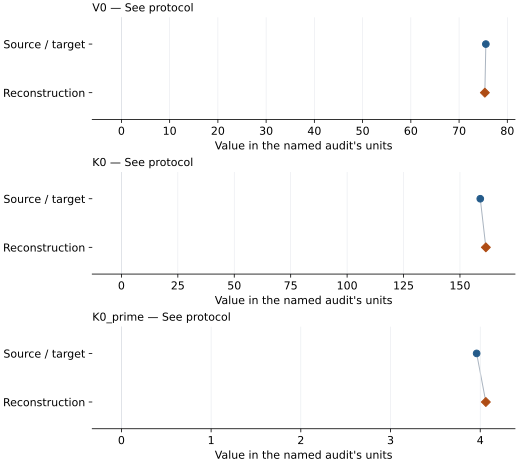

This is a **coefficient comparison**, not an observation or residual plot.
Each panel uses its coefficient's audit units and includes zero. Markers show
stored central values only. Error widths are retained in the table below;
no confidence interval or uncertainty band is inferred. Fixed/adopted values are constraints.

| Parameter | Source / target | Source error | Reconstruction | Reconstruction error | Fit role |
| --- | --- | --- | --- | --- | --- |
| V0 | 75.55 | 0.04 | 75.34347270530013 | Not specified | See protocol |
| K0 | 159.0 | 2 | 161.47123361971015 | Not specified | See protocol |
| K0\_prime | 3.96 | 0.14 | 4.062691485701653 | Not specified | See protocol |

Values and reported errors are copied without rounding or conversion from the named audit. Missing errors mean unknown, not zero. Parameter names and volume conventions follow that audit; error widths do not imply a confidence convention.

Recorded diagnostics, covariance and additional protocol

- **Solver success:** True
- **Solver message:** dedicated Solomatova coupled reconstruction completed
- **Rmse volume a3:** 0.15387023329995295

### Detailed evidence and existing plots

- [Earlier detailed record investigation](../primary-eos-refits.md#investigation-mg090fe010o_solomatova_2016_hs_bm3_reference_1).
- [Record-by-record numerical ledger](../primary-eos-refits.md#records).
- [Source-audit reports](../source-audits.md).

Observation curves and residual plots are provided by the supporting reports where available. Their absence is not filled by a reconstructed curve presented as measured data.

[Machine-readable comparison ledger](https://github.com/CPrescher/peritheos/blob/main/docs/data/primary-eos-refits.json) — look up `mg090fe010o_solomatova_2016_hs_bm3_reference_1`.
[Complete native EOSMAT file](https://github.com/CPrescher/peritheos/blob/main/peritheos/data/materials/mg090fe010o.eosmat).

## Solomatova et al. (2016), ls BM3 reference branch

Record: `mg090fe010o_solomatova_2016_ls_bm3_reference_2` · Model: `BM3`

**Outcome: Numerically similar, with qualifications.**

**Scope:** Comparison with the source parameterization.
**Comparison basis:** Every compared free coefficient meets either the recorded combined-two-sigma comparison or parameter-specific numerical similarity screen; the audit does not classify the complete comparison as parity.

[Stored EOS coefficients and source](../material-summaries/mg090fe010o.md#record-mg090fe010o_solomatova_2016_ls_bm3_reference_2)

### What this result establishes

**Separate source-review status:** primary\_source\_validated.
**Usage recommendation:** See the stored EOS qualifications; no recommendation is inferred here.

- Coupled three-level spin-state reconstruction using the recovered earlier observations and Solomatova Table 2 priors. The original MINUTI input, row weights, residual definition, and covariance are unpublished, so this equal-weight approximate-volume fit tests numerical similarity rather than claiming an exact reproduction.
- This named numerical assessment alone does not establish author-workflow reproduction, physical accuracy or recommendation for use.

### Data and reconstruction method

- **Dataset identifiers:** mg090fe010o\_marquardt\_2009\_table2\_pv
- **Observations:** 29
- **Fit kind:** coupled\_bm3\_three\_level\_spin\_crossover
- **Selection:** used\_in\_solomatova\_2016\_fit=1
- **Objective:** equal-weight approximate volume residuals plus Table 2 priors
- **Free parameters:** V0\_HS; K0\_HS; K0\_prime\_HS; V0\_LS; K0\_LS; omega0
- **Fixed parameters:** K0\_prime

Unspecified selections, weights, fixed values or error conventions remain unknown; they have not been inferred for this report.

### Source versus reconstruction

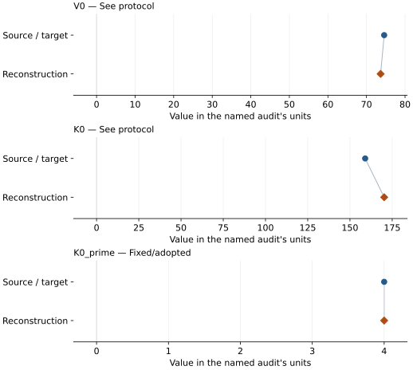

This is a **coefficient comparison**, not an observation or residual plot.
Each panel uses its coefficient's audit units and includes zero. Markers show
stored central values only. Error widths are retained in the table below;
no confidence interval or uncertainty band is inferred. Fixed/adopted values are constraints.

| Parameter | Source / target | Source error | Reconstruction | Reconstruction error | Fit role |
| --- | --- | --- | --- | --- | --- |
| V0 | 74.59 | 0.91 | 73.66660581589477 | Not specified | See protocol |
| K0 | 159.0 | 12 | 170.2499732076181 | Not specified | See protocol |
| K0\_prime | 4.0 | Not specified | 4.0 | Not specified | Fixed/adopted |

Values and reported errors are copied without rounding or conversion from the named audit. Missing errors mean unknown, not zero. Parameter names and volume conventions follow that audit; error widths do not imply a confidence convention.

Recorded diagnostics, covariance and additional protocol

- **Solver success:** True
- **Solver message:** dedicated Solomatova coupled reconstruction completed
- **Rmse volume a3:** 0.15387023329995295

### Detailed evidence and existing plots

- [Earlier detailed record investigation](../primary-eos-refits.md#investigation-mg090fe010o_solomatova_2016_ls_bm3_reference_2).
- [Record-by-record numerical ledger](../primary-eos-refits.md#records).
- [Source-audit reports](../source-audits.md).

Observation curves and residual plots are provided by the supporting reports where available. Their absence is not filled by a reconstructed curve presented as measured data.

[Machine-readable comparison ledger](https://github.com/CPrescher/peritheos/blob/main/docs/data/primary-eos-refits.json) — look up `mg090fe010o_solomatova_2016_ls_bm3_reference_2`.
[Complete native EOSMAT file](https://github.com/CPrescher/peritheos/blob/main/peritheos/data/materials/mg090fe010o.eosmat).

## Marquardt et al. (2009), EPSL high-spin BM3

Record: `mg090fe010o_marquardt_2009b_hs_bm3` · Model: `BM3`

**Outcome: Complete independent refit unavailable.**

**Scope:** Comparison with the source parameterization.
**Comparison basis:** EPSL Table 2 supplies the P-V observations, but the published HS fit also uses a room-pressure Brillouin constraint whose weighting is unspecified. Only the 14 rows below 45 GPa belong to this fit. The separate script scripts/reproduce\_marquardt\_2009\_epsl.py performs a P-V-only validation; it cannot reproduce the complete source objective.

[Stored EOS coefficients and source](../material-summaries/mg090fe010o.md#record-mg090fe010o_marquardt_2009b_hs_bm3)

### What this result establishes

**Separate source-review status:** primary\_source\_validated.
**Usage recommendation:** See the stored EOS qualifications; no recommendation is inferred here.

- This named numerical assessment alone does not establish author-workflow reproduction, physical accuracy or recommendation for use.
- No reconstructed coefficient table is recorded for this assessment; no missing values have been inferred.

### Data and reconstruction method

- **Dataset identifiers:** mg090fe010o\_marquardt\_2009\_table2\_pv
- **Fixed parameters:** V0

Unspecified selections, weights, fixed values or error conventions remain unknown; they have not been inferred for this report.

### Why no coefficient graph is shown

No numeric source/reconstruction pair is recorded for this assessment. A graph would require information that is not available here; no values or observations have been invented.

### Detailed evidence and existing plots

- [Record-by-record numerical ledger](../primary-eos-refits.md#records).
- [Source-audit reports](../source-audits.md).

Observation curves and residual plots are provided by the supporting reports where available. Their absence is not filled by a reconstructed curve presented as measured data.

[Machine-readable comparison ledger](https://github.com/CPrescher/peritheos/blob/main/docs/data/primary-eos-refits.json) — look up `mg090fe010o_marquardt_2009b_hs_bm3`.
[Complete native EOSMAT file](https://github.com/CPrescher/peritheos/blob/main/peritheos/data/materials/mg090fe010o.eosmat).

## Marquardt et al. (2009), EPSL LS BM3 Table S1 row 1

Record: `mg090fe010o_marquardt_2009b_ls_bm3_s1_01` · Model: `BM3`

**Outcome: Numerically similar, with qualifications.**

**Scope:** Comparison with the source parameterization.
**Comparison basis:** Every compared free coefficient meets either the recorded combined-two-sigma comparison or parameter-specific numerical similarity screen; the audit does not classify the complete comparison as parity.

[Stored EOS coefficients and source](../material-summaries/mg090fe010o.md#record-mg090fe010o_marquardt_2009b_ls_bm3_s1_01)

### What this result establishes

**Separate source-review status:** primary\_source\_validated.
**Usage recommendation:** See the stored EOS qualifications; no recommendation is inferred here.

- One of 12 alternative constrained LS fits from EPSL Table S1. Only six Table 2 rows above 63 GPa are fitted, with printed V0 and K0 prime fixed. Source objective weights and coefficient standard errors are not reported; the refit errors are residual-scaled diagnostics, not published uncertainties.
- This named numerical assessment alone does not establish author-workflow reproduction, physical accuracy or recommendation for use.

### Data and reconstruction method

- **Dataset identifiers:** mg090fe010o\_marquardt\_2009\_table2\_pv
- **Observations:** 6
- **Fit kind:** isothermal\_pv
- **Selection:** spin\_region=low\_spin
- **Objective:** errors\_in\_variables
- **Absolute sigma:** True
- **Free parameters:** K0
- **Fixed parameters:** V0; K0\_prime

Unspecified selections, weights, fixed values or error conventions remain unknown; they have not been inferred for this report.

### Source versus reconstruction

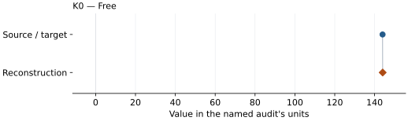

This is a **coefficient comparison**, not an observation or residual plot.
Each panel uses its coefficient's audit units and includes zero. Markers show
stored central values only. Error widths are retained in the table below;
no confidence interval or uncertainty band is inferred. Fixed/adopted values are constraints.

| Parameter | Source / target | Source error | Reconstruction | Reconstruction error | Fit role |
| --- | --- | --- | --- | --- | --- |
| K0 | 144.0 | Not specified | 144.05016999289649 | 1.5789605046373902 | Free |

Values and reported errors are copied without rounding or conversion from the named audit. Missing errors mean unknown, not zero. Parameter names and volume conventions follow that audit; error widths do not imply a confidence convention.

Recorded diagnostics, covariance and additional protocol

- **Columns:**
    - **Pressure:** pressure\_gpa
    - **Temperature:** Not specified
    - **Volume:** volume\_a3\_conventional\_cell
- **Observed pressure range gpa:** \[63.9, 77.4\]
- **Observed temperature range k:** Not specified
- **Observed volume range:** \[56.26, 58.51\]
- **Degrees of freedom:** 5
- **Solver success:** True
- **Solver message:** Both \`ftol\` and \`xtol\` termination conditions are satisfied.
- **Rmse gpa:** 0.315422303696759
- **Published rmse gpa:** 1.2831719717741563
- **Reduced chi square:** 0.4456888108063467

### Detailed evidence and existing plots

- [Earlier detailed record investigation](../primary-eos-refits.md#investigation-mg090fe010o_marquardt_2009b_ls_bm3_s1_01).
- [Record-by-record numerical ledger](../primary-eos-refits.md#records).
- [Source-audit reports](../source-audits.md).

Observation curves and residual plots are provided by the supporting reports where available. Their absence is not filled by a reconstructed curve presented as measured data.

[Machine-readable comparison ledger](https://github.com/CPrescher/peritheos/blob/main/docs/data/primary-eos-refits.json) — look up `mg090fe010o_marquardt_2009b_ls_bm3_s1_01`.
[Complete native EOSMAT file](https://github.com/CPrescher/peritheos/blob/main/peritheos/data/materials/mg090fe010o.eosmat).

## Marquardt et al. (2009), EPSL LS BM3 Table S1 row 2

Record: `mg090fe010o_marquardt_2009b_ls_bm3_s1_02` · Model: `BM3`

**Outcome: Numerically similar, with qualifications.**

**Scope:** Comparison with the source parameterization.
**Comparison basis:** Every compared free coefficient meets either the recorded combined-two-sigma comparison or parameter-specific numerical similarity screen; the audit does not classify the complete comparison as parity.

[Stored EOS coefficients and source](../material-summaries/mg090fe010o.md#record-mg090fe010o_marquardt_2009b_ls_bm3_s1_02)

### What this result establishes

**Separate source-review status:** primary\_source\_validated.
**Usage recommendation:** See the stored EOS qualifications; no recommendation is inferred here.

- One of 12 alternative constrained LS fits from EPSL Table S1. Only six Table 2 rows above 63 GPa are fitted, with printed V0 and K0 prime fixed. Source objective weights and coefficient standard errors are not reported; the refit errors are residual-scaled diagnostics, not published uncertainties.
- This named numerical assessment alone does not establish author-workflow reproduction, physical accuracy or recommendation for use.

### Data and reconstruction method

- **Dataset identifiers:** mg090fe010o\_marquardt\_2009\_table2\_pv
- **Observations:** 6
- **Fit kind:** isothermal\_pv
- **Selection:** spin\_region=low\_spin
- **Objective:** errors\_in\_variables
- **Absolute sigma:** True
- **Free parameters:** K0
- **Fixed parameters:** V0; K0\_prime

Unspecified selections, weights, fixed values or error conventions remain unknown; they have not been inferred for this report.

### Source versus reconstruction

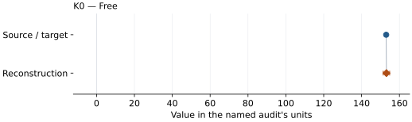

This is a **coefficient comparison**, not an observation or residual plot.
Each panel uses its coefficient's audit units and includes zero. Markers show
stored central values only. Error widths are retained in the table below;
no confidence interval or uncertainty band is inferred. Fixed/adopted values are constraints.

| Parameter | Source / target | Source error | Reconstruction | Reconstruction error | Fit role |
| --- | --- | --- | --- | --- | --- |
| K0 | 153.0 | Not specified | 153.13067129713863 | 1.7057793624477458 | Free |

Values and reported errors are copied without rounding or conversion from the named audit. Missing errors mean unknown, not zero. Parameter names and volume conventions follow that audit; error widths do not imply a confidence convention.

Recorded diagnostics, covariance and additional protocol

- **Columns:**
    - **Pressure:** pressure\_gpa
    - **Temperature:** Not specified
    - **Volume:** volume\_a3\_conventional\_cell
- **Observed pressure range gpa:** \[63.9, 77.4\]
- **Observed temperature range k:** Not specified
- **Observed volume range:** \[56.26, 58.51\]
- **Degrees of freedom:** 5
- **Solver success:** True
- **Solver message:** Both \`ftol\` and \`xtol\` termination conditions are satisfied.
- **Rmse gpa:** 0.3387918149481032
- **Published rmse gpa:** 1.4379533452433428
- **Reduced chi square:** 0.5327517448336939

### Detailed evidence and existing plots

- [Earlier detailed record investigation](../primary-eos-refits.md#investigation-mg090fe010o_marquardt_2009b_ls_bm3_s1_02).
- [Record-by-record numerical ledger](../primary-eos-refits.md#records).
- [Source-audit reports](../source-audits.md).

Observation curves and residual plots are provided by the supporting reports where available. Their absence is not filled by a reconstructed curve presented as measured data.

[Machine-readable comparison ledger](https://github.com/CPrescher/peritheos/blob/main/docs/data/primary-eos-refits.json) — look up `mg090fe010o_marquardt_2009b_ls_bm3_s1_02`.
[Complete native EOSMAT file](https://github.com/CPrescher/peritheos/blob/main/peritheos/data/materials/mg090fe010o.eosmat).

## Marquardt et al. (2009), EPSL LS BM3 Table S1 row 3

Record: `mg090fe010o_marquardt_2009b_ls_bm3_s1_03` · Model: `BM3`

**Outcome: Numerically similar, with qualifications.**

**Scope:** Comparison with the source parameterization.
**Comparison basis:** Every compared free coefficient meets either the recorded combined-two-sigma comparison or parameter-specific numerical similarity screen; the audit does not classify the complete comparison as parity.

[Stored EOS coefficients and source](../material-summaries/mg090fe010o.md#record-mg090fe010o_marquardt_2009b_ls_bm3_s1_03)

### What this result establishes

**Separate source-review status:** primary\_source\_validated.
**Usage recommendation:** See the stored EOS qualifications; no recommendation is inferred here.

- One of 12 alternative constrained LS fits from EPSL Table S1. Only six Table 2 rows above 63 GPa are fitted, with printed V0 and K0 prime fixed. Source objective weights and coefficient standard errors are not reported; the refit errors are residual-scaled diagnostics, not published uncertainties.
- This named numerical assessment alone does not establish author-workflow reproduction, physical accuracy or recommendation for use.

### Data and reconstruction method

- **Dataset identifiers:** mg090fe010o\_marquardt\_2009\_table2\_pv
- **Observations:** 6
- **Fit kind:** isothermal\_pv
- **Selection:** spin\_region=low\_spin
- **Objective:** errors\_in\_variables
- **Absolute sigma:** True
- **Free parameters:** K0
- **Fixed parameters:** V0; K0\_prime

Unspecified selections, weights, fixed values or error conventions remain unknown; they have not been inferred for this report.

### Source versus reconstruction

This is a **coefficient comparison**, not an observation or residual plot.
Each panel uses its coefficient's audit units and includes zero. Markers show
stored central values only. Error widths are retained in the table below;
no confidence interval or uncertainty band is inferred. Fixed/adopted values are constraints.

| Parameter | Source / target | Source error | Reconstruction | Reconstruction error | Fit role |
| --- | --- | --- | --- | --- | --- |
| K0 | 163.0 | Not specified | 163.27062329404384 | 1.8511752471916292 | Free |

Values and reported errors are copied without rounding or conversion from the named audit. Missing errors mean unknown, not zero. Parameter names and volume conventions follow that audit; error widths do not imply a confidence convention.

Recorded diagnostics, covariance and additional protocol

- **Columns:**
    - **Pressure:** pressure\_gpa
    - **Temperature:** Not specified
    - **Volume:** volume\_a3\_conventional\_cell
- **Observed pressure range gpa:** \[63.9, 77.4\]
- **Observed temperature range k:** Not specified
- **Observed volume range:** \[56.26, 58.51\]
- **Degrees of freedom:** 5
- **Solver success:** True
- **Solver message:** Both \`ftol\` and \`xtol\` termination conditions are satisfied.
- **Rmse gpa:** 0.3630727561610341
- **Published rmse gpa:** 1.6161681138842996
- **Reduced chi square:** 0.6353857659233374

### Detailed evidence and existing plots

- [Earlier detailed record investigation](../primary-eos-refits.md#investigation-mg090fe010o_marquardt_2009b_ls_bm3_s1_03).
- [Record-by-record numerical ledger](../primary-eos-refits.md#records).
- [Source-audit reports](../source-audits.md).

Observation curves and residual plots are provided by the supporting reports where available. Their absence is not filled by a reconstructed curve presented as measured data.

[Machine-readable comparison ledger](https://github.com/CPrescher/peritheos/blob/main/docs/data/primary-eos-refits.json) — look up `mg090fe010o_marquardt_2009b_ls_bm3_s1_03`.
[Complete native EOSMAT file](https://github.com/CPrescher/peritheos/blob/main/peritheos/data/materials/mg090fe010o.eosmat).

## Marquardt et al. (2009), EPSL LS BM3 Table S1 row 4

Record: `mg090fe010o_marquardt_2009b_ls_bm3_s1_04` · Model: `BM3`

**Outcome: Numerically similar, with qualifications.**

**Scope:** Comparison with the source parameterization.
**Comparison basis:** Every compared free coefficient meets either the recorded combined-two-sigma comparison or parameter-specific numerical similarity screen; the audit does not classify the complete comparison as parity.

[Stored EOS coefficients and source](../material-summaries/mg090fe010o.md#record-mg090fe010o_marquardt_2009b_ls_bm3_s1_04)

### What this result establishes

**Separate source-review status:** primary\_source\_validated.
**Usage recommendation:** See the stored EOS qualifications; no recommendation is inferred here.

- One of 12 alternative constrained LS fits from EPSL Table S1. Only six Table 2 rows above 63 GPa are fitted, with printed V0 and K0 prime fixed. Source objective weights and coefficient standard errors are not reported; the refit errors are residual-scaled diagnostics, not published uncertainties.
- This named numerical assessment alone does not establish author-workflow reproduction, physical accuracy or recommendation for use.

### Data and reconstruction method

- **Dataset identifiers:** mg090fe010o\_marquardt\_2009\_table2\_pv
- **Observations:** 6
- **Fit kind:** isothermal\_pv
- **Selection:** spin\_region=low\_spin
- **Objective:** errors\_in\_variables
- **Absolute sigma:** True
- **Free parameters:** K0
- **Fixed parameters:** V0; K0\_prime

Unspecified selections, weights, fixed values or error conventions remain unknown; they have not been inferred for this report.

### Source versus reconstruction

This is a **coefficient comparison**, not an observation or residual plot.
Each panel uses its coefficient's audit units and includes zero. Markers show
stored central values only. Error widths are retained in the table below;
no confidence interval or uncertainty band is inferred. Fixed/adopted values are constraints.

| Parameter | Source / target | Source error | Reconstruction | Reconstruction error | Fit role |
| --- | --- | --- | --- | --- | --- |
| K0 | 175.0 | Not specified | 174.34165134965681 | 2.0144860589893296 | Free |

Values and reported errors are copied without rounding or conversion from the named audit. Missing errors mean unknown, not zero. Parameter names and volume conventions follow that audit; error widths do not imply a confidence convention.

Recorded diagnostics, covariance and additional protocol

- **Columns:**
    - **Pressure:** pressure\_gpa
    - **Temperature:** Not specified
    - **Volume:** volume\_a3\_conventional\_cell
- **Observed pressure range gpa:** \[63.9, 77.4\]
- **Observed temperature range k:** Not specified
- **Observed volume range:** \[56.26, 58.51\]
- **Degrees of freedom:** 5
- **Solver success:** True
- **Solver message:** Both \`ftol\` and \`xtol\` termination conditions are satisfied.
- **Rmse gpa:** 0.3874613858317298
- **Published rmse gpa:** 1.7179655250363797
- **Reduced chi square:** 0.7528288308709483

### Detailed evidence and existing plots

- [Earlier detailed record investigation](../primary-eos-refits.md#investigation-mg090fe010o_marquardt_2009b_ls_bm3_s1_04).
- [Record-by-record numerical ledger](../primary-eos-refits.md#records).
- [Source-audit reports](../source-audits.md).

Observation curves and residual plots are provided by the supporting reports where available. Their absence is not filled by a reconstructed curve presented as measured data.

[Machine-readable comparison ledger](https://github.com/CPrescher/peritheos/blob/main/docs/data/primary-eos-refits.json) — look up `mg090fe010o_marquardt_2009b_ls_bm3_s1_04`.
[Complete native EOSMAT file](https://github.com/CPrescher/peritheos/blob/main/peritheos/data/materials/mg090fe010o.eosmat).

## Marquardt et al. (2009), EPSL LS BM3 Table S1 row 5

Record: `mg090fe010o_marquardt_2009b_ls_bm3_s1_05` · Model: `BM3`

**Outcome: Numerically similar, with qualifications.**

**Scope:** Comparison with the source parameterization.
**Comparison basis:** Every compared free coefficient meets either the recorded combined-two-sigma comparison or parameter-specific numerical similarity screen; the audit does not classify the complete comparison as parity.

[Stored EOS coefficients and source](../material-summaries/mg090fe010o.md#record-mg090fe010o_marquardt_2009b_ls_bm3_s1_05)

### What this result establishes

**Separate source-review status:** primary\_source\_validated.
**Usage recommendation:** See the stored EOS qualifications; no recommendation is inferred here.

- One of 12 alternative constrained LS fits from EPSL Table S1. Only six Table 2 rows above 63 GPa are fitted, with printed V0 and K0 prime fixed. Source objective weights and coefficient standard errors are not reported; the refit errors are residual-scaled diagnostics, not published uncertainties.
- This named numerical assessment alone does not establish author-workflow reproduction, physical accuracy or recommendation for use.

### Data and reconstruction method

- **Dataset identifiers:** mg090fe010o\_marquardt\_2009\_table2\_pv
- **Observations:** 6
- **Fit kind:** isothermal\_pv
- **Selection:** spin\_region=low\_spin
- **Objective:** errors\_in\_variables
- **Absolute sigma:** True
- **Free parameters:** K0
- **Fixed parameters:** V0; K0\_prime

Unspecified selections, weights, fixed values or error conventions remain unknown; they have not been inferred for this report.

### Source versus reconstruction

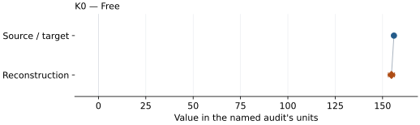

This is a **coefficient comparison**, not an observation or residual plot.
Each panel uses its coefficient's audit units and includes zero. Markers show
stored central values only. Error widths are retained in the table below;
no confidence interval or uncertainty band is inferred. Fixed/adopted values are constraints.

| Parameter | Source / target | Source error | Reconstruction | Reconstruction error | Fit role |
| --- | --- | --- | --- | --- | --- |
| K0 | 156.0 | Not specified | 154.6936470295564 | 1.6426616382586294 | Free |

Values and reported errors are copied without rounding or conversion from the named audit. Missing errors mean unknown, not zero. Parameter names and volume conventions follow that audit; error widths do not imply a confidence convention.

Recorded diagnostics, covariance and additional protocol

- **Columns:**
    - **Pressure:** pressure\_gpa
    - **Temperature:** Not specified
    - **Volume:** volume\_a3\_conventional\_cell
- **Observed pressure range gpa:** \[63.9, 77.4\]
- **Observed temperature range k:** Not specified
- **Observed volume range:** \[56.26, 58.51\]
- **Degrees of freedom:** 5
- **Solver success:** True
- **Solver message:** Both \`ftol\` and \`xtol\` termination conditions are satisfied.
- **Rmse gpa:** 0.267167846038256
- **Published rmse gpa:** 1.0321610486696218
- **Reduced chi square:** 0.2981026528356882

### Detailed evidence and existing plots

- [Earlier detailed record investigation](../primary-eos-refits.md#investigation-mg090fe010o_marquardt_2009b_ls_bm3_s1_05).
- [Record-by-record numerical ledger](../primary-eos-refits.md#records).
- [Source-audit reports](../source-audits.md).

Observation curves and residual plots are provided by the supporting reports where available. Their absence is not filled by a reconstructed curve presented as measured data.

[Machine-readable comparison ledger](https://github.com/CPrescher/peritheos/blob/main/docs/data/primary-eos-refits.json) — look up `mg090fe010o_marquardt_2009b_ls_bm3_s1_05`.
[Complete native EOSMAT file](https://github.com/CPrescher/peritheos/blob/main/peritheos/data/materials/mg090fe010o.eosmat).

## Marquardt et al. (2009), EPSL LS BM3 Table S1 row 6

Record: `mg090fe010o_marquardt_2009b_ls_bm3_s1_06` · Model: `BM3`

**Outcome: Numerically similar, with qualifications.**

**Scope:** Comparison with the source parameterization.
**Comparison basis:** Every compared free coefficient meets either the recorded combined-two-sigma comparison or parameter-specific numerical similarity screen; the audit does not classify the complete comparison as parity.

[Stored EOS coefficients and source](../material-summaries/mg090fe010o.md#record-mg090fe010o_marquardt_2009b_ls_bm3_s1_06)

### What this result establishes

**Separate source-review status:** primary\_source\_validated.
**Usage recommendation:** See the stored EOS qualifications; no recommendation is inferred here.

- One of 12 alternative constrained LS fits from EPSL Table S1. Only six Table 2 rows above 63 GPa are fitted, with printed V0 and K0 prime fixed. Source objective weights and coefficient standard errors are not reported; the refit errors are residual-scaled diagnostics, not published uncertainties.
- This named numerical assessment alone does not establish author-workflow reproduction, physical accuracy or recommendation for use.

### Data and reconstruction method

- **Dataset identifiers:** mg090fe010o\_marquardt\_2009\_table2\_pv
- **Observations:** 6
- **Fit kind:** isothermal\_pv
- **Selection:** spin\_region=low\_spin
- **Objective:** errors\_in\_variables
- **Absolute sigma:** True
- **Free parameters:** K0
- **Fixed parameters:** V0; K0\_prime

Unspecified selections, weights, fixed values or error conventions remain unknown; they have not been inferred for this report.

### Source versus reconstruction

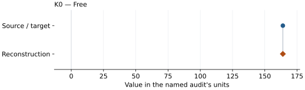

This is a **coefficient comparison**, not an observation or residual plot.
Each panel uses its coefficient's audit units and includes zero. Markers show
stored central values only. Error widths are retained in the table below;
no confidence interval or uncertainty band is inferred. Fixed/adopted values are constraints.

| Parameter | Source / target | Source error | Reconstruction | Reconstruction error | Fit role |
| --- | --- | --- | --- | --- | --- |
| K0 | 164.0 | Not specified | 163.98719137086155 | 1.7703993044473074 | Free |

Values and reported errors are copied without rounding or conversion from the named audit. Missing errors mean unknown, not zero. Parameter names and volume conventions follow that audit; error widths do not imply a confidence convention.

Recorded diagnostics, covariance and additional protocol

- **Columns:**
    - **Pressure:** pressure\_gpa
    - **Temperature:** Not specified
    - **Volume:** volume\_a3\_conventional\_cell
- **Observed pressure range gpa:** \[63.9, 77.4\]
- **Observed temperature range k:** Not specified
- **Observed volume range:** \[56.26, 58.51\]
- **Degrees of freedom:** 5
- **Solver success:** True
- **Solver message:** Both \`ftol\` and \`xtol\` termination conditions are satisfied.
- **Rmse gpa:** 0.29295056320964075
- **Published rmse gpa:** 1.152395203577993
- **Reduced chi square:** 0.3733074048405004

### Detailed evidence and existing plots

- [Earlier detailed record investigation](../primary-eos-refits.md#investigation-mg090fe010o_marquardt_2009b_ls_bm3_s1_06).
- [Record-by-record numerical ledger](../primary-eos-refits.md#records).
- [Source-audit reports](../source-audits.md).

Observation curves and residual plots are provided by the supporting reports where available. Their absence is not filled by a reconstructed curve presented as measured data.

[Machine-readable comparison ledger](https://github.com/CPrescher/peritheos/blob/main/docs/data/primary-eos-refits.json) — look up `mg090fe010o_marquardt_2009b_ls_bm3_s1_06`.
[Complete native EOSMAT file](https://github.com/CPrescher/peritheos/blob/main/peritheos/data/materials/mg090fe010o.eosmat).

## Marquardt et al. (2009), EPSL LS BM3 Table S1 row 7

Record: `mg090fe010o_marquardt_2009b_ls_bm3_s1_07` · Model: `BM3`

**Outcome: Numerically similar, with qualifications.**

**Scope:** Comparison with the source parameterization.
**Comparison basis:** Every compared free coefficient meets either the recorded combined-two-sigma comparison or parameter-specific numerical similarity screen; the audit does not classify the complete comparison as parity.

[Stored EOS coefficients and source](../material-summaries/mg090fe010o.md#record-mg090fe010o_marquardt_2009b_ls_bm3_s1_07)

### What this result establishes

**Separate source-review status:** primary\_source\_validated.
**Usage recommendation:** See the stored EOS qualifications; no recommendation is inferred here.

- One of 12 alternative constrained LS fits from EPSL Table S1. Only six Table 2 rows above 63 GPa are fitted, with printed V0 and K0 prime fixed. Source objective weights and coefficient standard errors are not reported; the refit errors are residual-scaled diagnostics, not published uncertainties.
- This named numerical assessment alone does not establish author-workflow reproduction, physical accuracy or recommendation for use.

### Data and reconstruction method

- **Dataset identifiers:** mg090fe010o\_marquardt\_2009\_table2\_pv
- **Observations:** 6
- **Fit kind:** isothermal\_pv
- **Selection:** spin\_region=low\_spin
- **Objective:** errors\_in\_variables
- **Absolute sigma:** True
- **Free parameters:** K0
- **Fixed parameters:** V0; K0\_prime

Unspecified selections, weights, fixed values or error conventions remain unknown; they have not been inferred for this report.

### Source versus reconstruction

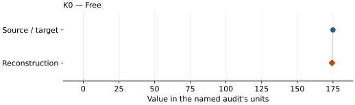

This is a **coefficient comparison**, not an observation or residual plot.
Each panel uses its coefficient's audit units and includes zero. Markers show
stored central values only. Error widths are retained in the table below;
no confidence interval or uncertainty band is inferred. Fixed/adopted values are constraints.

| Parameter | Source / target | Source error | Reconstruction | Reconstruction error | Fit role |
| --- | --- | --- | --- | --- | --- |
| K0 | 175.0 | Not specified | 174.34953250932278 | 1.9167193949147268 | Free |

Values and reported errors are copied without rounding or conversion from the named audit. Missing errors mean unknown, not zero. Parameter names and volume conventions follow that audit; error widths do not imply a confidence convention.

Recorded diagnostics, covariance and additional protocol

- **Columns:**
    - **Pressure:** pressure\_gpa
    - **Temperature:** Not specified
    - **Volume:** volume\_a3\_conventional\_cell
- **Observed pressure range gpa:** \[63.9, 77.4\]
- **Observed temperature range k:** Not specified
- **Observed volume range:** \[56.26, 58.51\]
- **Degrees of freedom:** 5
- **Solver success:** True
- **Solver message:** Both \`ftol\` and \`xtol\` termination conditions are satisfied.
- **Rmse gpa:** 0.32015216330334406
- **Published rmse gpa:** 1.276002506863264
- **Reduced chi square:** 0.46471151105284714

### Detailed evidence and existing plots

- [Earlier detailed record investigation](../primary-eos-refits.md#investigation-mg090fe010o_marquardt_2009b_ls_bm3_s1_07).
- [Record-by-record numerical ledger](../primary-eos-refits.md#records).
- [Source-audit reports](../source-audits.md).

Observation curves and residual plots are provided by the supporting reports where available. Their absence is not filled by a reconstructed curve presented as measured data.

[Machine-readable comparison ledger](https://github.com/CPrescher/peritheos/blob/main/docs/data/primary-eos-refits.json) — look up `mg090fe010o_marquardt_2009b_ls_bm3_s1_07`.
[Complete native EOSMAT file](https://github.com/CPrescher/peritheos/blob/main/peritheos/data/materials/mg090fe010o.eosmat).

## Marquardt et al. (2009), EPSL LS BM3 Table S1 row 8

Record: `mg090fe010o_marquardt_2009b_ls_bm3_s1_08` · Model: `BM3`

**Outcome: Numerically similar, with qualifications.**

**Scope:** Comparison with the source parameterization.
**Comparison basis:** Every compared free coefficient meets either the recorded combined-two-sigma comparison or parameter-specific numerical similarity screen; the audit does not classify the complete comparison as parity.

[Stored EOS coefficients and source](../material-summaries/mg090fe010o.md#record-mg090fe010o_marquardt_2009b_ls_bm3_s1_08)

### What this result establishes

**Separate source-review status:** primary\_source\_validated.
**Usage recommendation:** See the stored EOS qualifications; no recommendation is inferred here.

- One of 12 alternative constrained LS fits from EPSL Table S1. Only six Table 2 rows above 63 GPa are fitted, with printed V0 and K0 prime fixed. Source objective weights and coefficient standard errors are not reported; the refit errors are residual-scaled diagnostics, not published uncertainties.
- This named numerical assessment alone does not establish author-workflow reproduction, physical accuracy or recommendation for use.

### Data and reconstruction method

- **Dataset identifiers:** mg090fe010o\_marquardt\_2009\_table2\_pv
- **Observations:** 6
- **Fit kind:** isothermal\_pv
- **Selection:** spin\_region=low\_spin
- **Objective:** errors\_in\_variables
- **Absolute sigma:** True
- **Free parameters:** K0
- **Fixed parameters:** V0; K0\_prime

Unspecified selections, weights, fixed values or error conventions remain unknown; they have not been inferred for this report.

### Source versus reconstruction

This is a **coefficient comparison**, not an observation or residual plot.
Each panel uses its coefficient's audit units and includes zero. Markers show
stored central values only. Error widths are retained in the table below;
no confidence interval or uncertainty band is inferred. Fixed/adopted values are constraints.

| Parameter | Source / target | Source error | Reconstruction | Reconstruction error | Fit role |
| --- | --- | --- | --- | --- | --- |
| K0 | 186.0 | Not specified | 185.64667955119717 | 2.0809303630821696 | Free |

Values and reported errors are copied without rounding or conversion from the named audit. Missing errors mean unknown, not zero. Parameter names and volume conventions follow that audit; error widths do not imply a confidence convention.

Recorded diagnostics, covariance and additional protocol

- **Columns:**
    - **Pressure:** pressure\_gpa
    - **Temperature:** Not specified
    - **Volume:** volume\_a3\_conventional\_cell
- **Observed pressure range gpa:** \[63.9, 77.4\]
- **Observed temperature range k:** Not specified
- **Observed volume range:** \[56.26, 58.51\]
- **Degrees of freedom:** 5
- **Solver success:** True
- **Solver message:** Both \`ftol\` and \`xtol\` termination conditions are satisfied.
- **Rmse gpa:** 0.34776862004931813
- **Published rmse gpa:** 1.465219048351091
- **Reduced chi square:** 0.5719827642349108

### Detailed evidence and existing plots

- [Earlier detailed record investigation](../primary-eos-refits.md#investigation-mg090fe010o_marquardt_2009b_ls_bm3_s1_08).
- [Record-by-record numerical ledger](../primary-eos-refits.md#records).
- [Source-audit reports](../source-audits.md).

Observation curves and residual plots are provided by the supporting reports where available. Their absence is not filled by a reconstructed curve presented as measured data.

[Machine-readable comparison ledger](https://github.com/CPrescher/peritheos/blob/main/docs/data/primary-eos-refits.json) — look up `mg090fe010o_marquardt_2009b_ls_bm3_s1_08`.
[Complete native EOSMAT file](https://github.com/CPrescher/peritheos/blob/main/peritheos/data/materials/mg090fe010o.eosmat).

## Marquardt et al. (2009), EPSL LS BM3 Table S1 row 9

Record: `mg090fe010o_marquardt_2009b_ls_bm3_s1_09` · Model: `BM3`

**Outcome: Numerically similar, with qualifications.**

**Scope:** Comparison with the source parameterization.
**Comparison basis:** Every compared free coefficient meets either the recorded combined-two-sigma comparison or parameter-specific numerical similarity screen; the audit does not classify the complete comparison as parity.

[Stored EOS coefficients and source](../material-summaries/mg090fe010o.md#record-mg090fe010o_marquardt_2009b_ls_bm3_s1_09)

### What this result establishes

**Separate source-review status:** primary\_source\_validated.
**Usage recommendation:** See the stored EOS qualifications; no recommendation is inferred here.

- One of 12 alternative constrained LS fits from EPSL Table S1. Only six Table 2 rows above 63 GPa are fitted, with printed V0 and K0 prime fixed. Source objective weights and coefficient standard errors are not reported; the refit errors are residual-scaled diagnostics, not published uncertainties.
- This named numerical assessment alone does not establish author-workflow reproduction, physical accuracy or recommendation for use.

### Data and reconstruction method

- **Dataset identifiers:** mg090fe010o\_marquardt\_2009\_table2\_pv
- **Observations:** 6
- **Fit kind:** isothermal\_pv
- **Selection:** spin\_region=low\_spin
- **Objective:** errors\_in\_variables
- **Absolute sigma:** True
- **Free parameters:** K0
- **Fixed parameters:** V0; K0\_prime

Unspecified selections, weights, fixed values or error conventions remain unknown; they have not been inferred for this report.

### Source versus reconstruction

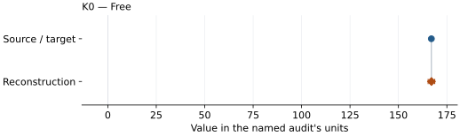

This is a **coefficient comparison**, not an observation or residual plot.
Each panel uses its coefficient's audit units and includes zero. Markers show
stored central values only. Error widths are retained in the table below;
no confidence interval or uncertainty band is inferred. Fixed/adopted values are constraints.

| Parameter | Source / target | Source error | Reconstruction | Reconstruction error | Fit role |
| --- | --- | --- | --- | --- | --- |
| K0 | 167.0 | Not specified | 167.03596583296786 | 1.708544045583997 | Free |

Values and reported errors are copied without rounding or conversion from the named audit. Missing errors mean unknown, not zero. Parameter names and volume conventions follow that audit; error widths do not imply a confidence convention.

Recorded diagnostics, covariance and additional protocol

- **Columns:**
    - **Pressure:** pressure\_gpa
    - **Temperature:** Not specified
    - **Volume:** volume\_a3\_conventional\_cell
- **Observed pressure range gpa:** \[63.9, 77.4\]
- **Observed temperature range k:** Not specified
- **Observed volume range:** \[56.26, 58.51\]
- **Degrees of freedom:** 5
- **Solver success:** True
- **Solver message:** Both \`ftol\` and \`xtol\` termination conditions are satisfied.
- **Rmse gpa:** 0.20955008251941537
- **Published rmse gpa:** 0.7160328495544448
- **Reduced chi square:** 0.16452768052798022

### Detailed evidence and existing plots

- [Earlier detailed record investigation](../primary-eos-refits.md#investigation-mg090fe010o_marquardt_2009b_ls_bm3_s1_09).
- [Record-by-record numerical ledger](../primary-eos-refits.md#records).
- [Source-audit reports](../source-audits.md).

Observation curves and residual plots are provided by the supporting reports where available. Their absence is not filled by a reconstructed curve presented as measured data.

[Machine-readable comparison ledger](https://github.com/CPrescher/peritheos/blob/main/docs/data/primary-eos-refits.json) — look up `mg090fe010o_marquardt_2009b_ls_bm3_s1_09`.
[Complete native EOSMAT file](https://github.com/CPrescher/peritheos/blob/main/peritheos/data/materials/mg090fe010o.eosmat).

## Marquardt et al. (2009), EPSL LS BM3 Table S1 row 10

Record: `mg090fe010o_marquardt_2009b_ls_bm3_s1_10` · Model: `BM3`

**Outcome: Numerically similar, with qualifications.**

**Scope:** Comparison with the source parameterization.
**Comparison basis:** Every compared free coefficient meets either the recorded combined-two-sigma comparison or parameter-specific numerical similarity screen; the audit does not classify the complete comparison as parity.

[Stored EOS coefficients and source](../material-summaries/mg090fe010o.md#record-mg090fe010o_marquardt_2009b_ls_bm3_s1_10)

### What this result establishes

**Separate source-review status:** primary\_source\_validated.
**Usage recommendation:** See the stored EOS qualifications; no recommendation is inferred here.

- One of 12 alternative constrained LS fits from EPSL Table S1. Only six Table 2 rows above 63 GPa are fitted, with printed V0 and K0 prime fixed. Source objective weights and coefficient standard errors are not reported; the refit errors are residual-scaled diagnostics, not published uncertainties.
- This named numerical assessment alone does not establish author-workflow reproduction, physical accuracy or recommendation for use.

### Data and reconstruction method

- **Dataset identifiers:** mg090fe010o\_marquardt\_2009\_table2\_pv
- **Observations:** 6
- **Fit kind:** isothermal\_pv
- **Selection:** spin\_region=low\_spin
- **Objective:** errors\_in\_variables
- **Absolute sigma:** True
- **Free parameters:** K0
- **Fixed parameters:** V0; K0\_prime

Unspecified selections, weights, fixed values or error conventions remain unknown; they have not been inferred for this report.

### Source versus reconstruction

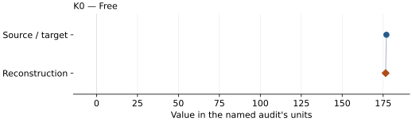

This is a **coefficient comparison**, not an observation or residual plot.
Each panel uses its coefficient's audit units and includes zero. Markers show
stored central values only. Error widths are retained in the table below;
no confidence interval or uncertainty band is inferred. Fixed/adopted values are constraints.

| Parameter | Source / target | Source error | Reconstruction | Reconstruction error | Fit role |
| --- | --- | --- | --- | --- | --- |
| K0 | 177.0 | Not specified | 176.50148199324164 | 1.8367690473848035 | Free |

Values and reported errors are copied without rounding or conversion from the named audit. Missing errors mean unknown, not zero. Parameter names and volume conventions follow that audit; error widths do not imply a confidence convention.

Recorded diagnostics, covariance and additional protocol

- **Columns:**
    - **Pressure:** pressure\_gpa
    - **Temperature:** Not specified
    - **Volume:** volume\_a3\_conventional\_cell
- **Observed pressure range gpa:** \[63.9, 77.4\]
- **Observed temperature range k:** Not specified
- **Observed volume range:** \[56.26, 58.51\]
- **Degrees of freedom:** 5
- **Solver success:** True
- **Solver message:** Both \`ftol\` and \`xtol\` termination conditions are satisfied.
- **Rmse gpa:** 0.23629886605941916
- **Published rmse gpa:** 0.8228740729169969
- **Reduced chi square:** 0.22201503013098103

### Detailed evidence and existing plots

- [Earlier detailed record investigation](../primary-eos-refits.md#investigation-mg090fe010o_marquardt_2009b_ls_bm3_s1_10).
- [Record-by-record numerical ledger](../primary-eos-refits.md#records).
- [Source-audit reports](../source-audits.md).

Observation curves and residual plots are provided by the supporting reports where available. Their absence is not filled by a reconstructed curve presented as measured data.

[Machine-readable comparison ledger](https://github.com/CPrescher/peritheos/blob/main/docs/data/primary-eos-refits.json) — look up `mg090fe010o_marquardt_2009b_ls_bm3_s1_10`.
[Complete native EOSMAT file](https://github.com/CPrescher/peritheos/blob/main/peritheos/data/materials/mg090fe010o.eosmat).

## Marquardt et al. (2009), EPSL LS BM3 Table S1 row 11

Record: `mg090fe010o_marquardt_2009b_ls_bm3_s1_11` · Model: `BM3`

**Outcome: Numerically similar, with qualifications.**

**Scope:** Comparison with the source parameterization.
**Comparison basis:** Every compared free coefficient meets either the recorded combined-two-sigma comparison or parameter-specific numerical similarity screen; the audit does not classify the complete comparison as parity.

[Stored EOS coefficients and source](../material-summaries/mg090fe010o.md#record-mg090fe010o_marquardt_2009b_ls_bm3_s1_11)

### What this result establishes

**Separate source-review status:** primary\_source\_validated.
**Usage recommendation:** See the stored EOS qualifications; no recommendation is inferred here.

- One of 12 alternative constrained LS fits from EPSL Table S1. Only six Table 2 rows above 63 GPa are fitted, with printed V0 and K0 prime fixed. Source objective weights and coefficient standard errors are not reported; the refit errors are residual-scaled diagnostics, not published uncertainties.
- This named numerical assessment alone does not establish author-workflow reproduction, physical accuracy or recommendation for use.

### Data and reconstruction method

- **Dataset identifiers:** mg090fe010o\_marquardt\_2009\_table2\_pv
- **Observations:** 6
- **Fit kind:** isothermal\_pv
- **Selection:** spin\_region=low\_spin
- **Objective:** errors\_in\_variables
- **Absolute sigma:** True
- **Free parameters:** K0
- **Fixed parameters:** V0; K0\_prime

Unspecified selections, weights, fixed values or error conventions remain unknown; they have not been inferred for this report.

### Source versus reconstruction

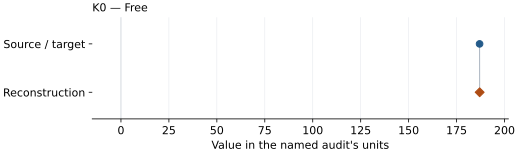

This is a **coefficient comparison**, not an observation or residual plot.
Each panel uses its coefficient's audit units and includes zero. Markers show
stored central values only. Error widths are retained in the table below;
no confidence interval or uncertainty band is inferred. Fixed/adopted values are constraints.

| Parameter | Source / target | Source error | Reconstruction | Reconstruction error | Fit role |
| --- | --- | --- | --- | --- | --- |
| K0 | 187.0 | Not specified | 187.04275144048634 | 1.9835558475022992 | Free |

Values and reported errors are copied without rounding or conversion from the named audit. Missing errors mean unknown, not zero. Parameter names and volume conventions follow that audit; error widths do not imply a confidence convention.

Recorded diagnostics, covariance and additional protocol

- **Columns:**
    - **Pressure:** pressure\_gpa
    - **Temperature:** Not specified
    - **Volume:** volume\_a3\_conventional\_cell
- **Observed pressure range gpa:** \[63.9, 77.4\]
- **Observed temperature range k:** Not specified
- **Observed volume range:** \[56.26, 58.51\]
- **Degrees of freedom:** 5
- **Solver success:** True
- **Solver message:** Both \`ftol\` and \`xtol\` termination conditions are satisfied.
- **Rmse gpa:** 0.266036563136773
- **Published rmse gpa:** 1.0167839863494872
- **Reduced chi square:** 0.2967768505543612

### Detailed evidence and existing plots

- [Earlier detailed record investigation](../primary-eos-refits.md#investigation-mg090fe010o_marquardt_2009b_ls_bm3_s1_11).
- [Record-by-record numerical ledger](../primary-eos-refits.md#records).
- [Source-audit reports](../source-audits.md).

Observation curves and residual plots are provided by the supporting reports where available. Their absence is not filled by a reconstructed curve presented as measured data.

[Machine-readable comparison ledger](https://github.com/CPrescher/peritheos/blob/main/docs/data/primary-eos-refits.json) — look up `mg090fe010o_marquardt_2009b_ls_bm3_s1_11`.
[Complete native EOSMAT file](https://github.com/CPrescher/peritheos/blob/main/peritheos/data/materials/mg090fe010o.eosmat).

## Marquardt et al. (2009), EPSL LS BM3 Table S1 row 12

Record: `mg090fe010o_marquardt_2009b_ls_bm3_s1_12` · Model: `BM3`

**Outcome: Numerically similar, with qualifications.**

**Scope:** Comparison with the source parameterization.
**Comparison basis:** Every compared free coefficient meets either the recorded combined-two-sigma comparison or parameter-specific numerical similarity screen; the audit does not classify the complete comparison as parity.

[Stored EOS coefficients and source](../material-summaries/mg090fe010o.md#record-mg090fe010o_marquardt_2009b_ls_bm3_s1_12)

### What this result establishes

**Separate source-review status:** primary\_source\_validated.
**Usage recommendation:** See the stored EOS qualifications; no recommendation is inferred here.

- One of 12 alternative constrained LS fits from EPSL Table S1. Only six Table 2 rows above 63 GPa are fitted, with printed V0 and K0 prime fixed. Source objective weights and coefficient standard errors are not reported; the refit errors are residual-scaled diagnostics, not published uncertainties.
- This named numerical assessment alone does not establish author-workflow reproduction, physical accuracy or recommendation for use.

### Data and reconstruction method

- **Dataset identifiers:** mg090fe010o\_marquardt\_2009\_table2\_pv
- **Observations:** 6
- **Fit kind:** isothermal\_pv
- **Selection:** spin\_region=low\_spin
- **Objective:** errors\_in\_variables
- **Absolute sigma:** True
- **Free parameters:** K0
- **Fixed parameters:** V0; K0\_prime

Unspecified selections, weights, fixed values or error conventions remain unknown; they have not been inferred for this report.

### Source versus reconstruction

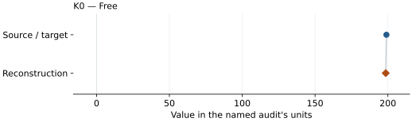

This is a **coefficient comparison**, not an observation or residual plot.
Each panel uses its coefficient's audit units and includes zero. Markers show
stored central values only. Error widths are retained in the table below;
no confidence interval or uncertainty band is inferred. Fixed/adopted values are constraints.

| Parameter | Source / target | Source error | Reconstruction | Reconstruction error | Fit role |
| --- | --- | --- | --- | --- | --- |
| K0 | 199.0 | Not specified | 198.52121311114507 | 2.1481941719694717 | Free |

Values and reported errors are copied without rounding or conversion from the named audit. Missing errors mean unknown, not zero. Parameter names and volume conventions follow that audit; error widths do not imply a confidence convention.

Recorded diagnostics, covariance and additional protocol

- **Columns:**
    - **Pressure:** pressure\_gpa
    - **Temperature:** Not specified
    - **Volume:** volume\_a3\_conventional\_cell
- **Observed pressure range gpa:** \[63.9, 77.4\]
- **Observed temperature range k:** Not specified
- **Observed volume range:** \[56.26, 58.51\]
- **Degrees of freedom:** 5
- **Solver success:** True
- **Solver message:** Both \`ftol\` and \`xtol\` termination conditions are satisfied.
- **Rmse gpa:** 0.29717076738997106
- **Published rmse gpa:** 1.1577417383961768
- **Reduced chi square:** 0.38907522705329806

### Detailed evidence and existing plots

- [Earlier detailed record investigation](../primary-eos-refits.md#investigation-mg090fe010o_marquardt_2009b_ls_bm3_s1_12).
- [Record-by-record numerical ledger](../primary-eos-refits.md#records).
- [Source-audit reports](../source-audits.md).

Observation curves and residual plots are provided by the supporting reports where available. Their absence is not filled by a reconstructed curve presented as measured data.

[Machine-readable comparison ledger](https://github.com/CPrescher/peritheos/blob/main/docs/data/primary-eos-refits.json) — look up `mg090fe010o_marquardt_2009b_ls_bm3_s1_12`.
[Complete native EOSMAT file](https://github.com/CPrescher/peritheos/blob/main/peritheos/data/materials/mg090fe010o.eosmat).
