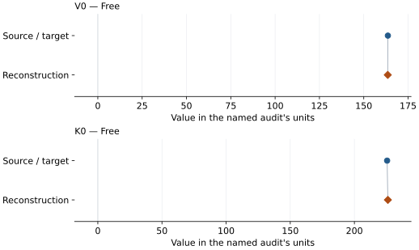
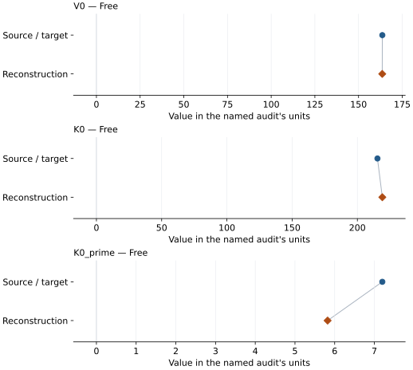

# Mg0.9Al0.2Si0.9O3 aluminous bridgmanite: EOS reconstruction reports

<!-- Generated by scripts.generate_reconstruction_reports; edit EOSMAT instead. -->

[All reconstruction reports](index.md) · [Material and EOS parameters](../material-summaries/mg09al02si09o3_bridgmanite.md)

These reports explain the assessments already stored in EOSMAT. Generating
this page does not refit observations, change classifications or replace source coefficients.

Use [scientific label definitions](../eos-labels.md) to distinguish coefficient
agreement, source verification, author-workflow reproduction and recommendation for use.

| EOS record | Recorded outcome | Coefficient comparison |
| --- | --- | --- |
| [Kubo et al. (2000), adopted fixed-derivative BM3](#record-mg09al02si09o3_bridgmanite_kubo_2000_bm3_1) | Coefficient parity achieved | Graph and table |
| [Kubo et al. (2000), unconstrained BM3](#record-mg09al02si09o3_bridgmanite_kubo_2000_bm3_2) | Coefficient parity achieved | Graph and table |

## Kubo et al. (2000), adopted fixed-derivative BM3

Record: `mg09al02si09o3_bridgmanite_kubo_2000_bm3_1` · Model: `BM3`

**Outcome: Coefficient parity achieved.**

**Scope:** Comparison with the source parameterization.
**Comparison basis:** Every compared free coefficient meets both the recorded combined-two-sigma comparison and parameter-specific numerical similarity screen. Error conventions and fit qualifications remain applicable.

[Stored EOS coefficients and source](../material-summaries/mg09al02si09o3_bridgmanite.md#record-mg09al02si09o3_bridgmanite_kubo_2000_bm3_1)

### What this result establishes

**Separate source-review status:** primary\_source\_validated.
**Usage recommendation:** See the stored EOS qualifications; no recommendation is inferred here.

- This named numerical assessment alone does not establish author-workflow reproduction, physical accuracy or recommendation for use.

### Data and reconstruction method

- **Dataset identifiers:** mg09al02si09o3\_bridgmanite\_kubo\_2000\_table1\_compression
- **Observations:** 10
- **Fit kind:** isothermal\_pv
- **Selection:** used\_in\_published\_fit=1
- **Objective:** errors\_in\_variables
- **Absolute sigma:** True
- **Free parameters:** V0; K0
- **Fixed parameters:** K0\_prime

Unspecified selections, weights, fixed values or error conventions remain unknown; they have not been inferred for this report.

### Source versus reconstruction

This is a **coefficient comparison**, not an observation or residual plot.
Each panel uses its coefficient's audit units and includes zero. Markers show
stored central values only. Error widths are retained in the table below;
no confidence interval or uncertainty band is inferred. Fixed/adopted values are constraints.

| Parameter | Source / target | Source error | Reconstruction | Reconstruction error | Fit role |
| --- | --- | --- | --- | --- | --- |
| V0 | 163.6 | 0.4 | 163.53481472952618 | 0.4661985022229434 | Free |
| K0 | 225.5 | 1.2 | 226.09755104733594 | 30.66884999717636 | Free |

Values and reported errors are copied without rounding or conversion from the named audit. Missing errors mean unknown, not zero. Parameter names and volume conventions follow that audit; error widths do not imply a confidence convention.

Recorded diagnostics, covariance and additional protocol

- **Columns:**
    - **Pressure:** pressure\_ruby\_gpa
    - **Temperature:** Not specified
    - **Volume:** volume\_a3\_conventional\_cell
- **Observed pressure range gpa:** \[0.0, 8.71\]
- **Observed temperature range k:** Not specified
- **Observed volume range:** \[157.8, 163.6\]
- **Degrees of freedom:** 8
- **Solver success:** True
- **Solver message:** Both \`ftol\` and \`xtol\` termination conditions are satisfied.
- **Rmse gpa:** 0.037895675177745454
- **Published rmse gpa:** 0.10320744048355725
- **Reduced chi square:** 0.002660930265451025

### Detailed evidence and existing plots

- [Record-by-record numerical ledger](../primary-eos-refits.md#records).
- [Source-audit reports](../source-audits.md).

Observation curves and residual plots are provided by the supporting reports where available. Their absence is not filled by a reconstructed curve presented as measured data.

[Machine-readable comparison ledger](https://github.com/CPrescher/peritheos/blob/main/docs/data/primary-eos-refits.json) — look up `mg09al02si09o3_bridgmanite_kubo_2000_bm3_1`.
[Complete native EOSMAT file](https://github.com/CPrescher/peritheos/blob/main/peritheos/data/materials/mg09al02si09o3_bridgmanite.eosmat).

## Kubo et al. (2000), unconstrained BM3

Record: `mg09al02si09o3_bridgmanite_kubo_2000_bm3_2` · Model: `BM3`

**Outcome: Coefficient parity achieved.**

**Scope:** Comparison with the source parameterization.
**Comparison basis:** Every compared free coefficient meets both the recorded combined-two-sigma comparison and parameter-specific numerical similarity screen. Error conventions and fit qualifications remain applicable.

[Stored EOS coefficients and source](../material-summaries/mg09al02si09o3_bridgmanite.md#record-mg09al02si09o3_bridgmanite_kubo_2000_bm3_2)

### What this result establishes

**Separate source-review status:** primary\_source\_validated.
**Usage recommendation:** See the stored EOS qualifications; no recommendation is inferred here.

- This named numerical assessment alone does not establish author-workflow reproduction, physical accuracy or recommendation for use.

### Data and reconstruction method

- **Dataset identifiers:** mg09al02si09o3\_bridgmanite\_kubo\_2000\_table1\_compression
- **Observations:** 10
- **Fit kind:** isothermal\_pv
- **Selection:** used\_in\_published\_fit=1
- **Objective:** errors\_in\_variables
- **Absolute sigma:** True
- **Free parameters:** V0; K0; K0\_prime
- **Fixed parameters:** None declared

Unspecified selections, weights, fixed values or error conventions remain unknown; they have not been inferred for this report.

### Source versus reconstruction

This is a **coefficient comparison**, not an observation or residual plot.
Each panel uses its coefficient's audit units and includes zero. Markers show
stored central values only. Error widths are retained in the table below;
no confidence interval or uncertainty band is inferred. Fixed/adopted values are constraints.

| Parameter | Source / target | Source error | Reconstruction | Reconstruction error | Fit role |
| --- | --- | --- | --- | --- | --- |
| V0 | 163.6 | 0.4 | 163.55450753589707 | 0.5636887861454142 | Free |
| K0 | 215.4 | 4.4 | 219.1338699718678 | 107.77011557250326 | Free |
| K0\_prime | 7.2 | 1.4 | 5.82193753747267 | 27.72279651526544 | Free |

Values and reported errors are copied without rounding or conversion from the named audit. Missing errors mean unknown, not zero. Parameter names and volume conventions follow that audit; error widths do not imply a confidence convention.

Recorded diagnostics, covariance and additional protocol

- **Columns:**
    - **Pressure:** pressure\_ruby\_gpa
    - **Temperature:** Not specified
    - **Volume:** volume\_a3\_conventional\_cell
- **Observed pressure range gpa:** \[0.0, 8.71\]
- **Observed temperature range k:** Not specified
- **Observed volume range:** \[157.8, 163.6\]
- **Degrees of freedom:** 7
- **Solver success:** True
- **Solver message:** \`ftol\` termination condition is satisfied.
- **Rmse gpa:** 0.03379659098906755
- **Published rmse gpa:** 0.09404774837049258
- **Reduced chi square:** 0.0023762941677099693

### Detailed evidence and existing plots

- [Record-by-record numerical ledger](../primary-eos-refits.md#records).
- [Source-audit reports](../source-audits.md).

Observation curves and residual plots are provided by the supporting reports where available. Their absence is not filled by a reconstructed curve presented as measured data.

[Machine-readable comparison ledger](https://github.com/CPrescher/peritheos/blob/main/docs/data/primary-eos-refits.json) — look up `mg09al02si09o3_bridgmanite_kubo_2000_bm3_2`.
[Complete native EOSMAT file](https://github.com/CPrescher/peritheos/blob/main/peritheos/data/materials/mg09al02si09o3_bridgmanite.eosmat).
