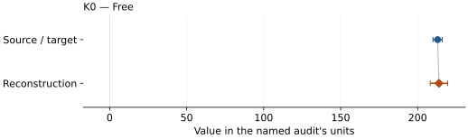
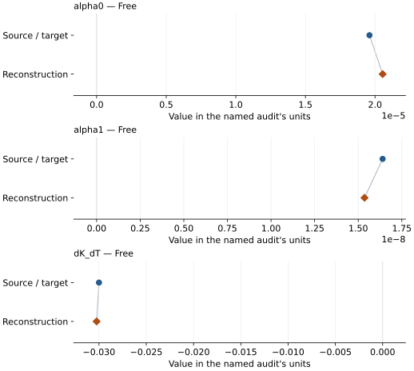
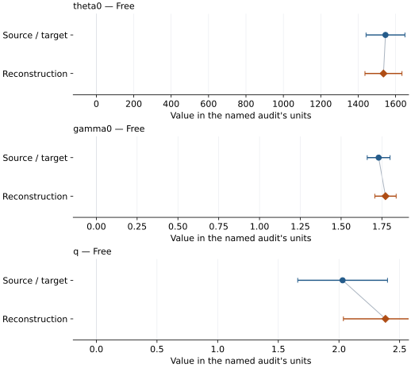

# MgAl2O4 calcium-ferrite phase: EOS reconstruction reports

<!-- Generated by scripts.generate_reconstruction_reports; edit EOSMAT instead. -->

[All reconstruction reports](index.md) · [Material and EOS parameters](../material-summaries/mgal2o4_cafe2o4.md)

These reports explain the assessments already stored in EOSMAT. Generating
this page does not refit observations, change classifications or replace source coefficients.

Use [scientific label definitions](../eos-labels.md) to distinguish coefficient
agreement, source verification, author-workflow reproduction and recommendation for use.

| EOS record | Recorded outcome | Coefficient comparison |
| --- | --- | --- |
| [Funamori et al. (1998), CaFe2O4-type MgAl2O4 BM2](#record-mgal2o4_cafe2o4_funamori_1998_bm2_1) | Complete independent refit unavailable | No numeric coefficient pair recorded |
| [Irifune et al. (2002), CaFe2O4-type MgAl2O4 BM2](#record-mgal2o4_cafe2o4_irifune_2002_bm2_2) | Coefficient parity achieved | Graph and table |
| [Sueda et al. (2009), CaFe2O4-type MgAl2O4 HTBM](#record-mgal2o4_cafe2o4_sueda_2009_htbm_2) | Coefficient parity achieved | Graph and table |
| [Sueda et al. (2009), CaFe2O4-type MgAl2O4 BM3-MGD](#record-mgal2o4_cafe2o4_sueda_2009_mgd_3) | Coefficient parity achieved | Graph and table |

## Funamori et al. (1998), CaFe2O4-type MgAl2O4 BM2

Record: `mgal2o4_cafe2o4_funamori_1998_bm2_1` · Model: `BM2`

**Outcome: Complete independent refit unavailable.**

**Scope:** Comparison with the source parameterization.
**Comparison basis:** The source construction is not a regression: recovered V0 is held fixed, K0-prime=4 is assumed, and the only compressed observation determines K0 algebraically. The article has no supplement, and the audit found no associated repository series; the complete reported endpoint evidence is bundled, but it leaves zero independent residual degrees of freedom.

[Stored EOS coefficients and source](../material-summaries/mgal2o4_cafe2o4.md#record-mgal2o4_cafe2o4_funamori_1998_bm2_1)

### What this result establishes

**Separate source-review status:** primary\_source\_validated.
**Usage recommendation:** not\_recommended\_for\_quantitative\_use

- Usage recommendation: not\_recommended\_for\_quantitative\_use
- This named numerical assessment alone does not establish author-workflow reproduction, physical accuracy or recommendation for use.
- No reconstructed coefficient table is recorded for this assessment; no missing values have been inferred.

### Data and reconstruction method

- **Dataset identifiers:** mgal2o4\_cafe2o4\_funamori\_1998\_text\_pv
- **Fixed parameters:** V0

Unspecified selections, weights, fixed values or error conventions remain unknown; they have not been inferred for this report.

### Why no coefficient graph is shown

No numeric source/reconstruction pair is recorded for this assessment. A graph would require information that is not available here; no values or observations have been invented.

### Detailed evidence and existing plots

- [Record-by-record numerical ledger](../primary-eos-refits.md#records).
- [Source-audit reports](../source-audits.md).

Observation curves and residual plots are provided by the supporting reports where available. Their absence is not filled by a reconstructed curve presented as measured data.

[Machine-readable comparison ledger](https://github.com/CPrescher/peritheos/blob/main/docs/data/primary-eos-refits.json) — look up `mgal2o4_cafe2o4_funamori_1998_bm2_1`.
[Complete native EOSMAT file](https://github.com/CPrescher/peritheos/blob/main/peritheos/data/materials/mgal2o4_cafe2o4.eosmat).

## Irifune et al. (2002), CaFe2O4-type MgAl2O4 BM2

Record: `mgal2o4_cafe2o4_irifune_2002_bm2_2` · Model: `BM2`

**Outcome: Coefficient parity achieved.**

**Scope:** Comparison with the source parameterization.
**Comparison basis:** Every compared free coefficient meets both the recorded combined-two-sigma comparison and parameter-specific numerical similarity screen. Error conventions and fit qualifications remain applicable.

[Stored EOS coefficients and source](../material-summaries/mgal2o4_cafe2o4.md#record-mgal2o4_cafe2o4_irifune_2002_bm2_2)

### What this result establishes

**Separate source-review status:** primary\_source\_validated.
**Usage recommendation:** See the stored EOS qualifications; no recommendation is inferred here.

- Three compressed states only; fixed averaged V0 and implicit K0-prime=4. This unweighted pressure diagnostic differs from the stated normalized-volume objective with unspecified weights. The dedicated reproduction also checks that objective; neither supplies source covariance. The refit error is a residual-scaled diagnostic, not a published uncertainty.
- This named numerical assessment alone does not establish author-workflow reproduction, physical accuracy or recommendation for use.

### Data and reconstruction method

- **Dataset identifiers:** mgal2o4\_cafe2o4\_irifune\_2002\_text\_pv
- **Observations:** 3
- **Fit kind:** isothermal\_pv
- **Selection:** fit\_included=1
- **Objective:** pressure\_residuals
- **Absolute sigma:** False
- **Free parameters:** K0
- **Fixed parameters:** V0

Unspecified selections, weights, fixed values or error conventions remain unknown; they have not been inferred for this report.

### Source versus reconstruction

This is a **coefficient comparison**, not an observation or residual plot.
Each panel uses its coefficient's audit units and includes zero. Markers show
stored central values only. Error widths are retained in the table below;
no confidence interval or uncertainty band is inferred. Fixed/adopted values are constraints.

| Parameter | Source / target | Source error | Reconstruction | Reconstruction error | Fit role |
| --- | --- | --- | --- | --- | --- |
| K0 | 213.0 | 3.0 | 213.86541623235252 | 5.668615221179417 | Free |

Values and reported errors are copied without rounding or conversion from the named audit. Missing errors mean unknown, not zero. Parameter names and volume conventions follow that audit; error widths do not imply a confidence convention.

Recorded diagnostics, covariance and additional protocol

- **Columns:**
    - **Pressure:** pressure\_gpa
    - **Temperature:** Not specified
    - **Volume:** volume\_a3
- **Observed pressure range gpa:** \[27.4, 34.7\]
- **Observed temperature range k:** Not specified
- **Observed volume range:** \[213.1, 216.1\]
- **Degrees of freedom:** 2
- **Solver success:** True
- **Solver message:** Both \`ftol\` and \`xtol\` termination conditions are satisfied.
- **Rmse gpa:** 1.1816176575311506
- **Published rmse gpa:** 1.18848285916044
- **Reduced chi square:** 2.094330432884105

### Detailed evidence and existing plots

- [Record-by-record numerical ledger](../primary-eos-refits.md#records).
- [Source-audit reports](../source-audits.md).

Observation curves and residual plots are provided by the supporting reports where available. Their absence is not filled by a reconstructed curve presented as measured data.

[Machine-readable comparison ledger](https://github.com/CPrescher/peritheos/blob/main/docs/data/primary-eos-refits.json) — look up `mgal2o4_cafe2o4_irifune_2002_bm2_2`.
[Complete native EOSMAT file](https://github.com/CPrescher/peritheos/blob/main/peritheos/data/materials/mgal2o4_cafe2o4.eosmat).

## Sueda et al. (2009), CaFe2O4-type MgAl2O4 HTBM

Record: `mgal2o4_cafe2o4_sueda_2009_htbm_2` · Model: `BM3`

**Outcome: Coefficient parity achieved.**

**Scope:** Comparison with the source parameterization.
**Comparison basis:** Every compared free coefficient meets both the recorded combined-two-sigma comparison and parameter-specific numerical similarity screen. Error conventions and fit qualifications remain applicable.

[Stored EOS coefficients and source](../material-summaries/mgal2o4_cafe2o4.md#record-mgal2o4_cafe2o4_sueda_2009_htbm_2)

### What this result establishes

**Separate source-review status:** primary\_source\_validated.
**Usage recommendation:** See the stored EOS qualifications; no recommendation is inferred here.

- Staged thermal diagnostic on all 46 Table 1 rows, with the published 300 K BM3 triplet fixed. The source does not specify weights or uncertainty confidence, so use unweighted pressure residuals. The independent static-stage reconstruction and printed-equation corrections are documented in the \[Sueda audit\](literature-reproductions/sueda-2009-mgal2o4-cafe2o4.md).
- This named numerical assessment alone does not establish author-workflow reproduction, physical accuracy or recommendation for use.

### Data and reconstruction method

- **Dataset identifiers:** mgal2o4\_cafe2o4\_sueda\_2009\_table1\_pvt
- **Observations:** 46
- **Fit kind:** joint\_pvt
- **Selection:** all rows
- **Objective:** pressure\_residuals
- **Absolute sigma:** False
- **Free parameters:** alpha0; alpha1; dK\_dT
- **Fixed parameters:** V0; K0; K0\_prime; Tr

Unspecified selections, weights, fixed values or error conventions remain unknown; they have not been inferred for this report.

### Source versus reconstruction

This is a **coefficient comparison**, not an observation or residual plot.
Each panel uses its coefficient's audit units and includes zero. Markers show
stored central values only. Error widths are retained in the table below;
no confidence interval or uncertainty band is inferred. Fixed/adopted values are constraints.

| Parameter | Source / target | Source error | Reconstruction | Reconstruction error | Fit role |
| --- | --- | --- | --- | --- | --- |
| alpha0 | 1.96e-05 | 1.3e-06 | 2.0545677882192407e-05 | 9.45880606019199e-07 | Free |
| alpha1 | 1.64e-08 | 2.4e-09 | 1.536111873108692e-08 | 8.882639906998163e-10 | Free |
| dK\_dT | -0.03 | 0.002 | -0.03025104522652718 | 2.59081185197411e-10 | Free |

Values and reported errors are copied without rounding or conversion from the named audit. Missing errors mean unknown, not zero. Parameter names and volume conventions follow that audit; error widths do not imply a confidence convention.

Recorded diagnostics, covariance and additional protocol

- **Columns:**
    - **Pressure:** pressure\_gpa
    - **Temperature:** temperature\_k
    - **Volume:** volume\_a3
- **Observed pressure range gpa:** \[0.0001, 41.5\]
- **Observed temperature range k:** \[298.0, 2400.0\]
- **Observed volume range:** \[206.9, 243.8\]
- **Degrees of freedom:** 43
- **Solver success:** True
- **Solver message:** \`ftol\` termination condition is satisfied.
- **Rmse gpa:** 0.29290011794332116
- **Published rmse gpa:** 0.30738576344813623
- **Reduced chi square:** 0.091775861353389

### Detailed evidence and existing plots

- [Supporting source report: sueda-2009-mgal2o4-cafe2o4](../literature-reproductions/sueda-2009-mgal2o4-cafe2o4.md).
- [Record-by-record numerical ledger](../primary-eos-refits.md#records).
- [Source-audit reports](../source-audits.md).

Observation curves and residual plots are provided by the supporting reports where available. Their absence is not filled by a reconstructed curve presented as measured data.

[Machine-readable comparison ledger](https://github.com/CPrescher/peritheos/blob/main/docs/data/primary-eos-refits.json) — look up `mgal2o4_cafe2o4_sueda_2009_htbm_2`.
[Complete native EOSMAT file](https://github.com/CPrescher/peritheos/blob/main/peritheos/data/materials/mgal2o4_cafe2o4.eosmat).

## Sueda et al. (2009), CaFe2O4-type MgAl2O4 BM3-MGD

Record: `mgal2o4_cafe2o4_sueda_2009_mgd_3` · Model: `BM3`

**Outcome: Coefficient parity achieved.**

**Scope:** Comparison with the source parameterization.
**Comparison basis:** Every compared free coefficient meets both the recorded combined-two-sigma comparison and parameter-specific numerical similarity screen. Error conventions and fit qualifications remain applicable.

[Stored EOS coefficients and source](../material-summaries/mgal2o4_cafe2o4.md#record-mgal2o4_cafe2o4_sueda_2009_mgd_3)

### What this result establishes

**Separate source-review status:** primary\_source\_validated.
**Usage recommendation:** See the stored EOS qualifications; no recommendation is inferred here.

- Staged thermal diagnostic on all 46 Table 1 rows, with the published 300 K BM3 triplet fixed. The source does not specify weights or uncertainty confidence, so use unweighted pressure residuals. The independent static-stage reconstruction and printed-equation corrections are documented in the \[Sueda audit\](literature-reproductions/sueda-2009-mgal2o4-cafe2o4.md).
- This named numerical assessment alone does not establish author-workflow reproduction, physical accuracy or recommendation for use.

### Data and reconstruction method

- **Dataset identifiers:** mgal2o4\_cafe2o4\_sueda\_2009\_table1\_pvt
- **Observations:** 46
- **Fit kind:** joint\_pvt
- **Selection:** all rows
- **Objective:** pressure\_residuals
- **Absolute sigma:** False
- **Free parameters:** theta0; gamma0; q
- **Fixed parameters:** V0; K0; K0\_prime; Tr; n

Unspecified selections, weights, fixed values or error conventions remain unknown; they have not been inferred for this report.

### Source versus reconstruction

This is a **coefficient comparison**, not an observation or residual plot.
Each panel uses its coefficient's audit units and includes zero. Markers show
stored central values only. Error widths are retained in the table below;
no confidence interval or uncertainty band is inferred. Fixed/adopted values are constraints.

| Parameter | Source / target | Source error | Reconstruction | Reconstruction error | Fit role |
| --- | --- | --- | --- | --- | --- |
| theta0 | 1546.0 | 104.0 | 1535.20247243221 | 98.97639964934156 | Free |
| gamma0 | 1.73 | 0.07 | 1.7719489187241777 | 0.06540471148893529 | Free |
| q | 2.03 | 0.37 | 2.3835091190509887 | 0.34696267152816135 | Free |

Values and reported errors are copied without rounding or conversion from the named audit. Missing errors mean unknown, not zero. Parameter names and volume conventions follow that audit; error widths do not imply a confidence convention.

Recorded diagnostics, covariance and additional protocol

- **Columns:**
    - **Pressure:** pressure\_gpa
    - **Temperature:** temperature\_k
    - **Volume:** volume\_a3
- **Observed pressure range gpa:** \[0.0001, 41.5\]
- **Observed temperature range k:** \[298.0, 2400.0\]
- **Observed volume range:** \[206.9, 243.8\]
- **Degrees of freedom:** 43
- **Solver success:** True
- **Solver message:** Both \`ftol\` and \`xtol\` termination conditions are satisfied.
- **Rmse gpa:** 0.28386243261309824
- **Published rmse gpa:** 0.28815743095604834
- **Reduced chi square:** 0.08619959325244615

### Detailed evidence and existing plots

- [Supporting source report: sueda-2009-mgal2o4-cafe2o4](../literature-reproductions/sueda-2009-mgal2o4-cafe2o4.md).
- [Record-by-record numerical ledger](../primary-eos-refits.md#records).
- [Source-audit reports](../source-audits.md).

Observation curves and residual plots are provided by the supporting reports where available. Their absence is not filled by a reconstructed curve presented as measured data.

[Machine-readable comparison ledger](https://github.com/CPrescher/peritheos/blob/main/docs/data/primary-eos-refits.json) — look up `mgal2o4_cafe2o4_sueda_2009_mgd_3`.
[Complete native EOSMAT file](https://github.com/CPrescher/peritheos/blob/main/peritheos/data/materials/mgal2o4_cafe2o4.eosmat).
