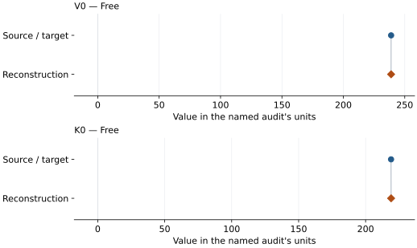

# MgAl2O4 calcium-titanate phase: EOS reconstruction reports

<!-- Generated by scripts.generate_reconstruction_reports; edit EOSMAT instead. -->

[All reconstruction reports](index.md) · [Material and EOS parameters](../material-summaries/mgal2o4_cati2o4.md)

These reports explain the assessments already stored in EOSMAT. Generating
this page does not refit observations, change classifications or replace source coefficients.

Use [scientific label definitions](../eos-labels.md) to distinguish coefficient
agreement, source verification, author-workflow reproduction and recommendation for use.

| EOS record | Recorded outcome | Coefficient comparison |
| --- | --- | --- |
| [Funamori et al. (1998), CaTi2O4-type MgAl2O4 BM2](#record-mgal2o4_cati2o4_funamori_1998_bm2_1) | Complete independent refit unavailable | No numeric coefficient pair recorded |
| [Ono et al. (2006), CaTi2O4-type MgAl2O4 BM2](#record-mgal2o4_cati2o4_ono_2006_bm2_2) | Coefficient parity achieved | Graph and table |

## Funamori et al. (1998), CaTi2O4-type MgAl2O4 BM2

Record: `mgal2o4_cati2o4_funamori_1998_bm2_1` · Model: `BM2`

**Outcome: Complete independent refit unavailable.**

**Scope:** Comparison with the source parameterization.
**Comparison basis:** The source construction is not a regression: recovered V0 is held fixed, K0-prime=4 is assumed, and the only compressed observation determines K0 algebraically. The article has no supplement, and the audit found no associated repository series; the complete reported endpoint evidence is bundled, but it leaves zero independent residual degrees of freedom.

[Stored EOS coefficients and source](../material-summaries/mgal2o4_cati2o4.md#record-mgal2o4_cati2o4_funamori_1998_bm2_1)

### What this result establishes

**Separate source-review status:** primary\_source\_validated.
**Usage recommendation:** not\_recommended\_for\_quantitative\_use

- Usage recommendation: not\_recommended\_for\_quantitative\_use
- This named numerical assessment alone does not establish author-workflow reproduction, physical accuracy or recommendation for use.
- No reconstructed coefficient table is recorded for this assessment; no missing values have been inferred.

### Data and reconstruction method

- **Dataset identifiers:** mgal2o4\_cati2o4\_funamori\_1998\_text\_pv
- **Fixed parameters:** V0

Unspecified selections, weights, fixed values or error conventions remain unknown; they have not been inferred for this report.

### Why no coefficient graph is shown

No numeric source/reconstruction pair is recorded for this assessment. A graph would require information that is not available here; no values or observations have been invented.

### Detailed evidence and existing plots

- [Record-by-record numerical ledger](../primary-eos-refits.md#records).
- [Source-audit reports](../source-audits.md).

Observation curves and residual plots are provided by the supporting reports where available. Their absence is not filled by a reconstructed curve presented as measured data.

[Machine-readable comparison ledger](https://github.com/CPrescher/peritheos/blob/main/docs/data/primary-eos-refits.json) — look up `mgal2o4_cati2o4_funamori_1998_bm2_1`.
[Complete native EOSMAT file](https://github.com/CPrescher/peritheos/blob/main/peritheos/data/materials/mgal2o4_cati2o4.eosmat).

## Ono et al. (2006), CaTi2O4-type MgAl2O4 BM2

Record: `mgal2o4_cati2o4_ono_2006_bm2_2` · Model: `BM2`

**Outcome: Coefficient parity achieved.**

**Scope:** Comparison with the source parameterization.
**Comparison basis:** Every compared free coefficient meets both the recorded combined-two-sigma comparison and parameter-specific numerical similarity screen. Error conventions and fit qualifications remain applicable.

[Stored EOS coefficients and source](../material-summaries/mgal2o4_cati2o4.md#record-mgal2o4_cati2o4_ono_2006_bm2_2)

### What this result establishes

**Separate source-review status:** primary\_source\_validated.
**Usage recommendation:** See the stored EOS qualifications; no recommendation is inferred here.

- All 14 Table 3 rows, including two recovered ambient cells. Source weights and selection are unspecified; zero-rounded volume errors preclude using those errors as weights. The unweighted diagnostic recovers the printed coefficients; the dedicated Ono reproduction documents the sensitivity to excluding ambient cells.
- This named numerical assessment alone does not establish author-workflow reproduction, physical accuracy or recommendation for use.

### Data and reconstruction method

- **Dataset identifiers:** mgal2o4\_cati2o4\_ono\_2006\_table3
- **Observations:** 14
- **Fit kind:** isothermal\_pv
- **Selection:** all rows; reference-T rows
- **Objective:** pressure\_residuals
- **Absolute sigma:** True
- **Free parameters:** V0; K0
- **Fixed parameters:** None declared

Unspecified selections, weights, fixed values or error conventions remain unknown; they have not been inferred for this report.

### Source versus reconstruction

This is a **coefficient comparison**, not an observation or residual plot.
Each panel uses its coefficient's audit units and includes zero. Markers show
stored central values only. Error widths are retained in the table below;
no confidence interval or uncertainty band is inferred. Fixed/adopted values are constraints.

| Parameter | Source / target | Source error | Reconstruction | Reconstruction error | Fit role |
| --- | --- | --- | --- | --- | --- |
| V0 | 238.9 | 0.9 | 238.88074707412352 | 0.9517179436935822 | Free |
| K0 | 219.0 | 6.0 | 219.0469702625556 | 6.2198911256599025 | Free |

Values and reported errors are copied without rounding or conversion from the named audit. Missing errors mean unknown, not zero. Parameter names and volume conventions follow that audit; error widths do not imply a confidence convention.

Recorded diagnostics, covariance and additional protocol

- **Columns:**
    - **Pressure:** pressure\_gpa
    - **Temperature:** temperature\_k
    - **Volume:** volume\_a3
- **Observed pressure range gpa:** \[0.0, 91.2\]
- **Observed temperature range k:** \[300.0, 300.0\]
- **Observed volume range:** \[186.4, 240.7\]
- **Degrees of freedom:** 12
- **Solver success:** True
- **Solver message:** Both \`ftol\` and \`xtol\` termination conditions are satisfied.
- **Rmse gpa:** 1.3260637609793657
- **Published rmse gpa:** 1.3262475763534347
- **Reduced chi square:** 2.0515192812131975

### Detailed evidence and existing plots

- [Supporting source report: ono-2006-mgal2o4-cati2o4](../literature-reproductions/ono-2006-mgal2o4-cati2o4.md).
- [Record-by-record numerical ledger](../primary-eos-refits.md#records).
- [Source-audit reports](../source-audits.md).

Observation curves and residual plots are provided by the supporting reports where available. Their absence is not filled by a reconstructed curve presented as measured data.

[Machine-readable comparison ledger](https://github.com/CPrescher/peritheos/blob/main/docs/data/primary-eos-refits.json) — look up `mgal2o4_cati2o4_ono_2006_bm2_2`.
[Complete native EOSMAT file](https://github.com/CPrescher/peritheos/blob/main/peritheos/data/materials/mgal2o4_cati2o4.eosmat).
