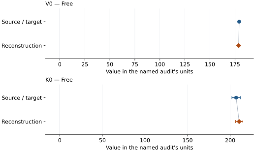
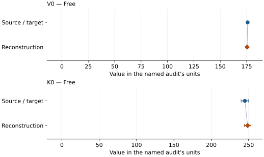
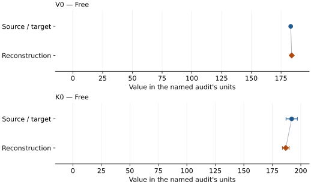
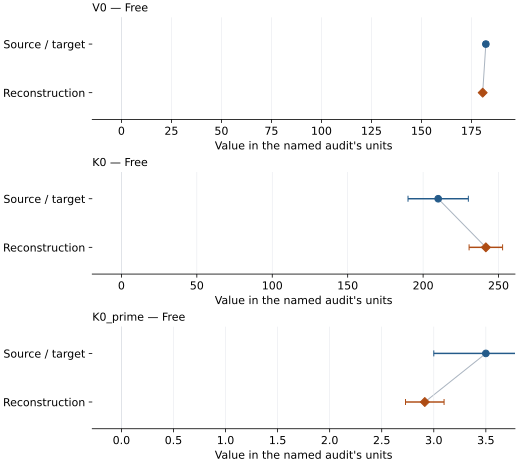

# MgGeO3 post-perovskite: EOS reconstruction reports

<!-- Generated by scripts.generate_reconstruction_reports; edit EOSMAT instead. -->

[All reconstruction reports](index.md) · [Material and EOS parameters](../material-summaries/mggeo3_post_perovskite.md)

These reports explain the assessments already stored in EOSMAT. Generating
this page does not refit observations, change classifications or replace source coefficients.

Use [scientific label definitions](../eos-labels.md) to distinguish coefficient
agreement, source verification, author-workflow reproduction and recommendation for use.

| EOS record | Recorded outcome | Coefficient comparison |
| --- | --- | --- |
| [Kubo et al. (2006), MgGeO3 post-perovskite preferred BM3](#record-mggeo3_post_perovskite_kubo_2006_bm3_1) | Coefficient parity achieved | Graph and table |
| [Kubo et al. (2006), MgGeO3 post-perovskite fixed-K0-prime=4 sensitivity fit](#record-mggeo3_post_perovskite_kubo_2006_bm2_sensitivity_2) | Coefficient parity achieved | Graph and table |
| [Hirose et al. (2005), MgGeO3 post-perovskite BM3 (K0-prime fixed)](#record-mggeo3_post_perovskite_hirose_2005_bm3_fixed_1) | Coefficient parity achieved | Graph and table |
| [Hirose et al. (2005), MgGeO3 post-perovskite BM3 (free)](#record-mggeo3_post_perovskite_hirose_2005_bm3_free_2) | Numerically similar, with qualifications | Graph and table |

## Kubo et al. (2006), MgGeO3 post-perovskite preferred BM3

Record: `mggeo3_post_perovskite_kubo_2006_bm3_1` · Model: `BM3`

**Outcome: Coefficient parity achieved.**

**Scope:** Comparison with the source parameterization.
**Comparison basis:** Every compared free coefficient meets both the recorded combined-two-sigma comparison and parameter-specific numerical similarity screen. Error conventions and fit qualifications remain applicable.

[Stored EOS coefficients and source](../material-summaries/mggeo3_post_perovskite.md#record-mggeo3_post_perovskite_kubo_2006_bm3_1)

### What this result establishes

**Separate source-review status:** primary\_source\_validated.
**Usage recommendation:** See the stored EOS qualifications; no recommendation is inferred here.

- This named numerical assessment alone does not establish author-workflow reproduction, physical accuracy or recommendation for use.

### Data and reconstruction method

- **Dataset identifiers:** mggeo3\_post\_perovskite\_kubo\_2006\_table\_s1\_pv
- **Observations:** 22
- **Fit kind:** isothermal\_pv
- **Selection:** fit\_included=1
- **Objective:** errors\_in\_variables
- **Absolute sigma:** True
- **Free parameters:** V0; K0
- **Fixed parameters:** K0\_prime

Unspecified selections, weights, fixed values or error conventions remain unknown; they have not been inferred for this report.

### Source versus reconstruction

This is a **coefficient comparison**, not an observation or residual plot.
Each panel uses its coefficient's audit units and includes zero. Markers show
stored central values only. Error widths are retained in the table below;
no confidence interval or uncertainty band is inferred. Fixed/adopted values are constraints.

| Parameter | Source / target | Source error | Reconstruction | Reconstruction error | Fit role |
| --- | --- | --- | --- | --- | --- |
| V0 | 179.2 | 0.7 | 178.66529189179212 | 0.6144318174627531 | Free |
| K0 | 207.0 | 5.0 | 210.58067184685015 | 4.293351645284262 | Free |

Values and reported errors are copied without rounding or conversion from the named audit. Missing errors mean unknown, not zero. Parameter names and volume conventions follow that audit; error widths do not imply a confidence convention.

Recorded diagnostics, covariance and additional protocol

- **Columns:**
    - **Pressure:** pressure\_gpa
    - **Temperature:** Not specified
    - **Volume:** volume\_a3
- **Observed pressure range gpa:** \[47.3, 196.3\]
- **Observed temperature range k:** Not specified
- **Observed volume range:** \[120.928305, 152.481768\]
- **Degrees of freedom:** 20
- **Solver success:** True
- **Solver message:** \`ftol\` termination condition is satisfied.
- **Rmse gpa:** 0.8120293208021537
- **Published rmse gpa:** 1.394506952622881
- **Reduced chi square:** 1.1509768661620852

### Detailed evidence and existing plots

- [Record-by-record numerical ledger](../primary-eos-refits.md#records).
- [Source-audit reports](../source-audits.md).

Observation curves and residual plots are provided by the supporting reports where available. Their absence is not filled by a reconstructed curve presented as measured data.

[Machine-readable comparison ledger](https://github.com/CPrescher/peritheos/blob/main/docs/data/primary-eos-refits.json) — look up `mggeo3_post_perovskite_kubo_2006_bm3_1`.
[Complete native EOSMAT file](https://github.com/CPrescher/peritheos/blob/main/peritheos/data/materials/mggeo3_post_perovskite.eosmat).

## Kubo et al. (2006), MgGeO3 post-perovskite fixed-K0-prime=4 sensitivity fit

Record: `mggeo3_post_perovskite_kubo_2006_bm2_sensitivity_2` · Model: `BM2`

**Outcome: Coefficient parity achieved.**

**Scope:** Comparison with the source parameterization.
**Comparison basis:** Every compared free coefficient meets both the recorded combined-two-sigma comparison and parameter-specific numerical similarity screen. Error conventions and fit qualifications remain applicable.

[Stored EOS coefficients and source](../material-summaries/mggeo3_post_perovskite.md#record-mggeo3_post_perovskite_kubo_2006_bm2_sensitivity_2)

### What this result establishes

**Separate source-review status:** primary\_source\_validated.
**Usage recommendation:** See the stored EOS qualifications; no recommendation is inferred here.

- This named numerical assessment alone does not establish author-workflow reproduction, physical accuracy or recommendation for use.

### Data and reconstruction method

- **Dataset identifiers:** mggeo3\_post\_perovskite\_kubo\_2006\_table\_s1\_pv
- **Observations:** 22
- **Fit kind:** isothermal\_pv
- **Selection:** fit\_included=1
- **Objective:** errors\_in\_variables
- **Absolute sigma:** True
- **Free parameters:** V0; K0
- **Fixed parameters:** None declared

Unspecified selections, weights, fixed values or error conventions remain unknown; they have not been inferred for this report.

### Source versus reconstruction

This is a **coefficient comparison**, not an observation or residual plot.
Each panel uses its coefficient's audit units and includes zero. Markers show
stored central values only. Error widths are retained in the table below;
no confidence interval or uncertainty band is inferred. Fixed/adopted values are constraints.

| Parameter | Source / target | Source error | Reconstruction | Reconstruction error | Fit role |
| --- | --- | --- | --- | --- | --- |
| V0 | 175.9 | 0.6 | 175.4561792818427 | 0.5221786996568926 | Free |
| K0 | 245.0 | 5.0 | 248.67933059047525 | 4.4205463150013795 | Free |

Values and reported errors are copied without rounding or conversion from the named audit. Missing errors mean unknown, not zero. Parameter names and volume conventions follow that audit; error widths do not imply a confidence convention.

Recorded diagnostics, covariance and additional protocol

- **Columns:**
    - **Pressure:** pressure\_gpa
    - **Temperature:** Not specified
    - **Volume:** volume\_a3
- **Observed pressure range gpa:** \[47.3, 196.3\]
- **Observed temperature range k:** Not specified
- **Observed volume range:** \[120.928305, 152.481768\]
- **Degrees of freedom:** 20
- **Solver success:** True
- **Solver message:** Both \`ftol\` and \`xtol\` termination conditions are satisfied.
- **Rmse gpa:** 0.749396935194924
- **Published rmse gpa:** 1.3561285588251957
- **Reduced chi square:** 1.0358363125552295

### Detailed evidence and existing plots

- [Record-by-record numerical ledger](../primary-eos-refits.md#records).
- [Source-audit reports](../source-audits.md).

Observation curves and residual plots are provided by the supporting reports where available. Their absence is not filled by a reconstructed curve presented as measured data.

[Machine-readable comparison ledger](https://github.com/CPrescher/peritheos/blob/main/docs/data/primary-eos-refits.json) — look up `mggeo3_post_perovskite_kubo_2006_bm2_sensitivity_2`.
[Complete native EOSMAT file](https://github.com/CPrescher/peritheos/blob/main/peritheos/data/materials/mggeo3_post_perovskite.eosmat).

## Hirose et al. (2005), MgGeO3 post-perovskite BM3 (K0-prime fixed)

Record: `mggeo3_post_perovskite_hirose_2005_bm3_fixed_1` · Model: `BM3`

**Outcome: Coefficient parity achieved.**

**Scope:** Comparison with the source parameterization.
**Comparison basis:** Every compared free coefficient meets both the recorded combined-two-sigma comparison and parameter-specific numerical similarity screen. Error conventions and fit qualifications remain applicable.

[Stored EOS coefficients and source](../material-summaries/mggeo3_post_perovskite.md#record-mggeo3_post_perovskite_hirose_2005_bm3_fixed_1)

### What this result establishes

**Separate source-review status:** primary\_source\_validated.
**Usage recommendation:** See the stored EOS qualifications; no recommendation is inferred here.

- This named numerical assessment alone does not establish author-workflow reproduction, physical accuracy or recommendation for use.

### Data and reconstruction method

- **Dataset identifiers:** mggeo3\_post\_perovskite\_hirose\_2005\_table3\_pv
- **Observations:** 9
- **Fit kind:** isothermal\_pv
- **Selection:** all rows
- **Objective:** errors\_in\_variables
- **Absolute sigma:** True
- **Free parameters:** V0; K0
- **Fixed parameters:** K0\_prime

Unspecified selections, weights, fixed values or error conventions remain unknown; they have not been inferred for this report.

### Source versus reconstruction

This is a **coefficient comparison**, not an observation or residual plot.
Each panel uses its coefficient's audit units and includes zero. Markers show
stored central values only. Error widths are retained in the table below;
no confidence interval or uncertainty band is inferred. Fixed/adopted values are constraints.

| Parameter | Source / target | Source error | Reconstruction | Reconstruction error | Fit role |
| --- | --- | --- | --- | --- | --- |
| V0 | 183.1 | 0.8 | 183.93533087455035 | 0.4732927919053868 | Free |
| K0 | 192.0 | 5.0 | 186.78503770450254 | 2.9501265433037833 | Free |

Values and reported errors are copied without rounding or conversion from the named audit. Missing errors mean unknown, not zero. Parameter names and volume conventions follow that audit; error widths do not imply a confidence convention.

Recorded diagnostics, covariance and additional protocol

- **Columns:**
    - **Pressure:** pressure\_gpa
    - **Temperature:** Not specified
    - **Volume:** volume\_a3
- **Observed pressure range gpa:** \[6.25, 78.55\]
- **Observed temperature range k:** Not specified
- **Observed volume range:** \[142.63, 177.45\]
- **Degrees of freedom:** 7
- **Solver success:** True
- **Solver message:** Both \`ftol\` and \`xtol\` termination conditions are satisfied.
- **Rmse gpa:** 0.57064955442719
- **Published rmse gpa:** 0.8717267563770555
- **Reduced chi square:** 19.322769809486257

### Detailed evidence and existing plots

- [Record-by-record numerical ledger](../primary-eos-refits.md#records).
- [Source-audit reports](../source-audits.md).

Observation curves and residual plots are provided by the supporting reports where available. Their absence is not filled by a reconstructed curve presented as measured data.

[Machine-readable comparison ledger](https://github.com/CPrescher/peritheos/blob/main/docs/data/primary-eos-refits.json) — look up `mggeo3_post_perovskite_hirose_2005_bm3_fixed_1`.
[Complete native EOSMAT file](https://github.com/CPrescher/peritheos/blob/main/peritheos/data/materials/mggeo3_post_perovskite.eosmat).

## Hirose et al. (2005), MgGeO3 post-perovskite BM3 (free)

Record: `mggeo3_post_perovskite_hirose_2005_bm3_free_2` · Model: `BM3`

**Outcome: Numerically similar, with qualifications.**

**Scope:** Comparison with the source parameterization.
**Comparison basis:** Every compared free coefficient meets either the recorded combined-two-sigma comparison or parameter-specific numerical similarity screen; the audit does not classify the complete comparison as parity.

[Stored EOS coefficients and source](../material-summaries/mggeo3_post_perovskite.md#record-mggeo3_post_perovskite_hirose_2005_bm3_free_2)

### What this result establishes

**Separate source-review status:** primary\_source\_validated.
**Usage recommendation:** See the stored EOS qualifications; no recommendation is inferred here.

- This named numerical assessment alone does not establish author-workflow reproduction, physical accuracy or recommendation for use.

### Data and reconstruction method

- **Dataset identifiers:** mggeo3\_post\_perovskite\_hirose\_2005\_table3\_pv
- **Observations:** 9
- **Fit kind:** isothermal\_pv
- **Selection:** all rows
- **Objective:** errors\_in\_variables
- **Absolute sigma:** True
- **Free parameters:** V0; K0; K0\_prime
- **Fixed parameters:** None declared

Unspecified selections, weights, fixed values or error conventions remain unknown; they have not been inferred for this report.

### Source versus reconstruction

This is a **coefficient comparison**, not an observation or residual plot.
Each panel uses its coefficient's audit units and includes zero. Markers show
stored central values only. Error widths are retained in the table below;
no confidence interval or uncertainty band is inferred. Fixed/adopted values are constraints.

| Parameter | Source / target | Source error | Reconstruction | Reconstruction error | Fit role |
| --- | --- | --- | --- | --- | --- |
| V0 | 182.2 | 1.1 | 180.6161469157237 | 0.6872522006206908 | Free |
| K0 | 210.0 | 20.0 | 241.59451164195318 | 11.10663739985238 | Free |
| K0\_prime | 3.5 | 0.5 | 2.913612561673377 | 0.1851831458386655 | Free |

Values and reported errors are copied without rounding or conversion from the named audit. Missing errors mean unknown, not zero. Parameter names and volume conventions follow that audit; error widths do not imply a confidence convention.

Recorded diagnostics, covariance and additional protocol

- **Columns:**
    - **Pressure:** pressure\_gpa
    - **Temperature:** Not specified
    - **Volume:** volume\_a3
- **Observed pressure range gpa:** \[6.25, 78.55\]
- **Observed temperature range k:** Not specified
- **Observed volume range:** \[142.63, 177.45\]
- **Degrees of freedom:** 6
- **Solver success:** True
- **Solver message:** \`ftol\` termination condition is satisfied.
- **Rmse gpa:** 0.44684007349046917
- **Published rmse gpa:** 0.8967730311392457
- **Reduced chi square:** 18.544072562225214

### Detailed evidence and existing plots

- [Earlier detailed record investigation](../primary-eos-refits.md#investigation-mggeo3_post_perovskite_hirose_2005_bm3_free_2).
- [Record-by-record numerical ledger](../primary-eos-refits.md#records).
- [Source-audit reports](../source-audits.md).

Observation curves and residual plots are provided by the supporting reports where available. Their absence is not filled by a reconstructed curve presented as measured data.

[Machine-readable comparison ledger](https://github.com/CPrescher/peritheos/blob/main/docs/data/primary-eos-refits.json) — look up `mggeo3_post_perovskite_hirose_2005_bm3_free_2`.
[Complete native EOSMAT file](https://github.com/CPrescher/peritheos/blob/main/peritheos/data/materials/mggeo3_post_perovskite.eosmat).
