# MgO: EOS reconstruction reports

<!-- Generated by scripts.generate_reconstruction_reports; edit EOSMAT instead. -->

[All reconstruction reports](index.md) · [Material and EOS parameters](../material-summaries/mgo.md)

These reports explain the assessments already stored in EOSMAT. Generating
this page does not refit observations, change classifications or replace source coefficients.

Use [scientific label definitions](../eos-labels.md) to distinguish coefficient
agreement, source verification, author-workflow reproduction and recommendation for use.

| EOS record | Recorded outcome | Coefficient comparison |
| --- | --- | --- |
| [Sakai et al. (2025), MgO generalized Rydberg-Stacey scale](#record-mgo_sakai_2025_rydberg_stacey_1) | Complete independent refit unavailable | No numeric coefficient pair recorded |
| [Tange et al. (2009), pressure-scale-free Fit3 Vinet-MGD](#record-mgo_b1_tange_2009_vinet) | Numerically similar, with qualifications | Graph and table |
| [JCPDS 4-0829, EOS from Duffy et al, 95](#record-mgo_duffy_1995_bm3_1) | Coefficient parity achieved | Graph and table |
| [Speziale et al. (2001), BM3 + variable-q Debye](#record-mgo_speziale_2001_bm3_2) | Coefficient parity achieved | Graph and table |
| [Li et al. (2006), acoustic absolute-pressure BM3](#record-mgo_li_2006_bm3_absolute_acoustic) | Numerically similar, with qualifications | Graph and table |
| [Jacobsen et al. (2008), KCl medium, Mao-1978 ruby-scale BM3](#record-mgo_jacobsen_2008_bm3_kcl_mao1978) | Coefficient parity achieved | Graph and table |
| [Jacobsen et al. (2008), helium medium, Mao-1986-scale BM3](#record-mgo_jacobsen_2008_bm3_helium_mao1986) | Coefficient parity achieved | Graph and table |
| [Shen and Smith (2026), Cu-referenced Vinet](#record-mgo_shen_2026_vinet_3) | Numerically similar, with qualifications | Graph and table |
| [Luo et al. (2023), cold Vinet plus second-order thermal pressure](#record-mgo_b1_luo_2023_vinet_thermal_5) | Complete independent refit unavailable | Graph and table |
| [Sokolova et al. (2013), Holzapfel thermal model (2016 workbook)](#record-mgo_sokolova_2013_holzapfel_4) | Source calculation reconstructed | No numeric coefficient pair recorded |
| [Dewaele et al. (2000), BM3-MGD](#record-mgo_dewaele_2000_bm3_mgd_5) | Coefficient parity achieved | Graph and table |
| [Dewaele et al. (2000), constrained BM2 sensitivity](#record-mgo_dewaele_2000_bm2_sensitivity_1) | Coefficient parity achieved | Graph and table |
| [Dewaele et al. (2000), Murnaghan sensitivity](#record-mgo_dewaele_2000_murnaghan_sensitivity_2) | Coefficient parity achieved | Graph and table |
| [Dewaele et al. (2000), Vinet sensitivity](#record-mgo_dewaele_2000_vinet_sensitivity_3) | Coefficient parity achieved | Graph and table |
| [Dewaele et al. (2000), logarithmic-strain sensitivity](#record-mgo_dewaele_2000_natural_strain3_sensitivity_4) | Coefficient parity achieved | Graph and table |
| [Duffy and Ahrens (1995), B1 principal Hugoniot](#record-mgo_b1_duffy_ahrens_1995_hugoniot_5) | Coefficient parity achieved | Graph and table |
| [Oganov and Dorogokupets (2003), GGA-ECP large-core static BM3](#record-mgo_oganov_2003_ecp_large_core_static_bm3) | Complete independent refit unavailable | No numeric coefficient pair recorded |
| [Oganov and Dorogokupets (2003), GGA-ECP small-core static BM3](#record-mgo_oganov_2003_ecp_small_core_static_bm3) | Complete independent refit unavailable | No numeric coefficient pair recorded |
| [Oganov and Dorogokupets (2003), GGA-PAW large-core static BM3](#record-mgo_oganov_2003_paw_large_core_static_bm3) | Complete independent refit unavailable | No numeric coefficient pair recorded |
| [Oganov and Dorogokupets (2003), GGA-PAW small-core static BM3](#record-mgo_oganov_2003_paw_small_core_static_bm3) | Numerically similar, with qualifications | Graph and table |
| [Oganov and Dorogokupets (2003), pressure-corrected static GGA-PAW BM3](#record-mgo_oganov_2003_pressure_corrected_static_bm3) | Numerically similar, with qualifications | Graph and table |
| [Oganov and Dorogokupets (2003), pressure-corrected 0 K BM3 with zero-point energy](#record-mgo_oganov_2003_pressure_corrected_0k_bm3) | Complete independent refit unavailable | No numeric coefficient pair recorded |
| [Oganov and Dorogokupets (2003), pressure-corrected 298 K BM3](#record-mgo_oganov_2003_pressure_corrected_298k_bm3) | Complete independent refit unavailable | No numeric coefficient pair recorded |
| [Oganov and Dorogokupets (2003), pressure-corrected 1000 K BM3](#record-mgo_oganov_2003_pressure_corrected_1000k_bm3) | Complete independent refit unavailable | No numeric coefficient pair recorded |
| [Oganov and Dorogokupets (2003), pressure-corrected 2000 K BM3](#record-mgo_oganov_2003_pressure_corrected_2000k_bm3) | Complete independent refit unavailable | No numeric coefficient pair recorded |
| [Oganov and Dorogokupets (2003), pressure-corrected 3000 K BM3](#record-mgo_oganov_2003_pressure_corrected_3000k_bm3) | Complete independent refit unavailable | No numeric coefficient pair recorded |
| [Oganov and Dorogokupets (2003), pressure-corrected 4000 K BM3](#record-mgo_oganov_2003_pressure_corrected_4000k_bm3) | Complete independent refit unavailable | No numeric coefficient pair recorded |
| [Lee and Wan (2008), LDA 0 K BM3](#record-mgo_lee_wan_2008_lda_static_bm3) | Complete independent refit unavailable | No numeric coefficient pair recorded |
| [Lee and Wan (2008), GGA 0 K BM3](#record-mgo_lee_wan_2008_gga_static_bm3) | Complete independent refit unavailable | No numeric coefficient pair recorded |
| [Holland et al. (2013), per modified Tait](#record-mgo_holland_2013_per_modified_tait) | Complete independent refit unavailable | No numeric coefficient pair recorded |
| [Zhang and Bukowinski (1991), MPIB B1 MgO](#record-mgo_b1_zhang_bukowinski_1991_mpib_bm3) | Complete independent refit unavailable | No numeric coefficient pair recorded |
| [Karki et al. (1997), LDA static BM4](#record-mgo_karki_1997_lda_static_bm4) | Complete independent refit unavailable | No numeric coefficient pair recorded |
| [Karki et al. (1997), LDA static BM3 sensitivity fit](#record-mgo_karki_1997_lda_static_bm3) | Complete independent refit unavailable | No numeric coefficient pair recorded |
| [Belmonte (2017), B3LYP static-lattice BM3](#record-mgo_belmonte_2017_b3lyp_static_bm3) | Numerically similar, with qualifications | Graph and table |
| [Hama and Suito (1996), QSM static-lattice Vinet comparison](#record-mgo_hama_suito_1996_qsm_static_vinet) | Complete independent refit unavailable | No numeric coefficient pair recorded |
| [Ye et al. (2017), MgO Vinet 300 K co-compression fit](#record-mgo_ye_2017_vinet_300k) | Coefficient parity achieved | Graph and table |
| [Zhu et al. (2025), MgO internally consistent P-V-T EOS](#record-mgo_zhu_2025_pvt) | Coefficient parity achieved | Graph and table |

## Sakai et al. (2025), MgO generalized Rydberg-Stacey scale

Record: `mgo_sakai_2025_rydberg_stacey_1` · Model: `RydbergStacey`

**Outcome: Complete independent refit unavailable.**

**Scope:** Comparison with the source parameterization.
**Comparison basis:** The bundled grid is calculated from the reported coefficients. Raw simultaneous-volume observations exist in Tables S1-S8, but the multi-stage fit also incorporates earlier studies and does not publish one flat pressure-volume regression table or covariance.

[Stored EOS coefficients and source](../material-summaries/mgo.md#record-mgo_sakai_2025_rydberg_stacey_1)

### What this result establishes

**Separate source-review status:** primary\_source\_validated.
**Usage recommendation:** See the stored EOS qualifications; no recommendation is inferred here.

- This named numerical assessment alone does not establish author-workflow reproduction, physical accuracy or recommendation for use.
- No reconstructed coefficient table is recorded for this assessment; no missing values have been inferred.

### Data and reconstruction method

- **Dataset identifiers:** None declared
- **Fixed parameters:** V0; K0; K\_infinity\_prime

Unspecified selections, weights, fixed values or error conventions remain unknown; they have not been inferred for this report.

### Why no coefficient graph is shown

No numeric source/reconstruction pair is recorded for this assessment. A graph would require information that is not available here; no values or observations have been invented.

### Detailed evidence and existing plots

- [Record-by-record numerical ledger](../primary-eos-refits.md#records).
- [Source-audit reports](../source-audits.md).

Observation curves and residual plots are provided by the supporting reports where available. Their absence is not filled by a reconstructed curve presented as measured data.

[Machine-readable comparison ledger](https://github.com/CPrescher/peritheos/blob/main/docs/data/primary-eos-refits.json) — look up `mgo_sakai_2025_rydberg_stacey_1`.
[Complete native EOSMAT file](https://github.com/CPrescher/peritheos/blob/main/peritheos/data/materials/mgo.eosmat).

## Tange et al. (2009), pressure-scale-free Fit3 Vinet-MGD

Record: `mgo_b1_tange_2009_vinet` · Model: `Vinet`

**Outcome: Numerically similar, with qualifications.**

**Scope:** Comparison with the source parameterization.
**Comparison basis:** Every compared free coefficient meets either the recorded combined-two-sigma comparison or parameter-specific numerical similarity screen; the audit does not classify the complete comparison as parity.

[Stored EOS coefficients and source](../material-summaries/mgo.md#record-mgo_b1_tange_2009_vinet)

### What this result establishes

**Separate source-review status:** primary\_source\_validated.
**Usage recommendation:** See the stored EOS qualifications; no recommendation is inferred here.

- The 164-row approximate reconstruction recovers all four independent Fit 3 coefficients within the numerical similarity limits, including over the tested 1-3% Zha-weight range. It is classified as similar, not parity, because the exact Zha rows and legacy weights are unpublished, one Fiquet state is unresolved, the Zha block is curve-based, and the restricted local inputs are not redistributed.
- This named numerical assessment alone does not establish author-workflow reproduction, physical accuracy or recommendation for use.

### Data and reconstruction method

- **Dataset identifiers:** mgo\_dubrovinsky\_1997\_cod\_thermal\_expansion; mgo\_fiquet\_1999\_cod\_thermal\_expansion; mgo\_li\_2006\_table1\_elasticity; mgo\_marsh\_1980\_lasl\_single\_crystal\_hugoniot
- **Observations:** 164
- **Fit kind:** approximate\_coupled\_vinet\_mgd\_global\_reconstruction
- **Objective:** source-weighted thermal, elastic, and shock residuals
- **Free parameters:** K0\_prime; a; b; gamma0
- **Fixed parameters:** V0; n

Unspecified selections, weights, fixed values or error conventions remain unknown; they have not been inferred for this report.

### Source versus reconstruction

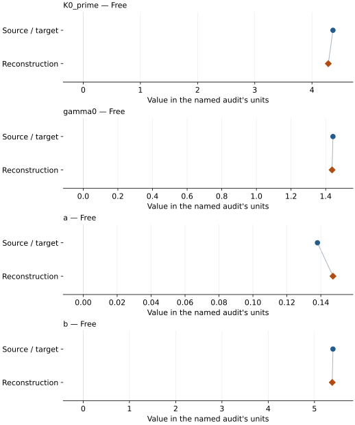

This is a **coefficient comparison**, not an observation or residual plot.
Each panel uses its coefficient's audit units and includes zero. Markers show
stored central values only. Error widths are retained in the table below;
no confidence interval or uncertainty band is inferred. Fixed/adopted values are constraints.

| Parameter | Source / target | Source error | Reconstruction | Reconstruction error | Fit role |
| --- | --- | --- | --- | --- | --- |
| K0\_prime | 4.367 | 0.013 | 4.285267999134705 | Not specified | Free |
| gamma0 | 1.442 | 0.015 | 1.43677861015837 | Not specified | Free |
| a | 0.138 | 0.019 | 0.14714590559240334 | Not specified | Free |
| b | 5.4 | 1.1 | 5.384586100820397 | Not specified | Free |

Values and reported errors are copied without rounding or conversion from the named audit. Missing errors mean unknown, not zero. Parameter names and volume conventions follow that audit; error widths do not imply a confidence convention.

Recorded diagnostics, covariance and additional protocol

- **Solver success:** True
- **Solver message:** \`xtol\` termination condition is satisfied.

### Detailed evidence and existing plots

- [Earlier detailed record investigation](../primary-eos-refits.md#investigation-mgo_b1_tange_2009_vinet).
- [Record-by-record numerical ledger](../primary-eos-refits.md#records).
- [Source-audit reports](../source-audits.md).

Observation curves and residual plots are provided by the supporting reports where available. Their absence is not filled by a reconstructed curve presented as measured data.

[Machine-readable comparison ledger](https://github.com/CPrescher/peritheos/blob/main/docs/data/primary-eos-refits.json) — look up `mgo_b1_tange_2009_vinet`.
[Complete native EOSMAT file](https://github.com/CPrescher/peritheos/blob/main/peritheos/data/materials/mgo.eosmat).

## JCPDS 4-0829, EOS from Duffy et al, 95

Record: `mgo_duffy_1995_bm3_1` · Model: `BM3`

**Outcome: Coefficient parity achieved.**

**Scope:** Comparison with the source parameterization.
**Comparison basis:** Every compared free coefficient meets both the recorded combined-two-sigma comparison and parameter-specific numerical similarity screen. Error conventions and fit qualifications remain applicable.

[Stored EOS coefficients and source](../material-summaries/mgo.md#record-mgo_duffy_1995_bm3_1)

### What this result establishes

**Separate source-review status:** primary\_source\_validated.
**Usage recommendation:** See the stored EOS qualifications; no recommendation is inferred here.

- This named numerical assessment alone does not establish author-workflow reproduction, physical accuracy or recommendation for use.

### Data and reconstruction method

- **Dataset identifiers:** mgo\_duffy\_1995\_figure2\_digitized
- **Observations:** 17
- **Fit kind:** isothermal\_pv
- **Selection:** all rows
- **Objective:** pressure\_residuals
- **Absolute sigma:** True
- **Free parameters:** K0; K0\_prime
- **Fixed parameters:** V0

Unspecified selections, weights, fixed values or error conventions remain unknown; they have not been inferred for this report.

### Source versus reconstruction

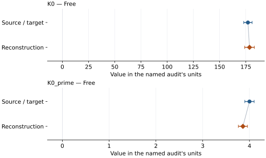

This is a **coefficient comparison**, not an observation or residual plot.
Each panel uses its coefficient's audit units and includes zero. Markers show
stored central values only. Error widths are retained in the table below;
no confidence interval or uncertainty band is inferred. Fixed/adopted values are constraints.

| Parameter | Source / target | Source error | Reconstruction | Reconstruction error | Fit role |
| --- | --- | --- | --- | --- | --- |
| K0 | 177.0 | 4.0 | 178.49028381412313 | 4.6381953359927 | Free |
| K0\_prime | 4.0 | 0.1 | 3.859588837182572 | 0.09743093231567918 | Free |

Values and reported errors are copied without rounding or conversion from the named audit. Missing errors mean unknown, not zero. Parameter names and volume conventions follow that audit; error widths do not imply a confidence convention.

Recorded diagnostics, covariance and additional protocol

- **Columns:**
    - **Pressure:** pressure\_gpa
    - **Temperature:** Not specified
    - **Volume:** molar\_volume\_cm3\_per\_mol
- **Observed pressure range gpa:** \[0.0, 223.5816\]
- **Observed temperature range k:** Not specified
- **Observed volume range:** \[45.68217365945462, 74.74418449162918\]
- **Degrees of freedom:** 15
- **Solver success:** True
- **Solver message:** Both \`ftol\` and \`xtol\` termination conditions are satisfied.
- **Rmse gpa:** 2.6250972329210525
- **Published rmse gpa:** 5.046547053641529
- **Reduced chi square:** 7.80995354659507

### Detailed evidence and existing plots

- [Record-by-record numerical ledger](../primary-eos-refits.md#records).
- [Source-audit reports](../source-audits.md).

Observation curves and residual plots are provided by the supporting reports where available. Their absence is not filled by a reconstructed curve presented as measured data.

[Machine-readable comparison ledger](https://github.com/CPrescher/peritheos/blob/main/docs/data/primary-eos-refits.json) — look up `mgo_duffy_1995_bm3_1`.
[Complete native EOSMAT file](https://github.com/CPrescher/peritheos/blob/main/peritheos/data/materials/mgo.eosmat).

## Speziale et al. (2001), BM3 + variable-q Debye

Record: `mgo_speziale_2001_bm3_2` · Model: `BM3`

**Outcome: Coefficient parity achieved.**

**Scope:** Comparison with the source parameterization.
**Comparison basis:** Every compared free coefficient meets both the recorded combined-two-sigma comparison and parameter-specific numerical similarity screen. Error conventions and fit qualifications remain applicable.

[Stored EOS coefficients and source](../material-summaries/mgo.md#record-mgo_speziale_2001_bm3_2)

### What this result establishes

**Separate source-review status:** primary\_source\_validated.
**Usage recommendation:** Use the published BM3 plus variable-q Debye EOS for MgO P-V-T calculations. The thermal formulation is author-confirmed and numerically verified. Full original fit reproduction and exact historical calculator replay remain separate unresolved provenance questions.

- Usage recommendation: Use the published BM3 plus variable-q Debye EOS for MgO P-V-T calculations. The thermal formulation is author-confirmed and numerically verified. Full original fit reproduction and exact historical calculator replay remain separate unresolved provenance questions.
- This named numerical assessment alone does not establish author-workflow reproduction, physical accuracy or recommendation for use.

### Data and reconstruction method

- **Dataset identifiers:** mgo\_speziale\_2001\_table1\_compression
- **Observations:** 32
- **Fit kind:** reference\_isotherm\_pv
- **Selection:** all rows
- **Objective:** errors\_in\_variables
- **Absolute sigma:** True
- **Free parameters:** rt\_eos.V0; rt\_eos.K0\_prime
- **Fixed parameters:** K0; Tr; theta0; gamma0; q0; n

Unspecified selections, weights, fixed values or error conventions remain unknown; they have not been inferred for this report.

### Source versus reconstruction

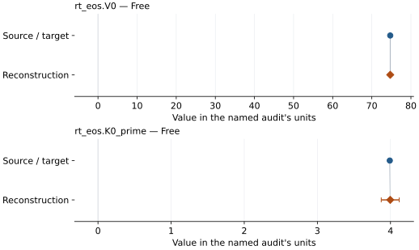

This is a **coefficient comparison**, not an observation or residual plot.
Each panel uses its coefficient's audit units and includes zero. Markers show
stored central values only. Error widths are retained in the table below;
no confidence interval or uncertainty band is inferred. Fixed/adopted values are constraints.

| Parameter | Source / target | Source error | Reconstruction | Reconstruction error | Fit role |
| --- | --- | --- | --- | --- | --- |
| rt\_eos.V0 | 74.71 | 0.01 | 74.71143069447233 | 0.09504114929587983 | Free |
| rt\_eos.K0\_prime | 3.99 | 0.01 | 3.9962802069361105 | 0.12311141551959584 | Free |

Values and reported errors are copied without rounding or conversion from the named audit. Missing errors mean unknown, not zero. Parameter names and volume conventions follow that audit; error widths do not imply a confidence convention.

Recorded diagnostics, covariance and additional protocol

- **Columns:**
    - **Pressure:** pressure\_gpa
    - **Temperature:** Not specified
    - **Volume:** unit\_cell\_volume\_a3
- **Observed pressure range gpa:** \[0.8, 52.2\]
- **Observed temperature range k:** Not specified
- **Observed volume range:** \[60.301, 74.442\]
- **Degrees of freedom:** 30
- **Solver success:** True
- **Solver message:** Both \`ftol\` and \`xtol\` termination conditions are satisfied.
- **Rmse gpa:** 0.28776895973657074
- **Published rmse gpa:** 0.2909393661335488
- **Reduced chi square:** 0.08905992792756487

### Detailed evidence and existing plots

- [Supporting source report: speziale-2001-mgo](../literature-reproductions/speziale-2001-mgo.md).
- [Record-by-record numerical ledger](../primary-eos-refits.md#records).
- [Source-audit reports](../source-audits.md).

Observation curves and residual plots are provided by the supporting reports where available. Their absence is not filled by a reconstructed curve presented as measured data.

[Machine-readable comparison ledger](https://github.com/CPrescher/peritheos/blob/main/docs/data/primary-eos-refits.json) — look up `mgo_speziale_2001_bm3_2`.
[Complete native EOSMAT file](https://github.com/CPrescher/peritheos/blob/main/peritheos/data/materials/mgo.eosmat).

## Li et al. (2006), acoustic absolute-pressure BM3

Record: `mgo_li_2006_bm3_absolute_acoustic` · Model: `BM3`

**Outcome: Numerically similar, with qualifications.**

**Scope:** Comparison with the source parameterization.
**Comparison basis:** Every compared free coefficient meets either the recorded combined-two-sigma comparison or parameter-specific numerical similarity screen; the audit does not classify the complete comparison as parity.

[Stored EOS coefficients and source](../material-summaries/mgo.md#record-mgo_li_2006_bm3_absolute_acoustic)

### What this result establishes

**Separate source-review status:** primary\_source\_validated.
**Usage recommendation:** See the stored EOS qualifications; no recommendation is inferred here.

- Direct reproduction of the source measurement-to-coefficient chain, not a pressure-volume refit: the preferred decompression density, VP, and VS rows plus the independently measured ambient anchor are fitted to the published third-order acoustic finite-strain equations. Equation 4 then maps the fitted adiabatic K0S and K0S-prime to the stored isothermal K0T and K0T-prime; paragraph 10's K0T-in-L2/M2 approximation accounts for the measured isothermal strains. The calculated Table 1 pressures are downstream BM3 outputs and are never used as observations. The source does not publish its exact weights, iterative adiabatic-foot correction, covariance, or propagated isothermal errors, so the unweighted rounded-table reconstruction is classified as numerically similar rather than strict parity.
- This named numerical assessment alone does not establish author-workflow reproduction, physical accuracy or recommendation for use.

### Data and reconstruction method

- **Dataset identifiers:** mgo\_li\_2006\_table1\_elasticity
- **Observations:** 11
- **Fit kind:** acoustic\_finite\_strain\_then\_isothermal\_conversion
- **Selection:** Section 2 ambient density/VP/VS anchor plus all ten Table 1 decompression-after-annealing density/VP/VS rows
- **Objective:** unweighted simultaneous VP and VS residuals in km/s
- **Absolute sigma:** False
- **Free parameters:** K0; K0\_prime
- **Fixed parameters:** V0

Unspecified selections, weights, fixed values or error conventions remain unknown; they have not been inferred for this report.

### Source versus reconstruction

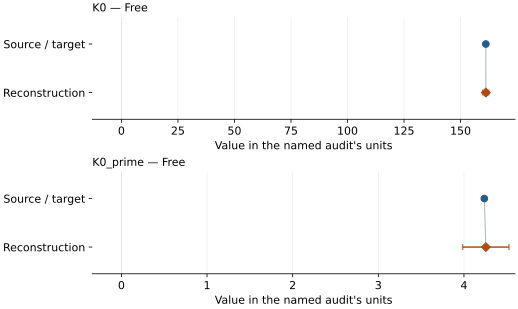

This is a **coefficient comparison**, not an observation or residual plot.
Each panel uses its coefficient's audit units and includes zero. Markers show
stored central values only. Error widths are retained in the table below;
no confidence interval or uncertainty band is inferred. Fixed/adopted values are constraints.

| Parameter | Source / target | Source error | Reconstruction | Reconstruction error | Fit role |
| --- | --- | --- | --- | --- | --- |
| K0 | 161.1767340842165 | Not specified | 161.18805709310493 | 1.3390340408145336 | Free |
| K0\_prime | 4.237911491402006 | Not specified | 4.255652450567938 | 0.26977445699632946 | Free |

Values and reported errors are copied without rounding or conversion from the named audit. Missing errors mean unknown, not zero. Parameter names and volume conventions follow that audit; error widths do not imply a confidence convention.

Recorded diagnostics, covariance and additional protocol

- **Columns:**
    - **Density:** density\_g\_cm3
    - **P wave velocity:** p\_wave\_velocity\_km\_s
    - **Pressure:** Not specified
    - **S wave velocity:** s\_wave\_velocity\_km\_s
- **Degrees of freedom:** 18
- **Solver success:** True
- **Solver message:** \`xtol\` termination condition is satisfied.
- **Reduced chi square:** Not specified

### Detailed evidence and existing plots

- [Earlier detailed record investigation](../primary-eos-refits.md#investigation-mgo_li_2006_bm3_absolute_acoustic).
- [Record-by-record numerical ledger](../primary-eos-refits.md#records).
- [Source-audit reports](../source-audits.md).

Observation curves and residual plots are provided by the supporting reports where available. Their absence is not filled by a reconstructed curve presented as measured data.

[Machine-readable comparison ledger](https://github.com/CPrescher/peritheos/blob/main/docs/data/primary-eos-refits.json) — look up `mgo_li_2006_bm3_absolute_acoustic`.
[Complete native EOSMAT file](https://github.com/CPrescher/peritheos/blob/main/peritheos/data/materials/mgo.eosmat).

## Jacobsen et al. (2008), KCl medium, Mao-1978 ruby-scale BM3

Record: `mgo_jacobsen_2008_bm3_kcl_mao1978` · Model: `BM3`

**Outcome: Coefficient parity achieved.**

**Scope:** Comparison with the source parameterization.
**Comparison basis:** Every compared free coefficient meets both the recorded combined-two-sigma comparison and parameter-specific numerical similarity screen. Error conventions and fit qualifications remain applicable.

[Stored EOS coefficients and source](../material-summaries/mgo.md#record-mgo_jacobsen_2008_bm3_kcl_mao1978)

### What this result establishes

**Separate source-review status:** primary\_source\_validated.
**Usage recommendation:** See the stored EOS qualifications; no recommendation is inferred here.

- This named numerical assessment alone does not establish author-workflow reproduction, physical accuracy or recommendation for use.

### Data and reconstruction method

- **Dataset identifiers:** mgo\_jacobsen\_2008\_table2\_kcl\_compression
- **Observations:** 26
- **Fit kind:** isothermal\_pv
- **Selection:** all rows
- **Objective:** errors\_in\_variables
- **Absolute sigma:** True
- **Free parameters:** V0; K0; K0\_prime
- **Fixed parameters:** None declared

Unspecified selections, weights, fixed values or error conventions remain unknown; they have not been inferred for this report.

### Source versus reconstruction

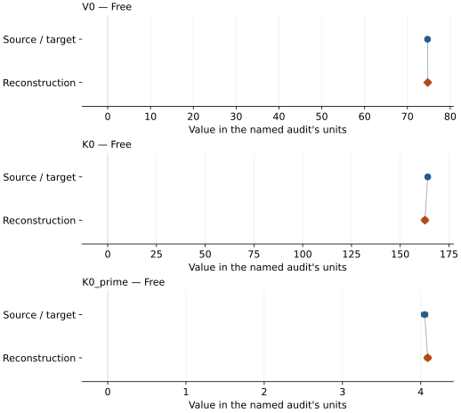

This is a **coefficient comparison**, not an observation or residual plot.
Each panel uses its coefficient's audit units and includes zero. Markers show
stored central values only. Error widths are retained in the table below;
no confidence interval or uncertainty band is inferred. Fixed/adopted values are constraints.

| Parameter | Source / target | Source error | Reconstruction | Reconstruction error | Fit role |
| --- | --- | --- | --- | --- | --- |
| V0 | 74.698 | 0.007 | 74.74331039394653 | 0.03575968541129269 | Free |
| K0 | 164.1 | 0.9 | 162.6681774569057 | 1.2057684879296597 | Free |
| K0\_prime | 4.05 | 0.04 | 4.089281887803185 | 0.03514911322985537 | Free |

Values and reported errors are copied without rounding or conversion from the named audit. Missing errors mean unknown, not zero. Parameter names and volume conventions follow that audit; error widths do not imply a confidence convention.

Recorded diagnostics, covariance and additional protocol

- **Columns:**
    - **Pressure:** reported\_pressure\_gpa
    - **Temperature:** Not specified
    - **Volume:** unit\_cell\_volume\_a3
- **Observed pressure range gpa:** \[3.6, 86.6\]
- **Observed temperature range k:** Not specified
- **Observed volume range:** \[55.792, 73.1\]
- **Degrees of freedom:** 23
- **Solver success:** True
- **Solver message:** \`ftol\` termination condition is satisfied.
- **Rmse gpa:** 0.31603260350532
- **Published rmse gpa:** 0.33114051930417365
- **Reduced chi square:** 4.735780550595273

### Detailed evidence and existing plots

- [Record-by-record numerical ledger](../primary-eos-refits.md#records).
- [Source-audit reports](../source-audits.md).

Observation curves and residual plots are provided by the supporting reports where available. Their absence is not filled by a reconstructed curve presented as measured data.

[Machine-readable comparison ledger](https://github.com/CPrescher/peritheos/blob/main/docs/data/primary-eos-refits.json) — look up `mgo_jacobsen_2008_bm3_kcl_mao1978`.
[Complete native EOSMAT file](https://github.com/CPrescher/peritheos/blob/main/peritheos/data/materials/mgo.eosmat).

## Jacobsen et al. (2008), helium medium, Mao-1986-scale BM3

Record: `mgo_jacobsen_2008_bm3_helium_mao1986` · Model: `BM3`

**Outcome: Coefficient parity achieved.**

**Scope:** Comparison with the source parameterization.
**Comparison basis:** Every compared free coefficient meets both the recorded combined-two-sigma comparison and parameter-specific numerical similarity screen. Error conventions and fit qualifications remain applicable.

[Stored EOS coefficients and source](../material-summaries/mgo.md#record-mgo_jacobsen_2008_bm3_helium_mao1986)

### What this result establishes

**Separate source-review status:** primary\_source\_validated.
**Usage recommendation:** See the stored EOS qualifications; no recommendation is inferred here.

- This named numerical assessment alone does not establish author-workflow reproduction, physical accuracy or recommendation for use.

### Data and reconstruction method

- **Dataset identifiers:** mgo\_jacobsen\_2008\_table1\_helium\_compression
- **Observations:** 52
- **Fit kind:** isothermal\_pv
- **Selection:** all rows
- **Objective:** errors\_in\_variables
- **Absolute sigma:** True
- **Free parameters:** V0; K0; K0\_prime
- **Fixed parameters:** None declared

Unspecified selections, weights, fixed values or error conventions remain unknown; they have not been inferred for this report.

### Source versus reconstruction

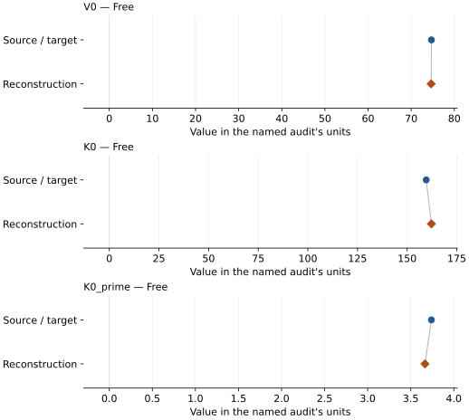

This is a **coefficient comparison**, not an observation or residual plot.
Each panel uses its coefficient's audit units and includes zero. Markers show
stored central values only. Error widths are retained in the table below;
no confidence interval or uncertainty band is inferred. Fixed/adopted values are constraints.

| Parameter | Source / target | Source error | Reconstruction | Reconstruction error | Fit role |
| --- | --- | --- | --- | --- | --- |
| V0 | 74.687 | 0.006 | 74.62131222773621 | 0.18140613737377156 | Free |
| K0 | 159.6 | 0.6 | 162.22138599588723 | 4.60618363125784 | Free |
| K0\_prime | 3.74 | 0.03 | 3.6650583303720996 | 0.09853073005865955 | Free |

Values and reported errors are copied without rounding or conversion from the named audit. Missing errors mean unknown, not zero. Parameter names and volume conventions follow that audit; error widths do not imply a confidence convention.

Recorded diagnostics, covariance and additional protocol

- **Columns:**
    - **Pressure:** reported\_pressure\_gpa
    - **Temperature:** Not specified
    - **Volume:** unit\_cell\_volume\_a3
- **Observed pressure range gpa:** \[0.0001, 111.0\]
- **Observed temperature range k:** Not specified
- **Observed volume range:** \[52.239, 74.698\]
- **Degrees of freedom:** 49
- **Solver success:** True
- **Solver message:** Both \`ftol\` and \`xtol\` termination conditions are satisfied.
- **Rmse gpa:** 0.28917809332275024
- **Published rmse gpa:** 0.3176878775243587
- **Reduced chi square:** 0.08961456938877022

### Detailed evidence and existing plots

- [Record-by-record numerical ledger](../primary-eos-refits.md#records).
- [Source-audit reports](../source-audits.md).

Observation curves and residual plots are provided by the supporting reports where available. Their absence is not filled by a reconstructed curve presented as measured data.

[Machine-readable comparison ledger](https://github.com/CPrescher/peritheos/blob/main/docs/data/primary-eos-refits.json) — look up `mgo_jacobsen_2008_bm3_helium_mao1986`.
[Complete native EOSMAT file](https://github.com/CPrescher/peritheos/blob/main/peritheos/data/materials/mgo.eosmat).

## Shen and Smith (2026), Cu-referenced Vinet

Record: `mgo_shen_2026_vinet_3` · Model: `Vinet`

**Outcome: Numerically similar, with qualifications.**

**Scope:** Comparison with the source parameterization.
**Comparison basis:** Every compared free coefficient meets either the recorded combined-two-sigma comparison or parameter-specific numerical similarity screen; the audit does not classify the complete comparison as parity.

[Stored EOS coefficients and source](../material-summaries/mgo.md#record-mgo_shen_2026_vinet_3)

### What this result establishes

**Separate source-review status:** primary\_source\_validated.
**Usage recommendation:** See the stored EOS qualifications; no recommendation is inferred here.

- Direct reconstruction from source observations: each Table S1 phase volume is paired with its simultaneous Cu volume, pressure is evaluated from Fratanduono et al.'s analytic third-order 298 K Vinet fit, and K0 and K0\_prime are fitted with Shen and Smith's fixed V0 and stated run selection. The source publishes no pressure weights, residual covariance, or weighting protocol, so the reproduction uses unweighted pressure residuals and does not infer any of them.
- This named numerical assessment alone does not establish author-workflow reproduction, physical accuracy or recommendation for use.

### Data and reconstruction method

- **Dataset identifiers:** shen\_smith\_2026\_table\_s1\_simultaneous\_volumes
- **Observations:** 194
- **Fit kind:** fixed\_v0\_vinet\_with\_reconstructed\_cu\_pressure
- **Selection:** MgO; DAC-2
- **Objective:** unweighted\_pressure\_residuals
- **Absolute sigma:** False
- **Free parameters:** K0; K0\_prime
- **Fixed parameters:** V0

Unspecified selections, weights, fixed values or error conventions remain unknown; they have not been inferred for this report.

### Source versus reconstruction

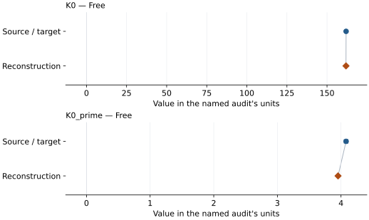

This is a **coefficient comparison**, not an observation or residual plot.
Each panel uses its coefficient's audit units and includes zero. Markers show
stored central values only. Error widths are retained in the table below;
no confidence interval or uncertainty band is inferred. Fixed/adopted values are constraints.

| Parameter | Source / target | Source error | Reconstruction | Reconstruction error | Fit role |
| --- | --- | --- | --- | --- | --- |
| K0 | 161.9 | 0.7 | 161.82743445658883 | 0.4531071509476315 | Free |
| K0\_prime | 4.08 | 0.03 | 3.9535830365020996 | 0.020515600867831534 | Free |

Values and reported errors are copied without rounding or conversion from the named audit. Missing errors mean unknown, not zero. Parameter names and volume conventions follow that audit; error widths do not imply a confidence convention.

Recorded diagnostics, covariance and additional protocol

- **Columns:**
    - **Pressure:** Fratanduono-2020 298 K Cu pressure reconstructed per run
    - **Temperature:** Not specified
    - **Volume:** unit\_cell\_volume\_a3
- **Observed pressure range gpa:** \[2.786190605963631, 110.25016209196069\]
- **Observed temperature range k:** Not specified
- **Observed volume range:** \[52.6915, 73.25306\]
- **Degrees of freedom:** 192
- **Solver success:** True
- **Solver message:** Both \`ftol\` and \`xtol\` termination conditions are satisfied.
- **Rmse gpa:** 0.4758785586078347
- **Reduced chi square:** 0.22881936506915648
- **Pressure reconstruction:**
    - **Density0 g cm3:** 8.939
    - **DOI:** 10.1103/PhysRevLett.124.015701
    - **Model:** vinet\_3
    - **Pairing:** Each phase volume uses the single Cu volume with the same experiment and run number; both source-labeled Pt first/last measurements are retained when the run is selected.
    - **Parameters:**
        - **K0 gpa:** 133.6
        - **Beta:** 2.06
        - **Eta:** 6.29
        - **Psi:** 1.65
    - **Reference:** Fratanduono et al. (2020)
    - **Reference eos record:** copper\_fratanduono\_2020\_vinet3\_298k
    - **Reference unit cell volume a3:** 47.218085048721
    - **Source locations:** main article Table I, 298 K isotherm row; Supplemental Material Eq. (2), Section S4

### Detailed evidence and existing plots

- [Earlier detailed record investigation](../primary-eos-refits.md#investigation-mgo_shen_2026_vinet_3).
- [Record-by-record numerical ledger](../primary-eos-refits.md#records).
- [Source-audit reports](../source-audits.md).

Observation curves and residual plots are provided by the supporting reports where available. Their absence is not filled by a reconstructed curve presented as measured data.

[Machine-readable comparison ledger](https://github.com/CPrescher/peritheos/blob/main/docs/data/primary-eos-refits.json) — look up `mgo_shen_2026_vinet_3`.
[Complete native EOSMAT file](https://github.com/CPrescher/peritheos/blob/main/peritheos/data/materials/mgo.eosmat).

## Luo et al. (2023), cold Vinet plus second-order thermal pressure

Record: `mgo_b1_luo_2023_vinet_thermal_5` · Model: `Vinet`

**Outcome: Complete independent refit unavailable.**

**Scope:** Comparison with the source parameterization.
**Comparison basis:** A 12-residual primary-row sensitivity fit is executable, but it is not the source global refit: Kono's exact velocity-density regressions, the selected upstream shock/PVT rows, temperature/density error propagation, cross-observable normalization, and covariance are still unavailable. Tables II-III are excluded because they are derived EOS output.

[Stored EOS coefficients and source](../material-summaries/mgo.md#record-mgo_b1_luo_2023_vinet_thermal_5)

### What this result establishes

**Separate source-review status:** primary\_source\_validated.
**Usage recommendation:** See the stored EOS qualifications; no recommendation is inferred here.

- The large coefficient shift is evidence that substituting Li's low-pressure velocity ratio and retaining only Luo's new states does not identify the published global parameterization.
- This named numerical assessment alone does not establish author-workflow reproduction, physical accuracy or recommendation for use.

### Data and reconstruction method

- **Dataset identifiers:** mgo\_luo\_2023\_table1\_shock; mgo\_li\_2006\_table1\_elasticity
- **Observations:** 12
- **Fit kind:** sound\_velocity\_quasi\_debye\_bounded\_partial
- **Selection:** all five Luo Table I P-V states, four reported temperatures, and three Eulerian sound velocities; all 18 Li ambient/high-pressure rows only determine the fixed proxy velocity-density regressions
- **Objective:** sum of squared shock-pressure, Hugoniot-temperature, and longitudinal-velocity residuals divided by their printed one-standard-deviation errors; printed two-sigma temperature errors are halved
- **Absolute sigma:** True
- **Free parameters:** V0; K0; K0\_prime
- **Fixed parameters:** Tr; molar\_mass\_g\_mol; n; Li proxy velocity-density coefficients

Unspecified selections, weights, fixed values or error conventions remain unknown; they have not been inferred for this report.

### Source versus reconstruction

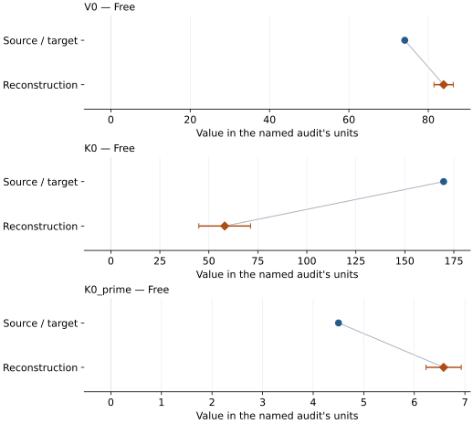

This is a **coefficient comparison**, not an observation or residual plot.
Each panel uses its coefficient's audit units and includes zero. Markers show
stored central values only. Error widths are retained in the table below;
no confidence interval or uncertainty band is inferred. Fixed/adopted values are constraints.

| Parameter | Source / target | Source error | Reconstruction | Reconstruction error | Fit role |
| --- | --- | --- | --- | --- | --- |
| V0 | 74.0741025123 | 0.0267705466 | 83.87551837049959 | 2.427454441898007 | Free |
| K0 | 169.8 | 0.5 | 58.09245166395956 | 13.198121781751428 | Free |
| K0\_prime | 4.501 | 0.007 | 6.579214294528745 | 0.34836786999591157 | Free |

Values and reported errors are copied without rounding or conversion from the named audit. Missing errors mean unknown, not zero. Parameter names and volume conventions follow that audit; error widths do not imply a confidence convention.

Recorded diagnostics, covariance and additional protocol

- **Columns:**
    - **Density:** density\_g\_cm3
    - **Longitudinal velocity:** euler\_sound\_velocity\_km\_s
    - **Pressure:** pressure\_gpa
    - **Temperature:** temperature\_k
- **Degrees of freedom:** 9
- **Solver success:** True
- **Solver message:** \`xtol\` termination condition is satisfied.
- **Reduced chi square:** 5.306865312040458

### Detailed evidence and existing plots

- [Record-by-record numerical ledger](../primary-eos-refits.md#records).
- [Source-audit reports](../source-audits.md).

Observation curves and residual plots are provided by the supporting reports where available. Their absence is not filled by a reconstructed curve presented as measured data.

[Machine-readable comparison ledger](https://github.com/CPrescher/peritheos/blob/main/docs/data/primary-eos-refits.json) — look up `mgo_b1_luo_2023_vinet_thermal_5`.
[Complete native EOSMAT file](https://github.com/CPrescher/peritheos/blob/main/peritheos/data/materials/mgo.eosmat).

## Sokolova et al. (2013), Holzapfel thermal model (2016 workbook)

Record: `mgo_sokolova_2013_holzapfel_4` · Model: `Holzapfel`

**Outcome: Source calculation reconstructed.**

**Scope:** Reconstruction of a source equation or calculation.
**Comparison basis:** All eleven machine-readable comparison series enter one shared Equation (20) objective against the mean Table 2 Holzapfel and Table 3 Vinet isotherm. Table 4 is retained as a post-calibration closure test. The calculation cannot recover the eleven EOS parameter sets independently because the source omits complete thermochemical/ultrasonic rows, weights, and covariance.

[Stored EOS coefficients and source](../material-summaries/mgo.md#record-mgo_sokolova_2013_holzapfel_4)

### What this result establishes

**Separate source-review status:** primary\_source\_validated.
**Usage recommendation:** See the stored EOS qualifications; no recommendation is inferred here.

- This named numerical assessment alone does not establish author-workflow reproduction, physical accuracy or recommendation for use.
- No reconstructed coefficient table is recorded for this assessment; no missing values have been inferred.

### Data and reconstruction method

- **Dataset identifiers:** mgo\_jacobsen\_2008\_table1\_helium\_compression
- **Observations:** 45
- **Fit kind:** coupled\_eleven\_marker\_ruby\_cross\_calibration
- **Objective:** minimize the sum over markers of the mean squared residual between Equation (20) and the pointwise mean of the Table 2 Holzapfel and Table 3 Vinet pressures, so each of the eleven markers has equal total weight
- **Fixed parameters:** n; Z; n

Unspecified selections, weights, fixed values or error conventions remain unknown; they have not been inferred for this report.

### Why no coefficient graph is shown

No numeric source/reconstruction pair is recorded for this assessment. A graph would require information that is not available here; no values or observations have been invented.

Recorded diagnostics, covariance and additional protocol

- **Rmse gpa:** 0.8497193014913668
- **Published rmse gpa:** 0.9335678496303198
- **Comparison scope:** shared\_ruby\_calibration
- **Published ruby parameters:**
    - **A gpa:** 1870.0
    - **M:** 6.0
- **Sensitivity fit ruby parameters:**
    - **A gpa:** 1869.3837840502665
    - **M:** 6.10334763359135

### Detailed evidence and existing plots

- [Record-by-record numerical ledger](../primary-eos-refits.md#records).
- [Source-audit reports](../source-audits.md).

Observation curves and residual plots are provided by the supporting reports where available. Their absence is not filled by a reconstructed curve presented as measured data.

[Machine-readable comparison ledger](https://github.com/CPrescher/peritheos/blob/main/docs/data/primary-eos-refits.json) — look up `mgo_sokolova_2013_holzapfel_4`.
[Complete native EOSMAT file](https://github.com/CPrescher/peritheos/blob/main/peritheos/data/materials/mgo.eosmat).

## Dewaele et al. (2000), BM3-MGD

Record: `mgo_dewaele_2000_bm3_mgd_5` · Model: `BM3`

**Outcome: Coefficient parity achieved.**

**Scope:** Comparison with the source parameterization.
**Comparison basis:** Every compared free coefficient meets both the recorded combined-two-sigma comparison and parameter-specific numerical similarity screen. Error conventions and fit qualifications remain applicable.

[Stored EOS coefficients and source](../material-summaries/mgo.md#record-mgo_dewaele_2000_bm3_mgd_5)

### What this result establishes

**Separate source-review status:** primary\_source\_validated.
**Usage recommendation:** See the stored EOS qualifications; no recommendation is inferred here.

- Conditional current-study thermal reproduction: the 41 heated Table 2 rows constrain q while V0, K0, K0', theta0, gamma0, Tr, and n are held to the source's staged/adopted values. Dewaele et al.'s published thermal analysis additionally used Fei (1999) observations that are not reprinted in this article, so exact parameter parity is not required from the new current-study rows alone.
- This named numerical assessment alone does not establish author-workflow reproduction, physical accuracy or recommendation for use.

### Data and reconstruction method

- **Dataset identifiers:** mgo\_dewaele\_2000\_table2\_pvt
- **Observations:** 41
- **Fit kind:** joint\_pvt
- **Selection:** 41 heated Table 2 rows
- **Objective:** errors\_in\_variables
- **Absolute sigma:** True
- **Free parameters:** q
- **Fixed parameters:** V0; K0; K0\_prime; Tr; theta0; gamma0; n

Unspecified selections, weights, fixed values or error conventions remain unknown; they have not been inferred for this report.

### Source versus reconstruction

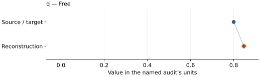

This is a **coefficient comparison**, not an observation or residual plot.
Each panel uses its coefficient's audit units and includes zero. Markers show
stored central values only. Error widths are retained in the table below;
no confidence interval or uncertainty band is inferred. Fixed/adopted values are constraints.

| Parameter | Source / target | Source error | Reconstruction | Reconstruction error | Fit role |
| --- | --- | --- | --- | --- | --- |
| q | 0.8 | 0.5 | 0.84708909954829 | 0.121623848975841 | Free |

Values and reported errors are copied without rounding or conversion from the named audit. Missing errors mean unknown, not zero. Parameter names and volume conventions follow that audit; error widths do not imply a confidence convention.

Recorded diagnostics, covariance and additional protocol

- **Columns:**
    - **Pressure:** pressure\_gpa
    - **Temperature:** temperature\_k
    - **Volume:** mgo\_unit\_cell\_volume\_a3
- **Observed pressure range gpa:** \[13.6, 53.0\]
- **Observed temperature range k:** \[1750.0, 2474.0\]
- **Observed volume range:** \[62.05, 72.433\]
- **Degrees of freedom:** 40
- **Solver success:** True
- **Solver message:** \`ftol\` termination condition is satisfied.
- **Rmse gpa:** 0.9496810532052754
- **Published rmse gpa:** 0.952183492923195
- **Reduced chi square:** 0.9249760713467585

### Detailed evidence and existing plots

- [Record-by-record numerical ledger](../primary-eos-refits.md#records).
- [Source-audit reports](../source-audits.md).

Observation curves and residual plots are provided by the supporting reports where available. Their absence is not filled by a reconstructed curve presented as measured data.

[Machine-readable comparison ledger](https://github.com/CPrescher/peritheos/blob/main/docs/data/primary-eos-refits.json) — look up `mgo_dewaele_2000_bm3_mgd_5`.
[Complete native EOSMAT file](https://github.com/CPrescher/peritheos/blob/main/peritheos/data/materials/mgo.eosmat).

## Dewaele et al. (2000), constrained BM2 sensitivity

Record: `mgo_dewaele_2000_bm2_sensitivity_1` · Model: `BM2`

**Outcome: Coefficient parity achieved.**

**Scope:** Comparison with the source parameterization.
**Comparison basis:** Every compared free coefficient meets both the recorded combined-two-sigma comparison and parameter-specific numerical similarity screen. Error conventions and fit qualifications remain applicable.

[Stored EOS coefficients and source](../material-summaries/mgo.md#record-mgo_dewaele_2000_bm2_sensitivity_1)

### What this result establishes

**Separate source-review status:** primary\_source\_validated.
**Usage recommendation:** See the stored EOS qualifications; no recommendation is inferred here.

- This named numerical assessment alone does not establish author-workflow reproduction, physical accuracy or recommendation for use.

### Data and reconstruction method

- **Dataset identifiers:** mgo\_dewaele\_2000\_table2\_pvt
- **Observations:** 20
- **Fit kind:** isothermal\_pv
- **Selection:** all rows; reference-T rows
- **Objective:** errors\_in\_variables
- **Absolute sigma:** True
- **Free parameters:** K0
- **Fixed parameters:** V0

Unspecified selections, weights, fixed values or error conventions remain unknown; they have not been inferred for this report.

### Source versus reconstruction

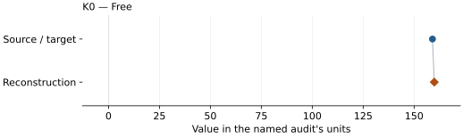

This is a **coefficient comparison**, not an observation or residual plot.
Each panel uses its coefficient's audit units and includes zero. Markers show
stored central values only. Error widths are retained in the table below;
no confidence interval or uncertainty band is inferred. Fixed/adopted values are constraints.

| Parameter | Source / target | Source error | Reconstruction | Reconstruction error | Fit role |
| --- | --- | --- | --- | --- | --- |
| K0 | 159.0 | 0.6 | 159.88169879508376 | 1.4110722032955016 | Free |

Values and reported errors are copied without rounding or conversion from the named audit. Missing errors mean unknown, not zero. Parameter names and volume conventions follow that audit; error widths do not imply a confidence convention.

Recorded diagnostics, covariance and additional protocol

- **Columns:**
    - **Pressure:** pressure\_gpa
    - **Temperature:** temperature\_k
    - **Volume:** mgo\_unit\_cell\_volume\_a3
- **Observed pressure range gpa:** \[0.0, 44.7\]
- **Observed temperature range k:** \[300.0, 300.0\]
- **Observed volume range:** \[61.778, 74.744\]
- **Degrees of freedom:** 19
- **Solver success:** True
- **Solver message:** Both \`ftol\` and \`xtol\` termination conditions are satisfied.
- **Rmse gpa:** 0.5916190786117861
- **Published rmse gpa:** 0.6080444829689718
- **Reduced chi square:** 0.36852398987537976

### Detailed evidence and existing plots

- [Record-by-record numerical ledger](../primary-eos-refits.md#records).
- [Source-audit reports](../source-audits.md).

Observation curves and residual plots are provided by the supporting reports where available. Their absence is not filled by a reconstructed curve presented as measured data.

[Machine-readable comparison ledger](https://github.com/CPrescher/peritheos/blob/main/docs/data/primary-eos-refits.json) — look up `mgo_dewaele_2000_bm2_sensitivity_1`.
[Complete native EOSMAT file](https://github.com/CPrescher/peritheos/blob/main/peritheos/data/materials/mgo.eosmat).

## Dewaele et al. (2000), Murnaghan sensitivity

Record: `mgo_dewaele_2000_murnaghan_sensitivity_2` · Model: `Murnaghan`

**Outcome: Coefficient parity achieved.**

**Scope:** Comparison with the source parameterization.
**Comparison basis:** Every compared free coefficient meets both the recorded combined-two-sigma comparison and parameter-specific numerical similarity screen. Error conventions and fit qualifications remain applicable.

[Stored EOS coefficients and source](../material-summaries/mgo.md#record-mgo_dewaele_2000_murnaghan_sensitivity_2)

### What this result establishes

**Separate source-review status:** primary\_source\_validated.
**Usage recommendation:** See the stored EOS qualifications; no recommendation is inferred here.

- This named numerical assessment alone does not establish author-workflow reproduction, physical accuracy or recommendation for use.

### Data and reconstruction method

- **Dataset identifiers:** mgo\_dewaele\_2000\_table2\_pvt
- **Observations:** 20
- **Fit kind:** isothermal\_pv
- **Selection:** all rows; reference-T rows
- **Objective:** errors\_in\_variables
- **Absolute sigma:** True
- **Free parameters:** K0\_prime
- **Fixed parameters:** V0; K0

Unspecified selections, weights, fixed values or error conventions remain unknown; they have not been inferred for this report.

### Source versus reconstruction

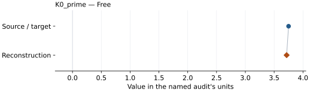

This is a **coefficient comparison**, not an observation or residual plot.
Each panel uses its coefficient's audit units and includes zero. Markers show
stored central values only. Error widths are retained in the table below;
no confidence interval or uncertainty band is inferred. Fixed/adopted values are constraints.

| Parameter | Source / target | Source error | Reconstruction | Reconstruction error | Fit role |
| --- | --- | --- | --- | --- | --- |
| K0\_prime | 3.75 | 0.05 | 3.7163028968540406 | 0.10782448459113742 | Free |

Values and reported errors are copied without rounding or conversion from the named audit. Missing errors mean unknown, not zero. Parameter names and volume conventions follow that audit; error widths do not imply a confidence convention.

Recorded diagnostics, covariance and additional protocol

- **Columns:**
    - **Pressure:** pressure\_gpa
    - **Temperature:** temperature\_k
    - **Volume:** mgo\_unit\_cell\_volume\_a3
- **Observed pressure range gpa:** \[0.0, 44.7\]
- **Observed temperature range k:** \[300.0, 300.0\]
- **Observed volume range:** \[61.778, 74.744\]
- **Degrees of freedom:** 19
- **Solver success:** True
- **Solver message:** Both \`ftol\` and \`xtol\` termination conditions are satisfied.
- **Rmse gpa:** 0.5914122757273657
- **Published rmse gpa:** 0.595690226793027
- **Reduced chi square:** 0.36826881030095315

### Detailed evidence and existing plots

- [Record-by-record numerical ledger](../primary-eos-refits.md#records).
- [Source-audit reports](../source-audits.md).

Observation curves and residual plots are provided by the supporting reports where available. Their absence is not filled by a reconstructed curve presented as measured data.

[Machine-readable comparison ledger](https://github.com/CPrescher/peritheos/blob/main/docs/data/primary-eos-refits.json) — look up `mgo_dewaele_2000_murnaghan_sensitivity_2`.
[Complete native EOSMAT file](https://github.com/CPrescher/peritheos/blob/main/peritheos/data/materials/mgo.eosmat).

## Dewaele et al. (2000), Vinet sensitivity

Record: `mgo_dewaele_2000_vinet_sensitivity_3` · Model: `Vinet`

**Outcome: Coefficient parity achieved.**

**Scope:** Comparison with the source parameterization.
**Comparison basis:** Every compared free coefficient meets both the recorded combined-two-sigma comparison and parameter-specific numerical similarity screen. Error conventions and fit qualifications remain applicable.

[Stored EOS coefficients and source](../material-summaries/mgo.md#record-mgo_dewaele_2000_vinet_sensitivity_3)

### What this result establishes

**Separate source-review status:** primary\_source\_validated.
**Usage recommendation:** See the stored EOS qualifications; no recommendation is inferred here.

- This named numerical assessment alone does not establish author-workflow reproduction, physical accuracy or recommendation for use.

### Data and reconstruction method

- **Dataset identifiers:** mgo\_dewaele\_2000\_table2\_pvt
- **Observations:** 20
- **Fit kind:** isothermal\_pv
- **Selection:** all rows; reference-T rows
- **Objective:** errors\_in\_variables
- **Absolute sigma:** True
- **Free parameters:** K0\_prime
- **Fixed parameters:** V0; K0

Unspecified selections, weights, fixed values or error conventions remain unknown; they have not been inferred for this report.

### Source versus reconstruction

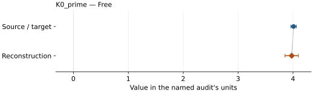

This is a **coefficient comparison**, not an observation or residual plot.
Each panel uses its coefficient's audit units and includes zero. Markers show
stored central values only. Error widths are retained in the table below;
no confidence interval or uncertainty band is inferred. Fixed/adopted values are constraints.

| Parameter | Source / target | Source error | Reconstruction | Reconstruction error | Fit role |
| --- | --- | --- | --- | --- | --- |
| K0\_prime | 4.01 | 0.05 | 3.975832241554772 | 0.12163217593704591 | Free |

Values and reported errors are copied without rounding or conversion from the named audit. Missing errors mean unknown, not zero. Parameter names and volume conventions follow that audit; error widths do not imply a confidence convention.

Recorded diagnostics, covariance and additional protocol

- **Columns:**
    - **Pressure:** pressure\_gpa
    - **Temperature:** temperature\_k
    - **Volume:** mgo\_unit\_cell\_volume\_a3
- **Observed pressure range gpa:** \[0.0, 44.7\]
- **Observed temperature range k:** \[300.0, 300.0\]
- **Observed volume range:** \[61.778, 74.744\]
- **Degrees of freedom:** 19
- **Solver success:** True
- **Solver message:** Both \`ftol\` and \`xtol\` termination conditions are satisfied.
- **Rmse gpa:** 0.5823162006958429
- **Published rmse gpa:** 0.5858390317523995
- **Reduced chi square:** 0.357023552848438

### Detailed evidence and existing plots

- [Record-by-record numerical ledger](../primary-eos-refits.md#records).
- [Source-audit reports](../source-audits.md).

Observation curves and residual plots are provided by the supporting reports where available. Their absence is not filled by a reconstructed curve presented as measured data.

[Machine-readable comparison ledger](https://github.com/CPrescher/peritheos/blob/main/docs/data/primary-eos-refits.json) — look up `mgo_dewaele_2000_vinet_sensitivity_3`.
[Complete native EOSMAT file](https://github.com/CPrescher/peritheos/blob/main/peritheos/data/materials/mgo.eosmat).

## Dewaele et al. (2000), logarithmic-strain sensitivity

Record: `mgo_dewaele_2000_natural_strain3_sensitivity_4` · Model: `NaturalStrain3`

**Outcome: Coefficient parity achieved.**

**Scope:** Comparison with the source parameterization.
**Comparison basis:** Every compared free coefficient meets both the recorded combined-two-sigma comparison and parameter-specific numerical similarity screen. Error conventions and fit qualifications remain applicable.

[Stored EOS coefficients and source](../material-summaries/mgo.md#record-mgo_dewaele_2000_natural_strain3_sensitivity_4)

### What this result establishes

**Separate source-review status:** primary\_source\_validated.
**Usage recommendation:** See the stored EOS qualifications; no recommendation is inferred here.

- This named numerical assessment alone does not establish author-workflow reproduction, physical accuracy or recommendation for use.

### Data and reconstruction method

- **Dataset identifiers:** mgo\_dewaele\_2000\_table2\_pvt
- **Observations:** 20
- **Fit kind:** isothermal\_pv
- **Selection:** all rows; reference-T rows
- **Objective:** errors\_in\_variables
- **Absolute sigma:** True
- **Free parameters:** K0\_prime
- **Fixed parameters:** V0; K0

Unspecified selections, weights, fixed values or error conventions remain unknown; they have not been inferred for this report.

### Source versus reconstruction

This is a **coefficient comparison**, not an observation or residual plot.
Each panel uses its coefficient's audit units and includes zero. Markers show
stored central values only. Error widths are retained in the table below;
no confidence interval or uncertainty band is inferred. Fixed/adopted values are constraints.

| Parameter | Source / target | Source error | Reconstruction | Reconstruction error | Fit role |
| --- | --- | --- | --- | --- | --- |
| K0\_prime | 4.08 | 0.06 | 4.050387288134976 | 0.13767114404188352 | Free |

Values and reported errors are copied without rounding or conversion from the named audit. Missing errors mean unknown, not zero. Parameter names and volume conventions follow that audit; error widths do not imply a confidence convention.

Recorded diagnostics, covariance and additional protocol

- **Columns:**
    - **Pressure:** pressure\_gpa
    - **Temperature:** temperature\_k
    - **Volume:** mgo\_unit\_cell\_volume\_a3
- **Observed pressure range gpa:** \[0.0, 44.7\]
- **Observed temperature range k:** \[300.0, 300.0\]
- **Observed volume range:** \[61.778, 74.744\]
- **Degrees of freedom:** 19
- **Solver success:** True
- **Solver message:** \`ftol\` termination condition is satisfied.
- **Rmse gpa:** 0.581713752850738
- **Published rmse gpa:** 0.5838326877999981
- **Reduced chi square:** 0.35628411164864393

### Detailed evidence and existing plots

- [Record-by-record numerical ledger](../primary-eos-refits.md#records).
- [Source-audit reports](../source-audits.md).

Observation curves and residual plots are provided by the supporting reports where available. Their absence is not filled by a reconstructed curve presented as measured data.

[Machine-readable comparison ledger](https://github.com/CPrescher/peritheos/blob/main/docs/data/primary-eos-refits.json) — look up `mgo_dewaele_2000_natural_strain3_sensitivity_4`.
[Complete native EOSMAT file](https://github.com/CPrescher/peritheos/blob/main/peritheos/data/materials/mgo.eosmat).

## Duffy and Ahrens (1995), B1 principal Hugoniot

Record: `mgo_b1_duffy_ahrens_1995_hugoniot_5` · Model: `LinearUsUpHugoniot`

**Outcome: Coefficient parity achieved.**

**Scope:** Comparison with the source parameterization.
**Comparison basis:** Every compared free coefficient meets both the recorded combined-two-sigma comparison and parameter-specific numerical similarity screen. Error conventions and fit qualifications remain applicable.

[Stored EOS coefficients and source](../material-summaries/mgo.md#record-mgo_b1_duffy_ahrens_1995_hugoniot_5)

### What this result establishes

**Separate source-review status:** primary\_source\_validated.
**Usage recommendation:** See the stored EOS qualifications; no recommendation is inferred here.

- This named numerical assessment alone does not establish author-workflow reproduction, physical accuracy or recommendation for use.

### Data and reconstruction method

- **Dataset identifiers:** mgo\_duffy\_ahrens\_1995\_table3\_hugoniot
- **Observations:** 4
- **Fit kind:** linear\_us\_up\_hugoniot
- **Selection:** finite particle\_velocity\_km\_s and shock\_velocity\_km\_s; used\_in\_published\_hugoniot\_fit=1; 4 rows
- **Objective:** errors\_in\_variables\_velocity\_residuals
- **Absolute sigma:** True
- **Free parameters:** c0; s
- **Fixed parameters:** V0; rho0; P0

Unspecified selections, weights, fixed values or error conventions remain unknown; they have not been inferred for this report.

### Source versus reconstruction

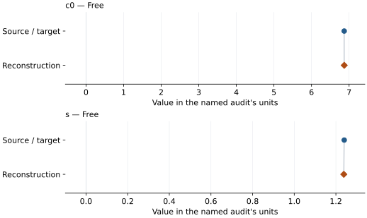

This is a **coefficient comparison**, not an observation or residual plot.
Each panel uses its coefficient's audit units and includes zero. Markers show
stored central values only. Error widths are retained in the table below;
no confidence interval or uncertainty band is inferred. Fixed/adopted values are constraints.

| Parameter | Source / target | Source error | Reconstruction | Reconstruction error | Fit role |
| --- | --- | --- | --- | --- | --- |
| c0 | 6.87 | 0.1 | 6.870439870231175 | 0.10034919071495181 | Free |
| s | 1.24 | 0.04 | 1.2379863126521224 | 0.041203117218599115 | Free |

Values and reported errors are copied without rounding or conversion from the named audit. Missing errors mean unknown, not zero. Parameter names and volume conventions follow that audit; error widths do not imply a confidence convention.

Recorded diagnostics, covariance and additional protocol

- **Columns:**
    - **Particle velocity:** particle\_velocity\_km\_s
    - **Particle velocity sigma:** particle\_velocity\_standard\_deviation\_km\_s
    - **Shock velocity:** shock\_velocity\_km\_s
    - **Shock velocity sigma:** shock\_velocity\_standard\_deviation\_km\_s
- **Degrees of freedom:** 2
- **Solver success:** True
- **Solver message:** Both \`ftol\` and \`xtol\` termination conditions are satisfied.
- **Rmse shock velocity km s:** 0.016661326938584825
- **Reduced chi square:** 0.04014860899161787

### Detailed evidence and existing plots

- [Record-by-record numerical ledger](../primary-eos-refits.md#records).
- [Source-audit reports](../source-audits.md).

Observation curves and residual plots are provided by the supporting reports where available. Their absence is not filled by a reconstructed curve presented as measured data.

[Machine-readable comparison ledger](https://github.com/CPrescher/peritheos/blob/main/docs/data/primary-eos-refits.json) — look up `mgo_b1_duffy_ahrens_1995_hugoniot_5`.
[Complete native EOSMAT file](https://github.com/CPrescher/peritheos/blob/main/peritheos/data/materials/mgo.eosmat).

## Oganov and Dorogokupets (2003), GGA-ECP large-core static BM3

Record: `mgo_oganov_2003_ecp_large_core_static_bm3` · Model: `BM3`

**Outcome: Complete independent refit unavailable.**

**Scope:** Comparison with the source parameterization.
**Comparison basis:** The complete coefficients are tabulated but the fitted energy-volume grid is not published.

[Stored EOS coefficients and source](../material-summaries/mgo.md#record-mgo_oganov_2003_ecp_large_core_static_bm3)

### What this result establishes

**Separate source-review status:** primary\_source\_validated.
**Usage recommendation:** See the stored EOS qualifications; no recommendation is inferred here.

- This named numerical assessment alone does not establish author-workflow reproduction, physical accuracy or recommendation for use.
- No reconstructed coefficient table is recorded for this assessment; no missing values have been inferred.

### Data and reconstruction method

- **Dataset identifiers:** None declared
- **Fixed parameters:** None declared

Unspecified selections, weights, fixed values or error conventions remain unknown; they have not been inferred for this report.

### Why no coefficient graph is shown

No numeric source/reconstruction pair is recorded for this assessment. A graph would require information that is not available here; no values or observations have been invented.

### Detailed evidence and existing plots

- [Record-by-record numerical ledger](../primary-eos-refits.md#records).
- [Source-audit reports](../source-audits.md).

Observation curves and residual plots are provided by the supporting reports where available. Their absence is not filled by a reconstructed curve presented as measured data.

[Machine-readable comparison ledger](https://github.com/CPrescher/peritheos/blob/main/docs/data/primary-eos-refits.json) — look up `mgo_oganov_2003_ecp_large_core_static_bm3`.
[Complete native EOSMAT file](https://github.com/CPrescher/peritheos/blob/main/peritheos/data/materials/mgo.eosmat).

## Oganov and Dorogokupets (2003), GGA-ECP small-core static BM3

Record: `mgo_oganov_2003_ecp_small_core_static_bm3` · Model: `BM3`

**Outcome: Complete independent refit unavailable.**

**Scope:** Comparison with the source parameterization.
**Comparison basis:** No numerical energy-volume grid is published.

[Stored EOS coefficients and source](../material-summaries/mgo.md#record-mgo_oganov_2003_ecp_small_core_static_bm3)

### What this result establishes

**Separate source-review status:** primary\_source\_validated.
**Usage recommendation:** See the stored EOS qualifications; no recommendation is inferred here.

- This named numerical assessment alone does not establish author-workflow reproduction, physical accuracy or recommendation for use.
- No reconstructed coefficient table is recorded for this assessment; no missing values have been inferred.

### Data and reconstruction method

- **Dataset identifiers:** None declared
- **Fixed parameters:** None declared

Unspecified selections, weights, fixed values or error conventions remain unknown; they have not been inferred for this report.

### Why no coefficient graph is shown

No numeric source/reconstruction pair is recorded for this assessment. A graph would require information that is not available here; no values or observations have been invented.

### Detailed evidence and existing plots

- [Record-by-record numerical ledger](../primary-eos-refits.md#records).
- [Source-audit reports](../source-audits.md).

Observation curves and residual plots are provided by the supporting reports where available. Their absence is not filled by a reconstructed curve presented as measured data.

[Machine-readable comparison ledger](https://github.com/CPrescher/peritheos/blob/main/docs/data/primary-eos-refits.json) — look up `mgo_oganov_2003_ecp_small_core_static_bm3`.
[Complete native EOSMAT file](https://github.com/CPrescher/peritheos/blob/main/peritheos/data/materials/mgo.eosmat).

## Oganov and Dorogokupets (2003), GGA-PAW large-core static BM3

Record: `mgo_oganov_2003_paw_large_core_static_bm3` · Model: `BM3`

**Outcome: Complete independent refit unavailable.**

**Scope:** Comparison with the source parameterization.
**Comparison basis:** No numerical energy-volume grid is published.

[Stored EOS coefficients and source](../material-summaries/mgo.md#record-mgo_oganov_2003_paw_large_core_static_bm3)

### What this result establishes

**Separate source-review status:** primary\_source\_validated.
**Usage recommendation:** See the stored EOS qualifications; no recommendation is inferred here.

- This named numerical assessment alone does not establish author-workflow reproduction, physical accuracy or recommendation for use.
- No reconstructed coefficient table is recorded for this assessment; no missing values have been inferred.

### Data and reconstruction method

- **Dataset identifiers:** None declared
- **Fixed parameters:** None declared

Unspecified selections, weights, fixed values or error conventions remain unknown; they have not been inferred for this report.

### Why no coefficient graph is shown

No numeric source/reconstruction pair is recorded for this assessment. A graph would require information that is not available here; no values or observations have been invented.

### Detailed evidence and existing plots

- [Record-by-record numerical ledger](../primary-eos-refits.md#records).
- [Source-audit reports](../source-audits.md).

Observation curves and residual plots are provided by the supporting reports where available. Their absence is not filled by a reconstructed curve presented as measured data.

[Machine-readable comparison ledger](https://github.com/CPrescher/peritheos/blob/main/docs/data/primary-eos-refits.json) — look up `mgo_oganov_2003_paw_large_core_static_bm3`.
[Complete native EOSMAT file](https://github.com/CPrescher/peritheos/blob/main/peritheos/data/materials/mgo.eosmat).

## Oganov and Dorogokupets (2003), GGA-PAW small-core static BM3

Record: `mgo_oganov_2003_paw_small_core_static_bm3` · Model: `BM3`

**Outcome: Numerically similar, with qualifications.**

**Scope:** Comparison with the source parameterization.
**Comparison basis:** Every compared free coefficient meets either the recorded combined-two-sigma comparison or parameter-specific numerical similarity screen; the audit does not classify the complete comparison as parity.

[Stored EOS coefficients and source](../material-summaries/mgo.md#record-mgo_oganov_2003_paw_small_core_static_bm3)

### What this result establishes

**Separate source-review status:** primary\_source\_validated.
**Usage recommendation:** See the stored EOS qualifications; no recommendation is inferred here.

- This named numerical assessment alone does not establish author-workflow reproduction, physical accuracy or recommendation for use.

### Data and reconstruction method

- **Dataset identifiers:** mgo\_oganov\_2003\_table3\_pv
- **Observations:** 8
- **Fit kind:** isothermal\_pv
- **Selection:** all rows
- **Objective:** pressure\_residuals
- **Absolute sigma:** True
- **Free parameters:** V0; K0; K0\_prime
- **Fixed parameters:** None declared

Unspecified selections, weights, fixed values or error conventions remain unknown; they have not been inferred for this report.

### Source versus reconstruction

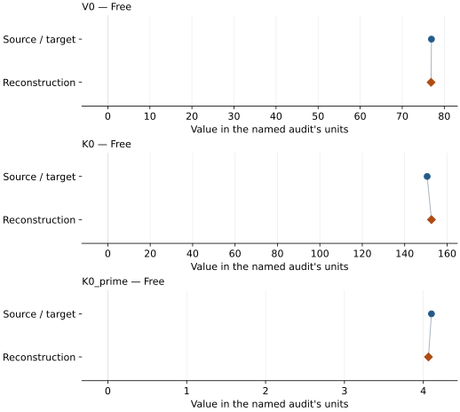

This is a **coefficient comparison**, not an observation or residual plot.
Each panel uses its coefficient's audit units and includes zero. Markers show
stored central values only. Error widths are retained in the table below;
no confidence interval or uncertainty band is inferred. Fixed/adopted values are constraints.

| Parameter | Source / target | Source error | Reconstruction | Reconstruction error | Fit role |
| --- | --- | --- | --- | --- | --- |
| V0 | 76.947 | Not specified | 76.85555591287978 | 0.023434664933481987 | Free |
| K0 | 150.597 | Not specified | 152.62328447139464 | 0.5205713115256253 | Free |
| K0\_prime | 4.103 | Not specified | 4.0651185334664905 | 0.0114759712009864 | Free |

Values and reported errors are copied without rounding or conversion from the named audit. Missing errors mean unknown, not zero. Parameter names and volume conventions follow that audit; error widths do not imply a confidence convention.

Recorded diagnostics, covariance and additional protocol

- **Columns:**
    - **Pressure:** static\_pressure\_gpa
    - **Temperature:** Not specified
    - **Volume:** volume\_a3
- **Observed pressure range gpa:** \[-4.82, 149.26\]
- **Observed temperature range k:** Not specified
- **Observed volume range:** \[50.65, 79.51\]
- **Degrees of freedom:** 5
- **Solver success:** True
- **Solver message:** Both \`ftol\` and \`xtol\` termination conditions are satisfied.
- **Rmse gpa:** 0.06763487440842908
- **Published rmse gpa:** 0.14355707642214074
- **Reduced chi square:** 0.00731916197799036

### Detailed evidence and existing plots

- [Earlier detailed record investigation](../primary-eos-refits.md#investigation-mgo_oganov_2003_paw_small_core_static_bm3).
- [Record-by-record numerical ledger](../primary-eos-refits.md#records).
- [Source-audit reports](../source-audits.md).

Observation curves and residual plots are provided by the supporting reports where available. Their absence is not filled by a reconstructed curve presented as measured data.

[Machine-readable comparison ledger](https://github.com/CPrescher/peritheos/blob/main/docs/data/primary-eos-refits.json) — look up `mgo_oganov_2003_paw_small_core_static_bm3`.
[Complete native EOSMAT file](https://github.com/CPrescher/peritheos/blob/main/peritheos/data/materials/mgo.eosmat).

## Oganov and Dorogokupets (2003), pressure-corrected static GGA-PAW BM3

Record: `mgo_oganov_2003_pressure_corrected_static_bm3` · Model: `BM3`

**Outcome: Numerically similar, with qualifications.**

**Scope:** Comparison with the source parameterization.
**Comparison basis:** Every compared free coefficient meets either the recorded combined-two-sigma comparison or parameter-specific numerical similarity screen; the audit does not classify the complete comparison as parity.

[Stored EOS coefficients and source](../material-summaries/mgo.md#record-mgo_oganov_2003_pressure_corrected_static_bm3)

### What this result establishes

**Separate source-review status:** primary\_source\_validated.
**Usage recommendation:** See the stored EOS qualifications; no recommendation is inferred here.

- This named numerical assessment alone does not establish author-workflow reproduction, physical accuracy or recommendation for use.

### Data and reconstruction method

- **Dataset identifiers:** mgo\_oganov\_2003\_table3\_pv
- **Observations:** 8
- **Fit kind:** isothermal\_pv
- **Selection:** all rows
- **Objective:** pressure\_residuals
- **Absolute sigma:** True
- **Free parameters:** V0; K0; K0\_prime
- **Fixed parameters:** None declared

Unspecified selections, weights, fixed values or error conventions remain unknown; they have not been inferred for this report.

### Source versus reconstruction

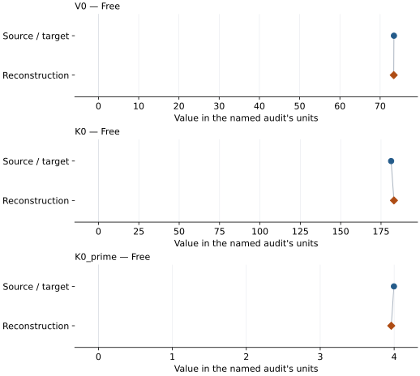

This is a **coefficient comparison**, not an observation or residual plot.
Each panel uses its coefficient's audit units and includes zero. Markers show
stored central values only. Error widths are retained in the table below;
no confidence interval or uncertainty band is inferred. Fixed/adopted values are constraints.

| Parameter | Source / target | Source error | Reconstruction | Reconstruction error | Fit role |
| --- | --- | --- | --- | --- | --- |
| V0 | 73.425 | Not specified | 73.37756556633245 | 0.014523678359949268 | Free |
| K0 | 181.24 | Not specified | 182.98298149402288 | 0.4181394111534414 | Free |
| K0\_prime | 3.997 | Not specified | 3.960852579674326 | 0.010089193213231491 | Free |

Values and reported errors are copied without rounding or conversion from the named audit. Missing errors mean unknown, not zero. Parameter names and volume conventions follow that audit; error widths do not imply a confidence convention.

Recorded diagnostics, covariance and additional protocol

- **Columns:**
    - **Pressure:** pressure\_corrected\_gpa
    - **Temperature:** Not specified
    - **Volume:** volume\_a3
- **Observed pressure range gpa:** \[-12.556, 141.524\]
- **Observed temperature range k:** Not specified
- **Observed volume range:** \[50.65, 79.51\]
- **Degrees of freedom:** 5
- **Solver success:** True
- **Solver message:** Both \`ftol\` and \`xtol\` termination conditions are satisfied.
- **Rmse gpa:** 0.06345624828870985
- **Published rmse gpa:** 0.14300399029281777
- **Reduced chi square:** 0.006442712715005428

### Detailed evidence and existing plots

- [Earlier detailed record investigation](../primary-eos-refits.md#investigation-mgo_oganov_2003_pressure_corrected_static_bm3).
- [Record-by-record numerical ledger](../primary-eos-refits.md#records).
- [Source-audit reports](../source-audits.md).

Observation curves and residual plots are provided by the supporting reports where available. Their absence is not filled by a reconstructed curve presented as measured data.

[Machine-readable comparison ledger](https://github.com/CPrescher/peritheos/blob/main/docs/data/primary-eos-refits.json) — look up `mgo_oganov_2003_pressure_corrected_static_bm3`.
[Complete native EOSMAT file](https://github.com/CPrescher/peritheos/blob/main/peritheos/data/materials/mgo.eosmat).

## Oganov and Dorogokupets (2003), pressure-corrected 0 K BM3 with zero-point energy

Record: `mgo_oganov_2003_pressure_corrected_0k_bm3` · Model: `BM3`

**Outcome: Complete independent refit unavailable.**

**Scope:** Comparison with the source parameterization.
**Comparison basis:** The coefficients and plotted curve are published; no row-level thermal grid is deposited.

[Stored EOS coefficients and source](../material-summaries/mgo.md#record-mgo_oganov_2003_pressure_corrected_0k_bm3)

### What this result establishes

**Separate source-review status:** primary\_source\_validated.
**Usage recommendation:** See the stored EOS qualifications; no recommendation is inferred here.

- This named numerical assessment alone does not establish author-workflow reproduction, physical accuracy or recommendation for use.
- No reconstructed coefficient table is recorded for this assessment; no missing values have been inferred.

### Data and reconstruction method

- **Dataset identifiers:** None declared
- **Fixed parameters:** None declared

Unspecified selections, weights, fixed values or error conventions remain unknown; they have not been inferred for this report.

### Why no coefficient graph is shown

No numeric source/reconstruction pair is recorded for this assessment. A graph would require information that is not available here; no values or observations have been invented.

### Detailed evidence and existing plots

- [Record-by-record numerical ledger](../primary-eos-refits.md#records).
- [Source-audit reports](../source-audits.md).

Observation curves and residual plots are provided by the supporting reports where available. Their absence is not filled by a reconstructed curve presented as measured data.

[Machine-readable comparison ledger](https://github.com/CPrescher/peritheos/blob/main/docs/data/primary-eos-refits.json) — look up `mgo_oganov_2003_pressure_corrected_0k_bm3`.
[Complete native EOSMAT file](https://github.com/CPrescher/peritheos/blob/main/peritheos/data/materials/mgo.eosmat).

## Oganov and Dorogokupets (2003), pressure-corrected 298 K BM3

Record: `mgo_oganov_2003_pressure_corrected_298k_bm3` · Model: `BM3`

**Outcome: Complete independent refit unavailable.**

**Scope:** Comparison with the source parameterization.
**Comparison basis:** Coefficients and curve are published; underlying thermal grid is not.

[Stored EOS coefficients and source](../material-summaries/mgo.md#record-mgo_oganov_2003_pressure_corrected_298k_bm3)

### What this result establishes

**Separate source-review status:** primary\_source\_validated.
**Usage recommendation:** See the stored EOS qualifications; no recommendation is inferred here.

- This named numerical assessment alone does not establish author-workflow reproduction, physical accuracy or recommendation for use.
- No reconstructed coefficient table is recorded for this assessment; no missing values have been inferred.

### Data and reconstruction method

- **Dataset identifiers:** None declared
- **Fixed parameters:** None declared

Unspecified selections, weights, fixed values or error conventions remain unknown; they have not been inferred for this report.

### Why no coefficient graph is shown

No numeric source/reconstruction pair is recorded for this assessment. A graph would require information that is not available here; no values or observations have been invented.

### Detailed evidence and existing plots

- [Record-by-record numerical ledger](../primary-eos-refits.md#records).
- [Source-audit reports](../source-audits.md).

Observation curves and residual plots are provided by the supporting reports where available. Their absence is not filled by a reconstructed curve presented as measured data.

[Machine-readable comparison ledger](https://github.com/CPrescher/peritheos/blob/main/docs/data/primary-eos-refits.json) — look up `mgo_oganov_2003_pressure_corrected_298k_bm3`.
[Complete native EOSMAT file](https://github.com/CPrescher/peritheos/blob/main/peritheos/data/materials/mgo.eosmat).

## Oganov and Dorogokupets (2003), pressure-corrected 1000 K BM3

Record: `mgo_oganov_2003_pressure_corrected_1000k_bm3` · Model: `BM3`

**Outcome: Complete independent refit unavailable.**

**Scope:** Comparison with the source parameterization.
**Comparison basis:** No row-level thermal grid is published.

[Stored EOS coefficients and source](../material-summaries/mgo.md#record-mgo_oganov_2003_pressure_corrected_1000k_bm3)

### What this result establishes

**Separate source-review status:** primary\_source\_validated.
**Usage recommendation:** See the stored EOS qualifications; no recommendation is inferred here.

- This named numerical assessment alone does not establish author-workflow reproduction, physical accuracy or recommendation for use.
- No reconstructed coefficient table is recorded for this assessment; no missing values have been inferred.

### Data and reconstruction method

- **Dataset identifiers:** None declared
- **Fixed parameters:** None declared

Unspecified selections, weights, fixed values or error conventions remain unknown; they have not been inferred for this report.

### Why no coefficient graph is shown

No numeric source/reconstruction pair is recorded for this assessment. A graph would require information that is not available here; no values or observations have been invented.

### Detailed evidence and existing plots

- [Record-by-record numerical ledger](../primary-eos-refits.md#records).
- [Source-audit reports](../source-audits.md).

Observation curves and residual plots are provided by the supporting reports where available. Their absence is not filled by a reconstructed curve presented as measured data.

[Machine-readable comparison ledger](https://github.com/CPrescher/peritheos/blob/main/docs/data/primary-eos-refits.json) — look up `mgo_oganov_2003_pressure_corrected_1000k_bm3`.
[Complete native EOSMAT file](https://github.com/CPrescher/peritheos/blob/main/peritheos/data/materials/mgo.eosmat).

## Oganov and Dorogokupets (2003), pressure-corrected 2000 K BM3

Record: `mgo_oganov_2003_pressure_corrected_2000k_bm3` · Model: `BM3`

**Outcome: Complete independent refit unavailable.**

**Scope:** Comparison with the source parameterization.
**Comparison basis:** No row-level thermal grid is published.

[Stored EOS coefficients and source](../material-summaries/mgo.md#record-mgo_oganov_2003_pressure_corrected_2000k_bm3)

### What this result establishes

**Separate source-review status:** primary\_source\_validated.
**Usage recommendation:** See the stored EOS qualifications; no recommendation is inferred here.

- This named numerical assessment alone does not establish author-workflow reproduction, physical accuracy or recommendation for use.
- No reconstructed coefficient table is recorded for this assessment; no missing values have been inferred.

### Data and reconstruction method

- **Dataset identifiers:** None declared
- **Fixed parameters:** None declared

Unspecified selections, weights, fixed values or error conventions remain unknown; they have not been inferred for this report.

### Why no coefficient graph is shown

No numeric source/reconstruction pair is recorded for this assessment. A graph would require information that is not available here; no values or observations have been invented.

### Detailed evidence and existing plots

- [Record-by-record numerical ledger](../primary-eos-refits.md#records).
- [Source-audit reports](../source-audits.md).

Observation curves and residual plots are provided by the supporting reports where available. Their absence is not filled by a reconstructed curve presented as measured data.

[Machine-readable comparison ledger](https://github.com/CPrescher/peritheos/blob/main/docs/data/primary-eos-refits.json) — look up `mgo_oganov_2003_pressure_corrected_2000k_bm3`.
[Complete native EOSMAT file](https://github.com/CPrescher/peritheos/blob/main/peritheos/data/materials/mgo.eosmat).

## Oganov and Dorogokupets (2003), pressure-corrected 3000 K BM3

Record: `mgo_oganov_2003_pressure_corrected_3000k_bm3` · Model: `BM3`

**Outcome: Complete independent refit unavailable.**

**Scope:** Comparison with the source parameterization.
**Comparison basis:** No row-level thermal grid is published.

[Stored EOS coefficients and source](../material-summaries/mgo.md#record-mgo_oganov_2003_pressure_corrected_3000k_bm3)

### What this result establishes

**Separate source-review status:** primary\_source\_validated.
**Usage recommendation:** See the stored EOS qualifications; no recommendation is inferred here.

- This named numerical assessment alone does not establish author-workflow reproduction, physical accuracy or recommendation for use.
- No reconstructed coefficient table is recorded for this assessment; no missing values have been inferred.

### Data and reconstruction method

- **Dataset identifiers:** None declared
- **Fixed parameters:** None declared

Unspecified selections, weights, fixed values or error conventions remain unknown; they have not been inferred for this report.

### Why no coefficient graph is shown

No numeric source/reconstruction pair is recorded for this assessment. A graph would require information that is not available here; no values or observations have been invented.

### Detailed evidence and existing plots

- [Record-by-record numerical ledger](../primary-eos-refits.md#records).
- [Source-audit reports](../source-audits.md).

Observation curves and residual plots are provided by the supporting reports where available. Their absence is not filled by a reconstructed curve presented as measured data.

[Machine-readable comparison ledger](https://github.com/CPrescher/peritheos/blob/main/docs/data/primary-eos-refits.json) — look up `mgo_oganov_2003_pressure_corrected_3000k_bm3`.
[Complete native EOSMAT file](https://github.com/CPrescher/peritheos/blob/main/peritheos/data/materials/mgo.eosmat).

## Oganov and Dorogokupets (2003), pressure-corrected 4000 K BM3

Record: `mgo_oganov_2003_pressure_corrected_4000k_bm3` · Model: `BM3`

**Outcome: Complete independent refit unavailable.**

**Scope:** Comparison with the source parameterization.
**Comparison basis:** No row-level thermal grid is published.

[Stored EOS coefficients and source](../material-summaries/mgo.md#record-mgo_oganov_2003_pressure_corrected_4000k_bm3)

### What this result establishes

**Separate source-review status:** primary\_source\_validated.
**Usage recommendation:** See the stored EOS qualifications; no recommendation is inferred here.

- This named numerical assessment alone does not establish author-workflow reproduction, physical accuracy or recommendation for use.
- No reconstructed coefficient table is recorded for this assessment; no missing values have been inferred.

### Data and reconstruction method

- **Dataset identifiers:** None declared
- **Fixed parameters:** None declared

Unspecified selections, weights, fixed values or error conventions remain unknown; they have not been inferred for this report.

### Why no coefficient graph is shown

No numeric source/reconstruction pair is recorded for this assessment. A graph would require information that is not available here; no values or observations have been invented.

### Detailed evidence and existing plots

- [Record-by-record numerical ledger](../primary-eos-refits.md#records).
- [Source-audit reports](../source-audits.md).

Observation curves and residual plots are provided by the supporting reports where available. Their absence is not filled by a reconstructed curve presented as measured data.

[Machine-readable comparison ledger](https://github.com/CPrescher/peritheos/blob/main/docs/data/primary-eos-refits.json) — look up `mgo_oganov_2003_pressure_corrected_4000k_bm3`.
[Complete native EOSMAT file](https://github.com/CPrescher/peritheos/blob/main/peritheos/data/materials/mgo.eosmat).

## Lee and Wan (2008), LDA 0 K BM3

Record: `mgo_lee_wan_2008_lda_static_bm3` · Model: `BM3`

**Outcome: Complete independent refit unavailable.**

**Scope:** Comparison with the source parameterization.
**Comparison basis:** The exact BM3 coefficients and plotted curves are published, but the underlying pressure-volume calculation table and fitting weights are not.

[Stored EOS coefficients and source](../material-summaries/mgo.md#record-mgo_lee_wan_2008_lda_static_bm3)

### What this result establishes

**Separate source-review status:** primary\_source\_validated.
**Usage recommendation:** See the stored EOS qualifications; no recommendation is inferred here.

- This named numerical assessment alone does not establish author-workflow reproduction, physical accuracy or recommendation for use.
- No reconstructed coefficient table is recorded for this assessment; no missing values have been inferred.

### Data and reconstruction method

- **Dataset identifiers:** None declared
- **Fixed parameters:** None declared

Unspecified selections, weights, fixed values or error conventions remain unknown; they have not been inferred for this report.

### Why no coefficient graph is shown

No numeric source/reconstruction pair is recorded for this assessment. A graph would require information that is not available here; no values or observations have been invented.

### Detailed evidence and existing plots

- [Record-by-record numerical ledger](../primary-eos-refits.md#records).
- [Source-audit reports](../source-audits.md).

Observation curves and residual plots are provided by the supporting reports where available. Their absence is not filled by a reconstructed curve presented as measured data.

[Machine-readable comparison ledger](https://github.com/CPrescher/peritheos/blob/main/docs/data/primary-eos-refits.json) — look up `mgo_lee_wan_2008_lda_static_bm3`.
[Complete native EOSMAT file](https://github.com/CPrescher/peritheos/blob/main/peritheos/data/materials/mgo.eosmat).

## Lee and Wan (2008), GGA 0 K BM3

Record: `mgo_lee_wan_2008_gga_static_bm3` · Model: `BM3`

**Outcome: Complete independent refit unavailable.**

**Scope:** Comparison with the source parameterization.
**Comparison basis:** The exact BM3 coefficients and plotted curves are published, but the underlying pressure-volume calculation table and fitting weights are not.

[Stored EOS coefficients and source](../material-summaries/mgo.md#record-mgo_lee_wan_2008_gga_static_bm3)

### What this result establishes

**Separate source-review status:** primary\_source\_validated.
**Usage recommendation:** See the stored EOS qualifications; no recommendation is inferred here.

- This named numerical assessment alone does not establish author-workflow reproduction, physical accuracy or recommendation for use.
- No reconstructed coefficient table is recorded for this assessment; no missing values have been inferred.

### Data and reconstruction method

- **Dataset identifiers:** None declared
- **Fixed parameters:** None declared

Unspecified selections, weights, fixed values or error conventions remain unknown; they have not been inferred for this report.

### Why no coefficient graph is shown

No numeric source/reconstruction pair is recorded for this assessment. A graph would require information that is not available here; no values or observations have been invented.

### Detailed evidence and existing plots

- [Record-by-record numerical ledger](../primary-eos-refits.md#records).
- [Source-audit reports](../source-audits.md).

Observation curves and residual plots are provided by the supporting reports where available. Their absence is not filled by a reconstructed curve presented as measured data.

[Machine-readable comparison ledger](https://github.com/CPrescher/peritheos/blob/main/docs/data/primary-eos-refits.json) — look up `mgo_lee_wan_2008_gga_static_bm3`.
[Complete native EOSMAT file](https://github.com/CPrescher/peritheos/blob/main/peritheos/data/materials/mgo.eosmat).

## Holland et al. (2013), per modified Tait

Record: `mgo_holland_2013_per_modified_tait` · Model: `ModifiedTait`

**Outcome: Complete independent refit unavailable.**

**Scope:** Comparison with the source parameterization.
**Comparison basis:** The official tc-ds62 per block provides all four coefficients.

[Stored EOS coefficients and source](../material-summaries/mgo.md#record-mgo_holland_2013_per_modified_tait)

### What this result establishes

**Separate source-review status:** primary\_source\_validated.
**Usage recommendation:** See the stored EOS qualifications; no recommendation is inferred here.

- This named numerical assessment alone does not establish author-workflow reproduction, physical accuracy or recommendation for use.
- No reconstructed coefficient table is recorded for this assessment; no missing values have been inferred.

### Data and reconstruction method

- **Dataset identifiers:** None declared
- **Fixed parameters:** None declared

Unspecified selections, weights, fixed values or error conventions remain unknown; they have not been inferred for this report.

### Why no coefficient graph is shown

No numeric source/reconstruction pair is recorded for this assessment. A graph would require information that is not available here; no values or observations have been invented.

### Detailed evidence and existing plots

- [Record-by-record numerical ledger](../primary-eos-refits.md#records).
- [Source-audit reports](../source-audits.md).

Observation curves and residual plots are provided by the supporting reports where available. Their absence is not filled by a reconstructed curve presented as measured data.

[Machine-readable comparison ledger](https://github.com/CPrescher/peritheos/blob/main/docs/data/primary-eos-refits.json) — look up `mgo_holland_2013_per_modified_tait`.
[Complete native EOSMAT file](https://github.com/CPrescher/peritheos/blob/main/peritheos/data/materials/mgo.eosmat).

## Zhang and Bukowinski (1991), MPIB B1 MgO

Record: `mgo_b1_zhang_bukowinski_1991_mpib_bm3` · Model: `BM3`

**Outcome: Complete independent refit unavailable.**

**Scope:** Comparison with the source parameterization.
**Comparison basis:** Calculated states are plotted but not tabulated.

[Stored EOS coefficients and source](../material-summaries/mgo.md#record-mgo_b1_zhang_bukowinski_1991_mpib_bm3)

### What this result establishes

**Separate source-review status:** primary\_source\_validated.
**Usage recommendation:** See the stored EOS qualifications; no recommendation is inferred here.

- This named numerical assessment alone does not establish author-workflow reproduction, physical accuracy or recommendation for use.
- No reconstructed coefficient table is recorded for this assessment; no missing values have been inferred.

### Data and reconstruction method

- **Dataset identifiers:** None declared
- **Fixed parameters:** None declared

Unspecified selections, weights, fixed values or error conventions remain unknown; they have not been inferred for this report.

### Why no coefficient graph is shown

No numeric source/reconstruction pair is recorded for this assessment. A graph would require information that is not available here; no values or observations have been invented.

### Detailed evidence and existing plots

- [Record-by-record numerical ledger](../primary-eos-refits.md#records).
- [Source-audit reports](../source-audits.md).

Observation curves and residual plots are provided by the supporting reports where available. Their absence is not filled by a reconstructed curve presented as measured data.

[Machine-readable comparison ledger](https://github.com/CPrescher/peritheos/blob/main/docs/data/primary-eos-refits.json) — look up `mgo_b1_zhang_bukowinski_1991_mpib_bm3`.
[Complete native EOSMAT file](https://github.com/CPrescher/peritheos/blob/main/peritheos/data/materials/mgo.eosmat).

## Karki et al. (1997), LDA static BM4

Record: `mgo_karki_1997_lda_static_bm4` · Model: `BM4`

**Outcome: Complete independent refit unavailable.**

**Scope:** Comparison with the source parameterization.
**Comparison basis:** The calculated states are plotted in Figure 1 but not tabulated; validation therefore checks the published equation, coefficients, derivative identities, and inverse curve rather than inventing row-level data.

[Stored EOS coefficients and source](../material-summaries/mgo.md#record-mgo_karki_1997_lda_static_bm4)

### What this result establishes

**Separate source-review status:** primary\_source\_validated.
**Usage recommendation:** See the stored EOS qualifications; no recommendation is inferred here.

- This named numerical assessment alone does not establish author-workflow reproduction, physical accuracy or recommendation for use.
- No reconstructed coefficient table is recorded for this assessment; no missing values have been inferred.

### Data and reconstruction method

- **Dataset identifiers:** None declared
- **Fixed parameters:** None declared

Unspecified selections, weights, fixed values or error conventions remain unknown; they have not been inferred for this report.

### Why no coefficient graph is shown

No numeric source/reconstruction pair is recorded for this assessment. A graph would require information that is not available here; no values or observations have been invented.

### Detailed evidence and existing plots

- [Record-by-record numerical ledger](../primary-eos-refits.md#records).
- [Source-audit reports](../source-audits.md).

Observation curves and residual plots are provided by the supporting reports where available. Their absence is not filled by a reconstructed curve presented as measured data.

[Machine-readable comparison ledger](https://github.com/CPrescher/peritheos/blob/main/docs/data/primary-eos-refits.json) — look up `mgo_karki_1997_lda_static_bm4`.
[Complete native EOSMAT file](https://github.com/CPrescher/peritheos/blob/main/peritheos/data/materials/mgo.eosmat).

## Karki et al. (1997), LDA static BM3 sensitivity fit

Record: `mgo_karki_1997_lda_static_bm3` · Model: `BM3`

**Outcome: Complete independent refit unavailable.**

**Scope:** Comparison with the source parameterization.
**Comparison basis:** The calculated states are plotted but not tabulated; no pseudo-observations were constructed.

[Stored EOS coefficients and source](../material-summaries/mgo.md#record-mgo_karki_1997_lda_static_bm3)

### What this result establishes

**Separate source-review status:** primary\_source\_validated.
**Usage recommendation:** See the stored EOS qualifications; no recommendation is inferred here.

- This named numerical assessment alone does not establish author-workflow reproduction, physical accuracy or recommendation for use.
- No reconstructed coefficient table is recorded for this assessment; no missing values have been inferred.

### Data and reconstruction method

- **Dataset identifiers:** None declared
- **Fixed parameters:** None declared

Unspecified selections, weights, fixed values or error conventions remain unknown; they have not been inferred for this report.

### Why no coefficient graph is shown

No numeric source/reconstruction pair is recorded for this assessment. A graph would require information that is not available here; no values or observations have been invented.

### Detailed evidence and existing plots

- [Record-by-record numerical ledger](../primary-eos-refits.md#records).
- [Source-audit reports](../source-audits.md).

Observation curves and residual plots are provided by the supporting reports where available. Their absence is not filled by a reconstructed curve presented as measured data.

[Machine-readable comparison ledger](https://github.com/CPrescher/peritheos/blob/main/docs/data/primary-eos-refits.json) — look up `mgo_karki_1997_lda_static_bm3`.
[Complete native EOSMAT file](https://github.com/CPrescher/peritheos/blob/main/peritheos/data/materials/mgo.eosmat).

## Belmonte (2017), B3LYP static-lattice BM3

Record: `mgo_belmonte_2017_b3lyp_static_bm3` · Model: `BM3`

**Outcome: Numerically similar, with qualifications.**

**Scope:** Comparison with the source parameterization.
**Comparison basis:** Every compared free coefficient meets either the recorded combined-two-sigma comparison or parameter-specific numerical similarity screen; the audit does not classify the complete comparison as parity.

[Stored EOS coefficients and source](../material-summaries/mgo.md#record-mgo_belmonte_2017_b3lyp_static_bm3)

### What this result establishes

**Separate source-review status:** primary\_source\_validated.
**Usage recommendation:** See the stored EOS qualifications; no recommendation is inferred here.

- This named numerical assessment alone does not establish author-workflow reproduction, physical accuracy or recommendation for use.

### Data and reconstruction method

- **Dataset identifiers:** mgo\_belmonte\_2017\_table4\_static\_pressure
- **Observations:** 8
- **Fit kind:** isothermal\_pv
- **Selection:** all rows; reference-T rows
- **Objective:** pressure\_residuals
- **Absolute sigma:** True
- **Free parameters:** V0; K0; K0\_prime
- **Fixed parameters:** None declared

Unspecified selections, weights, fixed values or error conventions remain unknown; they have not been inferred for this report.

### Source versus reconstruction

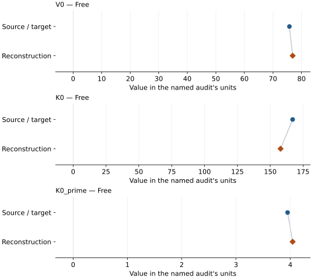

This is a **coefficient comparison**, not an observation or residual plot.
Each panel uses its coefficient's audit units and includes zero. Markers show
stored central values only. Error widths are retained in the table below;
no confidence interval or uncertainty band is inferred. Fixed/adopted values are constraints.

| Parameter | Source / target | Source error | Reconstruction | Reconstruction error | Fit role |
| --- | --- | --- | --- | --- | --- |
| V0 | 75.762 | Not specified | 76.89295629596002 | 0.009340733161200671 | Free |
| K0 | 167.01 | Not specified | 157.82335227676595 | 0.18929502013152452 | Free |
| K0\_prime | 3.95 | Not specified | 4.04335927979392 | 0.0031541735167935434 | Free |

Values and reported errors are copied without rounding or conversion from the named audit. Missing errors mean unknown, not zero. Parameter names and volume conventions follow that audit; error widths do not imply a confidence convention.

Recorded diagnostics, covariance and additional protocol

- **Columns:**
    - **Pressure:** total\_pressure\_gpa
    - **Temperature:** temperature\_k
    - **Volume:** volume\_ratio
- **Observed pressure range gpa:** \[2.44, 174.01\]
- **Observed temperature range k:** \[300.0, 300.0\]
- **Observed volume range:** \[49.2453, 75.762\]
- **Degrees of freedom:** 5
- **Solver success:** True
- **Solver message:** Both \`ftol\` and \`xtol\` termination conditions are satisfied.
- **Rmse gpa:** 0.019418455750899555
- **Published rmse gpa:** 3.3439249996446847
- **Reduced chi square:** 0.0006033222779994304

### Detailed evidence and existing plots

- [Earlier detailed record investigation](../primary-eos-refits.md#investigation-mgo_belmonte_2017_b3lyp_static_bm3).
- [Record-by-record numerical ledger](../primary-eos-refits.md#records).
- [Source-audit reports](../source-audits.md).

Observation curves and residual plots are provided by the supporting reports where available. Their absence is not filled by a reconstructed curve presented as measured data.

[Machine-readable comparison ledger](https://github.com/CPrescher/peritheos/blob/main/docs/data/primary-eos-refits.json) — look up `mgo_belmonte_2017_b3lyp_static_bm3`.
[Complete native EOSMAT file](https://github.com/CPrescher/peritheos/blob/main/peritheos/data/materials/mgo.eosmat).

## Hama and Suito (1996), QSM static-lattice Vinet comparison

Record: `mgo_hama_suito_1996_qsm_static_vinet` · Model: `Vinet`

**Outcome: Complete independent refit unavailable.**

**Scope:** Comparison with the source parameterization.
**Comparison basis:** The theoretical comparison curves are plotted but no pressure-volume calculation table is published; validation uses the exact printed equation and coefficients without inventing pseudo-observations.

[Stored EOS coefficients and source](../material-summaries/mgo.md#record-mgo_hama_suito_1996_qsm_static_vinet)

### What this result establishes

**Separate source-review status:** primary\_source\_validated.
**Usage recommendation:** See the stored EOS qualifications; no recommendation is inferred here.

- This named numerical assessment alone does not establish author-workflow reproduction, physical accuracy or recommendation for use.
- No reconstructed coefficient table is recorded for this assessment; no missing values have been inferred.

### Data and reconstruction method

- **Dataset identifiers:** None declared
- **Fixed parameters:** None declared

Unspecified selections, weights, fixed values or error conventions remain unknown; they have not been inferred for this report.

### Why no coefficient graph is shown

No numeric source/reconstruction pair is recorded for this assessment. A graph would require information that is not available here; no values or observations have been invented.

### Detailed evidence and existing plots

- [Record-by-record numerical ledger](../primary-eos-refits.md#records).
- [Source-audit reports](../source-audits.md).

Observation curves and residual plots are provided by the supporting reports where available. Their absence is not filled by a reconstructed curve presented as measured data.

[Machine-readable comparison ledger](https://github.com/CPrescher/peritheos/blob/main/docs/data/primary-eos-refits.json) — look up `mgo_hama_suito_1996_qsm_static_vinet`.
[Complete native EOSMAT file](https://github.com/CPrescher/peritheos/blob/main/peritheos/data/materials/mgo.eosmat).

## Ye et al. (2017), MgO Vinet 300 K co-compression fit

Record: `mgo_ye_2017_vinet_300k` · Model: `Vinet`

**Outcome: Coefficient parity achieved.**

**Scope:** Comparison with the source parameterization.
**Comparison basis:** Every compared free coefficient meets both the recorded combined-two-sigma comparison and parameter-specific numerical similarity screen. Error conventions and fit qualifications remain applicable.

[Stored EOS coefficients and source](../material-summaries/mgo.md#record-mgo_ye_2017_vinet_300k)

### What this result establishes

**Separate source-review status:** primary\_source\_validated.
**Usage recommendation:** See the stored EOS qualifications; no recommendation is inferred here.

- The corrected Ye et al. (2017) co-compression inputs for the selected pathway are bundled. The source-described V0/K0-fixed co-compression pathway reproduces the K0-prime point estimate and its 1 GPa-scatter standard error at the precision printed by Ye et al. (2017).
- This named numerical assessment alone does not establish author-workflow reproduction, physical accuracy or recommendation for use.

### Data and reconstruction method

- **Dataset identifiers:** ye\_2017\_data\_s1\_au\_mgo\_300k
- **Observations:** 28
- **Fit kind:** staged\_cocompression\_vinet\_k0\_prime
- **Selection:** All corrected Ye et al. (2017) co-compression rows in the selected MgO\_from\_Au pathway
- **Objective:** unweighted pressure differences between co-compressed phases
- **Absolute sigma:** True
- **Free parameters:** K0\_prime
- **Fixed parameters:** V0; K0

Unspecified selections, weights, fixed values or error conventions remain unknown; they have not been inferred for this report.

### Source versus reconstruction

This is a **coefficient comparison**, not an observation or residual plot.
Each panel uses its coefficient's audit units and includes zero. Markers show
stored central values only. Error widths are retained in the table below;
no confidence interval or uncertainty band is inferred. Fixed/adopted values are constraints.

| Parameter | Source / target | Source error | Reconstruction | Reconstruction error | Fit role |
| --- | --- | --- | --- | --- | --- |
| K0\_prime | 4.182 | 0.019 | 4.182461417926557 | 0.018958299796348287 | Free |

Values and reported errors are copied without rounding or conversion from the named audit. Missing errors mean unknown, not zero. Parameter names and volume conventions follow that audit; error widths do not imply a confidence convention.

Recorded diagnostics, covariance and additional protocol

- **Observed pressure range gpa:** \[18.682706167069096, 120.21912865945706\]
- **Solver success:** True
- **Solver message:** \`ftol\` termination condition is satisfied.
- **Rmse gpa:** 0.5713738024237984

### Detailed evidence and existing plots

- [Record-by-record numerical ledger](../primary-eos-refits.md#records).
- [Source-audit reports](../source-audits.md).

Observation curves and residual plots are provided by the supporting reports where available. Their absence is not filled by a reconstructed curve presented as measured data.

[Machine-readable comparison ledger](https://github.com/CPrescher/peritheos/blob/main/docs/data/primary-eos-refits.json) — look up `mgo_ye_2017_vinet_300k`.
[Complete native EOSMAT file](https://github.com/CPrescher/peritheos/blob/main/peritheos/data/materials/mgo.eosmat).

## Zhu et al. (2025), MgO internally consistent P-V-T EOS

Record: `mgo_zhu_2025_pvt` · Model: `Vinet`

**Outcome: Coefficient parity achieved.**

**Scope:** Comparison with the source parameterization.
**Comparison basis:** Every released v3 fit-input row is included in an independent translation of Zhu's iterative energy-balance and robust-bisquare optimization. The fitted gamma0 and b reproduce the rounded optimizer/property parameter set at its stated numerical precision. The inconsistent standalone v3 calculators are not used as the fit target.

[Stored EOS coefficients and source](../material-summaries/mgo.md#record-mgo_zhu_2025_pvt)

### What this result establishes

**Separate source-review status:** primary\_source\_validated.
**Usage recommendation:** See the stored EOS qualifications; no recommendation is inferred here.

- This named numerical assessment alone does not establish author-workflow reproduction, physical accuracy or recommendation for use.

### Data and reconstruction method

- **Dataset identifiers:** zhu\_2025\_mgo\_pvt
- **Observations:** 213
- **Fit kind:** iterative\_robust\_bisquare\_gruneisen\_refit
- **Selection:** All released v3 fit-input rows for this material
- **Objective:** Released v3 energy-balance transformation followed by robust bisquare nonlinear least squares
- **Free parameters:** gamma0; b
- **Fixed parameters:** V0; K0; K0\_prime; Tr; theta0; a; n; beta0; m

Unspecified selections, weights, fixed values or error conventions remain unknown; they have not been inferred for this report.

### Source versus reconstruction

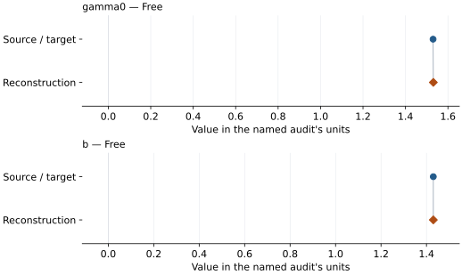

This is a **coefficient comparison**, not an observation or residual plot.
Each panel uses its coefficient's audit units and includes zero. Markers show
stored central values only. Error widths are retained in the table below;
no confidence interval or uncertainty band is inferred. Fixed/adopted values are constraints.

| Parameter | Source / target | Source error | Reconstruction | Reconstruction error | Fit role |
| --- | --- | --- | --- | --- | --- |
| gamma0 | 1.53 | Not specified | 1.531189310835376 | Not specified | Free |
| b | 1.43 | Not specified | 1.4301474629844562 | Not specified | Free |

Values and reported errors are copied without rounding or conversion from the named audit. Missing errors mean unknown, not zero. Parameter names and volume conventions follow that audit; error widths do not imply a confidence convention.

Recorded diagnostics, covariance and additional protocol

- **Observed pressure range gpa:** \[0.0001, 138.104\]
- **Solver success:** True
- **Solver message:** released v3 robust thermal refit converged in 7 outer iterations
- **Rmse gpa:** 0.9975739767001798

### Detailed evidence and existing plots

- [Record-by-record numerical ledger](../primary-eos-refits.md#records).
- [Source-audit reports](../source-audits.md).

Observation curves and residual plots are provided by the supporting reports where available. Their absence is not filled by a reconstructed curve presented as measured data.

[Machine-readable comparison ledger](https://github.com/CPrescher/peritheos/blob/main/docs/data/primary-eos-refits.json) — look up `mgo_zhu_2025_pvt`.
[Complete native EOSMAT file](https://github.com/CPrescher/peritheos/blob/main/peritheos/data/materials/mgo.eosmat).
