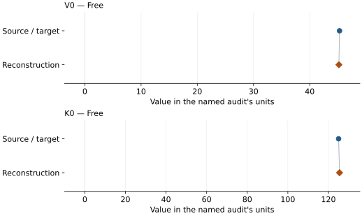

# Liquid MgSiO3: EOS reconstruction reports

<!-- Generated by scripts.generate_reconstruction_reports; edit EOSMAT instead. -->

[All reconstruction reports](index.md) · [Material and EOS parameters](../material-summaries/mgsio3_liquid.md)

These reports explain the assessments already stored in EOSMAT. Generating
this page does not refit observations, change classifications or replace source coefficients.

Use [scientific label definitions](../eos-labels.md) to distinguish coefficient
agreement, source verification, author-workflow reproduction and recommendation for use.

| EOS record | Recorded outcome | Coefficient comparison |
| --- | --- | --- |
| [Akins et al. (2004), candidate liquid MgSiO3 adiabatic BM3](#record-mgsio3_liquid_akins_2004_adiabatic_bm3) | Numerically similar, with qualifications | Graph and table |

## Akins et al. (2004), candidate liquid MgSiO3 adiabatic BM3

Record: `mgsio3_liquid_akins_2004_adiabatic_bm3` · Model: `BM3`

**Outcome: Numerically similar, with qualifications.**

**Scope:** Comparison with the source parameterization.
**Comparison basis:** Every compared free coefficient meets either the recorded combined-two-sigma comparison or parameter-specific numerical similarity screen; the audit does not classify the complete comparison as parity.

[Stored EOS coefficients and source](../material-summaries/mgsio3_liquid.md#record-mgsio3_liquid_akins_2004_adiabatic_bm3)

### What this result establishes

**Separate source-review status:** primary\_source\_validated.
**Usage recommendation:** See the stored EOS qualifications; no recommendation is inferred here.

- This is numerical similarity for a source-equation validation, not strict fit parity. Pressure and shock density are impedance-match reductions rather than independent direct BM3 observations. With three states, two refined coefficients, one residual degree of freedom, and near-perfect rho0-K0S correlation, K0S-prime and the thermal terms are not identifiable. The published candidate therefore remains unchanged and explicitly qualified.
- This named numerical assessment alone does not establish author-workflow reproduction, physical accuracy or recommendation for use.

### Data and reconstruction method

- **Dataset identifiers:** mgsio3\_liquid\_akins\_2004\_mosenfelder\_2009\_rereduced\_melt
- **Observations:** 3
- **Fit kind:** mie\_gruneisen\_hugoniot\_bounded\_reconstruction
- **Selection:** Mosenfelder et al. (2009) Table 2 rows credited to Akins et al. (2004), with enstatite starting material and phase\_state=melt
- **Objective:** unweighted theoretical-minus-reduced Hugoniot pressure residuals
- **Absolute sigma:** False
- **Free parameters:** V0; K0
- **Fixed parameters:** None declared

Unspecified selections, weights, fixed values or error conventions remain unknown; they have not been inferred for this report.

### Source versus reconstruction

This is a **coefficient comparison**, not an observation or residual plot.
Each panel uses its coefficient's audit units and includes zero. Markers show
stored central values only. Error widths are retained in the table below;
no confidence interval or uncertainty band is inferred. Fixed/adopted values are constraints.

| Parameter | Source / target | Source error | Reconstruction | Reconstruction error | Fit role |
| --- | --- | --- | --- | --- | --- |
| V0 | 45.29797155879917 | Not specified | 45.185995019007876 | 16.23987881216223 | Free |
| K0 | 125.0 | Not specified | 125.46292307750784 | 129.29534947040386 | Free |

Values and reported errors are copied without rounding or conversion from the named audit. Missing errors mean unknown, not zero. Parameter names and volume conventions follow that audit; error widths do not imply a confidence convention.

Recorded diagnostics, covariance and additional protocol

- **Observed pressure range gpa:** \[174.0, 204.3\]
- **Degrees of freedom:** 1
- **Solver success:** True
- **Solver message:** \`ftol\` termination condition is satisfied.
- **Rmse gpa:** 6.7945426904420545

### Detailed evidence and existing plots

- [Earlier detailed record investigation](../primary-eos-refits.md#investigation-mgsio3_liquid_akins_2004_adiabatic_bm3).
- [Record-by-record numerical ledger](../primary-eos-refits.md#records).
- [Source-audit reports](../source-audits.md).

Observation curves and residual plots are provided by the supporting reports where available. Their absence is not filled by a reconstructed curve presented as measured data.

[Machine-readable comparison ledger](https://github.com/CPrescher/peritheos/blob/main/docs/data/primary-eos-refits.json) — look up `mgsio3_liquid_akins_2004_adiabatic_bm3`.
[Complete native EOSMAT file](https://github.com/CPrescher/peritheos/blob/main/peritheos/data/materials/mgsio3_liquid.eosmat).
