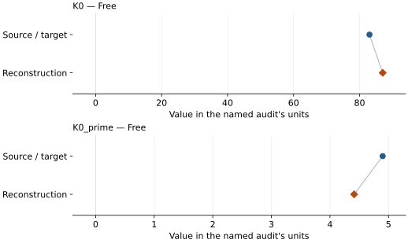
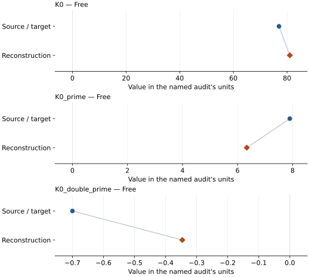

# MgSi(OH)6 3.65 A phase: EOS reconstruction reports

<!-- Generated by scripts.generate_reconstruction_reports; edit EOSMAT instead. -->

[All reconstruction reports](index.md) · [Material and EOS parameters](../material-summaries/mgsioh6_365a_phase.md)

These reports explain the assessments already stored in EOSMAT. Generating
this page does not refit observations, change classifications or replace source coefficients.

Use [scientific label definitions](../eos-labels.md) to distinguish coefficient
agreement, source verification, author-workflow reproduction and recommendation for use.

| EOS record | Recorded outcome | Coefficient comparison |
| --- | --- | --- |
| [Mookherjee et al. (2015), preferred experimental BM3](#record-mgsioh6_365a_phase_mookherjee_2015_bm3_experimental_1) | Coefficient parity achieved | Graph and table |
| [Mookherjee et al. (2015), experimental BM4 sensitivity fit](#record-mgsioh6_365a_phase_mookherjee_2015_bm4_experimental_sensitivity_2) | Numerically similar, with qualifications | Graph and table |
| [Mookherjee et al. (2015), static GGA model-crystal BM4](#record-mgsioh6_365a_phase_mookherjee_2015_gga_bm4_model_crystal_3) | Complete independent refit unavailable | No numeric coefficient pair recorded |

## Mookherjee et al. (2015), preferred experimental BM3

Record: `mgsioh6_365a_phase_mookherjee_2015_bm3_experimental_1` · Model: `BM3`

**Outcome: Coefficient parity achieved.**

**Scope:** Comparison with the source parameterization.
**Comparison basis:** Every compared free coefficient meets both the recorded combined-two-sigma comparison and parameter-specific numerical similarity screen. Error conventions and fit qualifications remain applicable.

[Stored EOS coefficients and source](../material-summaries/mgsioh6_365a_phase.md#record-mgsioh6_365a_phase_mookherjee_2015_bm3_experimental_1)

### What this result establishes

**Separate source-review status:** primary\_source\_validated.
**Usage recommendation:** See the stored EOS qualifications; no recommendation is inferred here.

- This named numerical assessment alone does not establish author-workflow reproduction, physical accuracy or recommendation for use.

### Data and reconstruction method

- **Dataset identifiers:** mgsioh6\_365a\_mookherjee\_2015\_supplement\_table1\_pv
- **Observations:** 95
- **Fit kind:** isothermal\_pv
- **Selection:** all rows
- **Objective:** errors\_in\_variables
- **Absolute sigma:** True
- **Free parameters:** K0; K0\_prime
- **Fixed parameters:** V0

Unspecified selections, weights, fixed values or error conventions remain unknown; they have not been inferred for this report.

### Source versus reconstruction

This is a **coefficient comparison**, not an observation or residual plot.
Each panel uses its coefficient's audit units and includes zero. Markers show
stored central values only. Error widths are retained in the table below;
no confidence interval or uncertainty band is inferred. Fixed/adopted values are constraints.

| Parameter | Source / target | Source error | Reconstruction | Reconstruction error | Fit role |
| --- | --- | --- | --- | --- | --- |
| K0 | 83.0 | 1.0 | 87.00415883431158 | 2.6429846058628867 | Free |
| K0\_prime | 4.9 | 0.2 | 4.412945405805343 | 0.33809443670353795 | Free |

Values and reported errors are copied without rounding or conversion from the named audit. Missing errors mean unknown, not zero. Parameter names and volume conventions follow that audit; error widths do not imply a confidence convention.

Recorded diagnostics, covariance and additional protocol

- **Columns:**
    - **Pressure:** pressure\_gpa
    - **Temperature:** Not specified
    - **Volume:** volume\_a3\_conventional\_cell
- **Observed pressure range gpa:** \[0.0, 41.0\]
- **Observed temperature range k:** Not specified
- **Observed volume range:** \[149.39, 195.03\]
- **Degrees of freedom:** 93
- **Solver success:** True
- **Solver message:** Both \`ftol\` and \`xtol\` termination conditions are satisfied.
- **Rmse gpa:** 0.27316331421530027
- **Published rmse gpa:** 0.4197429648934268
- **Reduced chi square:** 0.09445939595414121

### Detailed evidence and existing plots

- [Record-by-record numerical ledger](../primary-eos-refits.md#records).
- [Source-audit reports](../source-audits.md).

Observation curves and residual plots are provided by the supporting reports where available. Their absence is not filled by a reconstructed curve presented as measured data.

[Machine-readable comparison ledger](https://github.com/CPrescher/peritheos/blob/main/docs/data/primary-eos-refits.json) — look up `mgsioh6_365a_phase_mookherjee_2015_bm3_experimental_1`.
[Complete native EOSMAT file](https://github.com/CPrescher/peritheos/blob/main/peritheos/data/materials/mgsioh6_365a_phase.eosmat).

## Mookherjee et al. (2015), experimental BM4 sensitivity fit

Record: `mgsioh6_365a_phase_mookherjee_2015_bm4_experimental_sensitivity_2` · Model: `BM4`

**Outcome: Numerically similar, with qualifications.**

**Scope:** Comparison with the source parameterization.
**Comparison basis:** Every compared free coefficient meets either the recorded combined-two-sigma comparison or parameter-specific numerical similarity screen; the audit does not classify the complete comparison as parity.

[Stored EOS coefficients and source](../material-summaries/mgsioh6_365a_phase.md#record-mgsioh6_365a_phase_mookherjee_2015_bm4_experimental_sensitivity_2)

### What this result establishes

**Separate source-review status:** primary\_source\_validated.
**Usage recommendation:** See the stored EOS qualifications; no recommendation is inferred here.

- This named numerical assessment alone does not establish author-workflow reproduction, physical accuracy or recommendation for use.

### Data and reconstruction method

- **Dataset identifiers:** mgsioh6\_365a\_mookherjee\_2015\_supplement\_table1\_pv
- **Observations:** 95
- **Fit kind:** isothermal\_pv
- **Selection:** all rows
- **Objective:** errors\_in\_variables
- **Absolute sigma:** True
- **Free parameters:** K0; K0\_prime; K0\_double\_prime
- **Fixed parameters:** V0

Unspecified selections, weights, fixed values or error conventions remain unknown; they have not been inferred for this report.

### Source versus reconstruction

This is a **coefficient comparison**, not an observation or residual plot.
Each panel uses its coefficient's audit units and includes zero. Markers show
stored central values only. Error widths are retained in the table below;
no confidence interval or uncertainty band is inferred. Fixed/adopted values are constraints.

| Parameter | Source / target | Source error | Reconstruction | Reconstruction error | Fit role |
| --- | --- | --- | --- | --- | --- |
| K0 | 77.0 | 2.0 | 81.03456432406935 | 5.761664674518015 | Free |
| K0\_prime | 7.9 | 0.8 | 6.335145910920424 | 1.8140686022310453 | Free |
| K0\_double\_prime | -0.7 | 0.2 | -0.3461543118382347 | 0.33298044588510545 | Free |

Values and reported errors are copied without rounding or conversion from the named audit. Missing errors mean unknown, not zero. Parameter names and volume conventions follow that audit; error widths do not imply a confidence convention.

Recorded diagnostics, covariance and additional protocol

- **Columns:**
    - **Pressure:** pressure\_gpa
    - **Temperature:** Not specified
    - **Volume:** volume\_a3\_conventional\_cell
- **Observed pressure range gpa:** \[0.0, 41.0\]
- **Observed temperature range k:** Not specified
- **Observed volume range:** \[149.39, 195.03\]
- **Degrees of freedom:** 92
- **Solver success:** True
- **Solver message:** Both \`ftol\` and \`xtol\` termination conditions are satisfied.
- **Rmse gpa:** 0.24776106629747363
- **Published rmse gpa:** 0.39704509212881717
- **Reduced chi square:** 0.08060328566822579

### Detailed evidence and existing plots

- [Earlier detailed record investigation](../primary-eos-refits.md#investigation-mgsioh6_365a_phase_mookherjee_2015_bm4_experimental_sensitivity_2).
- [Record-by-record numerical ledger](../primary-eos-refits.md#records).
- [Source-audit reports](../source-audits.md).

Observation curves and residual plots are provided by the supporting reports where available. Their absence is not filled by a reconstructed curve presented as measured data.

[Machine-readable comparison ledger](https://github.com/CPrescher/peritheos/blob/main/docs/data/primary-eos-refits.json) — look up `mgsioh6_365a_phase_mookherjee_2015_bm4_experimental_sensitivity_2`.
[Complete native EOSMAT file](https://github.com/CPrescher/peritheos/blob/main/peritheos/data/materials/mgsioh6_365a_phase.eosmat).

## Mookherjee et al. (2015), static GGA model-crystal BM4

Record: `mgsioh6_365a_phase_mookherjee_2015_gga_bm4_model_crystal_3` · Model: `BM4`

**Outcome: Complete independent refit unavailable.**

**Scope:** Comparison with the source parameterization.
**Comparison basis:** The full four-coefficient BM4 is tabulated and the computed P-V markers are plotted, but the numerical energy-volume grid is not deposited; no false-precision digitization is bundled.

[Stored EOS coefficients and source](../material-summaries/mgsioh6_365a_phase.md#record-mgsioh6_365a_phase_mookherjee_2015_gga_bm4_model_crystal_3)

### What this result establishes

**Separate source-review status:** primary\_source\_validated.
**Usage recommendation:** See the stored EOS qualifications; no recommendation is inferred here.

- This named numerical assessment alone does not establish author-workflow reproduction, physical accuracy or recommendation for use.
- No reconstructed coefficient table is recorded for this assessment; no missing values have been inferred.

### Data and reconstruction method

- **Dataset identifiers:** None declared
- **Fixed parameters:** None declared

Unspecified selections, weights, fixed values or error conventions remain unknown; they have not been inferred for this report.

### Why no coefficient graph is shown

No numeric source/reconstruction pair is recorded for this assessment. A graph would require information that is not available here; no values or observations have been invented.

### Detailed evidence and existing plots

- [Record-by-record numerical ledger](../primary-eos-refits.md#records).
- [Source-audit reports](../source-audits.md).

Observation curves and residual plots are provided by the supporting reports where available. Their absence is not filled by a reconstructed curve presented as measured data.

[Machine-readable comparison ledger](https://github.com/CPrescher/peritheos/blob/main/docs/data/primary-eos-refits.json) — look up `mgsioh6_365a_phase_mookherjee_2015_gga_bm4_model_crystal_3`.
[Complete native EOSMAT file](https://github.com/CPrescher/peritheos/blob/main/peritheos/data/materials/mgsioh6_365a_phase.eosmat).
