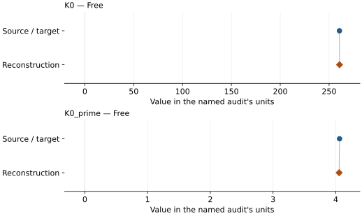
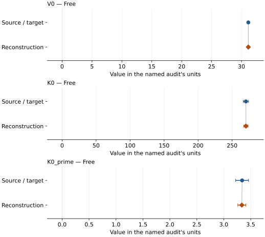
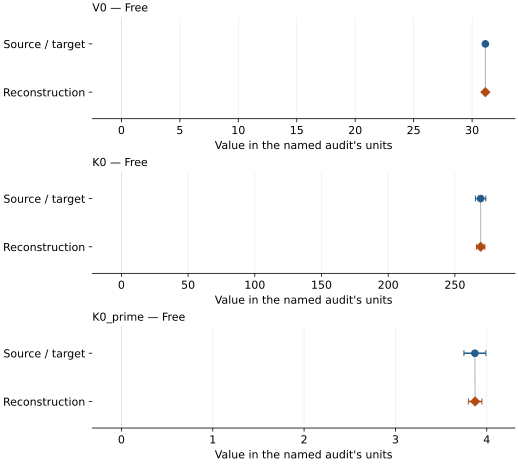
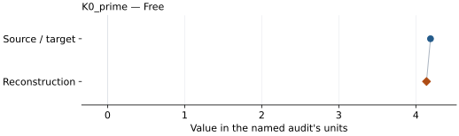
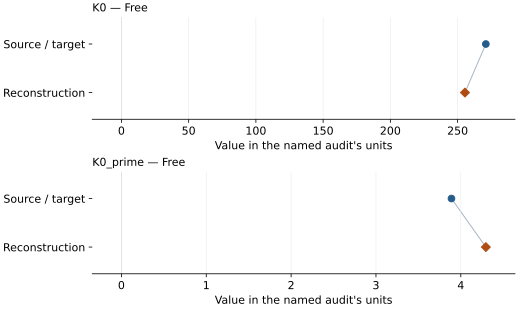

# Molybdenum: EOS reconstruction reports

<!-- Generated by scripts.generate_reconstruction_reports; edit EOSMAT instead. -->

[All reconstruction reports](index.md) · [Material and EOS parameters](../material-summaries/molybdenum.md)

These reports explain the assessments already stored in EOSMAT. Generating
this page does not refit observations, change classifications or replace source coefficients.

Use [scientific label definitions](../eos-labels.md) to distinguish coefficient
agreement, source verification, author-workflow reproduction and recommendation for use.

| EOS record | Recorded outcome | Coefficient comparison |
| --- | --- | --- |
| [Sakai et al. (2025), Mo generalized Rydberg-Stacey scale](#record-molybdenum_sakai_2025_rydberg_stacey_1) | Complete independent refit unavailable | No numeric coefficient pair recorded |
| [Shen and Smith (2026), Cu-referenced Vinet](#record-molybdenum_shen_2026_vinet_1) | Coefficient parity achieved | Graph and table |
| [Sokolova et al. (2013), Holzapfel thermal model (2016 workbook)](#record-molybdenum_sokolova_2013_holzapfel_2) | Source calculation reconstructed | No numeric coefficient pair recorded |
| [Dewaele (2019), Mo MAO-scale Vinet](#record-molybdenum_dewaele_2019_mao_vinet) | Numerically similar, with qualifications | Graph and table |
| [Dewaele (2019), Mo DOR-scale Vinet](#record-molybdenum_dewaele_2019_dor_vinet) | Numerically similar, with qualifications | Graph and table |
| [Dorfman et al. (2012), Mo K0-fixed Vinet](#record-molybdenum_dorfman_2012_tange_mgo_k0_fixed_vinet) | Parity not achieved for this comparison | Graph and table |
| [Dorfman et al. (2012), Mo K0-free Vinet](#record-molybdenum_dorfman_2012_tange_mgo_k0_free_vinet) | Parity not achieved for this comparison | Graph and table |

## Sakai et al. (2025), Mo generalized Rydberg-Stacey scale

Record: `molybdenum_sakai_2025_rydberg_stacey_1` · Model: `RydbergStacey`

**Outcome: Complete independent refit unavailable.**

**Scope:** Comparison with the source parameterization.
**Comparison basis:** The bundled grid is calculated from the reported coefficients. Raw simultaneous-volume observations exist in Tables S1-S8, but the multi-stage fit also incorporates earlier studies and does not publish one flat pressure-volume regression table or covariance.

[Stored EOS coefficients and source](../material-summaries/molybdenum.md#record-molybdenum_sakai_2025_rydberg_stacey_1)

### What this result establishes

**Separate source-review status:** primary\_source\_validated.
**Usage recommendation:** See the stored EOS qualifications; no recommendation is inferred here.

- This named numerical assessment alone does not establish author-workflow reproduction, physical accuracy or recommendation for use.
- No reconstructed coefficient table is recorded for this assessment; no missing values have been inferred.

### Data and reconstruction method

- **Dataset identifiers:** None declared
- **Fixed parameters:** V0; K0; K\_infinity\_prime

Unspecified selections, weights, fixed values or error conventions remain unknown; they have not been inferred for this report.

### Why no coefficient graph is shown

No numeric source/reconstruction pair is recorded for this assessment. A graph would require information that is not available here; no values or observations have been invented.

### Detailed evidence and existing plots

- [Record-by-record numerical ledger](../primary-eos-refits.md#records).
- [Source-audit reports](../source-audits.md).

Observation curves and residual plots are provided by the supporting reports where available. Their absence is not filled by a reconstructed curve presented as measured data.

[Machine-readable comparison ledger](https://github.com/CPrescher/peritheos/blob/main/docs/data/primary-eos-refits.json) — look up `molybdenum_sakai_2025_rydberg_stacey_1`.
[Complete native EOSMAT file](https://github.com/CPrescher/peritheos/blob/main/peritheos/data/materials/molybdenum.eosmat).

## Shen and Smith (2026), Cu-referenced Vinet

Record: `molybdenum_shen_2026_vinet_1` · Model: `Vinet`

**Outcome: Coefficient parity achieved.**

**Scope:** Comparison with the source parameterization.
**Comparison basis:** Every compared free coefficient meets both the recorded combined-two-sigma comparison and parameter-specific numerical similarity screen. Error conventions and fit qualifications remain applicable.

[Stored EOS coefficients and source](../material-summaries/molybdenum.md#record-molybdenum_shen_2026_vinet_1)

### What this result establishes

**Separate source-review status:** primary\_source\_validated.
**Usage recommendation:** See the stored EOS qualifications; no recommendation is inferred here.

- Direct reconstruction from source observations: each Table S1 phase volume is paired with its simultaneous Cu volume, pressure is evaluated from Fratanduono et al.'s analytic third-order 298 K Vinet fit, and K0 and K0\_prime are fitted with Shen and Smith's fixed V0 and stated run selection. The source publishes no pressure weights, residual covariance, or weighting protocol, so the reproduction uses unweighted pressure residuals and does not infer any of them.
- This named numerical assessment alone does not establish author-workflow reproduction, physical accuracy or recommendation for use.

### Data and reconstruction method

- **Dataset identifiers:** shen\_smith\_2026\_table\_s1\_simultaneous\_volumes
- **Observations:** 283
- **Fit kind:** fixed\_v0\_vinet\_with\_reconstructed\_cu\_pressure
- **Selection:** Mo; DAC-1 and DAC-2
- **Objective:** unweighted\_pressure\_residuals
- **Absolute sigma:** False
- **Free parameters:** K0; K0\_prime
- **Fixed parameters:** V0

Unspecified selections, weights, fixed values or error conventions remain unknown; they have not been inferred for this report.

### Source versus reconstruction

This is a **coefficient comparison**, not an observation or residual plot.
Each panel uses its coefficient's audit units and includes zero. Markers show
stored central values only. Error widths are retained in the table below;
no confidence interval or uncertainty band is inferred. Fixed/adopted values are constraints.

| Parameter | Source / target | Source error | Reconstruction | Reconstruction error | Fit role |
| --- | --- | --- | --- | --- | --- |
| K0 | 260.6 | 0.5 | 260.686918487191 | 0.4823717097515377 | Free |
| K0\_prime | 4.06 | 0.02 | 4.05353058458462 | 0.019482785245388795 | Free |

Values and reported errors are copied without rounding or conversion from the named audit. Missing errors mean unknown, not zero. Parameter names and volume conventions follow that audit; error widths do not imply a confidence convention.

Recorded diagnostics, covariance and additional protocol

- **Columns:**
    - **Pressure:** Fratanduono-2020 298 K Cu pressure reconstructed per run
    - **Temperature:** Not specified
    - **Volume:** unit\_cell\_volume\_a3
- **Observed pressure range gpa:** \[2.786190605963631, 110.25016209196069\]
- **Observed temperature range k:** Not specified
- **Observed volume range:** \[24.11538, 30.82583\]
- **Degrees of freedom:** 281
- **Solver success:** True
- **Solver message:** Both \`ftol\` and \`xtol\` termination conditions are satisfied.
- **Rmse gpa:** 0.4180910660710567
- **Published rmse gpa:** 0.41841029127093016
- **Reduced chi square:** 0.17604426863539666
- **Pressure reconstruction:**
    - **Density0 g cm3:** 8.939
    - **DOI:** 10.1103/PhysRevLett.124.015701
    - **Model:** vinet\_3
    - **Pairing:** Each phase volume uses the single Cu volume with the same experiment and run number; both source-labeled Pt first/last measurements are retained when the run is selected.
    - **Parameters:**
        - **K0 gpa:** 133.6
        - **Beta:** 2.06
        - **Eta:** 6.29
        - **Psi:** 1.65
    - **Reference:** Fratanduono et al. (2020)
    - **Reference eos record:** copper\_fratanduono\_2020\_vinet3\_298k
    - **Reference unit cell volume a3:** 47.218085048721
    - **Source locations:** main article Table I, 298 K isotherm row; Supplemental Material Eq. (2), Section S4

### Detailed evidence and existing plots

- [Record-by-record numerical ledger](../primary-eos-refits.md#records).
- [Source-audit reports](../source-audits.md).

Observation curves and residual plots are provided by the supporting reports where available. Their absence is not filled by a reconstructed curve presented as measured data.

[Machine-readable comparison ledger](https://github.com/CPrescher/peritheos/blob/main/docs/data/primary-eos-refits.json) — look up `molybdenum_shen_2026_vinet_1`.
[Complete native EOSMAT file](https://github.com/CPrescher/peritheos/blob/main/peritheos/data/materials/molybdenum.eosmat).

## Sokolova et al. (2013), Holzapfel thermal model (2016 workbook)

Record: `molybdenum_sokolova_2013_holzapfel_2` · Model: `Holzapfel`

**Outcome: Source calculation reconstructed.**

**Scope:** Reconstruction of a source equation or calculation.
**Comparison basis:** All eleven machine-readable comparison series enter one shared Equation (20) objective against the mean Table 2 Holzapfel and Table 3 Vinet isotherm. Table 4 is retained as a post-calibration closure test. The calculation cannot recover the eleven EOS parameter sets independently because the source omits complete thermochemical/ultrasonic rows, weights, and covariance.

[Stored EOS coefficients and source](../material-summaries/molybdenum.md#record-molybdenum_sokolova_2013_holzapfel_2)

### What this result establishes

**Separate source-review status:** primary\_source\_validated.
**Usage recommendation:** See the stored EOS qualifications; no recommendation is inferred here.

- This named numerical assessment alone does not establish author-workflow reproduction, physical accuracy or recommendation for use.
- No reconstructed coefficient table is recorded for this assessment; no missing values have been inferred.

### Data and reconstruction method

- **Dataset identifiers:** molybdenum\_dewaele\_2008\_table2\_compression
- **Observations:** 28
- **Fit kind:** coupled\_eleven\_marker\_ruby\_cross\_calibration
- **Objective:** minimize the sum over markers of the mean squared residual between Equation (20) and the pointwise mean of the Table 2 Holzapfel and Table 3 Vinet pressures, so each of the eleven markers has equal total weight
- **Fixed parameters:** n; Z; n

Unspecified selections, weights, fixed values or error conventions remain unknown; they have not been inferred for this report.

### Why no coefficient graph is shown

No numeric source/reconstruction pair is recorded for this assessment. A graph would require information that is not available here; no values or observations have been invented.

Recorded diagnostics, covariance and additional protocol

- **Rmse gpa:** 0.6855394756440152
- **Published rmse gpa:** 0.6467929629438924
- **Comparison scope:** shared\_ruby\_calibration
- **Published ruby parameters:**
    - **A gpa:** 1870.0
    - **M:** 6.0
- **Sensitivity fit ruby parameters:**
    - **A gpa:** 1869.3837840502665
    - **M:** 6.10334763359135

### Detailed evidence and existing plots

- [Record-by-record numerical ledger](../primary-eos-refits.md#records).
- [Source-audit reports](../source-audits.md).

Observation curves and residual plots are provided by the supporting reports where available. Their absence is not filled by a reconstructed curve presented as measured data.

[Machine-readable comparison ledger](https://github.com/CPrescher/peritheos/blob/main/docs/data/primary-eos-refits.json) — look up `molybdenum_sokolova_2013_holzapfel_2`.
[Complete native EOSMAT file](https://github.com/CPrescher/peritheos/blob/main/peritheos/data/materials/molybdenum.eosmat).

## Dewaele (2019), Mo MAO-scale Vinet

Record: `molybdenum_dewaele_2019_mao_vinet` · Model: `Vinet`

**Outcome: Numerically similar, with qualifications.**

**Scope:** Comparison with the source parameterization.
**Comparison basis:** Every compared free coefficient meets either the recorded combined-two-sigma comparison or parameter-specific numerical similarity screen; the audit does not classify the complete comparison as parity.

[Stored EOS coefficients and source](../material-summaries/molybdenum.md#record-molybdenum_dewaele_2019_mao_vinet)

### What this result establishes

**Separate source-review status:** primary\_source\_validated.
**Usage recommendation:** See the stored EOS qualifications; no recommendation is inferred here.

- Complete source rows for this material are bundled and the dedicated two-ruby-scale refit recovers every coefficient within the published 95% interval. The common ledger classifies the result as similar, not strict parity, because the dedicated audit does not infer a refit covariance from rounded source rows.
- This named numerical assessment alone does not establish author-workflow reproduction, physical accuracy or recommendation for use.

### Data and reconstruction method

- **Dataset identifiers:** molybdenum\_dewaele\_2008\_table2\_compression
- **Observations:** 29
- **Fit kind:** static\_vinet\_with\_explicit\_ruby\_scale\_conversion
- **Selection:** complete
- **Objective:** unweighted pressure residuals
- **Free parameters:** V0; K0; K0\_prime
- **Fixed parameters:** None declared

Unspecified selections, weights, fixed values or error conventions remain unknown; they have not been inferred for this report.

### Source versus reconstruction

This is a **coefficient comparison**, not an observation or residual plot.
Each panel uses its coefficient's audit units and includes zero. Markers show
stored central values only. Error widths are retained in the table below;
no confidence interval or uncertainty band is inferred. Fixed/adopted values are constraints.

| Parameter | Source / target | Source error | Reconstruction | Reconstruction error | Fit role |
| --- | --- | --- | --- | --- | --- |
| V0 | 31.138 | 0.042 | 31.13830887138314 | Not specified | Free |
| K0 | 270.3 | 3.9 | 270.3053393111082 | Not specified | Free |
| K0\_prime | 3.34 | 0.12 | 3.334844589411021 | Not specified | Free |

Values and reported errors are copied without rounding or conversion from the named audit. Missing errors mean unknown, not zero. Parameter names and volume conventions follow that audit; error widths do not imply a confidence convention.

Recorded diagnostics, covariance and additional protocol

- **Observed pressure range gpa:** \[0.0, 116.0\]
- **Solver success:** True
- **Solver message:** dedicated Dewaele (2019) refit completed
- **Rmse gpa:** 0.3336121252385827

### Detailed evidence and existing plots

- [Earlier detailed record investigation](../primary-eos-refits.md#investigation-molybdenum_dewaele_2019_mao_vinet).
- [Record-by-record numerical ledger](../primary-eos-refits.md#records).
- [Source-audit reports](../source-audits.md).

Observation curves and residual plots are provided by the supporting reports where available. Their absence is not filled by a reconstructed curve presented as measured data.

[Machine-readable comparison ledger](https://github.com/CPrescher/peritheos/blob/main/docs/data/primary-eos-refits.json) — look up `molybdenum_dewaele_2019_mao_vinet`.
[Complete native EOSMAT file](https://github.com/CPrescher/peritheos/blob/main/peritheos/data/materials/molybdenum.eosmat).

## Dewaele (2019), Mo DOR-scale Vinet

Record: `molybdenum_dewaele_2019_dor_vinet` · Model: `Vinet`

**Outcome: Numerically similar, with qualifications.**

**Scope:** Comparison with the source parameterization.
**Comparison basis:** Every compared free coefficient meets either the recorded combined-two-sigma comparison or parameter-specific numerical similarity screen; the audit does not classify the complete comparison as parity.

[Stored EOS coefficients and source](../material-summaries/molybdenum.md#record-molybdenum_dewaele_2019_dor_vinet)

### What this result establishes

**Separate source-review status:** primary\_source\_validated.
**Usage recommendation:** See the stored EOS qualifications; no recommendation is inferred here.

- Complete source rows for this material are bundled and the dedicated two-ruby-scale refit recovers every coefficient within the published 95% interval. The common ledger classifies the result as similar, not strict parity, because the dedicated audit does not infer a refit covariance from rounded source rows.
- This named numerical assessment alone does not establish author-workflow reproduction, physical accuracy or recommendation for use.

### Data and reconstruction method

- **Dataset identifiers:** molybdenum\_dewaele\_2008\_table2\_compression
- **Observations:** 29
- **Fit kind:** static\_vinet\_with\_explicit\_ruby\_scale\_conversion
- **Selection:** complete
- **Objective:** unweighted pressure residuals
- **Free parameters:** V0; K0; K0\_prime
- **Fixed parameters:** None declared

Unspecified selections, weights, fixed values or error conventions remain unknown; they have not been inferred for this report.

### Source versus reconstruction

This is a **coefficient comparison**, not an observation or residual plot.
Each panel uses its coefficient's audit units and includes zero. Markers show
stored central values only. Error widths are retained in the table below;
no confidence interval or uncertainty band is inferred. Fixed/adopted values are constraints.

| Parameter | Source / target | Source error | Reconstruction | Reconstruction error | Fit role |
| --- | --- | --- | --- | --- | --- |
| V0 | 31.134 | 0.042 | 31.133143723774438 | Not specified | Free |
| K0 | 269.3 | 3.9 | 269.3322683347472 | Not specified | Free |
| K0\_prime | 3.87 | 0.12 | 3.8727828290140347 | Not specified | Free |

Values and reported errors are copied without rounding or conversion from the named audit. Missing errors mean unknown, not zero. Parameter names and volume conventions follow that audit; error widths do not imply a confidence convention.

Recorded diagnostics, covariance and additional protocol

- **Observed pressure range gpa:** \[0.0, 123.81722045064414\]
- **Solver success:** True
- **Solver message:** dedicated Dewaele (2019) refit completed
- **Rmse gpa:** 0.34109811765746545

### Detailed evidence and existing plots

- [Earlier detailed record investigation](../primary-eos-refits.md#investigation-molybdenum_dewaele_2019_dor_vinet).
- [Record-by-record numerical ledger](../primary-eos-refits.md#records).
- [Source-audit reports](../source-audits.md).

Observation curves and residual plots are provided by the supporting reports where available. Their absence is not filled by a reconstructed curve presented as measured data.

[Machine-readable comparison ledger](https://github.com/CPrescher/peritheos/blob/main/docs/data/primary-eos-refits.json) — look up `molybdenum_dewaele_2019_dor_vinet`.
[Complete native EOSMAT file](https://github.com/CPrescher/peritheos/blob/main/peritheos/data/materials/molybdenum.eosmat).

## Dorfman et al. (2012), Mo K0-fixed Vinet

Record: `molybdenum_dorfman_2012_tange_mgo_k0_fixed_vinet` · Model: `Vinet`

**Outcome: Parity not achieved for this comparison.**

**Scope:** Comparison with the source parameterization.
**Comparison basis:** Complete reproduction of the rows available in official auxiliary Tables S1-S6, using the source's coupled Equation (3) objective and fixed Tange MgO anchor. The fit converges to a lower objective but does not recover Table 2. Run AN012 is listed in article Table 1 yet absent from the auxiliary PDF; unrounded inputs, row-selection detail, fit code, and covariance are unavailable.

[Stored EOS coefficients and source](../material-summaries/molybdenum.md#record-molybdenum_dorfman_2012_tange_mgo_k0_fixed_vinet)

### What this result establishes

**Separate source-review status:** primary\_source\_validated.
**Usage recommendation:** See the stored EOS qualifications; no recommendation is inferred here.

- This named numerical assessment alone does not establish author-workflow reproduction, physical accuracy or recommendation for use.

### Data and reconstruction method

- **Dataset identifiers:** jgrb17272-sup-0002-txts01.pdf
- **Observations:** 165
- **Fit kind:** simultaneous\_cocompression\_vinet
- **Selection:** Use every nonblank paired volume printed in Tables S1-S6; include the three MgO values marked as determined from the (200) peak alone.
- **Objective:** Dorfman Equation (3)
- **Free parameters:** K0\_prime
- **Fixed parameters:** V0; K0

Unspecified selections, weights, fixed values or error conventions remain unknown; they have not been inferred for this report.

### Source versus reconstruction

This is a **coefficient comparison**, not an observation or residual plot.
Each panel uses its coefficient's audit units and includes zero. Markers show
stored central values only. Error widths are retained in the table below;
no confidence interval or uncertainty band is inferred. Fixed/adopted values are constraints.

| Parameter | Source / target | Source error | Reconstruction | Reconstruction error | Fit role |
| --- | --- | --- | --- | --- | --- |
| K0\_prime | 4.19 | 0.02 | 4.13809805589023 | Not specified | Free |

Values and reported errors are copied without rounding or conversion from the named audit. Missing errors mean unknown, not zero. Parameter names and volume conventions follow that audit; error widths do not imply a confidence convention.

Recorded diagnostics, covariance and additional protocol

- **Observed pressure range gpa:** \[43.1, 214.6\]
- **Solver success:** True
- **Solver message:** \`ftol\` termination condition is satisfied.
- **Comparison scope:** joint\_system

### Detailed evidence and existing plots

- [Earlier detailed record investigation](../primary-eos-refits.md#investigation-molybdenum_dorfman_2012_tange_mgo_k0_fixed_vinet).
- [Record-by-record numerical ledger](../primary-eos-refits.md#records).
- [Source-audit reports](../source-audits.md).

Observation curves and residual plots are provided by the supporting reports where available. Their absence is not filled by a reconstructed curve presented as measured data.

[Machine-readable comparison ledger](https://github.com/CPrescher/peritheos/blob/main/docs/data/primary-eos-refits.json) — look up `molybdenum_dorfman_2012_tange_mgo_k0_fixed_vinet`.
[Complete native EOSMAT file](https://github.com/CPrescher/peritheos/blob/main/peritheos/data/materials/molybdenum.eosmat).

## Dorfman et al. (2012), Mo K0-free Vinet

Record: `molybdenum_dorfman_2012_tange_mgo_k0_free_vinet` · Model: `Vinet`

**Outcome: Parity not achieved for this comparison.**

**Scope:** Comparison with the source parameterization.
**Comparison basis:** Complete reproduction of the rows available in official auxiliary Tables S1-S6, using the source's coupled Equation (3) objective and fixed Tange MgO anchor. The fit converges to a lower objective but does not recover Table 2. Run AN012 is listed in article Table 1 yet absent from the auxiliary PDF; unrounded inputs, row-selection detail, fit code, and covariance are unavailable.

[Stored EOS coefficients and source](../material-summaries/molybdenum.md#record-molybdenum_dorfman_2012_tange_mgo_k0_free_vinet)

### What this result establishes

**Separate source-review status:** primary\_source\_validated.
**Usage recommendation:** See the stored EOS qualifications; no recommendation is inferred here.

- This named numerical assessment alone does not establish author-workflow reproduction, physical accuracy or recommendation for use.

### Data and reconstruction method

- **Dataset identifiers:** jgrb17272-sup-0002-txts01.pdf
- **Observations:** 165
- **Fit kind:** simultaneous\_cocompression\_vinet
- **Selection:** Use every nonblank paired volume printed in Tables S1-S6; include the three MgO values marked as determined from the (200) peak alone.
- **Objective:** Dorfman Equation (3)
- **Free parameters:** K0; K0\_prime
- **Fixed parameters:** V0

Unspecified selections, weights, fixed values or error conventions remain unknown; they have not been inferred for this report.

### Source versus reconstruction

This is a **coefficient comparison**, not an observation or residual plot.
Each panel uses its coefficient's audit units and includes zero. Markers show
stored central values only. Error widths are retained in the table below;
no confidence interval or uncertainty band is inferred. Fixed/adopted values are constraints.

| Parameter | Source / target | Source error | Reconstruction | Reconstruction error | Fit role |
| --- | --- | --- | --- | --- | --- |
| K0 | 271.0 | 3.0 | 255.46017518702442 | Not specified | Free |
| K0\_prime | 3.89 | 0.09 | 4.295099208339555 | Not specified | Free |

Values and reported errors are copied without rounding or conversion from the named audit. Missing errors mean unknown, not zero. Parameter names and volume conventions follow that audit; error widths do not imply a confidence convention.

Recorded diagnostics, covariance and additional protocol

- **Observed pressure range gpa:** \[43.1, 214.6\]
- **Solver success:** True
- **Solver message:** \`ftol\` termination condition is satisfied.
- **Comparison scope:** joint\_system

### Detailed evidence and existing plots

- [Earlier detailed record investigation](../primary-eos-refits.md#investigation-molybdenum_dorfman_2012_tange_mgo_k0_free_vinet).
- [Record-by-record numerical ledger](../primary-eos-refits.md#records).
- [Source-audit reports](../source-audits.md).

Observation curves and residual plots are provided by the supporting reports where available. Their absence is not filled by a reconstructed curve presented as measured data.

[Machine-readable comparison ledger](https://github.com/CPrescher/peritheos/blob/main/docs/data/primary-eos-refits.json) — look up `molybdenum_dorfman_2012_tange_mgo_k0_free_vinet`.
[Complete native EOSMAT file](https://github.com/CPrescher/peritheos/blob/main/peritheos/data/materials/molybdenum.eosmat).
