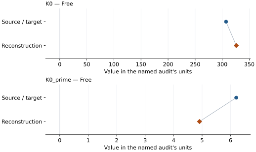
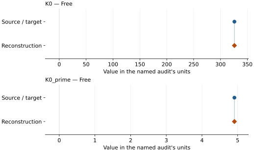

# Molybdenum carbide Mo2C: EOS reconstruction reports

<!-- Generated by scripts.generate_reconstruction_reports; edit EOSMAT instead. -->

[All reconstruction reports](index.md) · [Material and EOS parameters](../material-summaries/molybenum_carbide_mo2c.md)

These reports explain the assessments already stored in EOSMAT. Generating
this page does not refit observations, change classifications or replace source coefficients.

Use [scientific label definitions](../eos-labels.md) to distinguish coefficient
agreement, source verification, author-workflow reproduction and recommendation for use.

| EOS record | Recorded outcome | Coefficient comparison |
| --- | --- | --- |
| [EOS from Haines et al. 2001](#record-molybenum_carbide_mo2c_haines_2001_bm3_1) | Numerically similar, with qualifications | Graph and table |
| [Haines et al. (2001) Figure 2 direct BM3 refit](#record-molybenum_carbide_mo2c_haines_2001_bm3_refit) | Coefficient parity achieved | Graph and table |

## EOS from Haines et al. 2001

Record: `molybenum_carbide_mo2c_haines_2001_bm3_1` · Model: `BM3`

**Outcome: Numerically similar, with qualifications.**

**Scope:** Comparison with the source parameterization.
**Comparison basis:** Every compared free coefficient meets either the recorded combined-two-sigma comparison or parameter-specific numerical similarity screen; the audit does not classify the complete comparison as parity.

[Stored EOS coefficients and source](../material-summaries/molybenum_carbide_mo2c.md#record-molybenum_carbide_mo2c_haines_2001_bm3_1)

### What this result establishes

**Separate source-review status:** primary\_source\_validated.
**Usage recommendation:** See the stored EOS qualifications; no recommendation is inferred here.

- Corrected source-scope reproduction: Figure 2 expresses the observations as V/V0 and reports only K0 and K0' as fitted coefficients, so the measured ambient V0 is held fixed. The 16-marker refit is statistically compatible with both published coefficients but remains only numerically similar; see the \[dedicated Mo2C reproduction\](literature-reproductions.md#mo2c-haines-2001).
- This named numerical assessment alone does not establish author-workflow reproduction, physical accuracy or recommendation for use.

### Data and reconstruction method

- **Dataset identifiers:** molybdenum\_carbide\_haines\_2001\_figure2\_digitized
- **Observations:** 16
- **Fit kind:** isothermal\_pv
- **Selection:** all rows
- **Objective:** errors\_in\_variables
- **Absolute sigma:** True
- **Free parameters:** K0; K0\_prime
- **Fixed parameters:** V0

Unspecified selections, weights, fixed values or error conventions remain unknown; they have not been inferred for this report.

### Source versus reconstruction

This is a **coefficient comparison**, not an observation or residual plot.
Each panel uses its coefficient's audit units and includes zero. Markers show
stored central values only. Error widths are retained in the table below;
no confidence interval or uncertainty band is inferred. Fixed/adopted values are constraints.

| Parameter | Source / target | Source error | Reconstruction | Reconstruction error | Fit role |
| --- | --- | --- | --- | --- | --- |
| K0 | 307.0 | 5.0 | 325.87419826054304 | 9.50029103042738 | Free |
| K0\_prime | 6.2 | 0.3 | 4.9092021387052664 | 0.6513930636044009 | Free |

Values and reported errors are copied without rounding or conversion from the named audit. Missing errors mean unknown, not zero. Parameter names and volume conventions follow that audit; error widths do not imply a confidence convention.

Recorded diagnostics, covariance and additional protocol

- **Columns:**
    - **Pressure:** pressure\_gpa
    - **Temperature:** Not specified
    - **Volume:** volume\_ratio
- **Observed pressure range gpa:** \[0.0, 45.499\]
- **Observed temperature range k:** Not specified
- **Observed volume range:** \[133.452032091, 148.911567213\]
- **Degrees of freedom:** 14
- **Solver success:** True
- **Solver message:** Both \`ftol\` and \`xtol\` termination conditions are satisfied.
- **Rmse gpa:** 0.37453767113271197
- **Published rmse gpa:** 0.7040384578944161
- **Reduced chi square:** 0.9733212560820694

### Detailed evidence and existing plots

- [Earlier detailed record investigation](../primary-eos-refits.md#investigation-molybenum_carbide_mo2c_haines_2001_bm3_1).
- [Record-by-record numerical ledger](../primary-eos-refits.md#records).
- [Source-audit reports](../source-audits.md).

Observation curves and residual plots are provided by the supporting reports where available. Their absence is not filled by a reconstructed curve presented as measured data.

[Machine-readable comparison ledger](https://github.com/CPrescher/peritheos/blob/main/docs/data/primary-eos-refits.json) — look up `molybenum_carbide_mo2c_haines_2001_bm3_1`.
[Complete native EOSMAT file](https://github.com/CPrescher/peritheos/blob/main/peritheos/data/materials/molybenum_carbide_mo2c.eosmat).

## Haines et al. (2001) Figure 2 direct BM3 refit

Record: `molybenum_carbide_mo2c_haines_2001_bm3_refit` · Model: `BM3`

**Outcome: Coefficient parity achieved.**

**Scope:** Reproduction of a stored independent Peritheos refit.
**Comparison basis:** Every compared free coefficient meets both the recorded combined-two-sigma comparison and parameter-specific numerical similarity screen. Error conventions and fit qualifications remain applicable.

[Stored EOS coefficients and source](../material-summaries/molybenum_carbide_mo2c.md#record-molybenum_carbide_mo2c_haines_2001_bm3_refit)

### What this result establishes

**Separate source-review status:** primary\_source\_validated.
**Usage recommendation:** See the stored EOS qualifications; no recommendation is inferred here.

- This comparison concerns the stored independent Peritheos refit, not recovery of the original publication's coefficients or author workflow.
- Explicit Peritheos refit record: all 16 digitized Figure 2 markers are fitted with measured V0 fixed and the documented errors-in-variables objective. This record reproduces its stored coefficients exactly and does not replace the published Haines parameterization; see the \[dedicated Mo2C reproduction\](literature-reproductions.md#mo2c-haines-2001).

### Data and reconstruction method

The source/target column below is the stored **Peritheos refit**. Agreement with it does not reproduce the original publication's coefficients.

- **Dataset identifiers:** molybdenum\_carbide\_haines\_2001\_figure2\_digitized
- **Observations:** 16
- **Fit kind:** isothermal\_pv
- **Selection:** all rows
- **Objective:** errors\_in\_variables
- **Absolute sigma:** True
- **Free parameters:** K0; K0\_prime
- **Fixed parameters:** V0

Unspecified selections, weights, fixed values or error conventions remain unknown; they have not been inferred for this report.

### Source versus reconstruction

This is a **coefficient comparison**, not an observation or residual plot.
Each panel uses its coefficient's audit units and includes zero. Markers show
stored central values only. Error widths are retained in the table below;
no confidence interval or uncertainty band is inferred. Fixed/adopted values are constraints.

| Parameter | Source / target | Source error | Reconstruction | Reconstruction error | Fit role |
| --- | --- | --- | --- | --- | --- |
| K0 | 325.87419826054304 | 9.50029103042738 | 325.87441324143583 | 9.500289924692877 | Free |
| K0\_prime | 4.9092021387052664 | 0.6513930636044009 | 4.909186606761885 | 0.6513920513055321 | Free |

Values and reported errors are copied without rounding or conversion from the named audit. Missing errors mean unknown, not zero. Parameter names and volume conventions follow that audit; error widths do not imply a confidence convention.

Recorded diagnostics, covariance and additional protocol

- **Columns:**
    - **Pressure:** pressure\_gpa
    - **Temperature:** Not specified
    - **Volume:** volume\_ratio
- **Observed pressure range gpa:** \[0.0, 45.499\]
- **Observed temperature range k:** Not specified
- **Observed volume range:** \[133.452032091, 148.911567213\]
- **Degrees of freedom:** 14
- **Solver success:** True
- **Solver message:** \`ftol\` termination condition is satisfied.
- **Rmse gpa:** 0.37453844418422366
- **Published rmse gpa:** 0.6175533237710905
- **Reduced chi square:** 0.9733212561069121

### Detailed evidence and existing plots

- [Record-by-record numerical ledger](../primary-eos-refits.md#records).
- [Source-audit reports](../source-audits.md).

Observation curves and residual plots are provided by the supporting reports where available. Their absence is not filled by a reconstructed curve presented as measured data.

[Machine-readable comparison ledger](https://github.com/CPrescher/peritheos/blob/main/docs/data/primary-eos-refits.json) — look up `molybenum_carbide_mo2c_haines_2001_bm3_refit`.
[Complete native EOSMAT file](https://github.com/CPrescher/peritheos/blob/main/peritheos/data/materials/molybenum_carbide_mo2c.eosmat).
