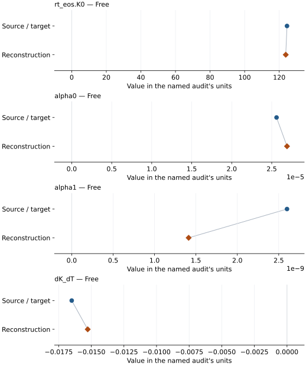

# NaAlSi2O6: EOS reconstruction reports

<!-- Generated by scripts.generate_reconstruction_reports; edit EOSMAT instead. -->

[All reconstruction reports](index.md) · [Material and EOS parameters](../material-summaries/naalsi2o6.md)

These reports explain the assessments already stored in EOSMAT. Generating
this page does not refit observations, change classifications or replace source coefficients.

Use [scientific label definitions](../eos-labels.md) to distinguish coefficient
agreement, source verification, author-workflow reproduction and recommendation for use.

| EOS record | Recorded outcome | Coefficient comparison |
| --- | --- | --- |
| [Zhao et al. (1997), jadeite thermal BM3](#record-naalsi2o6_zhao_1997_bm3_1) | Numerically similar, with qualifications | Graph and table |

## Zhao et al. (1997), jadeite thermal BM3

Record: `naalsi2o6_zhao_1997_bm3_1` · Model: `BM3`

**Outcome: Numerically similar, with qualifications.**

**Scope:** Comparison with the source parameterization.
**Comparison basis:** Every compared free coefficient meets either the recorded combined-two-sigma comparison or parameter-specific numerical similarity screen; the audit does not classify the complete comparison as parity.

[Stored EOS coefficients and source](../material-summaries/naalsi2o6.md#record-naalsi2o6_zhao_1997_bm3_1)

### What this result establishes

**Separate source-review status:** primary\_source\_validated.
**Usage recommendation:** See the stored EOS qualifications; no recommendation is inferred here.

- Complete conditional reproduction of the preferred K0'=5 thermal BM3 fit. All 31 source-selected hydrostatic Table 1 rows are used with the source-fixed V0=403 A^3 and K0'=5. The paper does not report its EOS residual definition, numerical weights, row-wise pressure/temperature uncertainties, covariance, or confidence convention, so Peritheos uses ordinary pressure residuals. Every varied coefficient is recovered within its published uncertainty; the result is classified similar because the small alpha1 coefficient has a 46% relative shift. See the dedicated \[Zhao jadeite audit\](literature-reproductions/zhao-1997-jadeite.md).
- This named numerical assessment alone does not establish author-workflow reproduction, physical accuracy or recommendation for use.

### Data and reconstruction method

- **Dataset identifiers:** jadeite\_zhao\_1997\_table1\_pvt
- **Observations:** 31
- **Fit kind:** joint\_pvt
- **Selection:** all 31 source-selected hydrostatic Table 1 rows; nonhydrostatic cold-compression observations were excluded by the authors before tabulation
- **Objective:** pressure\_residuals
- **Absolute sigma:** False
- **Free parameters:** rt\_eos.K0; alpha0; alpha1; dK\_dT
- **Fixed parameters:** V0; K0\_prime; Tr

Unspecified selections, weights, fixed values or error conventions remain unknown; they have not been inferred for this report.

### Source versus reconstruction

This is a **coefficient comparison**, not an observation or residual plot.
Each panel uses its coefficient's audit units and includes zero. Markers show
stored central values only. Error widths are retained in the table below;
no confidence interval or uncertainty band is inferred. Fixed/adopted values are constraints.

| Parameter | Source / target | Source error | Reconstruction | Reconstruction error | Fit role |
| --- | --- | --- | --- | --- | --- |
| rt\_eos.K0 | 124.5 | 4.0 | 123.76531127225114 | 1.3079217383697208 | Free |
| alpha0 | 2.56e-05 | 2.2e-06 | 2.6907805461388988e-05 | 2.2631463855223843e-06 | Free |
| alpha1 | 2.6e-09 | 1.8e-09 | 1.4119785809547507e-09 | 3.3359683548023392e-09 | Free |
| dK\_dT | -0.0165 | 0.0049 | -0.015274475228462205 | 0.002798352278049637 | Free |

Values and reported errors are copied without rounding or conversion from the named audit. Missing errors mean unknown, not zero. Parameter names and volume conventions follow that audit; error widths do not imply a confidence convention.

Recorded diagnostics, covariance and additional protocol

- **Columns:**
    - **Pressure:** pressure\_gpa
    - **Temperature:** temperature\_k
    - **Volume:** unit\_cell\_volume\_a3
- **Observed pressure range gpa:** \[0.0, 8.16\]
- **Observed temperature range k:** \[300.0, 1280.0\]
- **Observed volume range:** \[385.41, 406.7\]
- **Degrees of freedom:** 27
- **Solver success:** True
- **Solver message:** Both \`ftol\` and \`xtol\` termination conditions are satisfied.
- **Rmse gpa:** 0.10057798930809785
- **Published rmse gpa:** 0.1100101303257055
- **Reduced chi square:** 0.011614588515965007

### Detailed evidence and existing plots

- [Earlier detailed record investigation](../primary-eos-refits.md#investigation-naalsi2o6_zhao_1997_bm3_1).
- [Supporting source report: zhao-1997-jadeite](../literature-reproductions/zhao-1997-jadeite.md).
- [Record-by-record numerical ledger](../primary-eos-refits.md#records).
- [Source-audit reports](../source-audits.md).

Observation curves and residual plots are provided by the supporting reports where available. Their absence is not filled by a reconstructed curve presented as measured data.

[Machine-readable comparison ledger](https://github.com/CPrescher/peritheos/blob/main/docs/data/primary-eos-refits.json) — look up `naalsi2o6_zhao_1997_bm3_1`.
[Complete native EOSMAT file](https://github.com/CPrescher/peritheos/blob/main/peritheos/data/materials/naalsi2o6.eosmat).
