# NaCl (B2): EOS reconstruction reports

<!-- Generated by scripts.generate_reconstruction_reports; edit EOSMAT instead. -->

[All reconstruction reports](index.md) · [Material and EOS parameters](../material-summaries/nacl_b2.md)

These reports explain the assessments already stored in EOSMAT. Generating
this page does not refit observations, change classifications or replace source coefficients.

Use [scientific label definitions](../eos-labels.md) to distinguish coefficient
agreement, source verification, author-workflow reproduction and recommendation for use.

| EOS record | Recorded outcome | Coefficient comparison |
| --- | --- | --- |
| [Sakai et al. (2025), NaCl-B2 generalized Rydberg-Stacey scale](#record-nacl_b2_sakai_2025_rydberg_stacey_1) | Complete independent refit unavailable | No numeric coefficient pair recorded |
| [Heinz and Jeanloz (1984), NaCl-B2 BM2](#record-nacl_b2_heinz_1984_bm2_1) | Coefficient parity achieved | Graph and table |
| [Shen and Smith (2026), NaCl-B2 Cu-referenced Vinet](#record-nacl_b2_shen_2026_vinet_2) | Parity not achieved for this comparison | Graph and table |
| [Sakai et al. (2014), NaCl-B2 BM3, Yokoo et al. (2009) Pt scale](#record-nacl_b2_sakai_2014_yokoo_pt_bm3) | Complete independent refit unavailable | No numeric coefficient pair recorded |
| [Sakai et al. (2011), NaCl-B2 BM3, Matsui et al. (2009) Pt scale](#record-nacl_b2_sakai_2011_matsui_pt_bm3) | Coefficient parity achieved | Graph and table |
| [Sakai et al. (2011), NaCl-B2 Vinet, Matsui et al. (2009) Pt scale](#record-nacl_b2_sakai_2011_matsui_pt_vinet) | Coefficient parity achieved | Graph and table |
| [Sakai et al. (2011), NaCl-B2 BM3, Fei et al. (2007) Pt scale](#record-nacl_b2_sakai_2011_fei_pt_bm3) | Coefficient parity achieved | Graph and table |
| [Sakai et al. (2011), NaCl-B2 Vinet, Fei et al. (2007) Pt scale](#record-nacl_b2_sakai_2011_fei_pt_vinet) | Coefficient parity achieved | Graph and table |
| [Sakai et al. (2011), NaCl-B2 BM3, Dorogokupets and Oganov (2007) Pt scale](#record-nacl_b2_sakai_2011_do_pt_bm3) | Coefficient parity achieved | Graph and table |
| [Sakai et al. (2011), NaCl-B2 Vinet, Dorogokupets and Oganov (2007) Pt scale](#record-nacl_b2_sakai_2011_do_pt_vinet) | Coefficient parity achieved | Graph and table |
| [Sakai et al. (2011), NaCl-B2 BM3, Holmes et al. (1989) Pt scale](#record-nacl_b2_sakai_2011_holmes_pt_bm3) | Coefficient parity achieved | Graph and table |
| [Sakai et al. (2011), NaCl-B2 Vinet, Holmes et al. (1989) Pt scale](#record-nacl_b2_sakai_2011_holmes_pt_vinet) | Coefficient parity achieved | Graph and table |
| [Fei et al. (2007), NaCl-B2 Vinet-MGD pressure scale](#record-nacl_b2_fei_2007) | Parity not achieved for this comparison | Graph and table |
| [Peritheos refit: Fei (2007) NaCl-B2 digitized cold + 1000 K data](#record-nacl_b2_fei_2007_staged_thermal_refit) | Coefficient parity achieved | Graph and table |

## Sakai et al. (2025), NaCl-B2 generalized Rydberg-Stacey scale

Record: `nacl_b2_sakai_2025_rydberg_stacey_1` · Model: `RydbergStacey`

**Outcome: Complete independent refit unavailable.**

**Scope:** Comparison with the source parameterization.
**Comparison basis:** The bundled grid is calculated from the reported coefficients. Raw simultaneous-volume observations exist in Tables S1-S8, but the multi-stage fit also incorporates earlier studies and does not publish one flat pressure-volume regression table or covariance.

[Stored EOS coefficients and source](../material-summaries/nacl_b2.md#record-nacl_b2_sakai_2025_rydberg_stacey_1)

### What this result establishes

**Separate source-review status:** primary\_source\_validated.
**Usage recommendation:** See the stored EOS qualifications; no recommendation is inferred here.

- This named numerical assessment alone does not establish author-workflow reproduction, physical accuracy or recommendation for use.
- No reconstructed coefficient table is recorded for this assessment; no missing values have been inferred.

### Data and reconstruction method

- **Dataset identifiers:** None declared
- **Fixed parameters:** K\_infinity\_prime

Unspecified selections, weights, fixed values or error conventions remain unknown; they have not been inferred for this report.

### Why no coefficient graph is shown

No numeric source/reconstruction pair is recorded for this assessment. A graph would require information that is not available here; no values or observations have been invented.

### Detailed evidence and existing plots

- [Record-by-record numerical ledger](../primary-eos-refits.md#records).
- [Source-audit reports](../source-audits.md).

Observation curves and residual plots are provided by the supporting reports where available. Their absence is not filled by a reconstructed curve presented as measured data.

[Machine-readable comparison ledger](https://github.com/CPrescher/peritheos/blob/main/docs/data/primary-eos-refits.json) — look up `nacl_b2_sakai_2025_rydberg_stacey_1`.
[Complete native EOSMAT file](https://github.com/CPrescher/peritheos/blob/main/peritheos/data/materials/nacl_b2.eosmat).

## Heinz and Jeanloz (1984), NaCl-B2 BM2

Record: `nacl_b2_heinz_1984_bm2_1` · Model: `BM2`

**Outcome: Coefficient parity achieved.**

**Scope:** Comparison with the source parameterization.
**Comparison basis:** Every compared free coefficient meets both the recorded combined-two-sigma comparison and parameter-specific numerical similarity screen. Error conventions and fit qualifications remain applicable.

[Stored EOS coefficients and source](../material-summaries/nacl_b2.md#record-nacl_b2_heinz_1984_bm2_1)

### What this result establishes

**Separate source-review status:** primary\_source\_validated.
**Usage recommendation:** See the stored EOS qualifications; no recommendation is inferred here.

- This named numerical assessment alone does not establish author-workflow reproduction, physical accuracy or recommendation for use.

### Data and reconstruction method

- **Dataset identifiers:** nacl\_b2\_heinz\_1984\_table1\_compression
- **Observations:** 14
- **Fit kind:** isothermal\_pv
- **Selection:** all rows
- **Objective:** errors\_in\_variables
- **Absolute sigma:** True
- **Free parameters:** V0; K0
- **Fixed parameters:** None declared

Unspecified selections, weights, fixed values or error conventions remain unknown; they have not been inferred for this report.

### Source versus reconstruction

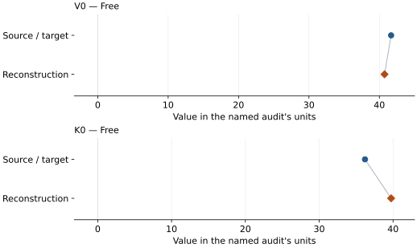

This is a **coefficient comparison**, not an observation or residual plot.
Each panel uses its coefficient's audit units and includes zero. Markers show
stored central values only. Error widths are retained in the table below;
no confidence interval or uncertainty band is inferred. Fixed/adopted values are constraints.

| Parameter | Source / target | Source error | Reconstruction | Reconstruction error | Fit role |
| --- | --- | --- | --- | --- | --- |
| V0 | 41.67 | 3.18 | 40.730520967484175 | 2.648330249843898 | Free |
| K0 | 36.2 | 4.2 | 39.739618233652365 | 10.425254054858431 | Free |

Values and reported errors are copied without rounding or conversion from the named audit. Missing errors mean unknown, not zero. Parameter names and volume conventions follow that audit; error widths do not imply a confidence convention.

Recorded diagnostics, covariance and additional protocol

- **Columns:**
    - **Pressure:** pressure\_gpa
    - **Temperature:** Not specified
    - **Volume:** volume\_ratio\_v\_v01
- **Observed pressure range gpa:** \[24.5, 68.9\]
- **Observed temperature range k:** Not specified
- **Observed volume range:** \[23.073248654467168, 29.84182023681378\]
- **Degrees of freedom:** 12
- **Solver success:** True
- **Solver message:** \`ftol\` termination condition is satisfied.
- **Rmse gpa:** 2.914150266127027
- **Published rmse gpa:** 3.081094198976813
- **Reduced chi square:** 1.3678745567703112

### Detailed evidence and existing plots

- [Record-by-record numerical ledger](../primary-eos-refits.md#records).
- [Source-audit reports](../source-audits.md).

Observation curves and residual plots are provided by the supporting reports where available. Their absence is not filled by a reconstructed curve presented as measured data.

[Machine-readable comparison ledger](https://github.com/CPrescher/peritheos/blob/main/docs/data/primary-eos-refits.json) — look up `nacl_b2_heinz_1984_bm2_1`.
[Complete native EOSMAT file](https://github.com/CPrescher/peritheos/blob/main/peritheos/data/materials/nacl_b2.eosmat).

## Shen and Smith (2026), NaCl-B2 Cu-referenced Vinet

Record: `nacl_b2_shen_2026_vinet_2` · Model: `Vinet`

**Outcome: Parity not achieved for this comparison.**

**Scope:** Comparison with the source parameterization.
**Comparison basis:** Direct reconstruction from source observations: each Table S1 phase volume is paired with its simultaneous Cu volume, pressure is evaluated from Fratanduono et al.'s analytic third-order 298 K Vinet fit, and K0 and K0\_prime are fitted with Shen and Smith's fixed V0 and stated run selection. The source publishes no pressure weights, residual covariance, or weighting protocol, so the reproduction uses unweighted pressure residuals and does not infer any of them. The paper identifies Table II as direct fits to this study's Cu-referenced P-V data, with earlier literature included for comparison. Its data-availability statement also mentions other author-held data, so completeness of the actual author fit inputs is unconfirmed. No additional experimental fit rows are identified by the published fitting description. See the \[source-input audit\](literature-reproductions/shen-smith-2026-cu-refits.md). Not recommended for scientific predictions or pressure calibration. Retained only for explicit diagnostic inspection. The published fixed-V0 NaCl-B2 Vinet curve gives 0.622381 GPa pressure RMS and mean residual -0.547610 GPa on 125 DAC-2 Table S1 observations above 35 GPa; all 125 residuals are negative. A direct unweighted refit gives K0=25.447259 GPa, K0\_prime=5.582768 and RMS 0.293229 GPa, versus published 24.92 GPa and 5.63. The source-fit discrepancy is unresolved; including the above-33-GPa transition rows does not restore agreement.

[Stored EOS coefficients and source](../material-summaries/nacl_b2.md#record-nacl_b2_shen_2026_vinet_2)

### What this result establishes

**Separate source-review status:** not\_reproduced.
**Usage recommendation:** not\_recommended\_for\_quantitative\_use

- Not recommended for scientific predictions or pressure calibration. Retained only for explicit diagnostic inspection. The published fixed-V0 NaCl-B2 Vinet curve gives 0.622381 GPa pressure RMS and mean residual -0.547610 GPa on 125 DAC-2 Table S1 observations above 35 GPa; all 125 residuals are negative. A direct unweighted refit gives K0=25.447259 GPa, K0\_prime=5.582768 and RMS 0.293229 GPa, versus published 24.92 GPa and 5.63. The source-fit discrepancy is unresolved; including the above-33-GPa transition rows does not restore agreement.
- Usage recommendation: not\_recommended\_for\_quantitative\_use
- Exact author-used P-V fit table and row mask, pressure-reduction implementation, residual coordinate, weights and covariance are unavailable.
- The article describes Table II as direct fits to this study's Cu-referenced data, with literature parameters for comparison, but its data-availability statement mentions additional author-held data. No extra fit observations are explicitly identified; completeness of the actual author inputs is unconfirmed.
- This named numerical assessment alone does not establish author-workflow reproduction, physical accuracy or recommendation for use.

### Data and reconstruction method

- **Dataset identifiers:** shen\_smith\_2026\_table\_s1\_simultaneous\_volumes
- **Observations:** 125
- **Fit kind:** fixed\_v0\_vinet\_with\_reconstructed\_cu\_pressure
- **Selection:** NaCl-B2; DAC-2; Cu pressure above 35 GPa (coexistence excluded)
- **Objective:** unweighted\_pressure\_residuals
- **Absolute sigma:** False
- **Free parameters:** K0; K0\_prime
- **Fixed parameters:** V0

Unspecified selections, weights, fixed values or error conventions remain unknown; they have not been inferred for this report.

### Source versus reconstruction

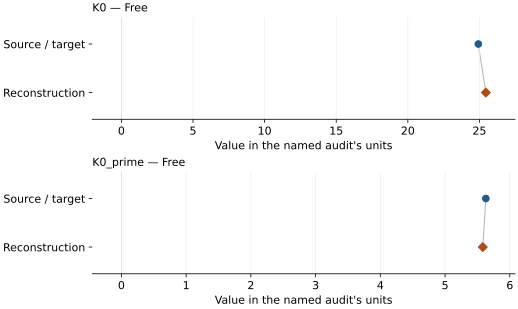

This is a **coefficient comparison**, not an observation or residual plot.
Each panel uses its coefficient's audit units and includes zero. Markers show
stored central values only. Error widths are retained in the table below;
no confidence interval or uncertainty band is inferred. Fixed/adopted values are constraints.

| Parameter | Source / target | Source error | Reconstruction | Reconstruction error | Fit role |
| --- | --- | --- | --- | --- | --- |
| K0 | 24.92 | 0.11 | 25.44725924830186 | 0.09134842945874447 | Free |
| K0\_prime | 5.63 | 0.02 | 5.582768070038436 | 0.012651643673731651 | Free |

Values and reported errors are copied without rounding or conversion from the named audit. Missing errors mean unknown, not zero. Parameter names and volume conventions follow that audit; error widths do not imply a confidence convention.

Recorded diagnostics, covariance and additional protocol

- **Columns:**
    - **Pressure:** Fratanduono-2020 298 K Cu pressure reconstructed per run
    - **Temperature:** Not specified
    - **Volume:** unit\_cell\_volume\_a3
- **Observed pressure range gpa:** \[35.714233962346135, 109.513016319132\]
- **Observed temperature range k:** Not specified
- **Observed volume range:** \[20.37353, 26.63517\]
- **Degrees of freedom:** 123
- **Solver success:** True
- **Solver message:** \`ftol\` termination condition is satisfied.
- **Rmse gpa:** 0.2932287343506067
- **Published rmse gpa:** 0.6223809764451977
- **Reduced chi square:** 0.08738118968379947
- **Pressure reconstruction:**
    - **Density0 g cm3:** 8.939
    - **DOI:** 10.1103/PhysRevLett.124.015701
    - **Model:** vinet\_3
    - **Pairing:** Each phase volume uses the single Cu volume with the same experiment and run number; both source-labeled Pt first/last measurements are retained when the run is selected.
    - **Parameters:**
        - **K0 gpa:** 133.6
        - **Beta:** 2.06
        - **Eta:** 6.29
        - **Psi:** 1.65
    - **Reference:** Fratanduono et al. (2020)
    - **Reference eos record:** copper\_fratanduono\_2020\_vinet3\_298k
    - **Reference unit cell volume a3:** 47.218085048721
    - **Source locations:** main article Table I, 298 K isotherm row; Supplemental Material Eq. (2), Section S4

### Detailed evidence and existing plots

- [Earlier detailed record investigation](../primary-eos-refits.md#investigation-nacl_b2_shen_2026_vinet_2).
- [Supporting source report: shen-smith-2026-cu-refits](../literature-reproductions/shen-smith-2026-cu-refits.md).
- [Record-by-record numerical ledger](../primary-eos-refits.md#records).
- [Source-audit reports](../source-audits.md).

Observation curves and residual plots are provided by the supporting reports where available. Their absence is not filled by a reconstructed curve presented as measured data.

[Machine-readable comparison ledger](https://github.com/CPrescher/peritheos/blob/main/docs/data/primary-eos-refits.json) — look up `nacl_b2_shen_2026_vinet_2`.
[Complete native EOSMAT file](https://github.com/CPrescher/peritheos/blob/main/peritheos/data/materials/nacl_b2.eosmat).

## Sakai et al. (2014), NaCl-B2 BM3, Yokoo et al. (2009) Pt scale

Record: `nacl_b2_sakai_2014_yokoo_pt_bm3` · Model: `BM3`

**Outcome: Complete independent refit unavailable.**

**Scope:** Comparison with the source parameterization.
**Comparison basis:** Original Sakai (2011a) paired NaCl/Pt calibration observations are not attached to this 2014 paper. Table 2 NaCl values are downstream measurements, not independent P5 calibration constraints.

[Stored EOS coefficients and source](../material-summaries/nacl_b2.md#record-nacl_b2_sakai_2014_yokoo_pt_bm3)

### What this result establishes

**Separate source-review status:** primary\_source\_validated.
**Usage recommendation:** See the stored EOS qualifications; no recommendation is inferred here.

- This named numerical assessment alone does not establish author-workflow reproduction, physical accuracy or recommendation for use.
- No reconstructed coefficient table is recorded for this assessment; no missing values have been inferred.

### Data and reconstruction method

- **Dataset identifiers:** None declared
- **Fixed parameters:** V0

Unspecified selections, weights, fixed values or error conventions remain unknown; they have not been inferred for this report.

### Why no coefficient graph is shown

No numeric source/reconstruction pair is recorded for this assessment. A graph would require information that is not available here; no values or observations have been invented.

### Detailed evidence and existing plots

- [Record-by-record numerical ledger](../primary-eos-refits.md#records).
- [Source-audit reports](../source-audits.md).

Observation curves and residual plots are provided by the supporting reports where available. Their absence is not filled by a reconstructed curve presented as measured data.

[Machine-readable comparison ledger](https://github.com/CPrescher/peritheos/blob/main/docs/data/primary-eos-refits.json) — look up `nacl_b2_sakai_2014_yokoo_pt_bm3`.
[Complete native EOSMAT file](https://github.com/CPrescher/peritheos/blob/main/peritheos/data/materials/nacl_b2.eosmat).

## Sakai et al. (2011), NaCl-B2 BM3, Matsui et al. (2009) Pt scale

Record: `nacl_b2_sakai_2011_matsui_pt_bm3` · Model: `BM3`

**Outcome: Coefficient parity achieved.**

**Scope:** Comparison with the source parameterization.
**Comparison basis:** Conditional fixed-V0 comparison under the documented diagnostic protocol; original source weighting and workflow are not established.

[Stored EOS coefficients and source](../material-summaries/nacl_b2.md#record-nacl_b2_sakai_2011_matsui_pt_bm3)

### What this result establishes

**Separate source-review status:** primary\_source\_validated.
**Usage recommendation:** See the stored EOS qualifications; no recommendation is inferred here.

- Conditional diagnostic, not exact source-regression recovery: source weights and Pt peak-combination rule are unspecified. Sata pressures reconstructed from equal-weight cubic Pt lattice parameters. Staged V0 and selection/objective sensitivity documented in sakai-2011-nacl-b2 reproduction; published parameters unchanged.
- This named numerical assessment alone does not establish author-workflow reproduction, physical accuracy or recommendation for use.

### Data and reconstruction method

- **Dataset identifiers:** nacl\_b2\_sakai\_2011\_table1; nacl\_b2\_sata\_2002\_table1\_sakai\_input
- **Observations:** 54
- **Fit kind:** primary\_table\_fixed\_V0\_bm3\_or\_vinet
- **Selection:** 27 Sakai rows plus 27 Sata rows after explicit exclusions 8 and 11; annealed-only selection retained as sensitivity
- **Objective:** unweighted\_pressure\_residuals
- **Free parameters:** K0; K0\_prime
- **Fixed parameters:** V0

Unspecified selections, weights, fixed values or error conventions remain unknown; they have not been inferred for this report.

### Source versus reconstruction

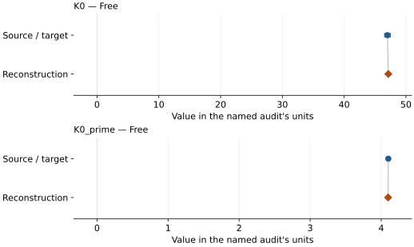

This is a **coefficient comparison**, not an observation or residual plot.
Each panel uses its coefficient's audit units and includes zero. Markers show
stored central values only. Error widths are retained in the table below;
no confidence interval or uncertainty band is inferred. Fixed/adopted values are constraints.

| Parameter | Source / target | Source error | Reconstruction | Reconstruction error | Fit role |
| --- | --- | --- | --- | --- | --- |
| K0 | 47 | 0.46 | 47.14269653390601 | Not specified | Free |
| K0\_prime | 4.1 | 0.02 | 4.097571435798029 | Not specified | Free |

Values and reported errors are copied without rounding or conversion from the named audit. Missing errors mean unknown, not zero. Parameter names and volume conventions follow that audit; error widths do not imply a confidence convention.

Recorded diagnostics, covariance and additional protocol

- **Rmse gpa:** 1.6993824533388564
- **Published rmse gpa:** 1.7230450703272333

### Detailed evidence and existing plots

- [Supporting source report: sakai-2011-nacl-b2](../literature-reproductions/sakai-2011-nacl-b2.md).
- [Record-by-record numerical ledger](../primary-eos-refits.md#records).
- [Source-audit reports](../source-audits.md).

Observation curves and residual plots are provided by the supporting reports where available. Their absence is not filled by a reconstructed curve presented as measured data.

[Machine-readable comparison ledger](https://github.com/CPrescher/peritheos/blob/main/docs/data/primary-eos-refits.json) — look up `nacl_b2_sakai_2011_matsui_pt_bm3`.
[Complete native EOSMAT file](https://github.com/CPrescher/peritheos/blob/main/peritheos/data/materials/nacl_b2.eosmat).

## Sakai et al. (2011), NaCl-B2 Vinet, Matsui et al. (2009) Pt scale

Record: `nacl_b2_sakai_2011_matsui_pt_vinet` · Model: `Vinet`

**Outcome: Coefficient parity achieved.**

**Scope:** Comparison with the source parameterization.
**Comparison basis:** Conditional fixed-V0 comparison under the documented diagnostic protocol; original source weighting and workflow are not established.

[Stored EOS coefficients and source](../material-summaries/nacl_b2.md#record-nacl_b2_sakai_2011_matsui_pt_vinet)

### What this result establishes

**Separate source-review status:** primary\_source\_validated.
**Usage recommendation:** See the stored EOS qualifications; no recommendation is inferred here.

- Conditional diagnostic, not exact source-regression recovery: source weights and Pt peak-combination rule are unspecified. Sata pressures reconstructed from equal-weight cubic Pt lattice parameters. Staged V0 and selection/objective sensitivity documented in sakai-2011-nacl-b2 reproduction; published parameters unchanged.
- This named numerical assessment alone does not establish author-workflow reproduction, physical accuracy or recommendation for use.

### Data and reconstruction method

- **Dataset identifiers:** nacl\_b2\_sakai\_2011\_table1; nacl\_b2\_sata\_2002\_table1\_sakai\_input
- **Observations:** 54
- **Fit kind:** primary\_table\_fixed\_V0\_bm3\_or\_vinet
- **Selection:** 27 Sakai rows plus 27 Sata rows after explicit exclusions 8 and 11; annealed-only selection retained as sensitivity
- **Objective:** unweighted\_pressure\_residuals
- **Free parameters:** K0; K0\_prime
- **Fixed parameters:** V0

Unspecified selections, weights, fixed values or error conventions remain unknown; they have not been inferred for this report.

### Source versus reconstruction

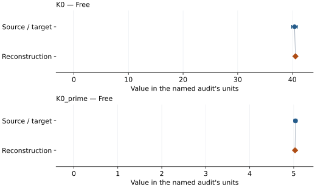

This is a **coefficient comparison**, not an observation or residual plot.
Each panel uses its coefficient's audit units and includes zero. Markers show
stored central values only. Error widths are retained in the table below;
no confidence interval or uncertainty band is inferred. Fixed/adopted values are constraints.

| Parameter | Source / target | Source error | Reconstruction | Reconstruction error | Fit role |
| --- | --- | --- | --- | --- | --- |
| K0 | 40.4 | 0.54 | 40.569075115357755 | Not specified | Free |
| K0\_prime | 5.04 | 0.04 | 5.030917242895907 | Not specified | Free |

Values and reported errors are copied without rounding or conversion from the named audit. Missing errors mean unknown, not zero. Parameter names and volume conventions follow that audit; error widths do not imply a confidence convention.

Recorded diagnostics, covariance and additional protocol

- **Rmse gpa:** 1.8395355775985864
- **Published rmse gpa:** 1.8460788926566665

### Detailed evidence and existing plots

- [Supporting source report: sakai-2011-nacl-b2](../literature-reproductions/sakai-2011-nacl-b2.md).
- [Record-by-record numerical ledger](../primary-eos-refits.md#records).
- [Source-audit reports](../source-audits.md).

Observation curves and residual plots are provided by the supporting reports where available. Their absence is not filled by a reconstructed curve presented as measured data.

[Machine-readable comparison ledger](https://github.com/CPrescher/peritheos/blob/main/docs/data/primary-eos-refits.json) — look up `nacl_b2_sakai_2011_matsui_pt_vinet`.
[Complete native EOSMAT file](https://github.com/CPrescher/peritheos/blob/main/peritheos/data/materials/nacl_b2.eosmat).

## Sakai et al. (2011), NaCl-B2 BM3, Fei et al. (2007) Pt scale

Record: `nacl_b2_sakai_2011_fei_pt_bm3` · Model: `BM3`

**Outcome: Coefficient parity achieved.**

**Scope:** Comparison with the source parameterization.
**Comparison basis:** Conditional fixed-V0 comparison under the documented diagnostic protocol; original source weighting and workflow are not established.

[Stored EOS coefficients and source](../material-summaries/nacl_b2.md#record-nacl_b2_sakai_2011_fei_pt_bm3)

### What this result establishes

**Separate source-review status:** primary\_source\_validated.
**Usage recommendation:** See the stored EOS qualifications; no recommendation is inferred here.

- Conditional diagnostic, not exact source-regression recovery: source weights and Pt peak-combination rule are unspecified. Sata pressures reconstructed from equal-weight cubic Pt lattice parameters. Staged V0 and selection/objective sensitivity documented in sakai-2011-nacl-b2 reproduction; published parameters unchanged.
- This named numerical assessment alone does not establish author-workflow reproduction, physical accuracy or recommendation for use.

### Data and reconstruction method

- **Dataset identifiers:** nacl\_b2\_sakai\_2011\_table1; nacl\_b2\_sata\_2002\_table1\_sakai\_input
- **Observations:** 54
- **Fit kind:** primary\_table\_fixed\_V0\_bm3\_or\_vinet
- **Selection:** 27 Sakai rows plus 27 Sata rows after explicit exclusions 8 and 11; annealed-only selection retained as sensitivity
- **Objective:** unweighted\_pressure\_residuals
- **Free parameters:** K0; K0\_prime
- **Fixed parameters:** V0

Unspecified selections, weights, fixed values or error conventions remain unknown; they have not been inferred for this report.

### Source versus reconstruction

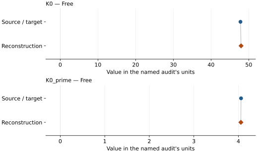

This is a **coefficient comparison**, not an observation or residual plot.
Each panel uses its coefficient's audit units and includes zero. Markers show
stored central values only. Error widths are retained in the table below;
no confidence interval or uncertainty band is inferred. Fixed/adopted values are constraints.

| Parameter | Source / target | Source error | Reconstruction | Reconstruction error | Fit role |
| --- | --- | --- | --- | --- | --- |
| K0 | 47.8 | 0.45 | 47.956343900334645 | Not specified | Free |
| K0\_prime | 4.06 | 0.02 | 4.056035057095808 | Not specified | Free |

Values and reported errors are copied without rounding or conversion from the named audit. Missing errors mean unknown, not zero. Parameter names and volume conventions follow that audit; error widths do not imply a confidence convention.

Recorded diagnostics, covariance and additional protocol

- **Rmse gpa:** 1.669898938809278
- **Published rmse gpa:** 1.6803982142212028

### Detailed evidence and existing plots

- [Supporting source report: sakai-2011-nacl-b2](../literature-reproductions/sakai-2011-nacl-b2.md).
- [Record-by-record numerical ledger](../primary-eos-refits.md#records).
- [Source-audit reports](../source-audits.md).

Observation curves and residual plots are provided by the supporting reports where available. Their absence is not filled by a reconstructed curve presented as measured data.

[Machine-readable comparison ledger](https://github.com/CPrescher/peritheos/blob/main/docs/data/primary-eos-refits.json) — look up `nacl_b2_sakai_2011_fei_pt_bm3`.
[Complete native EOSMAT file](https://github.com/CPrescher/peritheos/blob/main/peritheos/data/materials/nacl_b2.eosmat).

## Sakai et al. (2011), NaCl-B2 Vinet, Fei et al. (2007) Pt scale

Record: `nacl_b2_sakai_2011_fei_pt_vinet` · Model: `Vinet`

**Outcome: Coefficient parity achieved.**

**Scope:** Comparison with the source parameterization.
**Comparison basis:** Conditional fixed-V0 comparison under the documented diagnostic protocol; original source weighting and workflow are not established.

[Stored EOS coefficients and source](../material-summaries/nacl_b2.md#record-nacl_b2_sakai_2011_fei_pt_vinet)

### What this result establishes

**Separate source-review status:** primary\_source\_validated.
**Usage recommendation:** See the stored EOS qualifications; no recommendation is inferred here.

- Conditional diagnostic, not exact source-regression recovery: source weights and Pt peak-combination rule are unspecified. Sata pressures reconstructed from equal-weight cubic Pt lattice parameters. Staged V0 and selection/objective sensitivity documented in sakai-2011-nacl-b2 reproduction; published parameters unchanged.
- This named numerical assessment alone does not establish author-workflow reproduction, physical accuracy or recommendation for use.

### Data and reconstruction method

- **Dataset identifiers:** nacl\_b2\_sakai\_2011\_table1; nacl\_b2\_sata\_2002\_table1\_sakai\_input
- **Observations:** 54
- **Fit kind:** primary\_table\_fixed\_V0\_bm3\_or\_vinet
- **Selection:** 27 Sakai rows plus 27 Sata rows after explicit exclusions 8 and 11; annealed-only selection retained as sensitivity
- **Objective:** unweighted\_pressure\_residuals
- **Free parameters:** K0; K0\_prime
- **Fixed parameters:** V0

Unspecified selections, weights, fixed values or error conventions remain unknown; they have not been inferred for this report.

### Source versus reconstruction

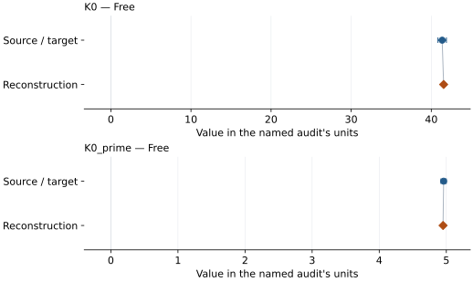

This is a **coefficient comparison**, not an observation or residual plot.
Each panel uses its coefficient's audit units and includes zero. Markers show
stored central values only. Error widths are retained in the table below;
no confidence interval or uncertainty band is inferred. Fixed/adopted values are constraints.

| Parameter | Source / target | Source error | Reconstruction | Reconstruction error | Fit role |
| --- | --- | --- | --- | --- | --- |
| K0 | 41.36 | 0.53 | 41.542728987872216 | Not specified | Free |
| K0\_prime | 4.96 | 0.04 | 4.9512824151430905 | Not specified | Free |

Values and reported errors are copied without rounding or conversion from the named audit. Missing errors mean unknown, not zero. Parameter names and volume conventions follow that audit; error widths do not imply a confidence convention.

Recorded diagnostics, covariance and additional protocol

- **Rmse gpa:** 1.7942403376763154
- **Published rmse gpa:** 1.806433366215317

### Detailed evidence and existing plots

- [Supporting source report: sakai-2011-nacl-b2](../literature-reproductions/sakai-2011-nacl-b2.md).
- [Record-by-record numerical ledger](../primary-eos-refits.md#records).
- [Source-audit reports](../source-audits.md).

Observation curves and residual plots are provided by the supporting reports where available. Their absence is not filled by a reconstructed curve presented as measured data.

[Machine-readable comparison ledger](https://github.com/CPrescher/peritheos/blob/main/docs/data/primary-eos-refits.json) — look up `nacl_b2_sakai_2011_fei_pt_vinet`.
[Complete native EOSMAT file](https://github.com/CPrescher/peritheos/blob/main/peritheos/data/materials/nacl_b2.eosmat).

## Sakai et al. (2011), NaCl-B2 BM3, Dorogokupets and Oganov (2007) Pt scale

Record: `nacl_b2_sakai_2011_do_pt_bm3` · Model: `BM3`

**Outcome: Coefficient parity achieved.**

**Scope:** Comparison with the source parameterization.
**Comparison basis:** Conditional fixed-V0 comparison under the documented diagnostic protocol; original source weighting and workflow are not established.

[Stored EOS coefficients and source](../material-summaries/nacl_b2.md#record-nacl_b2_sakai_2011_do_pt_bm3)

### What this result establishes

**Separate source-review status:** primary\_source\_validated.
**Usage recommendation:** See the stored EOS qualifications; no recommendation is inferred here.

- Conditional diagnostic, not exact source-regression recovery: source weights and Pt peak-combination rule are unspecified. Sata pressures reconstructed from equal-weight cubic Pt lattice parameters. Staged V0 and selection/objective sensitivity documented in sakai-2011-nacl-b2 reproduction; published parameters unchanged.
- This named numerical assessment alone does not establish author-workflow reproduction, physical accuracy or recommendation for use.

### Data and reconstruction method

- **Dataset identifiers:** nacl\_b2\_sakai\_2011\_table1; nacl\_b2\_sata\_2002\_table1\_sakai\_input
- **Observations:** 54
- **Fit kind:** primary\_table\_fixed\_V0\_bm3\_or\_vinet
- **Selection:** 27 Sakai rows plus 27 Sata rows after explicit exclusions 8 and 11; annealed-only selection retained as sensitivity
- **Objective:** unweighted\_pressure\_residuals
- **Free parameters:** K0; K0\_prime
- **Fixed parameters:** V0

Unspecified selections, weights, fixed values or error conventions remain unknown; they have not been inferred for this report.

### Source versus reconstruction

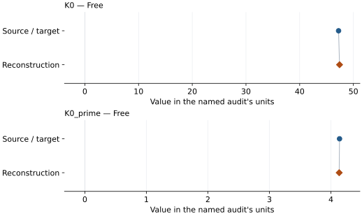

This is a **coefficient comparison**, not an observation or residual plot.
Each panel uses its coefficient's audit units and includes zero. Markers show
stored central values only. Error widths are retained in the table below;
no confidence interval or uncertainty band is inferred. Fixed/adopted values are constraints.

| Parameter | Source / target | Source error | Reconstruction | Reconstruction error | Fit role |
| --- | --- | --- | --- | --- | --- |
| K0 | 47.24 | 0.47 | 47.41982661181846 | Not specified | Free |
| K0\_prime | 4.14 | 0.02 | 4.134367448142497 | Not specified | Free |

Values and reported errors are copied without rounding or conversion from the named audit. Missing errors mean unknown, not zero. Parameter names and volume conventions follow that audit; error widths do not imply a confidence convention.

Recorded diagnostics, covariance and additional protocol

- **Rmse gpa:** 1.751572038560592
- **Published rmse gpa:** 1.758957818379996

### Detailed evidence and existing plots

- [Supporting source report: sakai-2011-nacl-b2](../literature-reproductions/sakai-2011-nacl-b2.md).
- [Record-by-record numerical ledger](../primary-eos-refits.md#records).
- [Source-audit reports](../source-audits.md).

Observation curves and residual plots are provided by the supporting reports where available. Their absence is not filled by a reconstructed curve presented as measured data.

[Machine-readable comparison ledger](https://github.com/CPrescher/peritheos/blob/main/docs/data/primary-eos-refits.json) — look up `nacl_b2_sakai_2011_do_pt_bm3`.
[Complete native EOSMAT file](https://github.com/CPrescher/peritheos/blob/main/peritheos/data/materials/nacl_b2.eosmat).

## Sakai et al. (2011), NaCl-B2 Vinet, Dorogokupets and Oganov (2007) Pt scale

Record: `nacl_b2_sakai_2011_do_pt_vinet` · Model: `Vinet`

**Outcome: Coefficient parity achieved.**

**Scope:** Comparison with the source parameterization.
**Comparison basis:** Conditional fixed-V0 comparison under the documented diagnostic protocol; original source weighting and workflow are not established.

[Stored EOS coefficients and source](../material-summaries/nacl_b2.md#record-nacl_b2_sakai_2011_do_pt_vinet)

### What this result establishes

**Separate source-review status:** primary\_source\_validated.
**Usage recommendation:** See the stored EOS qualifications; no recommendation is inferred here.

- Conditional diagnostic, not exact source-regression recovery: source weights and Pt peak-combination rule are unspecified. Sata pressures reconstructed from equal-weight cubic Pt lattice parameters. Staged V0 and selection/objective sensitivity documented in sakai-2011-nacl-b2 reproduction; published parameters unchanged.
- This named numerical assessment alone does not establish author-workflow reproduction, physical accuracy or recommendation for use.

### Data and reconstruction method

- **Dataset identifiers:** nacl\_b2\_sakai\_2011\_table1; nacl\_b2\_sata\_2002\_table1\_sakai\_input
- **Observations:** 54
- **Fit kind:** primary\_table\_fixed\_V0\_bm3\_or\_vinet
- **Selection:** 27 Sakai rows plus 27 Sata rows after explicit exclusions 8 and 11; annealed-only selection retained as sensitivity
- **Objective:** unweighted\_pressure\_residuals
- **Free parameters:** K0; K0\_prime
- **Fixed parameters:** V0

Unspecified selections, weights, fixed values or error conventions remain unknown; they have not been inferred for this report.

### Source versus reconstruction

This is a **coefficient comparison**, not an observation or residual plot.
Each panel uses its coefficient's audit units and includes zero. Markers show
stored central values only. Error widths are retained in the table below;
no confidence interval or uncertainty band is inferred. Fixed/adopted values are constraints.

| Parameter | Source / target | Source error | Reconstruction | Reconstruction error | Fit role |
| --- | --- | --- | --- | --- | --- |
| K0 | 40.37 | 0.55 | 40.571822361844646 | Not specified | Free |
| K0\_prime | 5.11 | 0.04 | 5.100330569110553 | Not specified | Free |

Values and reported errors are copied without rounding or conversion from the named audit. Missing errors mean unknown, not zero. Parameter names and volume conventions follow that audit; error widths do not imply a confidence convention.

Recorded diagnostics, covariance and additional protocol

- **Rmse gpa:** 1.9102536236213106
- **Published rmse gpa:** 1.927095895583068

### Detailed evidence and existing plots

- [Supporting source report: sakai-2011-nacl-b2](../literature-reproductions/sakai-2011-nacl-b2.md).
- [Record-by-record numerical ledger](../primary-eos-refits.md#records).
- [Source-audit reports](../source-audits.md).

Observation curves and residual plots are provided by the supporting reports where available. Their absence is not filled by a reconstructed curve presented as measured data.

[Machine-readable comparison ledger](https://github.com/CPrescher/peritheos/blob/main/docs/data/primary-eos-refits.json) — look up `nacl_b2_sakai_2011_do_pt_vinet`.
[Complete native EOSMAT file](https://github.com/CPrescher/peritheos/blob/main/peritheos/data/materials/nacl_b2.eosmat).

## Sakai et al. (2011), NaCl-B2 BM3, Holmes et al. (1989) Pt scale

Record: `nacl_b2_sakai_2011_holmes_pt_bm3` · Model: `BM3`

**Outcome: Coefficient parity achieved.**

**Scope:** Comparison with the source parameterization.
**Comparison basis:** Conditional fixed-V0 comparison under the documented diagnostic protocol; original source weighting and workflow are not established.

[Stored EOS coefficients and source](../material-summaries/nacl_b2.md#record-nacl_b2_sakai_2011_holmes_pt_bm3)

### What this result establishes

**Separate source-review status:** primary\_source\_validated.
**Usage recommendation:** See the stored EOS qualifications; no recommendation is inferred here.

- Conditional diagnostic, not exact source-regression recovery: source weights and Pt peak-combination rule are unspecified. Sata pressures reconstructed from equal-weight cubic Pt lattice parameters. Staged V0 and selection/objective sensitivity documented in sakai-2011-nacl-b2 reproduction; published parameters unchanged.
- This named numerical assessment alone does not establish author-workflow reproduction, physical accuracy or recommendation for use.

### Data and reconstruction method

- **Dataset identifiers:** nacl\_b2\_sakai\_2011\_table1; nacl\_b2\_sata\_2002\_table1\_sakai\_input
- **Observations:** 54
- **Fit kind:** primary\_table\_fixed\_V0\_bm3\_or\_vinet
- **Selection:** 27 Sakai rows plus 27 Sata rows after explicit exclusions 8 and 11; annealed-only selection retained as sensitivity
- **Objective:** unweighted\_pressure\_residuals
- **Free parameters:** K0; K0\_prime
- **Fixed parameters:** V0

Unspecified selections, weights, fixed values or error conventions remain unknown; they have not been inferred for this report.

### Source versus reconstruction

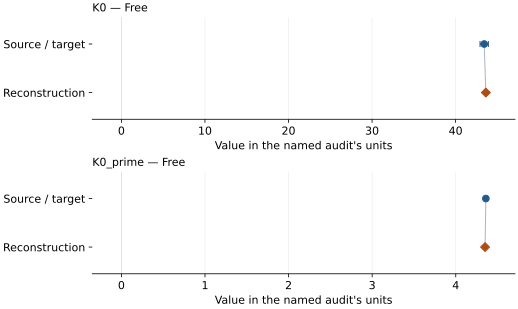

This is a **coefficient comparison**, not an observation or residual plot.
Each panel uses its coefficient's audit units and includes zero. Markers show
stored central values only. Error widths are retained in the table below;
no confidence interval or uncertainty band is inferred. Fixed/adopted values are constraints.

| Parameter | Source / target | Source error | Reconstruction | Reconstruction error | Fit role |
| --- | --- | --- | --- | --- | --- |
| K0 | 43.42 | 0.5 | 43.61799899381413 | Not specified | Free |
| K0\_prime | 4.36 | 0.02 | 4.3505817564940275 | Not specified | Free |

Values and reported errors are copied without rounding or conversion from the named audit. Missing errors mean unknown, not zero. Parameter names and volume conventions follow that audit; error widths do not imply a confidence convention.

Recorded diagnostics, covariance and additional protocol

- **Rmse gpa:** 1.9041763407754038
- **Published rmse gpa:** 1.9070710376559392

### Detailed evidence and existing plots

- [Supporting source report: sakai-2011-nacl-b2](../literature-reproductions/sakai-2011-nacl-b2.md).
- [Record-by-record numerical ledger](../primary-eos-refits.md#records).
- [Source-audit reports](../source-audits.md).

Observation curves and residual plots are provided by the supporting reports where available. Their absence is not filled by a reconstructed curve presented as measured data.

[Machine-readable comparison ledger](https://github.com/CPrescher/peritheos/blob/main/docs/data/primary-eos-refits.json) — look up `nacl_b2_sakai_2011_holmes_pt_bm3`.
[Complete native EOSMAT file](https://github.com/CPrescher/peritheos/blob/main/peritheos/data/materials/nacl_b2.eosmat).

## Sakai et al. (2011), NaCl-B2 Vinet, Holmes et al. (1989) Pt scale

Record: `nacl_b2_sakai_2011_holmes_pt_vinet` · Model: `Vinet`

**Outcome: Coefficient parity achieved.**

**Scope:** Comparison with the source parameterization.
**Comparison basis:** Conditional fixed-V0 comparison under the documented diagnostic protocol; original source weighting and workflow are not established.

[Stored EOS coefficients and source](../material-summaries/nacl_b2.md#record-nacl_b2_sakai_2011_holmes_pt_vinet)

### What this result establishes

**Separate source-review status:** primary\_source\_validated.
**Usage recommendation:** See the stored EOS qualifications; no recommendation is inferred here.

- Conditional diagnostic, not exact source-regression recovery: source weights and Pt peak-combination rule are unspecified. Sata pressures reconstructed from equal-weight cubic Pt lattice parameters. Staged V0 and selection/objective sensitivity documented in sakai-2011-nacl-b2 reproduction; published parameters unchanged.
- This named numerical assessment alone does not establish author-workflow reproduction, physical accuracy or recommendation for use.

### Data and reconstruction method

- **Dataset identifiers:** nacl\_b2\_sakai\_2011\_table1; nacl\_b2\_sata\_2002\_table1\_sakai\_input
- **Observations:** 54
- **Fit kind:** primary\_table\_fixed\_V0\_bm3\_or\_vinet
- **Selection:** 27 Sakai rows plus 27 Sata rows after explicit exclusions 8 and 11; annealed-only selection retained as sensitivity
- **Objective:** unweighted\_pressure\_residuals
- **Free parameters:** K0; K0\_prime
- **Fixed parameters:** V0

Unspecified selections, weights, fixed values or error conventions remain unknown; they have not been inferred for this report.

### Source versus reconstruction

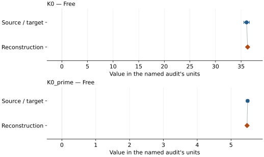

This is a **coefficient comparison**, not an observation or residual plot.
Each panel uses its coefficient's audit units and includes zero. Markers show
stored central values only. Error widths are retained in the table below;
no confidence interval or uncertainty band is inferred. Fixed/adopted values are constraints.

| Parameter | Source / target | Source error | Reconstruction | Reconstruction error | Fit role |
| --- | --- | --- | --- | --- | --- |
| K0 | 36.07 | 0.54 | 36.270653210568085 | Not specified | Free |
| K0\_prime | 5.49 | 0.04 | 5.47382474752777 | Not specified | Free |

Values and reported errors are copied without rounding or conversion from the named audit. Missing errors mean unknown, not zero. Parameter names and volume conventions follow that audit; error widths do not imply a confidence convention.

Recorded diagnostics, covariance and additional protocol

- **Rmse gpa:** 2.1397727210913047
- **Published rmse gpa:** 2.1441274596796984

### Detailed evidence and existing plots

- [Supporting source report: sakai-2011-nacl-b2](../literature-reproductions/sakai-2011-nacl-b2.md).
- [Record-by-record numerical ledger](../primary-eos-refits.md#records).
- [Source-audit reports](../source-audits.md).

Observation curves and residual plots are provided by the supporting reports where available. Their absence is not filled by a reconstructed curve presented as measured data.

[Machine-readable comparison ledger](https://github.com/CPrescher/peritheos/blob/main/docs/data/primary-eos-refits.json) — look up `nacl_b2_sakai_2011_holmes_pt_vinet`.
[Complete native EOSMAT file](https://github.com/CPrescher/peritheos/blob/main/peritheos/data/materials/nacl_b2.eosmat).

## Fei et al. (2007), NaCl-B2 Vinet-MGD pressure scale

Record: `nacl_b2_fei_2007` · Model: `Vinet`

**Outcome: Parity not achieved for this comparison.**

**Scope:** Comparison with the source parameterization.
**Comparison basis:** Twelve Figure 3 cold markers set K0/K0-prime, then twelve Figure 4 hot markers set q with the cold fit frozen. The duplicated Figure 4 cold markers and calculated curves are excluded. The staged hot fit does not recover published q; source errors, measured Pt volumes, original weights and covariance are unavailable. Conditional fit errors do not propagate cold-stage uncertainty. Cold and hot residual summaries remain separate.

[Stored EOS coefficients and source](../material-summaries/nacl_b2.md#record-nacl_b2_fei_2007)

### What this result establishes

**Separate source-review status:** primary\_source\_validated.
**Usage recommendation:** See the stored EOS qualifications; no recommendation is inferred here.

- This named numerical assessment alone does not establish author-workflow reproduction, physical accuracy or recommendation for use.

### Data and reconstruction method

- **Dataset identifiers:** nacl\_b2\_fei\_2007\_figure3\_digitized; nacl\_b2\_fei\_2007\_figure4\_digitized
- **Observations:** 24
- **Fit kind:** diagnostic\_staged\_figure\_pvt
- **Free parameters:** K0; K0\_prime; q
- **Fixed parameters:** V0; gamma0; theta0; n; Tr

Unspecified selections, weights, fixed values or error conventions remain unknown; they have not been inferred for this report.

### Source versus reconstruction

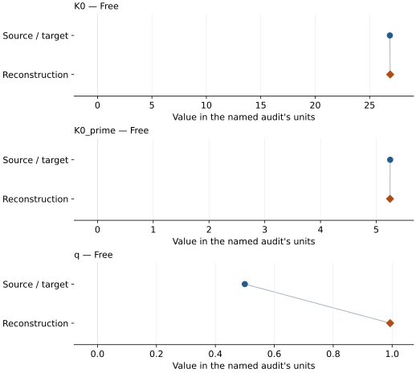

This is a **coefficient comparison**, not an observation or residual plot.
Each panel uses its coefficient's audit units and includes zero. Markers show
stored central values only. Error widths are retained in the table below;
no confidence interval or uncertainty band is inferred. Fixed/adopted values are constraints.

| Parameter | Source / target | Source error | Reconstruction | Reconstruction error | Fit role |
| --- | --- | --- | --- | --- | --- |
| K0 | 26.86 | 2.9 | 26.88910688628862 | 2.129618146414732 | Free |
| K0\_prime | 5.25 | 0.26 | 5.246912395711911 | 0.2700688894059465 | Free |
| q | 0.5 | 0.3 | 0.9933854990920269 | 0.4388146078612062 | Free |

Values and reported errors are copied without rounding or conversion from the named audit. Missing errors mean unknown, not zero. Parameter names and volume conventions follow that audit; error widths do not imply a confidence convention.

Recorded diagnostics, covariance and additional protocol

- **Solver success:** True

### Detailed evidence and existing plots

- [Earlier detailed record investigation](../primary-eos-refits.md#investigation-nacl_b2_fei_2007).
- [Related illustrated report explicitly naming this EOS: fei-2007-nacl-b2](../literature-reproductions/fei-2007-nacl-b2.md).
- [Record-by-record numerical ledger](../primary-eos-refits.md#records).
- [Source-audit reports](../source-audits.md).

Observation curves and residual plots are provided by the supporting reports where available. Their absence is not filled by a reconstructed curve presented as measured data.

[Machine-readable comparison ledger](https://github.com/CPrescher/peritheos/blob/main/docs/data/primary-eos-refits.json) — look up `nacl_b2_fei_2007`.
[Complete native EOSMAT file](https://github.com/CPrescher/peritheos/blob/main/peritheos/data/materials/nacl_b2.eosmat).

## Peritheos refit: Fei (2007) NaCl-B2 digitized cold + 1000 K data

Record: `nacl_b2_fei_2007_staged_thermal_refit` · Model: `Vinet`

**Outcome: Coefficient parity achieved.**

**Scope:** Reproduction of a stored independent Peritheos refit.
**Comparison basis:** Reproduction of the registered Peritheos refit's stored coefficients under its declared protocol.

[Stored EOS coefficients and source](../material-summaries/nacl_b2.md#record-nacl_b2_fei_2007_staged_thermal_refit)

### What this result establishes

**Separate source-review status:** primary\_source\_validated.
**Usage recommendation:** See the stored EOS qualifications; no recommendation is inferred here.

- This comparison concerns the stored independent Peritheos refit, not recovery of the original publication's coefficients or author workflow.
- Independent Peritheos staged refit of digitized Fei (2007) NaCl-B2 study markers: 12 Figure 3 rows at 300 K determine K0/K0-prime with V0 fixed; then all 12 Figure 4 rows at 1000 K determine q with the cold fit frozen. The printed variable-exponent Debye law, V0, gamma0 and theta0 are inherited from the published record. Equal pressure weights are an analyst choice. Duplicate Figure 4 cold markers, other-paper comparisons and calculated curve vertices are excluded. This is a conditional figure-data refit, not reproduction of the authors' fit or independent validation of pressure accuracy. Original unrounded measurements, P/V/T errors, measured Pt cells, source weights and calibration covariance remain unavailable. Conditional stage errors are archived in fit statistics only; catalog parameter errors and covariance are unset because predictor, calibrant, fixed-anchor and inter-stage uncertainty are not propagated. Coverage consists of separate 300 and 1000 K series, not a validated P-T rectangle.
- Original publication reproduction status: not\_reproduced

### Data and reconstruction method

The source/target column below is the stored **Peritheos refit**. Agreement with it does not reproduce the original publication's coefficients.

- **Dataset identifiers:** nacl\_b2\_fei\_2007\_figure3\_digitized; nacl\_b2\_fei\_2007\_figure4\_digitized
- **Observations:** 24
- **Fit kind:** stored\_staged\_thermal\_refit\_reproduction
- **Objective:** At each stage minimize sum((P\_model(V,T)-P\_digitized)^2) in GPa^2 with equal pressure-residual weights; cold K0/K0\_prime first, then hot q with the cold fit frozen.
- **Free parameters:** K0; K0\_prime; q
- **Fixed parameters:** V0; gamma0; theta0; n; Tr

Unspecified selections, weights, fixed values or error conventions remain unknown; they have not been inferred for this report.

### Source versus reconstruction

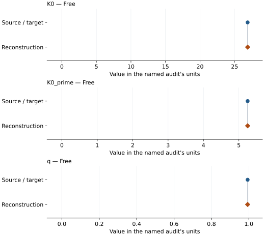

This is a **coefficient comparison**, not an observation or residual plot.
Each panel uses its coefficient's audit units and includes zero. Markers show
stored central values only. Error widths are retained in the table below;
no confidence interval or uncertainty band is inferred. Fixed/adopted values are constraints.

| Parameter | Source / target | Source error | Reconstruction | Reconstruction error | Fit role |
| --- | --- | --- | --- | --- | --- |
| K0 | 26.88910688628862 | Not specified | 26.88910688628862 | 2.129618146414732 | Free |
| K0\_prime | 5.246912395711911 | Not specified | 5.246912395711911 | 0.2700688894059465 | Free |
| q | 0.9933854990920269 | Not specified | 0.9933854990920269 | 0.4388146078612062 | Free |

Values and reported errors are copied without rounding or conversion from the named audit. Missing errors mean unknown, not zero. Parameter names and volume conventions follow that audit; error widths do not imply a confidence convention.

Recorded diagnostics, covariance and additional protocol

- **Solver success:** True

### Detailed evidence and existing plots

- [Related illustrated report explicitly naming this EOS: fei-2007-nacl-b2](../literature-reproductions/fei-2007-nacl-b2.md).
- [Record-by-record numerical ledger](../primary-eos-refits.md#records).
- [Source-audit reports](../source-audits.md).

Observation curves and residual plots are provided by the supporting reports where available. Their absence is not filled by a reconstructed curve presented as measured data.

[Machine-readable comparison ledger](https://github.com/CPrescher/peritheos/blob/main/docs/data/primary-eos-refits.json) — look up `nacl_b2_fei_2007_staged_thermal_refit`.
[Complete native EOSMAT file](https://github.com/CPrescher/peritheos/blob/main/peritheos/data/materials/nacl_b2.eosmat).
