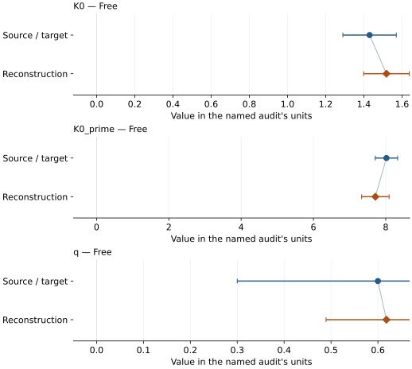
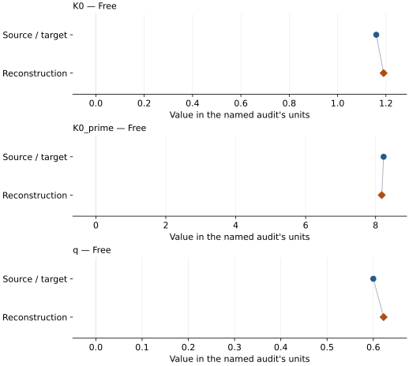
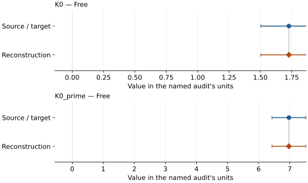

# Neon (fcc): EOS reconstruction reports

<!-- Generated by scripts.generate_reconstruction_reports; edit EOSMAT instead. -->

[All reconstruction reports](index.md) · [Material and EOS parameters](../material-summaries/neon_fcc.md)

These reports explain the assessments already stored in EOSMAT. Generating
this page does not refit observations, change classifications or replace source coefficients.

Use [scientific label definitions](../eos-labels.md) to distinguish coefficient
agreement, source verification, author-workflow reproduction and recommendation for use.

| EOS record | Recorded outcome | Coefficient comparison |
| --- | --- | --- |
| [Fei et al PNAS 2007 \[BM3\]](#record-neon_fcc_fei_2007_bm3_1) | Coefficient parity achieved | Graph and table |
| [Fei et al PNAS 2007 \[Vinet\]](#record-neon_fcc_fei_2007_vinet_2) | Coefficient parity achieved | Graph and table |
| [Hemley et al. (1989) Table I direct 300 K BM3 refit](#record-neon_fcc_hemley_1989_bm3_refit) | Coefficient parity achieved | Graph and table |

## Fei et al PNAS 2007 \[BM3\]

Record: `neon_fcc_fei_2007_bm3_1` · Model: `BM3`

**Outcome: Coefficient parity achieved.**

**Scope:** Comparison with the source parameterization.
**Comparison basis:** Conditional equal-pressure-weight joint PVT agreement within published parameter widths; source confidence and covariance are unspecified.

[Stored EOS coefficients and source](../material-summaries/neon_fcc.md#record-neon_fcc_fei_2007_bm3_1)

### What this result establishes

**Separate source-review status:** primary\_source\_validated.
**Usage recommendation:** See the stored EOS qualifications; no recommendation is inferred here.

- Fei original new observations, paired Pt/Au volumes, full source selection, weights, covariance and unrounded inputs not recovered. Cold unweighted fits can agree with individual published error widths without reproducing the original regression or joint uncertainty region. Only prior-table source errors permit source-error-weighted comparisons. Hot source errors and temperature errors are absent; no source-error-weighted hot fit is possible. Effective error weights use slopes of the published model, ignore shared calibration correlations and retain each table's original pressure/volume errors. Finger 293 K pressures are preserved on the original Piermarini scale; Fei explicitly recalibrates Hemley only. Assigning Finger to 300 K is a documented diagnostic choice. Curve agreement validates an equation/normalization at plotted conditions; it establishes neither exact original-regression recovery nor absolute pressure accuracy. Dewaele (2008) note29 discusses a 0 K reinterpretation and contains a self-referential citation typo. Fei Eq.3 and the Figure5 cold curve remain the authority for the retained 300 K subtraction. Published q error is 0.3; source confidence level and covariance are unspecified. No thermal diagnostic replaces published q=0.6.
- This named numerical assessment alone does not establish author-workflow reproduction, physical accuracy or recommendation for use.

### Data and reconstruction method

- **Dataset identifiers:** neon\_fei\_2007\_figure5\_digitized; neon\_hemley\_1989\_table1\_fei\_recalculated; neon\_finger\_1981\_table1; neon\_fei\_2007\_figure5\_1000k\_digitized
- **Observations:** 54
- **Fit kind:** diagnostic\_joint\_pvt
- **Free parameters:** K0; K0\_prime; q
- **Fixed parameters:**
    - **V0:** 88.967
    - **Gamma0:** 2.05
    - **Theta0:** 75.1

Unspecified selections, weights, fixed values or error conventions remain unknown; they have not been inferred for this report.

### Source versus reconstruction

This is a **coefficient comparison**, not an observation or residual plot.
Each panel uses its coefficient's audit units and includes zero. Markers show
stored central values only. Error widths are retained in the table below;
no confidence interval or uncertainty band is inferred. Fixed/adopted values are constraints.

| Parameter | Source / target | Source error | Reconstruction | Reconstruction error | Fit role |
| --- | --- | --- | --- | --- | --- |
| K0 | 1.43 | 0.14 | 1.5182220582605885 | 0.1195033052004044 | Free |
| K0\_prime | 8.02 | 0.31 | 7.713752591624531 | 0.38055629711750694 | Free |
| q | 0.6 | 0.3 | 0.6181752608698434 | 0.12877065447628067 | Free |

Values and reported errors are copied without rounding or conversion from the named audit. Missing errors mean unknown, not zero. Parameter names and volume conventions follow that audit; error widths do not imply a confidence convention.

Recorded diagnostics, covariance and additional protocol

- **Observed pressure range gpa:** \[4.83, 115.715945233\]
- **Observed temperature range k:** \[300.0, 1000.0\]
- **Solver success:** True
- **Rmse gpa:** 0.9968994754037073
- **Published rmse gpa:** 1.0064452317540593

### Detailed evidence and existing plots

- [Supporting source report: fei-2007-neon](../literature-reproductions/fei-2007-neon.md).
- [Record-by-record numerical ledger](../primary-eos-refits.md#records).
- [Source-audit reports](../source-audits.md).

Observation curves and residual plots are provided by the supporting reports where available. Their absence is not filled by a reconstructed curve presented as measured data.

[Machine-readable comparison ledger](https://github.com/CPrescher/peritheos/blob/main/docs/data/primary-eos-refits.json) — look up `neon_fcc_fei_2007_bm3_1`.
[Complete native EOSMAT file](https://github.com/CPrescher/peritheos/blob/main/peritheos/data/materials/neon_fcc.eosmat).

## Fei et al PNAS 2007 \[Vinet\]

Record: `neon_fcc_fei_2007_vinet_2` · Model: `Vinet`

**Outcome: Coefficient parity achieved.**

**Scope:** Comparison with the source parameterization.
**Comparison basis:** Conditional equal-pressure-weight joint PVT agreement within published parameter widths; source confidence and covariance are unspecified.

[Stored EOS coefficients and source](../material-summaries/neon_fcc.md#record-neon_fcc_fei_2007_vinet_2)

### What this result establishes

**Separate source-review status:** primary\_source\_validated.
**Usage recommendation:** See the stored EOS qualifications; no recommendation is inferred here.

- Fei original new observations, paired Pt/Au volumes, full source selection, weights, covariance and unrounded inputs not recovered. Cold unweighted fits can agree with individual published error widths without reproducing the original regression or joint uncertainty region. Only prior-table source errors permit source-error-weighted comparisons. Hot source errors and temperature errors are absent; no source-error-weighted hot fit is possible. Effective error weights use slopes of the published model, ignore shared calibration correlations and retain each table's original pressure/volume errors. Finger 293 K pressures are preserved on the original Piermarini scale; Fei explicitly recalibrates Hemley only. Assigning Finger to 300 K is a documented diagnostic choice. Curve agreement validates an equation/normalization at plotted conditions; it establishes neither exact original-regression recovery nor absolute pressure accuracy. Dewaele (2008) note29 discusses a 0 K reinterpretation and contains a self-referential citation typo. Fei Eq.3 and the Figure5 cold curve remain the authority for the retained 300 K subtraction. Published q error is 0.3; source confidence level and covariance are unspecified. No thermal diagnostic replaces published q=0.6.
- This named numerical assessment alone does not establish author-workflow reproduction, physical accuracy or recommendation for use.

### Data and reconstruction method

- **Dataset identifiers:** neon\_fei\_2007\_figure5\_digitized; neon\_hemley\_1989\_table1\_fei\_recalculated; neon\_finger\_1981\_table1; neon\_fei\_2007\_figure5\_1000k\_digitized
- **Observations:** 54
- **Fit kind:** diagnostic\_joint\_pvt
- **Free parameters:** K0; K0\_prime; q
- **Fixed parameters:**
    - **V0:** 88.967
    - **Gamma0:** 2.05
    - **Theta0:** 75.1

Unspecified selections, weights, fixed values or error conventions remain unknown; they have not been inferred for this report.

### Source versus reconstruction

This is a **coefficient comparison**, not an observation or residual plot.
Each panel uses its coefficient's audit units and includes zero. Markers show
stored central values only. Error widths are retained in the table below;
no confidence interval or uncertainty band is inferred. Fixed/adopted values are constraints.

| Parameter | Source / target | Source error | Reconstruction | Reconstruction error | Fit role |
| --- | --- | --- | --- | --- | --- |
| K0 | 1.16 | 0.14 | 1.1904095828283714 | 0.044824837066523536 | Free |
| K0\_prime | 8.23 | 0.31 | 8.176482612977884 | 0.07713244213469729 | Free |
| q | 0.6 | 0.3 | 0.6222960580475505 | 0.13340786728850254 | Free |

Values and reported errors are copied without rounding or conversion from the named audit. Missing errors mean unknown, not zero. Parameter names and volume conventions follow that audit; error widths do not imply a confidence convention.

Recorded diagnostics, covariance and additional protocol

- **Observed pressure range gpa:** \[4.83, 115.715945233\]
- **Observed temperature range k:** \[300.0, 1000.0\]
- **Solver success:** True
- **Rmse gpa:** 1.0229458085559253
- **Published rmse gpa:** 1.0278664292160768

### Detailed evidence and existing plots

- [Supporting source report: fei-2007-neon](../literature-reproductions/fei-2007-neon.md).
- [Record-by-record numerical ledger](../primary-eos-refits.md#records).
- [Source-audit reports](../source-audits.md).

Observation curves and residual plots are provided by the supporting reports where available. Their absence is not filled by a reconstructed curve presented as measured data.

[Machine-readable comparison ledger](https://github.com/CPrescher/peritheos/blob/main/docs/data/primary-eos-refits.json) — look up `neon_fcc_fei_2007_vinet_2`.
[Complete native EOSMAT file](https://github.com/CPrescher/peritheos/blob/main/peritheos/data/materials/neon_fcc.eosmat).

## Hemley et al. (1989) Table I direct 300 K BM3 refit

Record: `neon_fcc_hemley_1989_bm3_refit` · Model: `BM3`

**Outcome: Coefficient parity achieved.**

**Scope:** Comparison with the source parameterization.
**Comparison basis:** Every compared free coefficient meets both the recorded combined-two-sigma comparison and parameter-specific numerical similarity screen. Error conventions and fit qualifications remain applicable.

[Stored EOS coefficients and source](../material-summaries/neon_fcc.md#record-neon_fcc_hemley_1989_bm3_refit)

### What this result establishes

**Separate source-review status:** primary\_source\_validated.
**Usage recommendation:** See the stored EOS qualifications; no recommendation is inferred here.

- This named numerical assessment alone does not establish author-workflow reproduction, physical accuracy or recommendation for use.

### Data and reconstruction method

- **Dataset identifiers:** neon\_hemley\_1989\_table1\_compression
- **Observations:** 21
- **Fit kind:** isothermal\_pv
- **Selection:** all rows
- **Objective:** errors\_in\_variables
- **Absolute sigma:** True
- **Free parameters:** K0; K0\_prime
- **Fixed parameters:** V0

Unspecified selections, weights, fixed values or error conventions remain unknown; they have not been inferred for this report.

### Source versus reconstruction

This is a **coefficient comparison**, not an observation or residual plot.
Each panel uses its coefficient's audit units and includes zero. Markers show
stored central values only. Error widths are retained in the table below;
no confidence interval or uncertainty band is inferred. Fixed/adopted values are constraints.

| Parameter | Source / target | Source error | Reconstruction | Reconstruction error | Fit role |
| --- | --- | --- | --- | --- | --- |
| K0 | 1.7277462566083195 | 0.22322191999036312 | 1.7277485613618908 | 0.2232218905071419 | Free |
| K0\_prime | 6.972110967032526 | 0.5439133435530098 | 6.972105349252884 | 0.5439118223351491 | Free |

Values and reported errors are copied without rounding or conversion from the named audit. Missing errors mean unknown, not zero. Parameter names and volume conventions follow that audit; error widths do not imply a confidence convention.

Recorded diagnostics, covariance and additional protocol

- **Columns:**
    - **Pressure:** pressure\_gpa
    - **Temperature:** Not specified
    - **Volume:** volume\_a3\_conventional\_cell
- **Observed pressure range gpa:** \[10.0, 110.4\]
- **Observed temperature range k:** Not specified
- **Observed volume range:** \[25.076571983, 45.384685263\]
- **Degrees of freedom:** 19
- **Solver success:** True
- **Solver message:** \`ftol\` termination condition is satisfied.
- **Rmse gpa:** 0.027066792396926876
- **Published rmse gpa:** 0.9156108479099396
- **Reduced chi square:** 0.311633157391931

### Detailed evidence and existing plots

- [Record-by-record numerical ledger](../primary-eos-refits.md#records).
- [Source-audit reports](../source-audits.md).

Observation curves and residual plots are provided by the supporting reports where available. Their absence is not filled by a reconstructed curve presented as measured data.

[Machine-readable comparison ledger](https://github.com/CPrescher/peritheos/blob/main/docs/data/primary-eos-refits.json) — look up `neon_fcc_hemley_1989_bm3_refit`.
[Complete native EOSMAT file](https://github.com/CPrescher/peritheos/blob/main/peritheos/data/materials/neon_fcc.eosmat).
