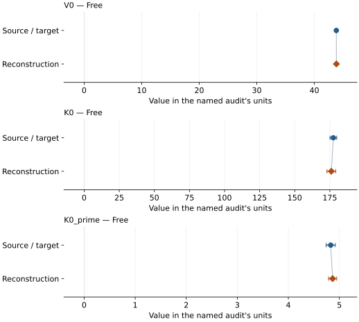
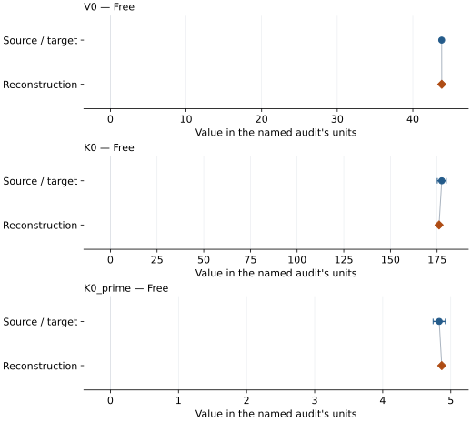
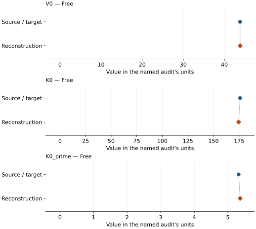
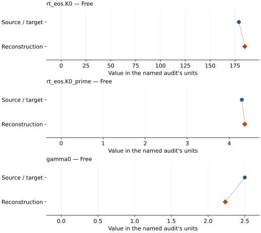

# Nickel: EOS reconstruction reports

<!-- Generated by scripts.generate_reconstruction_reports; edit EOSMAT instead. -->

[All reconstruction reports](index.md) · [Material and EOS parameters](../material-summaries/nickel.md)

These reports explain the assessments already stored in EOSMAT. Generating
this page does not refit observations, change classifications or replace source coefficients.

Use [scientific label definitions](../eos-labels.md) to distinguish coefficient
agreement, source verification, author-workflow reproduction and recommendation for use.

| EOS record | Recorded outcome | Coefficient comparison |
| --- | --- | --- |
| [Dewaele et al. (2008), Vinet](#record-nickel_dewaele_2008_vinet_1) | Numerically similar, with qualifications | Graph and table |
| [Dewaele (2019), Ni MAO-scale Vinet](#record-nickel_dewaele_2019_mao_vinet) | Numerically similar, with qualifications | Graph and table |
| [Dewaele (2019), Ni DOR-scale Vinet](#record-nickel_dewaele_2019_dor_vinet) | Numerically similar, with qualifications | Graph and table |
| [Campbell et al. (2009), fcc Ni, 295 K BM3-Debye](#record-nickel_campbell_2009_bm3_mgd) | Numerically similar, with qualifications | Graph and table |

## Dewaele et al. (2008), Vinet

Record: `nickel_dewaele_2008_vinet_1` · Model: `Vinet`

**Outcome: Numerically similar, with qualifications.**

**Scope:** Comparison with the source parameterization.
**Comparison basis:** Every compared free coefficient meets either the recorded combined-two-sigma comparison or parameter-specific numerical similarity screen; the audit does not classify the complete comparison as parity.

[Stored EOS coefficients and source](../material-summaries/nickel.md#record-nickel_dewaele_2008_vinet_1)

### What this result establishes

**Separate source-review status:** primary\_source\_validated.
**Usage recommendation:** See the stored EOS qualifications; no recommendation is inferred here.

- This named numerical assessment alone does not establish author-workflow reproduction, physical accuracy or recommendation for use.

### Data and reconstruction method

- **Dataset identifiers:** nickel\_dewaele\_2008\_table2\_compression
- **Observations:** 42
- **Fit kind:** isothermal\_pv
- **Selection:** all rows
- **Objective:** pressure\_residuals
- **Absolute sigma:** True
- **Free parameters:** V0; K0; K0\_prime
- **Fixed parameters:** None declared

Unspecified selections, weights, fixed values or error conventions remain unknown; they have not been inferred for this report.

### Source versus reconstruction

This is a **coefficient comparison**, not an observation or residual plot.
Each panel uses its coefficient's audit units and includes zero. Markers show
stored central values only. Error widths are retained in the table below;
no confidence interval or uncertainty band is inferred. Fixed/adopted values are constraints.

| Parameter | Source / target | Source error | Reconstruction | Reconstruction error | Fit role |
| --- | --- | --- | --- | --- | --- |
| V0 | 43.816 | 0.072 | 43.859263314438294 | 0.05651611678809481 | Free |
| K0 | 177.5 | 2.4 | 171.91104099081932 | 3.120778150112471 | Free |
| K0\_prime | 4.83 | 0.09 | 5.332305248001798 | 0.0792067839078175 | Free |

Values and reported errors are copied without rounding or conversion from the named audit. Missing errors mean unknown, not zero. Parameter names and volume conventions follow that audit; error widths do not imply a confidence convention.

Recorded diagnostics, covariance and additional protocol

- **Columns:**
    - **Pressure:** ruby\_pressure\_dewaele\_gpa
    - **Temperature:** Not specified
    - **Volume:** atomic\_volume\_a3
- **Observed pressure range gpa:** \[0.0, 156.6\]
- **Observed temperature range k:** Not specified
- **Observed volume range:** \[30.5116, 43.7692\]
- **Degrees of freedom:** 39
- **Solver success:** True
- **Solver message:** Both \`ftol\` and \`xtol\` termination conditions are satisfied.
- **Rmse gpa:** 0.6038814013928853
- **Published rmse gpa:** 3.3381367238639177
- **Reduced chi square:** 0.39272449671348386

### Detailed evidence and existing plots

- [Earlier detailed record investigation](../primary-eos-refits.md#investigation-nickel_dewaele_2008_vinet_1).
- [Record-by-record numerical ledger](../primary-eos-refits.md#records).
- [Source-audit reports](../source-audits.md).

Observation curves and residual plots are provided by the supporting reports where available. Their absence is not filled by a reconstructed curve presented as measured data.

[Machine-readable comparison ledger](https://github.com/CPrescher/peritheos/blob/main/docs/data/primary-eos-refits.json) — look up `nickel_dewaele_2008_vinet_1`.
[Complete native EOSMAT file](https://github.com/CPrescher/peritheos/blob/main/peritheos/data/materials/nickel.eosmat).

## Dewaele (2019), Ni MAO-scale Vinet

Record: `nickel_dewaele_2019_mao_vinet` · Model: `Vinet`

**Outcome: Numerically similar, with qualifications.**

**Scope:** Comparison with the source parameterization.
**Comparison basis:** Every compared free coefficient meets either the recorded combined-two-sigma comparison or parameter-specific numerical similarity screen; the audit does not classify the complete comparison as parity.

[Stored EOS coefficients and source](../material-summaries/nickel.md#record-nickel_dewaele_2019_mao_vinet)

### What this result establishes

**Separate source-review status:** primary\_source\_validated.
**Usage recommendation:** See the stored EOS qualifications; no recommendation is inferred here.

- Complete source rows for this material are bundled and the dedicated two-ruby-scale refit recovers every coefficient within the published 95% interval. The common ledger classifies the result as similar, not strict parity, because the dedicated audit does not infer a refit covariance from rounded source rows.
- This named numerical assessment alone does not establish author-workflow reproduction, physical accuracy or recommendation for use.

### Data and reconstruction method

- **Dataset identifiers:** nickel\_dewaele\_2008\_table2\_compression
- **Observations:** 42
- **Fit kind:** static\_vinet\_with\_explicit\_ruby\_scale\_conversion
- **Selection:** complete
- **Objective:** unweighted pressure residuals
- **Free parameters:** V0; K0; K0\_prime
- **Fixed parameters:** None declared

Unspecified selections, weights, fixed values or error conventions remain unknown; they have not been inferred for this report.

### Source versus reconstruction

This is a **coefficient comparison**, not an observation or residual plot.
Each panel uses its coefficient's audit units and includes zero. Markers show
stored central values only. Error widths are retained in the table below;
no confidence interval or uncertainty band is inferred. Fixed/adopted values are constraints.

| Parameter | Source / target | Source error | Reconstruction | Reconstruction error | Fit role |
| --- | --- | --- | --- | --- | --- |
| V0 | 43.816 | 0.072 | 43.82740979561661 | Not specified | Free |
| K0 | 177.5 | 2.4 | 176.04926688327072 | Not specified | Free |
| K0\_prime | 4.83 | 0.09 | 4.867459199246375 | Not specified | Free |

Values and reported errors are copied without rounding or conversion from the named audit. Missing errors mean unknown, not zero. Parameter names and volume conventions follow that audit; error widths do not imply a confidence convention.

Recorded diagnostics, covariance and additional protocol

- **Observed pressure range gpa:** \[0.0, 147.4\]
- **Solver success:** True
- **Solver message:** dedicated Dewaele (2019) refit completed
- **Rmse gpa:** 0.6016140965087852

### Detailed evidence and existing plots

- [Earlier detailed record investigation](../primary-eos-refits.md#investigation-nickel_dewaele_2019_mao_vinet).
- [Record-by-record numerical ledger](../primary-eos-refits.md#records).
- [Source-audit reports](../source-audits.md).

Observation curves and residual plots are provided by the supporting reports where available. Their absence is not filled by a reconstructed curve presented as measured data.

[Machine-readable comparison ledger](https://github.com/CPrescher/peritheos/blob/main/docs/data/primary-eos-refits.json) — look up `nickel_dewaele_2019_mao_vinet`.
[Complete native EOSMAT file](https://github.com/CPrescher/peritheos/blob/main/peritheos/data/materials/nickel.eosmat).

## Dewaele (2019), Ni DOR-scale Vinet

Record: `nickel_dewaele_2019_dor_vinet` · Model: `Vinet`

**Outcome: Numerically similar, with qualifications.**

**Scope:** Comparison with the source parameterization.
**Comparison basis:** Every compared free coefficient meets either the recorded combined-two-sigma comparison or parameter-specific numerical similarity screen; the audit does not classify the complete comparison as parity.

[Stored EOS coefficients and source](../material-summaries/nickel.md#record-nickel_dewaele_2019_dor_vinet)

### What this result establishes

**Separate source-review status:** primary\_source\_validated.
**Usage recommendation:** See the stored EOS qualifications; no recommendation is inferred here.

- Complete source rows for this material are bundled and the dedicated two-ruby-scale refit recovers every coefficient within the published 95% interval. The common ledger classifies the result as similar, not strict parity, because the dedicated audit does not infer a refit covariance from rounded source rows.
- This named numerical assessment alone does not establish author-workflow reproduction, physical accuracy or recommendation for use.

### Data and reconstruction method

- **Dataset identifiers:** nickel\_dewaele\_2008\_table2\_compression
- **Observations:** 42
- **Fit kind:** static\_vinet\_with\_explicit\_ruby\_scale\_conversion
- **Selection:** complete
- **Objective:** unweighted pressure residuals
- **Free parameters:** V0; K0; K0\_prime
- **Fixed parameters:** None declared

Unspecified selections, weights, fixed values or error conventions remain unknown; they have not been inferred for this report.

### Source versus reconstruction

This is a **coefficient comparison**, not an observation or residual plot.
Each panel uses its coefficient's audit units and includes zero. Markers show
stored central values only. Error widths are retained in the table below;
no confidence interval or uncertainty band is inferred. Fixed/adopted values are constraints.

| Parameter | Source / target | Source error | Reconstruction | Reconstruction error | Fit role |
| --- | --- | --- | --- | --- | --- |
| V0 | 43.808 | 0.072 | 43.81855566285343 | Not specified | Free |
| K0 | 176.0 | 2.4 | 174.5194065328531 | Not specified | Free |
| K0\_prime | 5.322 | 0.09 | 5.365945691302105 | Not specified | Free |

Values and reported errors are copied without rounding or conversion from the named audit. Missing errors mean unknown, not zero. Parameter names and volume conventions follow that audit; error widths do not imply a confidence convention.

Recorded diagnostics, covariance and additional protocol

- **Observed pressure range gpa:** \[0.0, 158.7461178680547\]
- **Solver success:** True
- **Solver message:** dedicated Dewaele (2019) refit completed
- **Rmse gpa:** 0.6562943317035914

### Detailed evidence and existing plots

- [Earlier detailed record investigation](../primary-eos-refits.md#investigation-nickel_dewaele_2019_dor_vinet).
- [Record-by-record numerical ledger](../primary-eos-refits.md#records).
- [Source-audit reports](../source-audits.md).

Observation curves and residual plots are provided by the supporting reports where available. Their absence is not filled by a reconstructed curve presented as measured data.

[Machine-readable comparison ledger](https://github.com/CPrescher/peritheos/blob/main/docs/data/primary-eos-refits.json) — look up `nickel_dewaele_2019_dor_vinet`.
[Complete native EOSMAT file](https://github.com/CPrescher/peritheos/blob/main/peritheos/data/materials/nickel.eosmat).

## Campbell et al. (2009), fcc Ni, 295 K BM3-Debye

Record: `nickel_campbell_2009_bm3_mgd` · Model: `BM3`

**Outcome: Numerically similar, with qualifications.**

**Scope:** Comparison with the source parameterization.
**Comparison basis:** Every compared free coefficient meets either the recorded combined-two-sigma comparison or parameter-specific numerical similarity screen; the audit does not classify the complete comparison as parity.

[Stored EOS coefficients and source](../material-summaries/nickel.md#record-nickel_campbell_2009_bm3_mgd)

### What this result establishes

**Separate source-review status:** primary\_source\_validated.
**Usage recommendation:** See the stored EOS qualifications; no recommendation is inferred here.

- Conditional reproduction, not an exact recovery of the unpublished regression protocol. Campbell specifies least squares but no residual variable, weights, covariance, or final row mask. The main diagnostic uses equal pressure-residual weights and simultaneous fitting of the three Table 1 free parameters. Fe/FeO main fits use current-study Table S2 only: Seagle contributes 81 recoverable V-T pairs but no individual pressures or NaCl observations. Separate sensitivities reconstruct 65 hcp-calibrated pressures using benchmark-checked Seagle (2006), compare its conflicting reference volumes, and optionally retain 16 unresolved rows as nominal-isobar estimates. A separate protocol audit adds 14 conditional fcc pressures from Funamori/Boehler/Basinski, leaving only two missing-iron-volume rows without individual pressures. The exact historical fcc reduction and combined regression remain unresolved. These are derived pressures, not original row-level pressure data. The published Fe/FeO records are deferred from the executable catalog because the combined-data mismatch remains unresolved. No refitted coefficients replace the source records. See literature-reproductions/campbell-2009-buffers.md.
- This named numerical assessment alone does not establish author-workflow reproduction, physical accuracy or recommendation for use.

### Data and reconstruction method

- **Dataset identifiers:** ni\_nio\_campbell\_2009\_table\_s3\_pvt
- **Observations:** 92
- **Fit kind:** conditional\_bm3\_mgd\_variable\_exponent
- **Selection:** All Table S2 rows for FeO; only its 15 explicitly fcc rows for Fe. For Ni/NiO, retain all 92 heated/MAP Table S3 rows (T&gt;295 K); exclude its nine 293-295 K quenched DAC rows from the main diagnostic. This exclusion follows the Section 2.2 stress warning but is an audit choice: the authors do not publish a regression row mask. All 101 rows are retained in the dataset and tested in a sensitivity refit.
- **Objective:** pressure\_residuals
- **Weighting:** unweighted
- **Free parameters:** rt\_eos.K0; rt\_eos.K0\_prime; gamma0
- **Fixed parameters:** V0; Tr; theta0; n; q

Unspecified selections, weights, fixed values or error conventions remain unknown; they have not been inferred for this report.

### Source versus reconstruction

This is a **coefficient comparison**, not an observation or residual plot.
Each panel uses its coefficient's audit units and includes zero. Markers show
stored central values only. Error widths are retained in the table below;
no confidence interval or uncertainty band is inferred. Fixed/adopted values are constraints.

| Parameter | Source / target | Source error | Reconstruction | Reconstruction error | Fit role |
| --- | --- | --- | --- | --- | --- |
| rt\_eos.K0 | 179.0 | 3.0 | 184.94162448810252 | 9.301918918127576 | Free |
| rt\_eos.K0\_prime | 4.3 | 0.2 | 4.369947088583044 | 0.4759938192780661 | Free |
| gamma0 | 2.5 | 0.06 | 2.2346872736363412 | 0.08731643222377894 | Free |

Values and reported errors are copied without rounding or conversion from the named audit. Missing errors mean unknown, not zero. Parameter names and volume conventions follow that audit; error widths do not imply a confidence convention.

Recorded diagnostics, covariance and additional protocol

- **Observed pressure range gpa:** \[2.336174779961698, 65.9\]
- **Observed temperature range k:** \[298.0, 2457.07\]
- **Degrees of freedom:** 89
- **Solver success:** True
- **Solver message:** \`ftol\` termination condition is satisfied.
- **Rmse gpa:** 1.6636675144162243
- **Published rmse gpa:** 1.8570845659080417
- **Reduced chi square:** 2.8610858771257854
- **Covariance:** \[\[86.52569555941969, -4.3388441574979275, -0.6750521773119051\], \[-4.338844157498334, 0.22657011599092028, 0.030712411253829057\], \[-0.675052177311737, 0.03071241125381744, 0.007624159336289782\]\]
- **Covariance convention:** Residual-scaled local inverse-Jacobian covariance; audit-only, not source errors.

### Detailed evidence and existing plots

- [Earlier detailed record investigation](../primary-eos-refits.md#investigation-nickel_campbell_2009_bm3_mgd).
- [Supporting source report: campbell-2009-buffers](../literature-reproductions/campbell-2009-buffers.md).
- [Record-by-record numerical ledger](../primary-eos-refits.md#records).
- [Source-audit reports](../source-audits.md).

Observation curves and residual plots are provided by the supporting reports where available. Their absence is not filled by a reconstructed curve presented as measured data.

[Machine-readable comparison ledger](https://github.com/CPrescher/peritheos/blob/main/docs/data/primary-eos-refits.json) — look up `nickel_campbell_2009_bm3_mgd`.
[Complete native EOSMAT file](https://github.com/CPrescher/peritheos/blob/main/peritheos/data/materials/nickel.eosmat).
