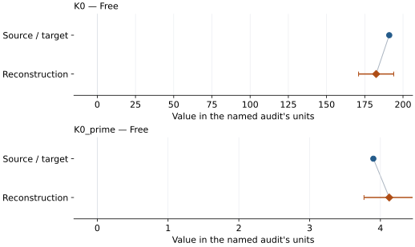
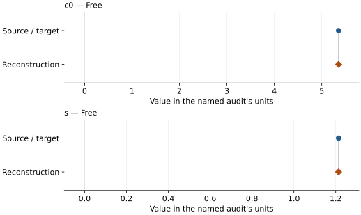

# Nickel oxide (rhombohedral B1): EOS reconstruction reports

<!-- Generated by scripts.generate_reconstruction_reports; edit EOSMAT instead. -->

[All reconstruction reports](index.md) · [Material and EOS parameters](../material-summaries/nickel_oxide.md)

These reports explain the assessments already stored in EOSMAT. Generating
this page does not refit observations, change classifications or replace source coefficients.

Use [scientific label definitions](../eos-labels.md) to distinguish coefficient
agreement, source verification, author-workflow reproduction and recommendation for use.

| EOS record | Recorded outcome | Coefficient comparison |
| --- | --- | --- |
| [Noguchi et al. (1999), shock BM3 isotherm](#record-nickel_oxide_noguchi_1999_bm3_1) | Numerically similar, with qualifications | Graph and table |
| [Noguchi et al. (1999), derived B1 principal Hugoniot](#record-nickel_oxide_noguchi_1999_linear_hugoniot_2) | Coefficient parity achieved | Graph and table |

## Noguchi et al. (1999), shock BM3 isotherm

Record: `nickel_oxide_noguchi_1999_bm3_1` · Model: `BM3`

**Outcome: Numerically similar, with qualifications.**

**Scope:** Comparison with the source parameterization.
**Comparison basis:** Every compared free coefficient meets either the recorded combined-two-sigma comparison or parameter-specific numerical similarity screen; the audit does not classify the complete comparison as parity.

[Stored EOS coefficients and source](../material-summaries/nickel_oxide.md#record-nickel_oxide_noguchi_1999_bm3_1)

### What this result establishes

**Separate source-review status:** primary\_source\_validated.
**Usage recommendation:** See the stored EOS qualifications; no recommendation is inferred here.

- The reduction uses the source's Us=5.36+1.19up relation, 300 K Debye theta0=390 K, gamma0=1.38, gamma/V constant (q=1), and two atoms per NiO formula unit. The seven-state predecessor reproduces K0=184+/-5 GPa and about 1600 K at 132.9 GPa. The eight rounded journal rows recover the final coefficients within the residual-scaled refit errors; exact parity is unavailable because unrounded states, row-wise uncertainties, weights, and numerical objective are not published.
- This named numerical assessment alone does not establish author-workflow reproduction, physical accuracy or recommendation for use.

### Data and reconstruction method

- **Dataset identifiers:** nickel\_oxide\_noguchi\_1999\_table1\_shock
- **Observations:** 8
- **Fit kind:** shock\_to\_300k\_mie\_gruneisen\_debye\_then\_bm3
- **Selection:** all eight Table 1 final Hugoniot states; HEL precursor columns excluded; each pressure thermally reduced to 300 K before BM3 fitting
- **Objective:** unweighted\_reduced\_isothermal\_pressure\_residuals
- **Free parameters:** K0; K0\_prime
- **Fixed parameters:** V0

Unspecified selections, weights, fixed values or error conventions remain unknown; they have not been inferred for this report.

### Source versus reconstruction

This is a **coefficient comparison**, not an observation or residual plot.
Each panel uses its coefficient's audit units and includes zero. Markers show
stored central values only. Error widths are retained in the table below;
no confidence interval or uncertainty band is inferred. Fixed/adopted values are constraints.

| Parameter | Source / target | Source error | Reconstruction | Reconstruction error | Fit role |
| --- | --- | --- | --- | --- | --- |
| K0 | 191.0 | Not specified | 182.43511253506455 | 11.494590806763085 | Free |
| K0\_prime | 3.9 | Not specified | 4.124651942331509 | 0.35671288331062556 | Free |

Values and reported errors are copied without rounding or conversion from the named audit. Missing errors mean unknown, not zero. Parameter names and volume conventions follow that audit; error widths do not imply a confidence convention.

Recorded diagnostics, covariance and additional protocol

- **Observed pressure range gpa:** \[17.7, 147.6\]
- **Degrees of freedom:** 6
- **Solver success:** True
- **Solver message:** Both \`ftol\` and \`xtol\` termination conditions are satisfied.
- **Rmse gpa:** 2.084318952516954
- **Reduced chi square:** 5.792513994428496

### Detailed evidence and existing plots

- [Earlier detailed record investigation](../primary-eos-refits.md#investigation-nickel_oxide_noguchi_1999_bm3_1).
- [Record-by-record numerical ledger](../primary-eos-refits.md#records).
- [Source-audit reports](../source-audits.md).

Observation curves and residual plots are provided by the supporting reports where available. Their absence is not filled by a reconstructed curve presented as measured data.

[Machine-readable comparison ledger](https://github.com/CPrescher/peritheos/blob/main/docs/data/primary-eos-refits.json) — look up `nickel_oxide_noguchi_1999_bm3_1`.
[Complete native EOSMAT file](https://github.com/CPrescher/peritheos/blob/main/peritheos/data/materials/nickel_oxide.eosmat).

## Noguchi et al. (1999), derived B1 principal Hugoniot

Record: `nickel_oxide_noguchi_1999_linear_hugoniot_2` · Model: `LinearUsUpHugoniot`

**Outcome: Coefficient parity achieved.**

**Scope:** Comparison with the source parameterization.
**Comparison basis:** Every compared free coefficient meets both the recorded combined-two-sigma comparison and parameter-specific numerical similarity screen. Error conventions and fit qualifications remain applicable.

[Stored EOS coefficients and source](../material-summaries/nickel_oxide.md#record-nickel_oxide_noguchi_1999_linear_hugoniot_2)

### What this result establishes

**Separate source-review status:** primary\_source\_validated.
**Usage recommendation:** See the stored EOS qualifications; no recommendation is inferred here.

- This named numerical assessment alone does not establish author-workflow reproduction, physical accuracy or recommendation for use.

### Data and reconstruction method

- **Dataset identifiers:** nickel\_oxide\_noguchi\_1999\_table1\_shock
- **Observations:** 8
- **Fit kind:** linear\_us\_up\_hugoniot
- **Selection:** finite final\_particle\_velocity\_km\_s and final\_shock\_velocity\_km\_s; 8 rows
- **Objective:** shock\_velocity\_residuals
- **Absolute sigma:** False
- **Free parameters:** c0; s
- **Fixed parameters:** V0; rho0; P0

Unspecified selections, weights, fixed values or error conventions remain unknown; they have not been inferred for this report.

### Source versus reconstruction

This is a **coefficient comparison**, not an observation or residual plot.
Each panel uses its coefficient's audit units and includes zero. Markers show
stored central values only. Error widths are retained in the table below;
no confidence interval or uncertainty band is inferred. Fixed/adopted values are constraints.

| Parameter | Source / target | Source error | Reconstruction | Reconstruction error | Fit role |
| --- | --- | --- | --- | --- | --- |
| c0 | 5.3549770536 | 0.0531157378 | 5.354977053622233 | 0.05311573780318259 | Free |
| s | 1.2137281492 | 0.02956091343 | 1.2137281492244212 | 0.029560913431890334 | Free |

Values and reported errors are copied without rounding or conversion from the named audit. Missing errors mean unknown, not zero. Parameter names and volume conventions follow that audit; error widths do not imply a confidence convention.

Recorded diagnostics, covariance and additional protocol

- **Columns:**
    - **Particle velocity:** final\_particle\_velocity\_km\_s
    - **Shock velocity:** final\_shock\_velocity\_km\_s
- **Degrees of freedom:** 6
- **Solver success:** True
- **Solver message:** \`gtol\` termination condition is satisfied.
- **Rmse shock velocity km s:** 0.05563671460959945
- **Reduced chi square:** 0.004127258683400022

### Detailed evidence and existing plots

- [Record-by-record numerical ledger](../primary-eos-refits.md#records).
- [Source-audit reports](../source-audits.md).

Observation curves and residual plots are provided by the supporting reports where available. Their absence is not filled by a reconstructed curve presented as measured data.

[Machine-readable comparison ledger](https://github.com/CPrescher/peritheos/blob/main/docs/data/primary-eos-refits.json) — look up `nickel_oxide_noguchi_1999_linear_hugoniot_2`.
[Complete native EOSMAT file](https://github.com/CPrescher/peritheos/blob/main/peritheos/data/materials/nickel_oxide.eosmat).
