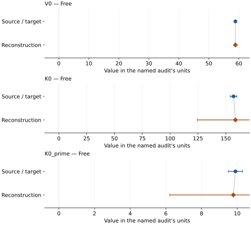
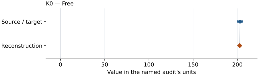
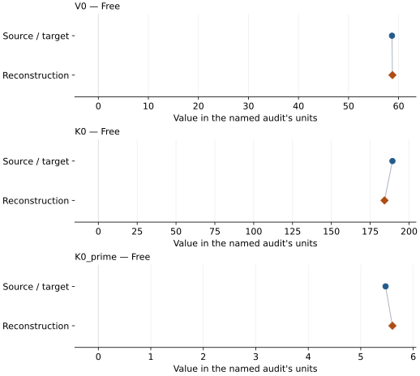
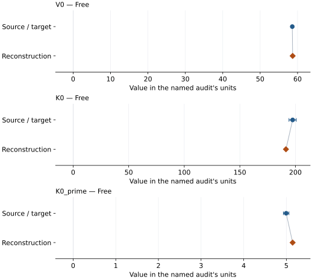
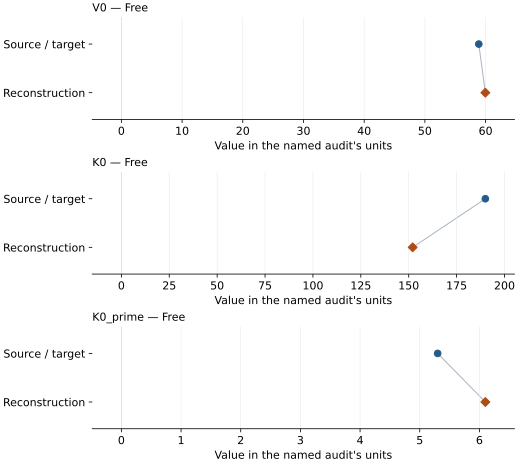

# Palladium: EOS reconstruction reports

<!-- Generated by scripts.generate_reconstruction_reports; edit EOSMAT instead. -->

[All reconstruction reports](index.md) · [Material and EOS parameters](../material-summaries/palladium.md)

These reports explain the assessments already stored in EOSMAT. Generating
this page does not refit observations, change classifications or replace source coefficients.

Use [scientific label definitions](../eos-labels.md) to distinguish coefficient
agreement, source verification, author-workflow reproduction and recommendation for use.

| EOS record | Recorded outcome | Coefficient comparison |
| --- | --- | --- |
| [Baty et al. (2024), 0 K DFT BM3](#record-palladium_baty_2024_bm3_dft_2) | Complete independent refit unavailable | No numeric coefficient pair recorded |
| [Guigue et al. (2020), Vinet](#record-palladium_guigue_2020_vinet_1) | Complete independent refit unavailable | No numeric coefficient pair recorded |
| [Fedotenko et al. (2020), BM3](#record-palladium_fedotenko_2020_bm3_1) | Coefficient parity achieved | Graph and table |
| [Fedotenko et al. (2020), constrained BM2](#record-palladium_fedotenko_2020_bm2_2) | Coefficient parity achieved | Graph and table |
| [Frost et al. (2023), Vinet](#record-palladium_frost_2023_vinet_1) | Numerically similar, with qualifications | Graph and table |
| [Frost et al. (2023), BM3](#record-palladium_frost_2023_bm3_2) | Numerically similar, with qualifications | Graph and table |
| [Baty et al. (2024), BM3](#record-palladium_baty_2024_bm3_1) | Parity not achieved for this comparison | Graph and table |

## Baty et al. (2024), 0 K DFT BM3

Record: `palladium_baty_2024_bm3_dft_2` · Model: `BM3`

**Outcome: Complete independent refit unavailable.**

**Scope:** Comparison with the source parameterization.
**Comparison basis:** The calculated P(V) grid is not published as independent row-level fit input. Table S3 contains pressures generated from the already fitted EOS at selected volumes.

[Stored EOS coefficients and source](../material-summaries/palladium.md#record-palladium_baty_2024_bm3_dft_2)

### What this result establishes

**Separate source-review status:** primary\_source\_validated.
**Usage recommendation:** See the stored EOS qualifications; no recommendation is inferred here.

- This named numerical assessment alone does not establish author-workflow reproduction, physical accuracy or recommendation for use.
- No reconstructed coefficient table is recorded for this assessment; no missing values have been inferred.

### Data and reconstruction method

- **Dataset identifiers:** None declared
- **Fixed parameters:** None declared

Unspecified selections, weights, fixed values or error conventions remain unknown; they have not been inferred for this report.

### Why no coefficient graph is shown

No numeric source/reconstruction pair is recorded for this assessment. A graph would require information that is not available here; no values or observations have been invented.

### Detailed evidence and existing plots

- [Record-by-record numerical ledger](../primary-eos-refits.md#records).
- [Source-audit reports](../source-audits.md).

Observation curves and residual plots are provided by the supporting reports where available. Their absence is not filled by a reconstructed curve presented as measured data.

[Machine-readable comparison ledger](https://github.com/CPrescher/peritheos/blob/main/docs/data/primary-eos-refits.json) — look up `palladium_baty_2024_bm3_dft_2`.
[Complete native EOSMAT file](https://github.com/CPrescher/peritheos/blob/main/peritheos/data/materials/palladium.eosmat).

## Guigue et al. (2020), Vinet

Record: `palladium_guigue_2020_vinet_1` · Model: `Vinet`

**Outcome: Complete independent refit unavailable.**

**Scope:** Comparison with the source parameterization.
**Comparison basis:** The underlying pure-Pd observations are plotted but not tabulated in the accessible primary article; no numerical refit is claimed.

[Stored EOS coefficients and source](../material-summaries/palladium.md#record-palladium_guigue_2020_vinet_1)

### What this result establishes

**Separate source-review status:** primary\_source\_validated.
**Usage recommendation:** See the stored EOS qualifications; no recommendation is inferred here.

- This named numerical assessment alone does not establish author-workflow reproduction, physical accuracy or recommendation for use.
- No reconstructed coefficient table is recorded for this assessment; no missing values have been inferred.

### Data and reconstruction method

- **Dataset identifiers:** None declared
- **Fixed parameters:** None declared

Unspecified selections, weights, fixed values or error conventions remain unknown; they have not been inferred for this report.

### Why no coefficient graph is shown

No numeric source/reconstruction pair is recorded for this assessment. A graph would require information that is not available here; no values or observations have been invented.

### Detailed evidence and existing plots

- [Record-by-record numerical ledger](../primary-eos-refits.md#records).
- [Source-audit reports](../source-audits.md).

Observation curves and residual plots are provided by the supporting reports where available. Their absence is not filled by a reconstructed curve presented as measured data.

[Machine-readable comparison ledger](https://github.com/CPrescher/peritheos/blob/main/docs/data/primary-eos-refits.json) — look up `palladium_guigue_2020_vinet_1`.
[Complete native EOSMAT file](https://github.com/CPrescher/peritheos/blob/main/peritheos/data/materials/palladium.eosmat).

## Fedotenko et al. (2020), BM3

Record: `palladium_fedotenko_2020_bm3_1` · Model: `BM3`

**Outcome: Coefficient parity achieved.**

**Scope:** Comparison with the source parameterization.
**Comparison basis:** Every compared free coefficient meets both the recorded combined-two-sigma comparison and parameter-specific numerical similarity screen. Error conventions and fit qualifications remain applicable.

[Stored EOS coefficients and source](../material-summaries/palladium.md#record-palladium_fedotenko_2020_bm3_1)

### What this result establishes

**Separate source-review status:** primary\_source\_validated.
**Usage recommendation:** See the stored EOS qualifications; no recommendation is inferred here.

- This named numerical assessment alone does not establish author-workflow reproduction, physical accuracy or recommendation for use.

### Data and reconstruction method

- **Dataset identifiers:** palladium\_fedotenko\_2020\_table1\_compression
- **Observations:** 15
- **Fit kind:** isothermal\_pv
- **Selection:** all rows
- **Objective:** errors\_in\_variables
- **Absolute sigma:** True
- **Free parameters:** V0; K0; K0\_prime
- **Fixed parameters:** None declared

Unspecified selections, weights, fixed values or error conventions remain unknown; they have not been inferred for this report.

### Source versus reconstruction

This is a **coefficient comparison**, not an observation or residual plot.
Each panel uses its coefficient's audit units and includes zero. Markers show
stored central values only. Error widths are retained in the table below;
no confidence interval or uncertainty band is inferred. Fixed/adopted values are constraints.

| Parameter | Source / target | Source error | Reconstruction | Reconstruction error | Fit role |
| --- | --- | --- | --- | --- | --- |
| V0 | 58.868 | 0.002 | 58.853666469947484 | 0.33891833156786705 | Free |
| K0 | 157.0 | 3.0 | 158.6681151821531 | 34.16957310711251 | Free |
| K0\_prime | 9.9 | 0.4 | 9.783509440958094 | 3.5695353810228267 | Free |

Values and reported errors are copied without rounding or conversion from the named audit. Missing errors mean unknown, not zero. Parameter names and volume conventions follow that audit; error widths do not imply a confidence convention.

Recorded diagnostics, covariance and additional protocol

- **Columns:**
    - **Pressure:** pressure\_gpa
    - **Temperature:** Not specified
    - **Volume:** volume\_a3\_conventional\_cell
- **Observed pressure range gpa:** \[0.0, 31.2\]
- **Observed temperature range k:** Not specified
- **Observed volume range:** \[52.411, 58.868\]
- **Degrees of freedom:** 12
- **Solver success:** True
- **Solver message:** \`ftol\` termination condition is satisfied.
- **Rmse gpa:** 0.07495317817507276
- **Published rmse gpa:** 0.08853265579056052
- **Reduced chi square:** 0.007024818746604909

### Detailed evidence and existing plots

- [Record-by-record numerical ledger](../primary-eos-refits.md#records).
- [Source-audit reports](../source-audits.md).

Observation curves and residual plots are provided by the supporting reports where available. Their absence is not filled by a reconstructed curve presented as measured data.

[Machine-readable comparison ledger](https://github.com/CPrescher/peritheos/blob/main/docs/data/primary-eos-refits.json) — look up `palladium_fedotenko_2020_bm3_1`.
[Complete native EOSMAT file](https://github.com/CPrescher/peritheos/blob/main/peritheos/data/materials/palladium.eosmat).

## Fedotenko et al. (2020), constrained BM2

Record: `palladium_fedotenko_2020_bm2_2` · Model: `BM2`

**Outcome: Coefficient parity achieved.**

**Scope:** Comparison with the source parameterization.
**Comparison basis:** Every compared free coefficient meets both the recorded combined-two-sigma comparison and parameter-specific numerical similarity screen. Error conventions and fit qualifications remain applicable.

[Stored EOS coefficients and source](../material-summaries/palladium.md#record-palladium_fedotenko_2020_bm2_2)

### What this result establishes

**Separate source-review status:** primary\_source\_validated.
**Usage recommendation:** See the stored EOS qualifications; no recommendation is inferred here.

- This named numerical assessment alone does not establish author-workflow reproduction, physical accuracy or recommendation for use.

### Data and reconstruction method

- **Dataset identifiers:** palladium\_fedotenko\_2020\_table1\_compression
- **Observations:** 15
- **Fit kind:** isothermal\_pv
- **Selection:** all rows
- **Objective:** errors\_in\_variables
- **Absolute sigma:** True
- **Free parameters:** K0
- **Fixed parameters:** V0

Unspecified selections, weights, fixed values or error conventions remain unknown; they have not been inferred for this report.

### Source versus reconstruction

This is a **coefficient comparison**, not an observation or residual plot.
Each panel uses its coefficient's audit units and includes zero. Markers show
stored central values only. Error widths are retained in the table below;
no confidence interval or uncertainty band is inferred. Fixed/adopted values are constraints.

| Parameter | Source / target | Source error | Reconstruction | Reconstruction error | Fit role |
| --- | --- | --- | --- | --- | --- |
| K0 | 203.0 | 3.0 | 202.66732584626578 | 2.6964526193481033 | Free |

Values and reported errors are copied without rounding or conversion from the named audit. Missing errors mean unknown, not zero. Parameter names and volume conventions follow that audit; error widths do not imply a confidence convention.

Recorded diagnostics, covariance and additional protocol

- **Columns:**
    - **Pressure:** pressure\_gpa
    - **Temperature:** Not specified
    - **Volume:** volume\_a3\_conventional\_cell
- **Observed pressure range gpa:** \[0.0, 31.2\]
- **Observed temperature range k:** Not specified
- **Observed volume range:** \[52.411, 58.868\]
- **Degrees of freedom:** 14
- **Solver success:** True
- **Solver message:** Both \`ftol\` and \`xtol\` termination conditions are satisfied.
- **Rmse gpa:** 0.9334901591251806
- **Published rmse gpa:** 0.9342455220941308
- **Reduced chi square:** 0.9338601176416805

### Detailed evidence and existing plots

- [Record-by-record numerical ledger](../primary-eos-refits.md#records).
- [Source-audit reports](../source-audits.md).

Observation curves and residual plots are provided by the supporting reports where available. Their absence is not filled by a reconstructed curve presented as measured data.

[Machine-readable comparison ledger](https://github.com/CPrescher/peritheos/blob/main/docs/data/primary-eos-refits.json) — look up `palladium_fedotenko_2020_bm2_2`.
[Complete native EOSMAT file](https://github.com/CPrescher/peritheos/blob/main/peritheos/data/materials/palladium.eosmat).

## Frost et al. (2023), Vinet

Record: `palladium_frost_2023_vinet_1` · Model: `Vinet`

**Outcome: Numerically similar, with qualifications.**

**Scope:** Comparison with the source parameterization.
**Comparison basis:** Every compared free coefficient meets either the recorded combined-two-sigma comparison or parameter-specific numerical similarity screen; the audit does not classify the complete comparison as parity.

[Stored EOS coefficients and source](../material-summaries/palladium.md#record-palladium_frost_2023_vinet_1)

### What this result establishes

**Separate source-review status:** not\_reproduced.
**Usage recommendation:** not\_recommended\_for\_quantitative\_use

- All 93 verified source rows are independently fitted using sigma(P)=0.1 GPa and sigma(V)=3a^2 sigma(a). The final paper specifies uncertainty-aware Marquardt-Levenberg but not its exact objective, ambient-point inclusion, constraints or covariance convention. Numerical classification remains similar: the combined-two-width coefficient test fails with absolute-error covariance but passes with residual-scaled covariance. Original author-fit reproduction is unresolved; scientific status not\_reproduced and recommendation/default hold pending protocol clarification. This does not establish a failed replay of the authors' protocol. Measured-volume pressure RMS is 0.771992 GPa published and 0.825323 GPa refitted; the earlier 0.276359 GPa used adjusted volumes. See the \[Frost audit\](literature-reproductions/palladium-frost-2023-audit.md). The original author regression remains unrecovered. The final paper specifies uncertainty-aware Marquardt-Levenberg fitting but not the exact objective, ambient-point inclusion, constraints or covariance convention. Independent refits have similar central coefficients; the combined-two-width comparison fails with absolute-error covariance and passes with residual-scaled covariance. This is not a demonstrated failed replay of the author protocol. Quantitative recommendation and the default remain on hold pending clarification.
- The original author regression remains unrecovered. The final paper specifies uncertainty-aware Marquardt-Levenberg fitting but not the exact objective, ambient-point inclusion, constraints or covariance convention. Independent refits have similar central coefficients; the combined-two-width comparison fails with absolute-error covariance and passes with residual-scaled covariance. This is not a demonstrated failed replay of the author protocol. Quantitative recommendation and the default remain on hold pending clarification.
- Usage recommendation: not\_recommended\_for\_quantitative\_use
- This named numerical assessment alone does not establish author-workflow reproduction, physical accuracy or recommendation for use.

### Data and reconstruction method

- **Dataset identifiers:** palladium\_frost\_2023\_tables\_i\_iii\_compression
- **Observations:** 93
- **Fit kind:** isothermal\_pv
- **Selection:** all rows
- **Objective:** errors\_in\_variables
- **Absolute sigma:** True
- **Free parameters:** V0; K0; K0\_prime
- **Fixed parameters:** None declared

Unspecified selections, weights, fixed values or error conventions remain unknown; they have not been inferred for this report.

### Source versus reconstruction

This is a **coefficient comparison**, not an observation or residual plot.
Each panel uses its coefficient's audit units and includes zero. Markers show
stored central values only. Error widths are retained in the table below;
no confidence interval or uncertainty band is inferred. Fixed/adopted values are constraints.

| Parameter | Source / target | Source error | Reconstruction | Reconstruction error | Fit role |
| --- | --- | --- | --- | --- | --- |
| V0 | 58.678 | 0.073 | 58.766517847521946 | 0.01447584075596417 | Free |
| K0 | 189.3 | 3.0 | 184.19060495665687 | 0.6128828687022512 | Free |
| K0\_prime | 5.473 | 0.063 | 5.603711667723233 | 0.013813323627936764 | Free |

Values and reported errors are copied without rounding or conversion from the named audit. Missing errors mean unknown, not zero. Parameter names and volume conventions follow that audit; error widths do not imply a confidence convention.

Recorded diagnostics, covariance and additional protocol

- **Columns:**
    - **Pressure:** pressure\_gpa
    - **Temperature:** Not specified
    - **Volume:** volume\_a3\_conventional\_cell
- **Observed pressure range gpa:** \[2.99, 181.79\]
- **Observed temperature range k:** Not specified
- **Observed volume range:** \[40.50202633, 58.050510848\]
- **Degrees of freedom:** 90
- **Solver success:** True
- **Solver message:** Both \`ftol\` and \`xtol\` termination conditions are satisfied.
- **Rmse gpa:** 0.8253227533623266
- **Published rmse gpa:** 0.7719918204007176
- **Reduced chi square:** 19.049086216259077

### Detailed evidence and existing plots

- [Earlier detailed record investigation](../primary-eos-refits.md#investigation-palladium_frost_2023_vinet_1).
- [Supporting source report: palladium-frost-2023-audit](../literature-reproductions/palladium-frost-2023-audit.md).
- [Record-by-record numerical ledger](../primary-eos-refits.md#records).
- [Source-audit reports](../source-audits.md).

Observation curves and residual plots are provided by the supporting reports where available. Their absence is not filled by a reconstructed curve presented as measured data.

[Machine-readable comparison ledger](https://github.com/CPrescher/peritheos/blob/main/docs/data/primary-eos-refits.json) — look up `palladium_frost_2023_vinet_1`.
[Complete native EOSMAT file](https://github.com/CPrescher/peritheos/blob/main/peritheos/data/materials/palladium.eosmat).

## Frost et al. (2023), BM3

Record: `palladium_frost_2023_bm3_2` · Model: `BM3`

**Outcome: Numerically similar, with qualifications.**

**Scope:** Comparison with the source parameterization.
**Comparison basis:** Every compared free coefficient meets either the recorded combined-two-sigma comparison or parameter-specific numerical similarity screen; the audit does not classify the complete comparison as parity.

[Stored EOS coefficients and source](../material-summaries/palladium.md#record-palladium_frost_2023_bm3_2)

### What this result establishes

**Separate source-review status:** not\_reproduced.
**Usage recommendation:** not\_recommended\_for\_quantitative\_use

- Independent refit of all 93 verified rows under explicit orthogonal/effective-variance interpretations of the final paper's uncertainty-aware Marquardt-Levenberg prose. Numerical classification remains similar: absolute-error covariance fails the combined-two-width test, whereas residual-scaled covariance passes. The original objective, ambient treatment, constraints and covariance convention are unrecovered; not\_reproduced means original fit not recovered, with quantitative recommendation/default on hold pending clarification. Measured-volume pressure RMS is 0.845419 GPa published and 0.915380 GPa refitted; the earlier 0.293082 GPa used adjusted volumes. See the \[Frost audit\](literature-reproductions/palladium-frost-2023-audit.md). The original author regression remains unrecovered. The final paper specifies uncertainty-aware Marquardt-Levenberg fitting but not the exact objective, ambient-point inclusion, constraints or covariance convention. Independent refits have similar central coefficients; the combined-two-width comparison fails with absolute-error covariance and passes with residual-scaled covariance. This is not a demonstrated failed replay of the author protocol. Quantitative recommendation and the default remain on hold pending clarification.
- The original author regression remains unrecovered. The final paper specifies uncertainty-aware Marquardt-Levenberg fitting but not the exact objective, ambient-point inclusion, constraints or covariance convention. Independent refits have similar central coefficients; the combined-two-width comparison fails with absolute-error covariance and passes with residual-scaled covariance. This is not a demonstrated failed replay of the author protocol. Quantitative recommendation and the default remain on hold pending clarification.
- Usage recommendation: not\_recommended\_for\_quantitative\_use
- This named numerical assessment alone does not establish author-workflow reproduction, physical accuracy or recommendation for use.

### Data and reconstruction method

- **Dataset identifiers:** palladium\_frost\_2023\_tables\_i\_iii\_compression
- **Observations:** 93
- **Fit kind:** isothermal\_pv
- **Selection:** all rows
- **Objective:** errors\_in\_variables
- **Absolute sigma:** True
- **Free parameters:** V0; K0; K0\_prime
- **Fixed parameters:** None declared

Unspecified selections, weights, fixed values or error conventions remain unknown; they have not been inferred for this report.

### Source versus reconstruction

This is a **coefficient comparison**, not an observation or residual plot.
Each panel uses its coefficient's audit units and includes zero. Markers show
stored central values only. Error widths are retained in the table below;
no confidence interval or uncertainty band is inferred. Fixed/adopted values are constraints.

| Parameter | Source / target | Source error | Reconstruction | Reconstruction error | Fit role |
| --- | --- | --- | --- | --- | --- |
| V0 | 58.588 | 0.076 | 58.68458056352506 | 0.0140851237096774 | Free |
| K0 | 197.5 | 3.3 | 191.47672089799707 | 0.6218647046062601 | Free |
| K0\_prime | 4.996 | 0.066 | 5.147381675970761 | 0.013925053842452267 | Free |

Values and reported errors are copied without rounding or conversion from the named audit. Missing errors mean unknown, not zero. Parameter names and volume conventions follow that audit; error widths do not imply a confidence convention.

Recorded diagnostics, covariance and additional protocol

- **Columns:**
    - **Pressure:** pressure\_gpa
    - **Temperature:** Not specified
    - **Volume:** volume\_a3\_conventional\_cell
- **Observed pressure range gpa:** \[2.99, 181.79\]
- **Observed temperature range k:** Not specified
- **Observed volume range:** \[40.50202633, 58.050510848\]
- **Degrees of freedom:** 90
- **Solver success:** True
- **Solver message:** Both \`ftol\` and \`xtol\` termination conditions are satisfied.
- **Rmse gpa:** 0.9153804754371527
- **Published rmse gpa:** 0.8454188587538582
- **Reduced chi square:** 22.07960671974955

### Detailed evidence and existing plots

- [Earlier detailed record investigation](../primary-eos-refits.md#investigation-palladium_frost_2023_bm3_2).
- [Supporting source report: palladium-frost-2023-audit](../literature-reproductions/palladium-frost-2023-audit.md).
- [Record-by-record numerical ledger](../primary-eos-refits.md#records).
- [Source-audit reports](../source-audits.md).

Observation curves and residual plots are provided by the supporting reports where available. Their absence is not filled by a reconstructed curve presented as measured data.

[Machine-readable comparison ledger](https://github.com/CPrescher/peritheos/blob/main/docs/data/primary-eos-refits.json) — look up `palladium_frost_2023_bm3_2`.
[Complete native EOSMAT file](https://github.com/CPrescher/peritheos/blob/main/peritheos/data/materials/palladium.eosmat).

## Baty et al. (2024), BM3

Record: `palladium_baty_2024_bm3_1` · Model: `BM3`

**Outcome: Parity not achieved for this comparison.**

**Scope:** Comparison with the source parameterization.
**Comparison basis:** Complete-table reproduction with unresolved source-fit discrepancy: all 78 official Table S1 rows and the printed BM3 equation are reproduced, but reasonable pressure-, volume-, and errors-in-variables objectives do not jointly recover the published coefficients. See the \[dedicated palladium reproduction\](literature-reproductions.md#palladium-baty-2024). Not recommended for scientific predictions or pressure calibration. Retained only for explicit diagnostic inspection. The verified experimental Table S1 observations and source equation do not recover the published experimental BM3 fit under the completed audit checks.

[Stored EOS coefficients and source](../material-summaries/palladium.md#record-palladium_baty_2024_bm3_1)

### What this result establishes

**Separate source-review status:** not\_reproduced.
**Usage recommendation:** not\_recommended\_for\_quantitative\_use

- Not recommended for scientific predictions or pressure calibration. Retained only for explicit diagnostic inspection. The verified experimental Table S1 observations and source equation do not recover the published experimental BM3 fit under the completed audit checks.
- Usage recommendation: not\_recommended\_for\_quantitative\_use
- This named numerical assessment alone does not establish author-workflow reproduction, physical accuracy or recommendation for use.

### Data and reconstruction method

- **Dataset identifiers:** palladium\_baty\_2024\_table\_s1\_compression
- **Observations:** 78
- **Fit kind:** isothermal\_pv
- **Selection:** all rows
- **Objective:** pressure\_residuals
- **Absolute sigma:** True
- **Free parameters:** V0; K0; K0\_prime
- **Fixed parameters:** None declared

Unspecified selections, weights, fixed values or error conventions remain unknown; they have not been inferred for this report.

### Source versus reconstruction

This is a **coefficient comparison**, not an observation or residual plot.
Each panel uses its coefficient's audit units and includes zero. Markers show
stored central values only. Error widths are retained in the table below;
no confidence interval or uncertainty band is inferred. Fixed/adopted values are constraints.

| Parameter | Source / target | Source error | Reconstruction | Reconstruction error | Fit role |
| --- | --- | --- | --- | --- | --- |
| V0 | 58.88 | 0.16 | 59.96030527476279 | 0.17412128205044958 | Free |
| K0 | 190.0 | 3.0 | 152.0572835175919 | 7.798166110606747 | Free |
| K0\_prime | 5.3 | 0.2 | 6.099357222085515 | 0.326725501677344 | Free |

Values and reported errors are copied without rounding or conversion from the named audit. Missing errors mean unknown, not zero. Parameter names and volume conventions follow that audit; error widths do not imply a confidence convention.

Recorded diagnostics, covariance and additional protocol

- **Columns:**
    - **Pressure:** pressure\_gpa
    - **Temperature:** Not specified
    - **Volume:** volume\_a3\_conventional\_cell
- **Observed pressure range gpa:** \[0.0, 73.7963\]
- **Observed temperature range k:** Not specified
- **Observed volume range:** \[47.24163336, 58.89565212\]
- **Degrees of freedom:** 75
- **Solver success:** True
- **Solver message:** Both \`ftol\` and \`xtol\` termination conditions are satisfied.
- **Rmse gpa:** 0.7043366920848168
- **Published rmse gpa:** 1.2731181917301628
- **Reduced chi square:** 0.5159337828496612

### Detailed evidence and existing plots

- [Earlier detailed record investigation](../primary-eos-refits.md#investigation-palladium_baty_2024_bm3_1).
- [Supporting source report: eos-recommendation-dispositions-2026-10-17](../research/eos-recommendation-dispositions-2026-10-17.md).
- [Record-by-record numerical ledger](../primary-eos-refits.md#records).
- [Source-audit reports](../source-audits.md).

Observation curves and residual plots are provided by the supporting reports where available. Their absence is not filled by a reconstructed curve presented as measured data.

[Machine-readable comparison ledger](https://github.com/CPrescher/peritheos/blob/main/docs/data/primary-eos-refits.json) — look up `palladium_baty_2024_bm3_1`.
[Complete native EOSMAT file](https://github.com/CPrescher/peritheos/blob/main/peritheos/data/materials/palladium.eosmat).
