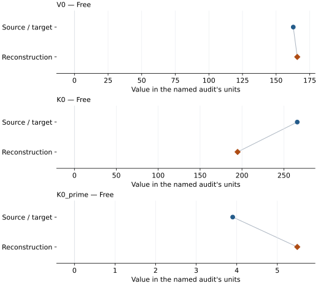

# (Mg0.88Fe0.12)SiO3 perovskite: EOS reconstruction reports

<!-- Generated by scripts.generate_reconstruction_reports; edit EOSMAT instead. -->

[All reconstruction reports](index.md) · [Material and EOS parameters](../material-summaries/perovskite_orthorhombic.md)

These reports explain the assessments already stored in EOSMAT. Generating
this page does not refit observations, change classifications or replace source coefficients.

Use [scientific label definitions](../eos-labels.md) to distinguish coefficient
agreement, source verification, author-workflow reproduction and recommendation for use.

| EOS record | Recorded outcome | Coefficient comparison |
| --- | --- | --- |
| [Knittle and Jeanloz (1987), (Mg0.88Fe0.12)SiO3 BM3](#record-perovskite_orthorhombic_knittle_1987_bm3_1) | Numerically similar, with qualifications | Graph and table |

## Knittle and Jeanloz (1987), (Mg0.88Fe0.12)SiO3 BM3

Record: `perovskite_orthorhombic_knittle_1987_bm3_1` · Model: `BM3`

**Outcome: Numerically similar, with qualifications.**

**Scope:** Comparison with the source parameterization.
**Comparison basis:** Every compared free coefficient meets either the recorded combined-two-sigma comparison or parameter-specific numerical similarity screen; the audit does not classify the complete comparison as parity.

[Stored EOS coefficients and source](../material-summaries/perovskite_orthorhombic.md#record-perovskite_orthorhombic_knittle_1987_bm3_1)

### What this result establishes

**Separate source-review status:** primary\_source\_validated.
**Usage recommendation:** See the stored EOS qualifications; no recommendation is inferred here.

- This named numerical assessment alone does not establish author-workflow reproduction, physical accuracy or recommendation for use.

### Data and reconstruction method

- **Dataset identifiers:** mgfe\_perovskite\_knittle\_1987\_table2\_compression
- **Observations:** 5
- **Fit kind:** isothermal\_pv
- **Selection:** all rows
- **Objective:** errors\_in\_variables
- **Absolute sigma:** True
- **Free parameters:** V0; K0; K0\_prime
- **Fixed parameters:** None declared

Unspecified selections, weights, fixed values or error conventions remain unknown; they have not been inferred for this report.

### Source versus reconstruction

This is a **coefficient comparison**, not an observation or residual plot.
Each panel uses its coefficient's audit units and includes zero. Markers show
stored central values only. Error widths are retained in the table below;
no confidence interval or uncertainty band is inferred. Fixed/adopted values are constraints.

| Parameter | Source / target | Source error | Reconstruction | Reconstruction error | Fit role |
| --- | --- | --- | --- | --- | --- |
| V0 | 162.77 | 0.39 | 165.72923759090324 | 6.6848643575656705 | Free |
| K0 | 266.0 | 6.0 | 194.7470166451314 | 121.94739377340618 | Free |
| K0\_prime | 3.9 | 0.4 | 5.490806405819618 | 3.244614633488159 | Free |

Values and reported errors are copied without rounding or conversion from the named audit. Missing errors mean unknown, not zero. Parameter names and volume conventions follow that audit; error widths do not imply a confidence convention.

Recorded diagnostics, covariance and additional protocol

- **Columns:**
    - **Pressure:** pressure\_after\_heating\_gpa
    - **Temperature:** Not specified
    - **Volume:** normalized\_volume
- **Observed pressure range gpa:** \[20.8, 111.9\]
- **Observed temperature range k:** Not specified
- **Observed volume range:** \[126.96060000000001, 152.02718000000002\]
- **Degrees of freedom:** 2
- **Solver success:** True
- **Solver message:** \`ftol\` termination condition is satisfied.
- **Rmse gpa:** 1.4557004036304708
- **Published rmse gpa:** 2.8805025946118414
- **Reduced chi square:** 1.294773969300724

### Detailed evidence and existing plots

- [Earlier detailed record investigation](../primary-eos-refits.md#investigation-perovskite_orthorhombic_knittle_1987_bm3_1).
- [Record-by-record numerical ledger](../primary-eos-refits.md#records).
- [Source-audit reports](../source-audits.md).

Observation curves and residual plots are provided by the supporting reports where available. Their absence is not filled by a reconstructed curve presented as measured data.

[Machine-readable comparison ledger](https://github.com/CPrescher/peritheos/blob/main/docs/data/primary-eos-refits.json) — look up `perovskite_orthorhombic_knittle_1987_bm3_1`.
[Complete native EOSMAT file](https://github.com/CPrescher/peritheos/blob/main/peritheos/data/materials/perovskite_orthorhombic.eosmat).
