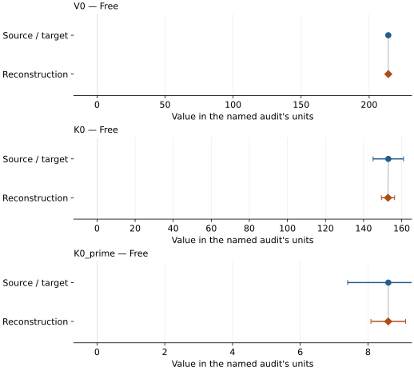
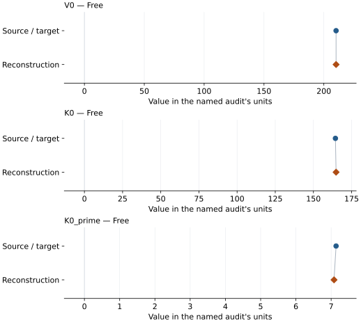
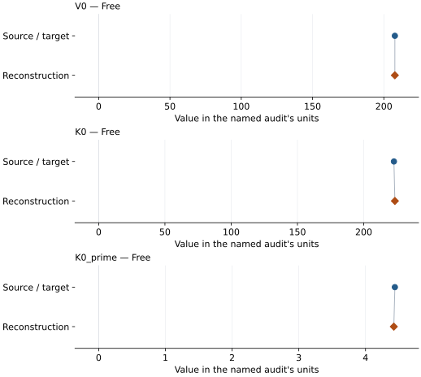

# Phase Egg: EOS reconstruction reports

<!-- Generated by scripts.generate_reconstruction_reports; edit EOSMAT instead. -->

[All reconstruction reports](index.md) · [Material and EOS parameters](../material-summaries/phase_egg.md)

These reports explain the assessments already stored in EOSMAT. Generating
this page does not refit observations, change classifications or replace source coefficients.

Use [scientific label definitions](../eos-labels.md) to distinguish coefficient
agreement, source verification, author-workflow reproduction and recommendation for use.

| EOS record | Recorded outcome | Coefficient comparison |
| --- | --- | --- |
| [Schulze et al. (2018), single-crystal BM3](#record-phase_egg_schulze_2018_bm3_1) | Coefficient parity achieved | Graph and table |
| [Mookherjee et al. (2019), static LP BM3](#record-phase_egg_mookherjee_2019_bm3_lp_1) | Coefficient parity achieved | Graph and table |
| [Mookherjee et al. (2019), static HP proton-transferred BM3](#record-phase_egg_mookherjee_2019_bm3_hp_1) | Numerically similar, with qualifications | Graph and table |

## Schulze et al. (2018), single-crystal BM3

Record: `phase_egg_schulze_2018_bm3_1` · Model: `BM3`

**Outcome: Coefficient parity achieved.**

**Scope:** Comparison with the source parameterization.
**Comparison basis:** Every compared free coefficient meets both the recorded combined-two-sigma comparison and parameter-specific numerical similarity screen. Error conventions and fit qualifications remain applicable.

[Stored EOS coefficients and source](../material-summaries/phase_egg.md#record-phase_egg_schulze_2018_bm3_1)

### What this result establishes

**Separate source-review status:** primary\_source\_validated.
**Usage recommendation:** See the stored EOS qualifications; no recommendation is inferred here.

- This named numerical assessment alone does not establish author-workflow reproduction, physical accuracy or recommendation for use.

### Data and reconstruction method

- **Dataset identifiers:** phase\_egg\_schulze\_2018\_table1\_compression
- **Observations:** 15
- **Fit kind:** isothermal\_pv
- **Selection:** used\_in\_published\_fit=1
- **Objective:** errors\_in\_variables
- **Absolute sigma:** True
- **Free parameters:** V0; K0; K0\_prime
- **Fixed parameters:** None declared

Unspecified selections, weights, fixed values or error conventions remain unknown; they have not been inferred for this report.

### Source versus reconstruction

This is a **coefficient comparison**, not an observation or residual plot.
Each panel uses its coefficient's audit units and includes zero. Markers show
stored central values only. Error widths are retained in the table below;
no confidence interval or uncertainty band is inferred. Fixed/adopted values are constraints.

| Parameter | Source / target | Source error | Reconstruction | Reconstruction error | Fit role |
| --- | --- | --- | --- | --- | --- |
| V0 | 214.08 | 0.17 | 214.08105948439913 | 0.07471862387156843 | Free |
| K0 | 153.0 | 8.0 | 152.8459200508773 | 3.452004107426867 | Free |
| K0\_prime | 8.6 | 1.2 | 8.597514757812375 | 0.5103663766300438 | Free |

Values and reported errors are copied without rounding or conversion from the named audit. Missing errors mean unknown, not zero. Parameter names and volume conventions follow that audit; error widths do not imply a confidence convention.

Recorded diagnostics, covariance and additional protocol

- **Columns:**
    - **Pressure:** pressure\_gpa
    - **Temperature:** Not specified
    - **Volume:** volume\_a3\_conventional\_cell
- **Observed pressure range gpa:** \[1.09, 23.33\]
- **Observed temperature range k:** Not specified
- **Observed volume range:** \[193.75, 212.69\]
- **Degrees of freedom:** 12
- **Solver success:** True
- **Solver message:** \`ftol\` termination condition is satisfied.
- **Rmse gpa:** 0.21173304498974524
- **Published rmse gpa:** 0.2269903600333908
- **Reduced chi square:** 5.486063468893597

### Detailed evidence and existing plots

- [Record-by-record numerical ledger](../primary-eos-refits.md#records).
- [Source-audit reports](../source-audits.md).

Observation curves and residual plots are provided by the supporting reports where available. Their absence is not filled by a reconstructed curve presented as measured data.

[Machine-readable comparison ledger](https://github.com/CPrescher/peritheos/blob/main/docs/data/primary-eos-refits.json) — look up `phase_egg_schulze_2018_bm3_1`.
[Complete native EOSMAT file](https://github.com/CPrescher/peritheos/blob/main/peritheos/data/materials/phase_egg.eosmat).

## Mookherjee et al. (2019), static LP BM3

Record: `phase_egg_mookherjee_2019_bm3_lp_1` · Model: `BM3`

**Outcome: Coefficient parity achieved.**

**Scope:** Comparison with the source parameterization.
**Comparison basis:** Every compared free coefficient meets both the recorded combined-two-sigma comparison and parameter-specific numerical similarity screen. Error conventions and fit qualifications remain applicable.

[Stored EOS coefficients and source](../material-summaries/phase_egg.md#record-phase_egg_mookherjee_2019_bm3_lp_1)

### What this result establishes

**Separate source-review status:** primary\_source\_validated.
**Usage recommendation:** See the stored EOS qualifications; no recommendation is inferred here.

- Curve-level diagnostic reproduction: Supplementary Table 1 provides all 11 static LP pressure-volume points and they recover the published BM3 coefficients within the printed parameter uncertainties. The publication fitted total energy versus volume, however, and the deposited workbook does not include those energies, row uncertainties, regression weights, objective, covariance, or fit statistic. This pressure-residual refit therefore validates the published pressure curve but cannot reconstruct the source energy-fit protocol exactly. See the dedicated phase-Egg reproduction in literature-reproductions.md.
- This named numerical assessment alone does not establish author-workflow reproduction, physical accuracy or recommendation for use.

### Data and reconstruction method

- **Dataset identifiers:** phase\_egg\_mookherjee\_2019\_supplement\_lp\_pv
- **Observations:** 11
- **Fit kind:** isothermal\_pv
- **Selection:** all rows
- **Objective:** pressure\_residuals
- **Absolute sigma:** True
- **Free parameters:** V0; K0; K0\_prime
- **Fixed parameters:** None declared

Unspecified selections, weights, fixed values or error conventions remain unknown; they have not been inferred for this report.

### Source versus reconstruction

This is a **coefficient comparison**, not an observation or residual plot.
Each panel uses its coefficient's audit units and includes zero. Markers show
stored central values only. Error widths are retained in the table below;
no confidence interval or uncertainty band is inferred. Fixed/adopted values are constraints.

| Parameter | Source / target | Source error | Reconstruction | Reconstruction error | Fit role |
| --- | --- | --- | --- | --- | --- |
| V0 | 210.21 | 0.14 | 210.2176007194148 | 0.014434224595616635 | Free |
| K0 | 164.4 | 1.8 | 164.83396027958415 | 0.3021723046783939 | Free |
| K0\_prime | 7.14 | 0.24 | 7.081372126606693 | 0.027581570310362798 | Free |

Values and reported errors are copied without rounding or conversion from the named audit. Missing errors mean unknown, not zero. Parameter names and volume conventions follow that audit; error widths do not imply a confidence convention.

Recorded diagnostics, covariance and additional protocol

- **Columns:**
    - **Pressure:** pressure\_gpa
    - **Temperature:** Not specified
    - **Volume:** volume\_a3
- **Observed pressure range gpa:** \[-6.4, 43.7\]
- **Observed temperature range k:** Not specified
- **Observed volume range:** \[180.0, 220.0\]
- **Degrees of freedom:** 8
- **Solver success:** True
- **Solver message:** Both \`ftol\` and \`xtol\` termination conditions are satisfied.
- **Rmse gpa:** 0.02339254239900827
- **Published rmse gpa:** 0.03011320576939226
- **Reduced chi square:** 0.0007524151798479245

### Detailed evidence and existing plots

- [Record-by-record numerical ledger](../primary-eos-refits.md#records).
- [Source-audit reports](../source-audits.md).

Observation curves and residual plots are provided by the supporting reports where available. Their absence is not filled by a reconstructed curve presented as measured data.

[Machine-readable comparison ledger](https://github.com/CPrescher/peritheos/blob/main/docs/data/primary-eos-refits.json) — look up `phase_egg_mookherjee_2019_bm3_lp_1`.
[Complete native EOSMAT file](https://github.com/CPrescher/peritheos/blob/main/peritheos/data/materials/phase_egg.eosmat).

## Mookherjee et al. (2019), static HP proton-transferred BM3

Record: `phase_egg_mookherjee_2019_bm3_hp_1` · Model: `BM3`

**Outcome: Numerically similar, with qualifications.**

**Scope:** Comparison with the source parameterization.
**Comparison basis:** Every compared free coefficient meets either the recorded combined-two-sigma comparison or parameter-specific numerical similarity screen; the audit does not classify the complete comparison as parity.

[Stored EOS coefficients and source](../material-summaries/phase_egg.md#record-phase_egg_mookherjee_2019_bm3_hp_1)

### What this result establishes

**Separate source-review status:** primary\_source\_validated.
**Usage recommendation:** See the stored EOS qualifications; no recommendation is inferred here.

- This named numerical assessment alone does not establish author-workflow reproduction, physical accuracy or recommendation for use.

### Data and reconstruction method

- **Dataset identifiers:** phase\_egg\_mookherjee\_2019\_supplement\_hp\_pv
- **Observations:** 5
- **Fit kind:** isothermal\_pv
- **Selection:** all rows
- **Objective:** pressure\_residuals
- **Absolute sigma:** True
- **Free parameters:** V0; K0; K0\_prime
- **Fixed parameters:** None declared

Unspecified selections, weights, fixed values or error conventions remain unknown; they have not been inferred for this report.

### Source versus reconstruction

This is a **coefficient comparison**, not an observation or residual plot.
Each panel uses its coefficient's audit units and includes zero. Markers show
stored central values only. Error widths are retained in the table below;
no confidence interval or uncertainty band is inferred. Fixed/adopted values are constraints.

| Parameter | Source / target | Source error | Reconstruction | Reconstruction error | Fit role |
| --- | --- | --- | --- | --- | --- |
| V0 | 207.74 | 0.01 | 207.71787916507864 | 0.009621196164558728 | Free |
| K0 | 222.8 | 0.2 | 223.5098675480139 | 0.20351257604669015 | Free |
| K0\_prime | 4.44 | 0.02 | 4.424316057689833 | 0.015177342005826796 | Free |

Values and reported errors are copied without rounding or conversion from the named audit. Missing errors mean unknown, not zero. Parameter names and volume conventions follow that audit; error widths do not imply a confidence convention.

Recorded diagnostics, covariance and additional protocol

- **Columns:**
    - **Pressure:** pressure\_gpa
    - **Temperature:** Not specified
    - **Volume:** volume\_a3
- **Observed pressure range gpa:** \[-11.3, 44.0\]
- **Observed temperature range k:** Not specified
- **Observed volume range:** \[180.0, 220.0\]
- **Degrees of freedom:** 2
- **Solver success:** True
- **Solver message:** Both \`ftol\` and \`xtol\` termination conditions are satisfied.
- **Rmse gpa:** 0.011231481308555374
- **Published rmse gpa:** 0.039665757737281995
- **Reduced chi square:** 0.0003153654309610718

### Detailed evidence and existing plots

- [Earlier detailed record investigation](../primary-eos-refits.md#investigation-phase_egg_mookherjee_2019_bm3_hp_1).
- [Record-by-record numerical ledger](../primary-eos-refits.md#records).
- [Source-audit reports](../source-audits.md).

Observation curves and residual plots are provided by the supporting reports where available. Their absence is not filled by a reconstructed curve presented as measured data.

[Machine-readable comparison ledger](https://github.com/CPrescher/peritheos/blob/main/docs/data/primary-eos-refits.json) — look up `phase_egg_mookherjee_2019_bm3_hp_1`.
[Complete native EOSMAT file](https://github.com/CPrescher/peritheos/blob/main/peritheos/data/materials/phase_egg.eosmat).
