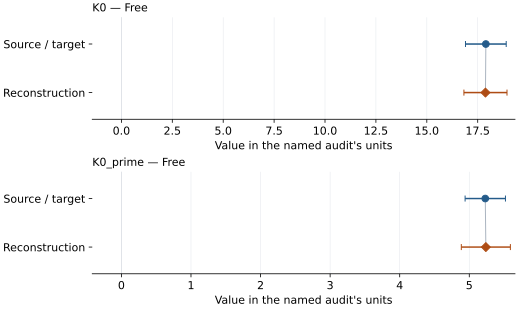
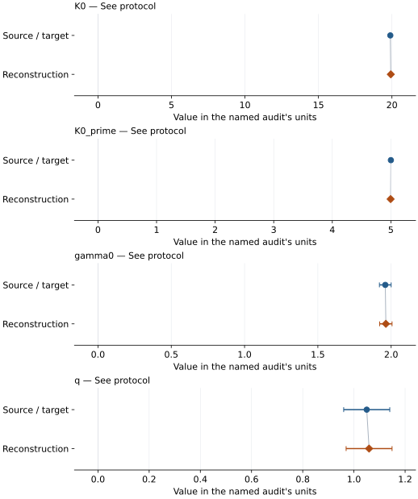

# Rubidium chloride (B2): EOS reconstruction reports

<!-- Generated by scripts.generate_reconstruction_reports; edit EOSMAT instead. -->

[All reconstruction reports](index.md) · [Material and EOS parameters](../material-summaries/rbcl.md)

These reports explain the assessments already stored in EOSMAT. Generating
this page does not refit observations, change classifications or replace source coefficients.

Use [scientific label definitions](../eos-labels.md) to distinguish coefficient
agreement, source verification, author-workflow reproduction and recommendation for use.

| EOS record | Recorded outcome | Coefficient comparison |
| --- | --- | --- |
| [Campbell and Heinz (1994), RbCl-B2 BM3](#record-rbcl_b2_campbell_1994_bm3_1) | Coefficient parity achieved | Graph and table |
| [Farla et al. (2025), RbCl-B2 BM3-MGD, CsCl pressures (case 1)](#record-rbcl_b2_farla_2025_bm3_mgd_cscl) | Numerically similar, with qualifications | Graph and table |

## Campbell and Heinz (1994), RbCl-B2 BM3

Record: `rbcl_b2_campbell_1994_bm3_1` · Model: `BM3`

**Outcome: Coefficient parity achieved.**

**Scope:** Comparison with the source parameterization.
**Comparison basis:** Every compared free coefficient meets both the recorded combined-two-sigma comparison and parameter-specific numerical similarity screen. Error conventions and fit qualifications remain applicable.

[Stored EOS coefficients and source](../material-summaries/rbcl.md#record-rbcl_b2_campbell_1994_bm3_1)

### What this result establishes

**Separate source-review status:** primary\_source\_validated.
**Usage recommendation:** See the stored EOS qualifications; no recommendation is inferred here.

- Complete source-data reproduction: all 24 RbCl-B2 Table 1 rows are fitted with the paper's hypothetical zero-pressure density held fixed. The refit recovers K0 and K0' within combined two-sigma uncertainty. See the \[dedicated Campbell-Heinz reproduction\](literature-reproductions.md#campbell-heinz-1994-cscl-and-rbcl).
- This named numerical assessment alone does not establish author-workflow reproduction, physical accuracy or recommendation for use.

### Data and reconstruction method

- **Dataset identifiers:** rbcl\_campbell\_1994\_table1\_compression
- **Observations:** 24
- **Fit kind:** isothermal\_pv
- **Selection:** all rows
- **Objective:** errors\_in\_variables
- **Absolute sigma:** True
- **Free parameters:** K0; K0\_prime
- **Fixed parameters:** V0

Unspecified selections, weights, fixed values or error conventions remain unknown; they have not been inferred for this report.

### Source versus reconstruction

This is a **coefficient comparison**, not an observation or residual plot.
Each panel uses its coefficient's audit units and includes zero. Markers show
stored central values only. Error widths are retained in the table below;
no confidence interval or uncertainty band is inferred. Fixed/adopted values are constraints.

| Parameter | Source / target | Source error | Reconstruction | Reconstruction error | Fit role |
| --- | --- | --- | --- | --- | --- |
| K0 | 17.9 | 1.0 | 17.88084365996729 | 1.0581791574892083 | Free |
| K0\_prime | 5.23 | 0.29 | 5.238151959171043 | 0.3525905442063895 | Free |

Values and reported errors are copied without rounding or conversion from the named audit. Missing errors mean unknown, not zero. Parameter names and volume conventions follow that audit; error widths do not imply a confidence convention.

Recorded diagnostics, covariance and additional protocol

- **Columns:**
    - **Pressure:** pressure\_gpa
    - **Temperature:** Not specified
    - **Volume:** lattice\_parameter\_a
- **Observed pressure range gpa:** \[1.11, 32.3\]
- **Observed temperature range k:** Not specified
- **Observed volume range:** \[36.929363769900995, 58.406555796399005\]
- **Degrees of freedom:** 22
- **Solver success:** True
- **Solver message:** Both \`ftol\` and \`xtol\` termination conditions are satisfied.
- **Rmse gpa:** 0.27906464867282704
- **Published rmse gpa:** 0.28986542659100895
- **Reduced chi square:** 0.19972537696575704

### Detailed evidence and existing plots

- [Record-by-record numerical ledger](../primary-eos-refits.md#records).
- [Source-audit reports](../source-audits.md).

Observation curves and residual plots are provided by the supporting reports where available. Their absence is not filled by a reconstructed curve presented as measured data.

[Machine-readable comparison ledger](https://github.com/CPrescher/peritheos/blob/main/docs/data/primary-eos-refits.json) — look up `rbcl_b2_campbell_1994_bm3_1`.
[Complete native EOSMAT file](https://github.com/CPrescher/peritheos/blob/main/peritheos/data/materials/rbcl.eosmat).

## Farla et al. (2025), RbCl-B2 BM3-MGD, CsCl pressures (case 1)

Record: `rbcl_b2_farla_2025_bm3_mgd_cscl` · Model: `BM3`

**Outcome: Numerically similar, with qualifications.**

**Scope:** Comparison with the source parameterization.
**Comparison basis:** Every compared free coefficient meets either the recorded combined-two-sigma comparison or parameter-specific numerical similarity screen; the audit does not classify the complete comparison as parity.

[Stored EOS coefficients and source](../material-summaries/rbcl.md#record-rbcl_b2_farla_2025_bm3_mgd_cscl)

### What this result establishes

**Separate source-review status:** primary\_source\_validated.
**Usage recommendation:** See the stored EOS qualifications; no recommendation is inferred here.

- Conditional numerical similarity, not source-exact coefficient or workflow parity. Iterated frozen effective-variance weights use diagonal printed P/V/T errors without a pressure floor; all DAC and heated LVP observations are included, cold LVP rows excluded as a documented analyst choice. Fixed V0/theta0 and source-reported CsCl pressures are retained. No full calibration-error covariance or original author row flags are recovered. The independent fit does not round to every published coefficient; source benchmarks and CsCl replay discrepancies remain separate qualifications.
- This named numerical assessment alone does not establish author-workflow reproduction, physical accuracy or recommendation for use.

### Data and reconstruction method

- **Dataset identifiers:** rbcl\_farla\_2025\_observations
- **Observations:** 122
- **Fit kind:** iterated\_effective\_variance\_bm3\_mgd
- **Objective:** iterated frozen diagonal effective P/V/T variance
- **Fixed parameters:** V0; Tr; theta0; n

Unspecified selections, weights, fixed values or error conventions remain unknown; they have not been inferred for this report.

### Source versus reconstruction

This is a **coefficient comparison**, not an observation or residual plot.
Each panel uses its coefficient's audit units and includes zero. Markers show
stored central values only. Error widths are retained in the table below;
no confidence interval or uncertainty band is inferred. Fixed/adopted values are constraints.

| Parameter | Source / target | Source error | Reconstruction | Reconstruction error | Fit role |
| --- | --- | --- | --- | --- | --- |
| K0 | 19.89 | 0.08 | 19.921940727841257 | Not specified | See protocol |
| K0\_prime | 5.0 | 0.02 | 4.995184896218001 | Not specified | See protocol |
| gamma0 | 1.96 | 0.04 | 1.9639111476753601 | Not specified | See protocol |
| q | 1.05 | 0.09 | 1.0592376167051918 | Not specified | See protocol |

Values and reported errors are copied without rounding or conversion from the named audit. Missing errors mean unknown, not zero. Parameter names and volume conventions follow that audit; error widths do not imply a confidence convention.

Recorded diagnostics, covariance and additional protocol

- **Solver success:** True
- **Rmse gpa:** 0.15516257838688707
- **Published rmse gpa:** 0.15442869781174814
- **Reproduction report:** docs/data/rubidium-halides-farla-2025-follow-up.json

### Detailed evidence and existing plots

- [Earlier detailed record investigation](../primary-eos-refits.md#investigation-rbcl_b2_farla_2025_bm3_mgd_cscl).
- [Supporting source report: rubidium-halides-farla-2025](../literature-reproductions/rubidium-halides-farla-2025.md).
- [Record-by-record numerical ledger](../primary-eos-refits.md#records).
- [Source-audit reports](../source-audits.md).

Observation curves and residual plots are provided by the supporting reports where available. Their absence is not filled by a reconstructed curve presented as measured data.

[Machine-readable comparison ledger](https://github.com/CPrescher/peritheos/blob/main/docs/data/primary-eos-refits.json) — look up `rbcl_b2_farla_2025_bm3_mgd_cscl`.
[Complete native EOSMAT file](https://github.com/CPrescher/peritheos/blob/main/peritheos/data/materials/rbcl.eosmat).
