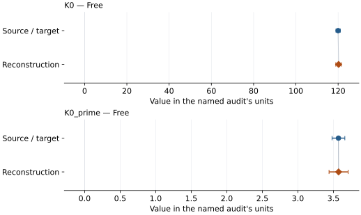
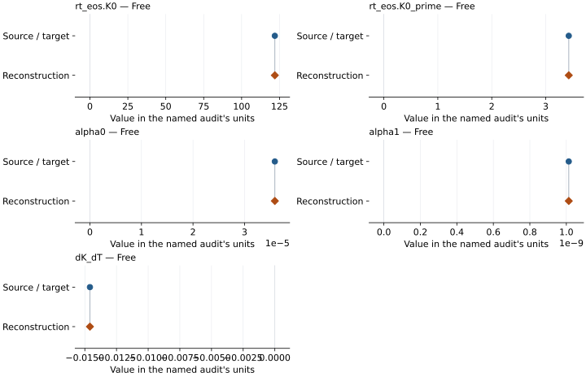

# Siderite (Fe0.95Mn0.05CO3): EOS reconstruction reports

<!-- Generated by scripts.generate_reconstruction_reports; edit EOSMAT instead. -->

[All reconstruction reports](index.md) · [Material and EOS parameters](../material-summaries/siderite_fe095mn005.md)

These reports explain the assessments already stored in EOSMAT. Generating
this page does not refit observations, change classifications or replace source coefficients.

Use [scientific label definitions](../eos-labels.md) to distinguish coefficient
agreement, source verification, author-workflow reproduction and recommendation for use.

| EOS record | Recorded outcome | Coefficient comparison |
| --- | --- | --- |
| [Litasov et al. (2013), natural Fe0.95Mn0.05CO3, 300 K BM3](#record-siderite_fe095mn005_litasov_2013_bm3) | Numerically similar, with qualifications | Graph and table |
| [Peritheos joint thermal refit of Litasov et al. (2013), Fe0.95Mn0.05CO3](#record-siderite_fe095mn005_litasov_2013_joint_thermal_refit) | Coefficient parity achieved | Graph and table |

## Litasov et al. (2013), natural Fe0.95Mn0.05CO3, 300 K BM3

Record: `siderite_fe095mn005_litasov_2013_bm3` · Model: `BM3`

**Outcome: Numerically similar, with qualifications.**

**Scope:** Comparison with the source parameterization.
**Comparison basis:** Every compared free coefficient meets either the recorded combined-two-sigma comparison or parameter-specific numerical similarity screen; the audit does not classify the complete comparison as parity.

[Stored EOS coefficients and source](../material-summaries/siderite_fe095mn005.md#record-siderite_fe095mn005_litasov_2013_bm3)

### What this result establishes

**Separate source-review status:** primary\_source\_validated.
**Usage recommendation:** See the stored EOS qualifications; no recommendation is inferred here.

- Point estimates fall within the published errors, but source weighting and covariance are unspecified. All 27 printed 300 K rows are retained; the source RMS range is not recovered. The conflicting thermal coefficient is withheld. See literature-reproductions/litasov-2013-siderite.md.
- This named numerical assessment alone does not establish author-workflow reproduction, physical accuracy or recommendation for use.

### Data and reconstruction method

- **Dataset identifiers:** siderite\_fe095mn005\_litasov\_2013\_table2\_pvt
- **Observations:** 27
- **Fit kind:** fixed\_V0\_linearized\_bm3
- **Objective:** unweighted\_pressure\_residuals
- **Absolute sigma:** False
- **Free parameters:** K0; K0\_prime
- **Fixed parameters:** V0

Unspecified selections, weights, fixed values or error conventions remain unknown; they have not been inferred for this report.

### Source versus reconstruction

This is a **coefficient comparison**, not an observation or residual plot.
Each panel uses its coefficient's audit units and includes zero. Markers show
stored central values only. Error widths are retained in the table below;
no confidence interval or uncertainty band is inferred. Fixed/adopted values are constraints.

| Parameter | Source / target | Source error | Reconstruction | Reconstruction error | Fit role |
| --- | --- | --- | --- | --- | --- |
| K0 | 120.0 | 1.0 | 120.2242130752825 | 1.322686992288662 | Free |
| K0\_prime | 3.57 | 0.09 | 3.5722139862709232 | 0.13418562510556464 | Free |

Values and reported errors are copied without rounding or conversion from the named audit. Missing errors mean unknown, not zero. Parameter names and volume conventions follow that audit; error widths do not imply a confidence convention.

Recorded diagnostics, covariance and additional protocol

- **Observed pressure range gpa:** \[0, 33.01\]
- **Observed temperature range k:** \[300, 300\]
- **Solver success:** True
- **Rmse gpa:** 0.22730866010656467
- **Published rmse gpa:** 0.22958469054073105

### Detailed evidence and existing plots

- [Earlier detailed record investigation](../primary-eos-refits.md#investigation-siderite_fe095mn005_litasov_2013_bm3).
- [Supporting source report: litasov-2013-siderite](../literature-reproductions/litasov-2013-siderite.md).
- [Record-by-record numerical ledger](../primary-eos-refits.md#records).
- [Source-audit reports](../source-audits.md).

Observation curves and residual plots are provided by the supporting reports where available. Their absence is not filled by a reconstructed curve presented as measured data.

[Machine-readable comparison ledger](https://github.com/CPrescher/peritheos/blob/main/docs/data/primary-eos-refits.json) — look up `siderite_fe095mn005_litasov_2013_bm3`.
[Complete native EOSMAT file](https://github.com/CPrescher/peritheos/blob/main/peritheos/data/materials/siderite_fe095mn005.eosmat).

## Peritheos joint thermal refit of Litasov et al. (2013), Fe0.95Mn0.05CO3

Record: `siderite_fe095mn005_litasov_2013_joint_thermal_refit` · Model: `BM3`

**Outcome: Coefficient parity achieved.**

**Scope:** Reproduction of a stored independent Peritheos refit.
**Comparison basis:** Reproduction of the stored independent Peritheos refit under its declared protocol.

[Stored EOS coefficients and source](../material-summaries/siderite_fe095mn005.md#record-siderite_fe095mn005_litasov_2013_joint_thermal_refit)

### What this result establishes

**Separate source-review status:** primary\_source\_validated.
**Usage recommendation:** See the stored EOS qualifications; no recommendation is inferred here.

- This comparison concerns the stored independent Peritheos refit, not recovery of the original publication's coefficients or author workflow.
- Reproduces the separately labelled Peritheos refit, not either published thermal coefficient set. All 111 printed states enter an unweighted joint pressure-residual fit; V0 and Tr are fixed. The ledger's published column contains the stored refit values for this comparison. Formal covariance excludes fixed V0 uncertainty and calibration systematics. Both source thermal variants remain non-executable evidence.

### Data and reconstruction method

The source/target column below is the stored **Peritheos refit**. Agreement with it does not reproduce the original publication's coefficients.

- **Dataset identifiers:** siderite\_fe095mn005\_litasov\_2013\_table2\_pvt
- **Observations:** 111
- **Fit kind:** joint\_thermal\_reference\_state\_refit
- **Objective:** unweighted\_pressure\_residuals
- **Absolute sigma:** False
- **Free parameters:** rt\_eos.K0; rt\_eos.K0\_prime; alpha0; alpha1; dK\_dT
- **Fixed parameters:** V0; Tr

Unspecified selections, weights, fixed values or error conventions remain unknown; they have not been inferred for this report.

### Source versus reconstruction

This is a **coefficient comparison**, not an observation or residual plot.
Each panel uses its coefficient's audit units and includes zero. Markers show
stored central values only. Error widths are retained in the table below;
no confidence interval or uncertainty band is inferred. Fixed/adopted values are constraints.

| Parameter | Source / target | Source error | Reconstruction | Reconstruction error | Fit role |
| --- | --- | --- | --- | --- | --- |
| rt\_eos.K0 | 121.90288040577286 | 0.8855927629328301 | 121.90287687707195 | 0.8855930573905902 | Free |
| rt\_eos.K0\_prime | 3.427642322450656 | 0.08617420289324854 | 3.427643358874071 | 0.08617420444691092 | Free |
| alpha0 | 3.587839262956832e-05 | 1.442174904027276e-06 | 3.5878359568313225e-05 | 1.4421765164866188e-06 | Free |
| alpha1 | 1.0132344225608927e-09 | 1.9588122131294773e-09 | 1.0133103185840319e-09 | 1.958811150464104e-09 | Free |
| dK\_dT | -0.014597911024728977 | 0.0011884239133985548 | -0.014597941803188182 | 0.0011884224642203412 | Free |

Values and reported errors are copied without rounding or conversion from the named audit. Missing errors mean unknown, not zero. Parameter names and volume conventions follow that audit; error widths do not imply a confidence convention.

Recorded diagnostics, covariance and additional protocol

- **Observed pressure range gpa:** \[0, 33.01\]
- **Observed temperature range k:** \[300, 1673\]
- **Solver success:** True
- **Rmse gpa:** 0.22121166605654996
- **Published rmse gpa:** 0.22121166605746373

### Detailed evidence and existing plots

- [Record-by-record numerical ledger](../primary-eos-refits.md#records).
- [Source-audit reports](../source-audits.md).

Observation curves and residual plots are provided by the supporting reports where available. Their absence is not filled by a reconstructed curve presented as measured data.

[Machine-readable comparison ledger](https://github.com/CPrescher/peritheos/blob/main/docs/data/primary-eos-refits.json) — look up `siderite_fe095mn005_litasov_2013_joint_thermal_refit`.
[Complete native EOSMAT file](https://github.com/CPrescher/peritheos/blob/main/peritheos/data/materials/siderite_fe095mn005.eosmat).
