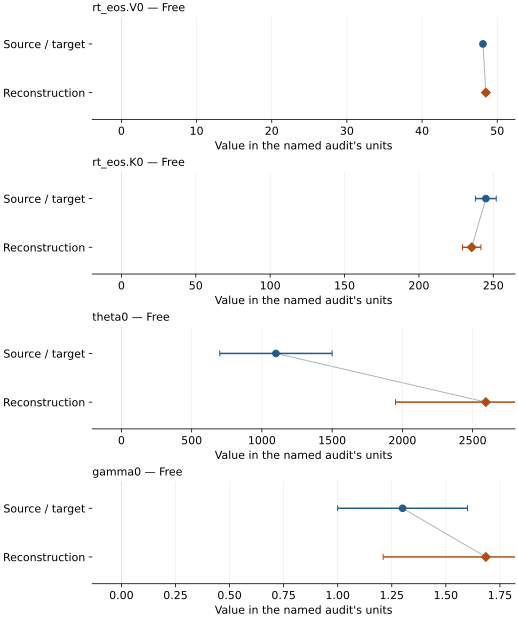

# Silica (CaCl2-type): EOS reconstruction reports

<!-- Generated by scripts.generate_reconstruction_reports; edit EOSMAT instead. -->

[All reconstruction reports](index.md) · [Material and EOS parameters](../material-summaries/silica_cacl2.md)

These reports explain the assessments already stored in EOSMAT. Generating
this page does not refit observations, change classifications or replace source coefficients.

Use [scientific label definitions](../eos-labels.md) to distinguish coefficient
agreement, source verification, author-workflow reproduction and recommendation for use.

| EOS record | Recorded outcome | Coefficient comparison |
| --- | --- | --- |
| [Sun et al. (2019), BM2-MGD](#record-silica_cacl2_sun_2019_bm2_1) | Numerically similar, with qualifications | Graph and table |

## Sun et al. (2019), BM2-MGD

Record: `silica_cacl2_sun_2019_bm2_1` · Model: `BM2`

**Outcome: Numerically similar, with qualifications.**

**Scope:** Comparison with the source parameterization.
**Comparison basis:** Every compared free coefficient meets either the recorded combined-two-sigma comparison or parameter-specific numerical similarity screen; the audit does not classify the complete comparison as parity.

[Stored EOS coefficients and source](../material-summaries/silica_cacl2.md#record-silica_cacl2_sun_2019_bm2_1)

### What this result establishes

**Separate source-review status:** primary\_source\_validated.
**Usage recommendation:** See the stored EOS qualifications; no recommendation is inferred here.

- This named numerical assessment alone does not establish author-workflow reproduction, physical accuracy or recommendation for use.

### Data and reconstruction method

- **Dataset identifiers:** sio2\_cacl2\_sun\_2019\_dataset\_s1\_pvt
- **Observations:** 48
- **Fit kind:** joint\_pvt
- **Selection:** all rows
- **Objective:** errors\_in\_variables
- **Absolute sigma:** True
- **Free parameters:** rt\_eos.V0; rt\_eos.K0; theta0; gamma0
- **Fixed parameters:** q; n

Unspecified selections, weights, fixed values or error conventions remain unknown; they have not been inferred for this report.

### Source versus reconstruction

This is a **coefficient comparison**, not an observation or residual plot.
Each panel uses its coefficient's audit units and includes zero. Markers show
stored central values only. Error widths are retained in the table below;
no confidence interval or uncertainty band is inferred. Fixed/adopted values are constraints.

| Parameter | Source / target | Source error | Reconstruction | Reconstruction error | Fit role |
| --- | --- | --- | --- | --- | --- |
| rt\_eos.V0 | 48.1 | 0.2 | 48.485206451852385 | 0.20725728953425138 | Free |
| rt\_eos.K0 | 245.0 | 7.0 | 235.5085295711504 | 6.220566444223275 | Free |
| theta0 | 1100.0 | 400.0 | 2594.2340425650036 | 643.243317153621 | Free |
| gamma0 | 1.3 | 0.3 | 1.684938828541015 | 0.47487077401613464 | Free |

Values and reported errors are copied without rounding or conversion from the named audit. Missing errors mean unknown, not zero. Parameter names and volume conventions follow that audit; error widths do not imply a confidence convention.

Recorded diagnostics, covariance and additional protocol

- **Columns:**
    - **Pressure:** pressure\_gpa
    - **Temperature:** temperature\_k
    - **Volume:** volume\_angstrom3
- **Observed pressure range gpa:** \[64.4, 143.0\]
- **Observed temperature range k:** \[300.0, 2250.0\]
- **Observed volume range:** \[35.68, 40.65\]
- **Degrees of freedom:** 44
- **Solver success:** True
- **Solver message:** \`ftol\` termination condition is satisfied.
- **Rmse gpa:** 1.5045744179271328
- **Published rmse gpa:** 1.907159817564574
- **Reduced chi square:** 1.0838539447098678

### Detailed evidence and existing plots

- [Earlier detailed record investigation](../primary-eos-refits.md#investigation-silica_cacl2_sun_2019_bm2_1).
- [Record-by-record numerical ledger](../primary-eos-refits.md#records).
- [Source-audit reports](../source-audits.md).

Observation curves and residual plots are provided by the supporting reports where available. Their absence is not filled by a reconstructed curve presented as measured data.

[Machine-readable comparison ledger](https://github.com/CPrescher/peritheos/blob/main/docs/data/primary-eos-refits.json) — look up `silica_cacl2_sun_2019_bm2_1`.
[Complete native EOSMAT file](https://github.com/CPrescher/peritheos/blob/main/peritheos/data/materials/silica_cacl2.eosmat).
