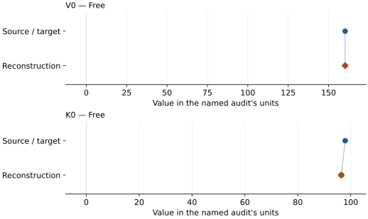

# Silicon (Si-I, diamond cubic): EOS reconstruction reports

<!-- Generated by scripts.generate_reconstruction_reports; edit EOSMAT instead. -->

[All reconstruction reports](index.md) · [Material and EOS parameters](../material-summaries/silicon.md)

These reports explain the assessments already stored in EOSMAT. Generating
this page does not refit observations, change classifications or replace source coefficients.

Use [scientific label definitions](../eos-labels.md) to distinguish coefficient
agreement, source verification, author-workflow reproduction and recommendation for use.

| EOS record | Recorded outcome | Coefficient comparison |
| --- | --- | --- |
| [Anzellini et al. (2019), constrained Vinet](#record-silicon_anzellini_2019_vinet_1) | Numerically similar, with qualifications | Graph and table |

## Anzellini et al. (2019), constrained Vinet

Record: `silicon_anzellini_2019_vinet_1` · Model: `Vinet`

**Outcome: Numerically similar, with qualifications.**

**Scope:** Comparison with the source parameterization.
**Comparison basis:** Every compared free coefficient meets either the recorded combined-two-sigma comparison or parameter-specific numerical similarity screen; the audit does not classify the complete comparison as parity.

[Stored EOS coefficients and source](../material-summaries/silicon.md#record-silicon_anzellini_2019_vinet_1)

### What this result establishes

**Separate source-review status:** primary\_source\_validated.
**Usage recommendation:** See the stored EOS qualifications; no recommendation is inferred here.

- This named numerical assessment alone does not establish author-workflow reproduction, physical accuracy or recommendation for use.

### Data and reconstruction method

- **Dataset identifiers:** silicon\_anzellini\_2019\_tables1\_4\_6\_7\_compression
- **Observations:** 44
- **Fit kind:** isothermal\_pv
- **Selection:** phase=I
- **Objective:** pressure\_residuals
- **Absolute sigma:** True
- **Free parameters:** V0; K0
- **Fixed parameters:** K0\_prime

Unspecified selections, weights, fixed values or error conventions remain unknown; they have not been inferred for this report.

### Source versus reconstruction

This is a **coefficient comparison**, not an observation or residual plot.
Each panel uses its coefficient's audit units and includes zero. Markers show
stored central values only. Error widths are retained in the table below;
no confidence interval or uncertainty band is inferred. Fixed/adopted values are constraints.

| Parameter | Source / target | Source error | Reconstruction | Reconstruction error | Fit role |
| --- | --- | --- | --- | --- | --- |
| V0 | 160.248 | Not specified | 160.21186069359948 | 0.09505219982877938 | Free |
| K0 | 97.89 | Not specified | 96.43184854524975 | 0.7768789566851051 | Free |

Values and reported errors are copied without rounding or conversion from the named audit. Missing errors mean unknown, not zero. Parameter names and volume conventions follow that audit; error widths do not imply a confidence convention.

Recorded diagnostics, covariance and additional protocol

- **Columns:**
    - **Pressure:** pressure\_gold\_gpa\|pressure\_tungsten\_gpa\|pressure\_ruby\_gpa
    - **Temperature:** Not specified
    - **Volume:** silicon\_lattice\_a\_angstrom
- **Observed pressure range gpa:** \[0.0, 13.2\]
- **Observed temperature range k:** Not specified
- **Observed volume range:** \[143.630847053, 160.191477991\]
- **Degrees of freedom:** 42
- **Solver success:** True
- **Solver message:** Both \`ftol\` and \`xtol\` termination conditions are satisfied.
- **Rmse gpa:** 0.1821641827595541
- **Published rmse gpa:** 0.25228931871931043
- **Reduced chi square:** 0.03476396993190652

### Detailed evidence and existing plots

- [Earlier detailed record investigation](../primary-eos-refits.md#investigation-silicon_anzellini_2019_vinet_1).
- [Record-by-record numerical ledger](../primary-eos-refits.md#records).
- [Source-audit reports](../source-audits.md).

Observation curves and residual plots are provided by the supporting reports where available. Their absence is not filled by a reconstructed curve presented as measured data.

[Machine-readable comparison ledger](https://github.com/CPrescher/peritheos/blob/main/docs/data/primary-eos-refits.json) — look up `silicon_anzellini_2019_vinet_1`.
[Complete native EOSMAT file](https://github.com/CPrescher/peritheos/blob/main/peritheos/data/materials/silicon.eosmat).
