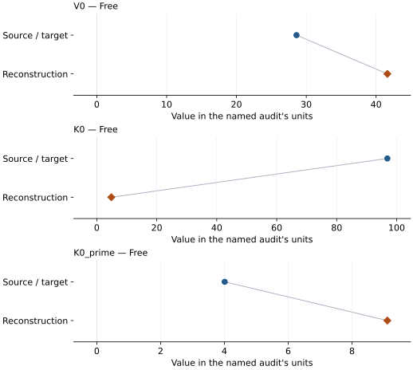

# Silicon (Si-VII, hcp): EOS reconstruction reports

<!-- Generated by scripts.generate_reconstruction_reports; edit EOSMAT instead. -->

[All reconstruction reports](index.md) · [Material and EOS parameters](../material-summaries/silicon_vii.md)

These reports explain the assessments already stored in EOSMAT. Generating
this page does not refit observations, change classifications or replace source coefficients.

Use [scientific label definitions](../eos-labels.md) to distinguish coefficient
agreement, source verification, author-workflow reproduction and recommendation for use.

| EOS record | Recorded outcome | Coefficient comparison |
| --- | --- | --- |
| [Anzellini et al. (2019), 300 K Vinet](#record-silicon_vii_anzellini_2019_vinet_1) | Parity not achieved for this comparison | Graph and table |

## Anzellini et al. (2019), 300 K Vinet

Record: `silicon_vii_anzellini_2019_vinet_1` · Model: `Vinet`

**Outcome: Parity not achieved for this comparison.**

**Scope:** Comparison with the source parameterization.
**Comparison basis:** The recorded parameter reconstruction did not meet the audit's agreement criterion; the parameter comparisons retain the actual reconstructed values.

[Stored EOS coefficients and source](../material-summaries/silicon_vii.md#record-silicon_vii_anzellini_2019_vinet_1)

### What this result establishes

**Separate source-review status:** primary\_source\_validated.
**Usage recommendation:** See the stored EOS qualifications; no recommendation is inferred here.

- This named numerical assessment alone does not establish author-workflow reproduction, physical accuracy or recommendation for use.

### Data and reconstruction method

- **Dataset identifiers:** silicon\_anzellini\_2019\_tables1\_4\_6\_7\_compression
- **Observations:** 25
- **Fit kind:** isothermal\_pv
- **Selection:** phase=VII
- **Objective:** pressure\_residuals
- **Absolute sigma:** True
- **Free parameters:** V0; K0; K0\_prime
- **Fixed parameters:** None declared

Unspecified selections, weights, fixed values or error conventions remain unknown; they have not been inferred for this report.

### Source versus reconstruction

This is a **coefficient comparison**, not an observation or residual plot.
Each panel uses its coefficient's audit units and includes zero. Markers show
stored central values only. Error widths are retained in the table below;
no confidence interval or uncertainty band is inferred. Fixed/adopted values are constraints.

| Parameter | Source / target | Source error | Reconstruction | Reconstruction error | Fit role |
| --- | --- | --- | --- | --- | --- |
| V0 | 28.6 | 0.2 | 41.61388882865503 | 15.579440094875807 | Free |
| K0 | 96.9 | 0.9 | 4.845000000000001 | 13.575661949382226 | Free |
| K0\_prime | 4.01 | 0.04 | 9.109685061321683 | 2.8032984672439807 | Free |

Values and reported errors are copied without rounding or conversion from the named audit. Missing errors mean unknown, not zero. Parameter names and volume conventions follow that audit; error widths do not imply a confidence convention.

Recorded diagnostics, covariance and additional protocol

- **Columns:**
    - **Pressure:** pressure\_gold\_gpa\|pressure\_tungsten\_gpa\|pressure\_ruby\_gpa
    - **Temperature:** Not specified
    - **Volume:** silicon\_lattice\_a\_angstrom
- **Observed pressure range gpa:** \[47.7, 93.7\]
- **Observed temperature range k:** Not specified
- **Observed volume range:** \[18.994759460133043, 21.64265740715537\]
- **Degrees of freedom:** 22
- **Solver success:** True
- **Solver message:** Both \`ftol\` and \`xtol\` termination conditions are satisfied.
- **Rmse gpa:** 0.3781328178079222
- **Published rmse gpa:** 3.559994893107983
- **Reduced chi square:** 0.16248230443563555

### Detailed evidence and existing plots

- [Earlier detailed record investigation](../primary-eos-refits.md#investigation-silicon_vii_anzellini_2019_vinet_1).
- [Record-by-record numerical ledger](../primary-eos-refits.md#records).
- [Source-audit reports](../source-audits.md).

Observation curves and residual plots are provided by the supporting reports where available. Their absence is not filled by a reconstructed curve presented as measured data.

[Machine-readable comparison ledger](https://github.com/CPrescher/peritheos/blob/main/docs/data/primary-eos-refits.json) — look up `silicon_vii_anzellini_2019_vinet_1`.
[Complete native EOSMAT file](https://github.com/CPrescher/peritheos/blob/main/peritheos/data/materials/silicon_vii.eosmat).
