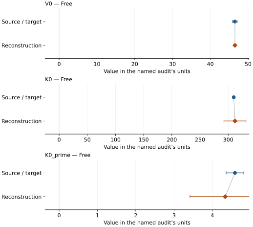
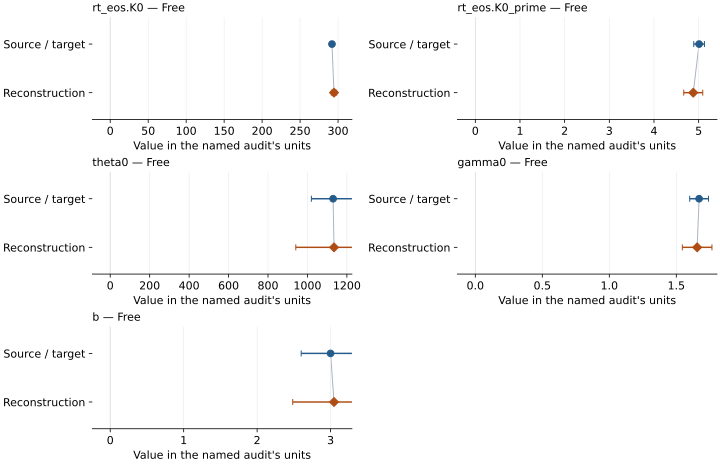
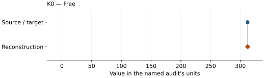

# SiO2 stishovite: EOS reconstruction reports

<!-- Generated by scripts.generate_reconstruction_reports; edit EOSMAT instead. -->

[All reconstruction reports](index.md) · [Material and EOS parameters](../material-summaries/sio2_stv_andr.md)

These reports explain the assessments already stored in EOSMAT. Generating
this page does not refit observations, change classifications or replace source coefficients.

Use [scientific label definitions](../eos-labels.md) to distinguish coefficient
agreement, source verification, author-workflow reproduction and recommendation for use.

| EOS record | Recorded outcome | Coefficient comparison |
| --- | --- | --- |
| [Andrault et al. (2003)](#record-sio2_stv_andr_andrault_2003_bm3_1) | Coefficient parity achieved | Graph and table |
| [Wang et al. (2012), principal Vinet-MGD presentation](#record-sio2_stv_andr_wang_2012_vinet_mgd_2) | Coefficient parity achieved | Graph and table |
| [Driver et al. (2010), QMC 300 K Vinet](#record-sio2_stv_andr_driver_2010_qmc_300k_vinet) | Complete independent refit unavailable | No numeric coefficient pair recorded |
| [Holland et al. (2013), stv modified Tait](#record-sio2_stv_andr_holland_2013_stv_modified_tait) | Complete independent refit unavailable | No numeric coefficient pair recorded |
| [Akber-Knutson et al. (2002), VIBC 300 K BM3](#record-stishovite_akber_knutson_2002_vibc_300k_bm3) | Complete independent refit unavailable | No numeric coefficient pair recorded |
| [Zhang and Bukowinski (1991), MPIB stishovite](#record-stishovite_zhang_bukowinski_1991_mpib_bm3) | Complete independent refit unavailable | No numeric coefficient pair recorded |
| [Nisr et al. (2017), dry reference stishovite BM3](#record-stishovite_nisr_2017_dry_bm3) | Coefficient parity achieved | Graph and table |

## Andrault et al. (2003)

Record: `sio2_stv_andr_andrault_2003_bm3_1` · Model: `BM3`

**Outcome: Coefficient parity achieved.**

**Scope:** Comparison with the source parameterization.
**Comparison basis:** Every compared free coefficient meets both the recorded combined-two-sigma comparison and parameter-specific numerical similarity screen. Error conventions and fit qualifications remain applicable.

[Stored EOS coefficients and source](../material-summaries/sio2_stv_andr.md#record-sio2_stv_andr_andrault_2003_bm3_1)

### What this result establishes

**Separate source-review status:** primary\_source\_validated.
**Usage recommendation:** See the stored EOS qualifications; no recommendation is inferred here.

- This named numerical assessment alone does not establish author-workflow reproduction, physical accuracy or recommendation for use.

### Data and reconstruction method

- **Dataset identifiers:** stishovite\_andrault\_2003\_tables1\_2\_compression
- **Observations:** 24
- **Fit kind:** isothermal\_pv
- **Selection:** all rows
- **Objective:** errors\_in\_variables
- **Absolute sigma:** True
- **Free parameters:** V0; K0; K0\_prime
- **Fixed parameters:** None declared

Unspecified selections, weights, fixed values or error conventions remain unknown; they have not been inferred for this report.

### Source versus reconstruction

This is a **coefficient comparison**, not an observation or residual plot.
Each panel uses its coefficient's audit units and includes zero. Markers show
stored central values only. Error widths are retained in the table below;
no confidence interval or uncertainty band is inferred. Fixed/adopted values are constraints.

| Parameter | Source / target | Source error | Reconstruction | Reconstruction error | Fit role |
| --- | --- | --- | --- | --- | --- |
| V0 | 46.5025 | 0.61 | 46.51620569580344 | 0.06681011905733115 | Free |
| K0 | 309.9 | 1.1 | 312.0083609784845 | 19.582738316007905 | Free |
| K0\_prime | 4.59 | 0.23 | 4.335524418230295 | 0.9203830703703608 | Free |

Values and reported errors are copied without rounding or conversion from the named audit. Missing errors mean unknown, not zero. Parameter names and volume conventions follow that audit; error widths do not imply a confidence convention.

Recorded diagnostics, covariance and additional protocol

- **Columns:**
    - **Pressure:** pressure\_gpa
    - **Temperature:** Not specified
    - **Volume:** volume\_a3\_conventional\_cell
- **Observed pressure range gpa:** \[0.0, 52.73\]
- **Observed temperature range k:** Not specified
- **Observed volume range:** \[40.999, 46.5126\]
- **Degrees of freedom:** 21
- **Solver success:** True
- **Solver message:** Both \`ftol\` and \`xtol\` termination conditions are satisfied.
- **Rmse gpa:** 0.6018195432010657
- **Published rmse gpa:** 0.6225020567661582
- **Reduced chi square:** 0.4174152920004365

### Detailed evidence and existing plots

- [Record-by-record numerical ledger](../primary-eos-refits.md#records).
- [Source-audit reports](../source-audits.md).

Observation curves and residual plots are provided by the supporting reports where available. Their absence is not filled by a reconstructed curve presented as measured data.

[Machine-readable comparison ledger](https://github.com/CPrescher/peritheos/blob/main/docs/data/primary-eos-refits.json) — look up `sio2_stv_andr_andrault_2003_bm3_1`.
[Complete native EOSMAT file](https://github.com/CPrescher/peritheos/blob/main/peritheos/data/materials/sio2_stv_andr.eosmat).

## Wang et al. (2012), principal Vinet-MGD presentation

Record: `sio2_stv_andr_wang_2012_vinet_mgd_2` · Model: `Vinet`

**Outcome: Coefficient parity achieved.**

**Scope:** Comparison with the source parameterization.
**Comparison basis:** Every compared free coefficient meets both the recorded combined-two-sigma comparison and parameter-specific numerical similarity screen. Error conventions and fit qualifications remain applicable.

[Stored EOS coefficients and source](../material-summaries/sio2_stv_andr.md#record-sio2_stv_andr_wang_2012_vinet_mgd_2)

### What this result establishes

**Separate source-review status:** primary\_source\_validated.
**Usage recommendation:** See the stored EOS qualifications; no recommendation is inferred here.

- This named numerical assessment alone does not establish author-workflow reproduction, physical accuracy or recommendation for use.

### Data and reconstruction method

- **Dataset identifiers:** stishovite\_wang\_2012\_table1\_pvt
- **Observations:** 56
- **Fit kind:** joint\_pvt
- **Selection:** all rows
- **Objective:** errors\_in\_variables
- **Absolute sigma:** True
- **Free parameters:** rt\_eos.K0; rt\_eos.K0\_prime; theta0; gamma0; b
- **Fixed parameters:** V0; Tr; a; n

Unspecified selections, weights, fixed values or error conventions remain unknown; they have not been inferred for this report.

### Source versus reconstruction

This is a **coefficient comparison**, not an observation or residual plot.
Each panel uses its coefficient's audit units and includes zero. Markers show
stored central values only. Error widths are retained in the table below;
no confidence interval or uncertainty band is inferred. Fixed/adopted values are constraints.

| Parameter | Source / target | Source error | Reconstruction | Reconstruction error | Fit role |
| --- | --- | --- | --- | --- | --- |
| rt\_eos.K0 | 292.0 | 2.0 | 294.6773736502755 | 3.498249817619043 | Free |
| rt\_eos.K0\_prime | 5.01 | 0.12 | 4.878995649116853 | 0.21281160051056341 | Free |
| theta0 | 1130.0 | 110.0 | 1134.7092148557913 | 193.7972052633596 | Free |
| gamma0 | 1.67 | 0.07 | 1.655519686643682 | 0.11045969542863156 | Free |
| b | 3.0 | 0.4 | 3.0469258011103415 | 0.5624754863702742 | Free |

Values and reported errors are copied without rounding or conversion from the named audit. Missing errors mean unknown, not zero. Parameter names and volume conventions follow that audit; error widths do not imply a confidence convention.

Recorded diagnostics, covariance and additional protocol

- **Columns:**
    - **Pressure:** pressure\_gpa
    - **Temperature:** temperature\_k
    - **Volume:** volume\_a3\_conventional\_cell
- **Observed pressure range gpa:** \[16.85, 54.5\]
- **Observed temperature range k:** \[300.0, 1700.0\]
- **Observed volume range:** \[40.8, 44.8\]
- **Degrees of freedom:** 51
- **Solver success:** True
- **Solver message:** \`ftol\` termination condition is satisfied.
- **Rmse gpa:** 0.10024480560149769
- **Published rmse gpa:** 0.21344058766885318
- **Reduced chi square:** 0.4060514859634414

### Detailed evidence and existing plots

- [Record-by-record numerical ledger](../primary-eos-refits.md#records).
- [Source-audit reports](../source-audits.md).

Observation curves and residual plots are provided by the supporting reports where available. Their absence is not filled by a reconstructed curve presented as measured data.

[Machine-readable comparison ledger](https://github.com/CPrescher/peritheos/blob/main/docs/data/primary-eos-refits.json) — look up `sio2_stv_andr_wang_2012_vinet_mgd_2`.
[Complete native EOSMAT file](https://github.com/CPrescher/peritheos/blob/main/peritheos/data/materials/sio2_stv_andr.eosmat).

## Driver et al. (2010), QMC 300 K Vinet

Record: `sio2_stv_andr_driver_2010_qmc_300k_vinet` · Model: `Vinet`

**Outcome: Complete independent refit unavailable.**

**Scope:** Comparison with the source parameterization.
**Comparison basis:** The source describes approximately six volumes spanning +/-10% and plots the statistical envelope, but does not tabulate the individual QMC energies or pressures.

[Stored EOS coefficients and source](../material-summaries/sio2_stv_andr.md#record-sio2_stv_andr_driver_2010_qmc_300k_vinet)

### What this result establishes

**Separate source-review status:** primary\_source\_validated.
**Usage recommendation:** See the stored EOS qualifications; no recommendation is inferred here.

- This named numerical assessment alone does not establish author-workflow reproduction, physical accuracy or recommendation for use.
- No reconstructed coefficient table is recorded for this assessment; no missing values have been inferred.

### Data and reconstruction method

- **Dataset identifiers:** None declared
- **Fixed parameters:** None declared

Unspecified selections, weights, fixed values or error conventions remain unknown; they have not been inferred for this report.

### Why no coefficient graph is shown

No numeric source/reconstruction pair is recorded for this assessment. A graph would require information that is not available here; no values or observations have been invented.

### Detailed evidence and existing plots

- [Record-by-record numerical ledger](../primary-eos-refits.md#records).
- [Source-audit reports](../source-audits.md).

Observation curves and residual plots are provided by the supporting reports where available. Their absence is not filled by a reconstructed curve presented as measured data.

[Machine-readable comparison ledger](https://github.com/CPrescher/peritheos/blob/main/docs/data/primary-eos-refits.json) — look up `sio2_stv_andr_driver_2010_qmc_300k_vinet`.
[Complete native EOSMAT file](https://github.com/CPrescher/peritheos/blob/main/peritheos/data/materials/sio2_stv_andr.eosmat).

## Holland et al. (2013), stv modified Tait

Record: `sio2_stv_andr_holland_2013_stv_modified_tait` · Model: `ModifiedTait`

**Outcome: Complete independent refit unavailable.**

**Scope:** Comparison with the source parameterization.
**Comparison basis:** The official tc-ds62 stv block provides all four coefficients.

[Stored EOS coefficients and source](../material-summaries/sio2_stv_andr.md#record-sio2_stv_andr_holland_2013_stv_modified_tait)

### What this result establishes

**Separate source-review status:** primary\_source\_validated.
**Usage recommendation:** See the stored EOS qualifications; no recommendation is inferred here.

- This named numerical assessment alone does not establish author-workflow reproduction, physical accuracy or recommendation for use.
- No reconstructed coefficient table is recorded for this assessment; no missing values have been inferred.

### Data and reconstruction method

- **Dataset identifiers:** None declared
- **Fixed parameters:** None declared

Unspecified selections, weights, fixed values or error conventions remain unknown; they have not been inferred for this report.

### Why no coefficient graph is shown

No numeric source/reconstruction pair is recorded for this assessment. A graph would require information that is not available here; no values or observations have been invented.

### Detailed evidence and existing plots

- [Record-by-record numerical ledger](../primary-eos-refits.md#records).
- [Source-audit reports](../source-audits.md).

Observation curves and residual plots are provided by the supporting reports where available. Their absence is not filled by a reconstructed curve presented as measured data.

[Machine-readable comparison ledger](https://github.com/CPrescher/peritheos/blob/main/docs/data/primary-eos-refits.json) — look up `sio2_stv_andr_holland_2013_stv_modified_tait`.
[Complete native EOSMAT file](https://github.com/CPrescher/peritheos/blob/main/peritheos/data/materials/sio2_stv_andr.eosmat).

## Akber-Knutson et al. (2002), VIBC 300 K BM3

Record: `stishovite_akber_knutson_2002_vibc_300k_bm3` · Model: `BM3`

**Outcome: Complete independent refit unavailable.**

**Scope:** Comparison with the source parameterization.
**Comparison basis:** The paper tabulates coefficients but not the calculated energy-volume grid.

[Stored EOS coefficients and source](../material-summaries/sio2_stv_andr.md#record-stishovite_akber_knutson_2002_vibc_300k_bm3)

### What this result establishes

**Separate source-review status:** primary\_source\_validated.
**Usage recommendation:** See the stored EOS qualifications; no recommendation is inferred here.

- This named numerical assessment alone does not establish author-workflow reproduction, physical accuracy or recommendation for use.
- No reconstructed coefficient table is recorded for this assessment; no missing values have been inferred.

### Data and reconstruction method

- **Dataset identifiers:** None declared
- **Fixed parameters:** None declared

Unspecified selections, weights, fixed values or error conventions remain unknown; they have not been inferred for this report.

### Why no coefficient graph is shown

No numeric source/reconstruction pair is recorded for this assessment. A graph would require information that is not available here; no values or observations have been invented.

### Detailed evidence and existing plots

- [Record-by-record numerical ledger](../primary-eos-refits.md#records).
- [Source-audit reports](../source-audits.md).

Observation curves and residual plots are provided by the supporting reports where available. Their absence is not filled by a reconstructed curve presented as measured data.

[Machine-readable comparison ledger](https://github.com/CPrescher/peritheos/blob/main/docs/data/primary-eos-refits.json) — look up `stishovite_akber_knutson_2002_vibc_300k_bm3`.
[Complete native EOSMAT file](https://github.com/CPrescher/peritheos/blob/main/peritheos/data/materials/sio2_stv_andr.eosmat).

## Zhang and Bukowinski (1991), MPIB stishovite

Record: `stishovite_zhang_bukowinski_1991_mpib_bm3` · Model: `BM3`

**Outcome: Complete independent refit unavailable.**

**Scope:** Comparison with the source parameterization.
**Comparison basis:** Calculated states are plotted but not tabulated.

[Stored EOS coefficients and source](../material-summaries/sio2_stv_andr.md#record-stishovite_zhang_bukowinski_1991_mpib_bm3)

### What this result establishes

**Separate source-review status:** primary\_source\_validated.
**Usage recommendation:** See the stored EOS qualifications; no recommendation is inferred here.

- This named numerical assessment alone does not establish author-workflow reproduction, physical accuracy or recommendation for use.
- No reconstructed coefficient table is recorded for this assessment; no missing values have been inferred.

### Data and reconstruction method

- **Dataset identifiers:** None declared
- **Fixed parameters:** None declared

Unspecified selections, weights, fixed values or error conventions remain unknown; they have not been inferred for this report.

### Why no coefficient graph is shown

No numeric source/reconstruction pair is recorded for this assessment. A graph would require information that is not available here; no values or observations have been invented.

### Detailed evidence and existing plots

- [Record-by-record numerical ledger](../primary-eos-refits.md#records).
- [Source-audit reports](../source-audits.md).

Observation curves and residual plots are provided by the supporting reports where available. Their absence is not filled by a reconstructed curve presented as measured data.

[Machine-readable comparison ledger](https://github.com/CPrescher/peritheos/blob/main/docs/data/primary-eos-refits.json) — look up `stishovite_zhang_bukowinski_1991_mpib_bm3`.
[Complete native EOSMAT file](https://github.com/CPrescher/peritheos/blob/main/peritheos/data/materials/sio2_stv_andr.eosmat).

## Nisr et al. (2017), dry reference stishovite BM3

Record: `stishovite_nisr_2017_dry_bm3` · Model: `BM3`

**Outcome: Coefficient parity achieved.**

**Scope:** Comparison with the source parameterization.
**Comparison basis:** Every compared free coefficient meets both the recorded combined-two-sigma comparison and parameter-specific numerical similarity screen. Error conventions and fit qualifications remain applicable.

[Stored EOS coefficients and source](../material-summaries/sio2_stv_andr.md#record-stishovite_nisr_2017_dry_bm3)

### What this result establishes

**Separate source-review status:** primary\_source\_validated.
**Usage recommendation:** See the stored EOS qualifications; no recommendation is inferred here.

- Coefficient parity within published 1-sigma widths, not recovery of an unpublished weighting protocol. Pressure errors, gold volumes and source covariance are absent. Printed zero volume errors are retained, never treated as infinite weights. Volume-objective sensitivity fits are in the paper-specific reproduction.
- Original least-squares dependent variable and weights are unspecified; diagnostic objective is explicit.
- Pressure marker variant and row-wise marker observations unavailable.
- This named numerical assessment alone does not establish author-workflow reproduction, physical accuracy or recommendation for use.

### Data and reconstruction method

- **Dataset identifiers:** nisr\_2017\_silica\_tables\_s1\_s4
- **Observations:** 20
- **Fit kind:** diagnostic\_unweighted\_pressure
- **Selection:** All Table S1 rows, including its ambient row when present; Table S3 coexistence rows excluded.
- **Objective:** unweighted pressure residuals; source dependent variable and weights unspecified
- **Absolute sigma:** False
- **Free parameters:** K0
- **Fixed parameters:** V0; K0\_prime

Unspecified selections, weights, fixed values or error conventions remain unknown; they have not been inferred for this report.

### Source versus reconstruction

This is a **coefficient comparison**, not an observation or residual plot.
Each panel uses its coefficient's audit units and includes zero. Markers show
stored central values only. Error widths are retained in the table below;
no confidence interval or uncertainty band is inferred. Fixed/adopted values are constraints.

| Parameter | Source / target | Source error | Reconstruction | Reconstruction error | Fit role |
| --- | --- | --- | --- | --- | --- |
| K0 | 312.0 | 2.0 | 312.13550830271987 | 1.2359903703892177 | Free |

Values and reported errors are copied without rounding or conversion from the named audit. Missing errors mean unknown, not zero. Parameter names and volume conventions follow that audit; error widths do not imply a confidence convention.

Recorded diagnostics, covariance and additional protocol

- **Observed pressure range gpa:** \[0.0, 62.934\]
- **Degrees of freedom:** 19
- **Solver success:** True
- **Rmse gpa:** 0.6474641865194608
- **Published rmse gpa:** 0.6476689559796908

### Detailed evidence and existing plots

- [Supporting source report: nisr-2017-hydrous-silica](../literature-reproductions/nisr-2017-hydrous-silica.md).
- [Record-by-record numerical ledger](../primary-eos-refits.md#records).
- [Source-audit reports](../source-audits.md).

Observation curves and residual plots are provided by the supporting reports where available. Their absence is not filled by a reconstructed curve presented as measured data.

[Machine-readable comparison ledger](https://github.com/CPrescher/peritheos/blob/main/docs/data/primary-eos-refits.json) — look up `stishovite_nisr_2017_dry_bm3`.
[Complete native EOSMAT file](https://github.com/CPrescher/peritheos/blob/main/peritheos/data/materials/sio2_stv_andr.eosmat).
