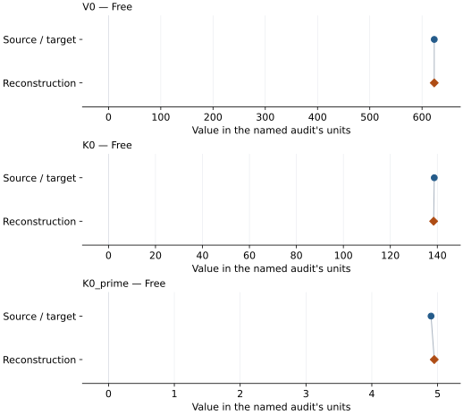
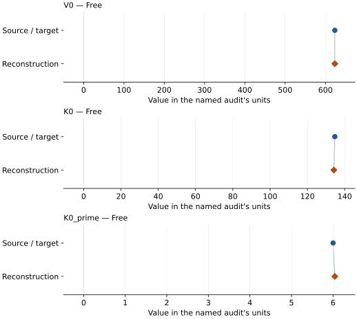
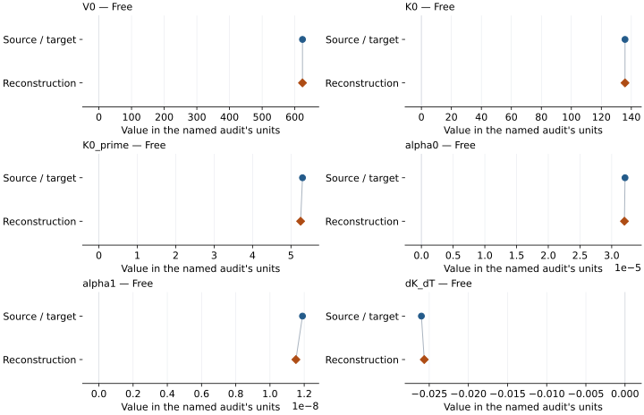
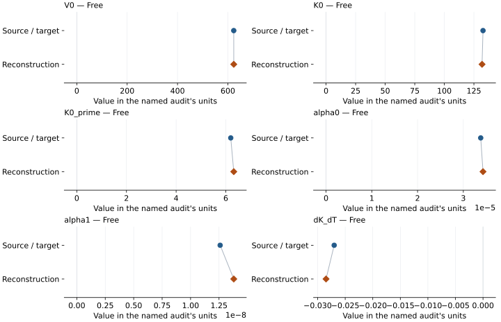
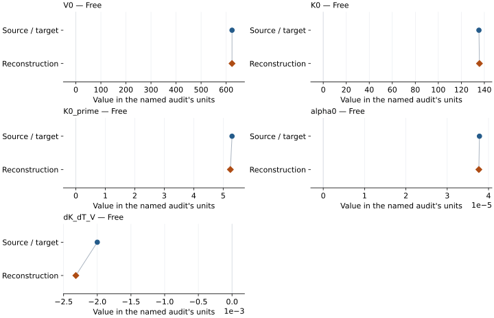
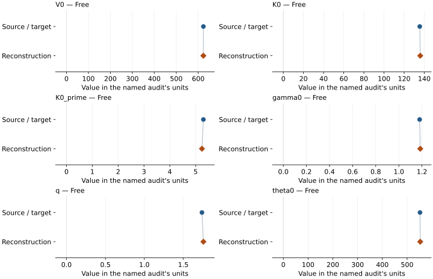
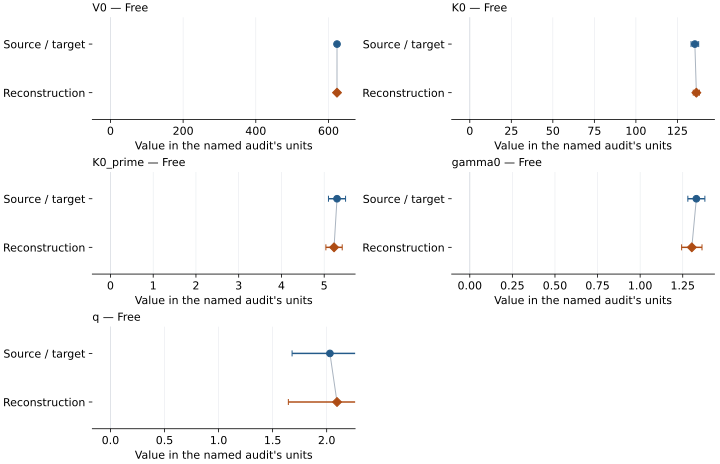

# Superhydrous phase B (LT, nominally pure Mg): EOS reconstruction reports

<!-- Generated by scripts.generate_reconstruction_reports; edit EOSMAT instead. -->

[All reconstruction reports](index.md) · [Material and EOS parameters](../material-summaries/superhydrous_phase_b_lt.md)

These reports explain the assessments already stored in EOSMAT. Generating
this page does not refit observations, change classifications or replace source coefficients.

Use [scientific label definitions](../eos-labels.md) to distinguish coefficient
agreement, source verification, author-workflow reproduction and recommendation for use.

| EOS record | Recorded outcome | Coefficient comparison |
| --- | --- | --- |
| [Litasov et al. (2007), bm3 a89](#record-superhydrous_phase_b_lt_litasov_2007_bm3_a89) | Numerically similar, with qualifications | Graph and table |
| [Litasov et al. (2007), bm3 t03](#record-superhydrous_phase_b_lt_litasov_2007_bm3_t03) | Numerically similar, with qualifications | Graph and table |
| [Litasov et al. (2007), htbm a89](#record-superhydrous_phase_b_lt_litasov_2007_htbm_a89) | Numerically similar, with qualifications | Graph and table |
| [Litasov et al. (2007), htbm t03](#record-superhydrous_phase_b_lt_litasov_2007_htbm_t03) | Numerically similar, with qualifications | Graph and table |
| [Litasov et al. (2007), thermal pressure a89](#record-superhydrous_phase_b_lt_litasov_2007_thermal_pressure_a89) | Numerically similar, with qualifications | Graph and table |
| [Litasov et al. (2007), mgd free debye a89](#record-superhydrous_phase_b_lt_litasov_2007_mgd_free_debye_a89) | Numerically similar, with qualifications | Graph and table |
| [Litasov et al. (2007), mgd elastic debye a89](#record-superhydrous_phase_b_lt_litasov_2007_mgd_elastic_debye_a89) | Numerically similar, with qualifications | Graph and table |

## Litasov et al. (2007), bm3 a89

Record: `superhydrous_phase_b_lt_litasov_2007_bm3_a89` · Model: `BM3`

**Outcome: Numerically similar, with qualifications.**

**Scope:** Comparison with the source parameterization.
**Comparison basis:** Every compared free coefficient meets either the recorded combined-two-sigma comparison or parameter-specific numerical similarity screen; the audit does not classify the complete comparison as parity.

[Stored EOS coefficients and source](../material-summaries/superhydrous_phase_b_lt.md#record-superhydrous_phase_b_lt_litasov_2007_bm3_a89)

### What this result establishes

**Separate source-review status:** primary\_source\_validated.
**Usage recommendation:** See the stored EOS qualifications; no recommendation is inferred here.

- Published coefficients compared with independent Table 2 unweighted pressure least squares; all reported-error comparisons use combined two-error diagnostic intervals (source confidence unspecified). Source weights/covariance unavailable. No diagnostic fit replaces a published record. Explicit BM3 and MGD sign interpretations, weighted/literal controls and held alternatives documented in literature-reproductions/litasov-2007-superhydrous-phase-b.md.
- This named numerical assessment alone does not establish author-workflow reproduction, physical accuracy or recommendation for use.

### Data and reconstruction method

- **Dataset identifiers:** superhydrous\_phase\_b\_lt\_litasov\_2007\_table2
- **Observations:** 20
- **Fit kind:** independent\_nonlinear\_pressure\_least\_squares
- **Objective:** unweighted pressure residuals; all 69 rows for thermal models, 20 at 300 K for BM3
- **Free parameters:** V0; K0; K0\_prime
- **Fixed parameters:** None declared

Unspecified selections, weights, fixed values or error conventions remain unknown; they have not been inferred for this report.

### Source versus reconstruction

This is a **coefficient comparison**, not an observation or residual plot.
Each panel uses its coefficient's audit units and includes zero. Markers show
stored central values only. Error widths are retained in the table below;
no confidence interval or uncertainty band is inferred. Fixed/adopted values are constraints.

| Parameter | Source / target | Source error | Reconstruction | Reconstruction error | Fit role |
| --- | --- | --- | --- | --- | --- |
| V0 | 623.38 | 0.39 | 623.3136511689688 | 0.18823779100714583 | Free |
| K0 | 138.7 | 3.0 | 138.4342806122216 | 1.4952624685883737 | Free |
| K0\_prime | 4.9 | 0.3 | 4.9487496801675 | 0.158131776207648 | Free |

Values and reported errors are copied without rounding or conversion from the named audit. Missing errors mean unknown, not zero. Parameter names and volume conventions follow that audit; error widths do not imply a confidence convention.

Recorded diagnostics, covariance and additional protocol

- **Observed pressure range gpa:** \[0.0, 24.3\]
- **Observed temperature range k:** \[300.0, 300.0\]
- **Solver success:** True
- **Rmse gpa:** 0.07312160499987383
- **Published rmse gpa:** 0.07514057887346923

### Detailed evidence and existing plots

- [Earlier detailed record investigation](../primary-eos-refits.md#investigation-superhydrous_phase_b_lt_litasov_2007_bm3_a89).
- [Supporting source report: litasov-2007-superhydrous-phase-b](../literature-reproductions/litasov-2007-superhydrous-phase-b.md).
- [Record-by-record numerical ledger](../primary-eos-refits.md#records).
- [Source-audit reports](../source-audits.md).

Observation curves and residual plots are provided by the supporting reports where available. Their absence is not filled by a reconstructed curve presented as measured data.

[Machine-readable comparison ledger](https://github.com/CPrescher/peritheos/blob/main/docs/data/primary-eos-refits.json) — look up `superhydrous_phase_b_lt_litasov_2007_bm3_a89`.
[Complete native EOSMAT file](https://github.com/CPrescher/peritheos/blob/main/peritheos/data/materials/superhydrous_phase_b_lt.eosmat).

## Litasov et al. (2007), bm3 t03

Record: `superhydrous_phase_b_lt_litasov_2007_bm3_t03` · Model: `BM3`

**Outcome: Numerically similar, with qualifications.**

**Scope:** Comparison with the source parameterization.
**Comparison basis:** Every compared free coefficient meets either the recorded combined-two-sigma comparison or parameter-specific numerical similarity screen; the audit does not classify the complete comparison as parity.

[Stored EOS coefficients and source](../material-summaries/superhydrous_phase_b_lt.md#record-superhydrous_phase_b_lt_litasov_2007_bm3_t03)

### What this result establishes

**Separate source-review status:** primary\_source\_validated.
**Usage recommendation:** See the stored EOS qualifications; no recommendation is inferred here.

- Published coefficients compared with independent Table 2 unweighted pressure least squares; all reported-error comparisons use combined two-error diagnostic intervals (source confidence unspecified). Source weights/covariance unavailable. No diagnostic fit replaces a published record. Explicit BM3 and MGD sign interpretations, weighted/literal controls and held alternatives documented in literature-reproductions/litasov-2007-superhydrous-phase-b.md.
- This named numerical assessment alone does not establish author-workflow reproduction, physical accuracy or recommendation for use.

### Data and reconstruction method

- **Dataset identifiers:** superhydrous\_phase\_b\_lt\_litasov\_2007\_table2
- **Observations:** 20
- **Fit kind:** independent\_nonlinear\_pressure\_least\_squares
- **Objective:** unweighted pressure residuals; all 69 rows for thermal models, 20 at 300 K for BM3
- **Free parameters:** V0; K0; K0\_prime
- **Fixed parameters:** None declared

Unspecified selections, weights, fixed values or error conventions remain unknown; they have not been inferred for this report.

### Source versus reconstruction

This is a **coefficient comparison**, not an observation or residual plot.
Each panel uses its coefficient's audit units and includes zero. Markers show
stored central values only. Error widths are retained in the table below;
no confidence interval or uncertainty band is inferred. Fixed/adopted values are constraints.

| Parameter | Source / target | Source error | Reconstruction | Reconstruction error | Fit role |
| --- | --- | --- | --- | --- | --- |
| V0 | 623.34 | 0.04 | 623.3045744919759 | 0.1698748530533363 | Free |
| K0 | 134.7 | 1.8 | 134.17297395805127 | 1.3398123800210247 | Free |
| K0\_prime | 6.0 | 0.3 | 6.042880934079354 | 0.15276815848196748 | Free |

Values and reported errors are copied without rounding or conversion from the named audit. Missing errors mean unknown, not zero. Parameter names and volume conventions follow that audit; error widths do not imply a confidence convention.

Recorded diagnostics, covariance and additional protocol

- **Observed pressure range gpa:** \[0.0, 25.1\]
- **Observed temperature range k:** \[300.0, 300.0\]
- **Solver success:** True
- **Rmse gpa:** 0.06397977143078648
- **Published rmse gpa:** 0.07552462214798593

### Detailed evidence and existing plots

- [Earlier detailed record investigation](../primary-eos-refits.md#investigation-superhydrous_phase_b_lt_litasov_2007_bm3_t03).
- [Supporting source report: litasov-2007-superhydrous-phase-b](../literature-reproductions/litasov-2007-superhydrous-phase-b.md).
- [Record-by-record numerical ledger](../primary-eos-refits.md#records).
- [Source-audit reports](../source-audits.md).

Observation curves and residual plots are provided by the supporting reports where available. Their absence is not filled by a reconstructed curve presented as measured data.

[Machine-readable comparison ledger](https://github.com/CPrescher/peritheos/blob/main/docs/data/primary-eos-refits.json) — look up `superhydrous_phase_b_lt_litasov_2007_bm3_t03`.
[Complete native EOSMAT file](https://github.com/CPrescher/peritheos/blob/main/peritheos/data/materials/superhydrous_phase_b_lt.eosmat).

## Litasov et al. (2007), htbm a89

Record: `superhydrous_phase_b_lt_litasov_2007_htbm_a89` · Model: `BM3`

**Outcome: Numerically similar, with qualifications.**

**Scope:** Comparison with the source parameterization.
**Comparison basis:** Every compared free coefficient meets either the recorded combined-two-sigma comparison or parameter-specific numerical similarity screen; the audit does not classify the complete comparison as parity.

[Stored EOS coefficients and source](../material-summaries/superhydrous_phase_b_lt.md#record-superhydrous_phase_b_lt_litasov_2007_htbm_a89)

### What this result establishes

**Separate source-review status:** primary\_source\_validated.
**Usage recommendation:** See the stored EOS qualifications; no recommendation is inferred here.

- Published coefficients compared with independent Table 2 unweighted pressure least squares; all reported-error comparisons use combined two-error diagnostic intervals (source confidence unspecified). Source weights/covariance unavailable. No diagnostic fit replaces a published record. Explicit BM3 and MGD sign interpretations, weighted/literal controls and held alternatives documented in literature-reproductions/litasov-2007-superhydrous-phase-b.md.
- This named numerical assessment alone does not establish author-workflow reproduction, physical accuracy or recommendation for use.

### Data and reconstruction method

- **Dataset identifiers:** superhydrous\_phase\_b\_lt\_litasov\_2007\_table2
- **Observations:** 69
- **Fit kind:** independent\_nonlinear\_pressure\_least\_squares
- **Objective:** unweighted pressure residuals; all 69 rows for thermal models, 20 at 300 K for BM3
- **Free parameters:** V0; K0; K0\_prime; alpha0; alpha1; dK\_dT
- **Fixed parameters:** Tr

Unspecified selections, weights, fixed values or error conventions remain unknown; they have not been inferred for this report.

### Source versus reconstruction

This is a **coefficient comparison**, not an observation or residual plot.
Each panel uses its coefficient's audit units and includes zero. Markers show
stored central values only. Error widths are retained in the table below;
no confidence interval or uncertainty band is inferred. Fixed/adopted values are constraints.

| Parameter | Source / target | Source error | Reconstruction | Reconstruction error | Fit role |
| --- | --- | --- | --- | --- | --- |
| V0 | 623.47 | 0.37 | 623.4622455180263 | 0.2575824161972996 | Free |
| K0 | 135.8 | 2.6 | 135.781767022147 | 1.8576732611740419 | Free |
| K0\_prime | 5.3 | 0.2 | 5.251179243570913 | 0.1935188739453234 | Free |
| alpha0 | 3.21e-05 | 1.4e-06 | 3.200583361010583e-05 | 1.1271048909251933e-06 | Free |
| alpha1 | 1.19e-08 | 3.7e-09 | 1.1515771971921886e-08 | 2.5662916001040617e-09 | Free |
| dK\_dT | -0.026 | 0.003 | -0.02563806087001639 | 0.0026413691487219004 | Free |

Values and reported errors are copied without rounding or conversion from the named audit. Missing errors mean unknown, not zero. Parameter names and volume conventions follow that audit; error widths do not imply a confidence convention.

Recorded diagnostics, covariance and additional protocol

- **Observed pressure range gpa:** \[0.0, 26.6\]
- **Observed temperature range k:** \[300.0, 1373.0\]
- **Solver success:** True
- **Rmse gpa:** 0.10813474664224723
- **Published rmse gpa:** 0.12637114188299595

### Detailed evidence and existing plots

- [Earlier detailed record investigation](../primary-eos-refits.md#investigation-superhydrous_phase_b_lt_litasov_2007_htbm_a89).
- [Supporting source report: litasov-2007-superhydrous-phase-b](../literature-reproductions/litasov-2007-superhydrous-phase-b.md).
- [Record-by-record numerical ledger](../primary-eos-refits.md#records).
- [Source-audit reports](../source-audits.md).

Observation curves and residual plots are provided by the supporting reports where available. Their absence is not filled by a reconstructed curve presented as measured data.

[Machine-readable comparison ledger](https://github.com/CPrescher/peritheos/blob/main/docs/data/primary-eos-refits.json) — look up `superhydrous_phase_b_lt_litasov_2007_htbm_a89`.
[Complete native EOSMAT file](https://github.com/CPrescher/peritheos/blob/main/peritheos/data/materials/superhydrous_phase_b_lt.eosmat).

## Litasov et al. (2007), htbm t03

Record: `superhydrous_phase_b_lt_litasov_2007_htbm_t03` · Model: `BM3`

**Outcome: Numerically similar, with qualifications.**

**Scope:** Comparison with the source parameterization.
**Comparison basis:** Every compared free coefficient meets either the recorded combined-two-sigma comparison or parameter-specific numerical similarity screen; the audit does not classify the complete comparison as parity.

[Stored EOS coefficients and source](../material-summaries/superhydrous_phase_b_lt.md#record-superhydrous_phase_b_lt_litasov_2007_htbm_t03)

### What this result establishes

**Separate source-review status:** primary\_source\_validated.
**Usage recommendation:** See the stored EOS qualifications; no recommendation is inferred here.

- Published coefficients compared with independent Table 2 unweighted pressure least squares; all reported-error comparisons use combined two-error diagnostic intervals (source confidence unspecified). Source weights/covariance unavailable. No diagnostic fit replaces a published record. Explicit BM3 and MGD sign interpretations, weighted/literal controls and held alternatives documented in literature-reproductions/litasov-2007-superhydrous-phase-b.md.
- This named numerical assessment alone does not establish author-workflow reproduction, physical accuracy or recommendation for use.

### Data and reconstruction method

- **Dataset identifiers:** superhydrous\_phase\_b\_lt\_litasov\_2007\_table2
- **Observations:** 69
- **Fit kind:** independent\_nonlinear\_pressure\_least\_squares
- **Objective:** unweighted pressure residuals; all 69 rows for thermal models, 20 at 300 K for BM3
- **Free parameters:** V0; K0; K0\_prime; alpha0; alpha1; dK\_dT
- **Fixed parameters:** Tr

Unspecified selections, weights, fixed values or error conventions remain unknown; they have not been inferred for this report.

### Source versus reconstruction

This is a **coefficient comparison**, not an observation or residual plot.
Each panel uses its coefficient's audit units and includes zero. Markers show
stored central values only. Error widths are retained in the table below;
no confidence interval or uncertainty band is inferred. Fixed/adopted values are constraints.

| Parameter | Source / target | Source error | Reconstruction | Reconstruction error | Fit role |
| --- | --- | --- | --- | --- | --- |
| V0 | 623.34 | 0.04 | 623.4132846844781 | 0.32053807668176815 | Free |
| K0 | 132.7 | 1.5 | 131.88958651317557 | 2.3053574330701823 | Free |
| K0\_prime | 6.2 | 0.2 | 6.321468991688166 | 0.25752601139591985 | Free |
| alpha0 | 3.38e-05 | 1.5e-06 | 3.4301504516603735e-05 | 1.2279635579527844e-06 | Free |
| alpha1 | 1.26e-08 | 3.7e-09 | 1.3796464886515867e-08 | 3.2022085346294376e-09 | Free |
| dK\_dT | -0.027 | 0.003 | -0.028476152419237243 | 0.0030487576398255853 | Free |

Values and reported errors are copied without rounding or conversion from the named audit. Missing errors mean unknown, not zero. Parameter names and volume conventions follow that audit; error widths do not imply a confidence convention.

Recorded diagnostics, covariance and additional protocol

- **Observed pressure range gpa:** \[0.0, 28.1\]
- **Observed temperature range k:** \[300.0, 1373.0\]
- **Solver success:** True
- **Rmse gpa:** 0.13036669472985118
- **Published rmse gpa:** 0.13411117660373725

### Detailed evidence and existing plots

- [Earlier detailed record investigation](../primary-eos-refits.md#investigation-superhydrous_phase_b_lt_litasov_2007_htbm_t03).
- [Supporting source report: litasov-2007-superhydrous-phase-b](../literature-reproductions/litasov-2007-superhydrous-phase-b.md).
- [Record-by-record numerical ledger](../primary-eos-refits.md#records).
- [Source-audit reports](../source-audits.md).

Observation curves and residual plots are provided by the supporting reports where available. Their absence is not filled by a reconstructed curve presented as measured data.

[Machine-readable comparison ledger](https://github.com/CPrescher/peritheos/blob/main/docs/data/primary-eos-refits.json) — look up `superhydrous_phase_b_lt_litasov_2007_htbm_t03`.
[Complete native EOSMAT file](https://github.com/CPrescher/peritheos/blob/main/peritheos/data/materials/superhydrous_phase_b_lt.eosmat).

## Litasov et al. (2007), thermal pressure a89

Record: `superhydrous_phase_b_lt_litasov_2007_thermal_pressure_a89` · Model: `BM3`

**Outcome: Numerically similar, with qualifications.**

**Scope:** Comparison with the source parameterization.
**Comparison basis:** Every compared free coefficient meets either the recorded combined-two-sigma comparison or parameter-specific numerical similarity screen; the audit does not classify the complete comparison as parity.

[Stored EOS coefficients and source](../material-summaries/superhydrous_phase_b_lt.md#record-superhydrous_phase_b_lt_litasov_2007_thermal_pressure_a89)

### What this result establishes

**Separate source-review status:** primary\_source\_validated.
**Usage recommendation:** See the stored EOS qualifications; no recommendation is inferred here.

- Published coefficients compared with independent Table 2 unweighted pressure least squares; all reported-error comparisons use combined two-error diagnostic intervals (source confidence unspecified). Source weights/covariance unavailable. No diagnostic fit replaces a published record. Explicit BM3 and MGD sign interpretations, weighted/literal controls and held alternatives documented in literature-reproductions/litasov-2007-superhydrous-phase-b.md.
- This named numerical assessment alone does not establish author-workflow reproduction, physical accuracy or recommendation for use.

### Data and reconstruction method

- **Dataset identifiers:** superhydrous\_phase\_b\_lt\_litasov\_2007\_table2
- **Observations:** 69
- **Fit kind:** independent\_nonlinear\_pressure\_least\_squares
- **Objective:** unweighted pressure residuals; all 69 rows for thermal models, 20 at 300 K for BM3
- **Free parameters:** V0; K0; K0\_prime; alpha0; dK\_dT\_V
- **Fixed parameters:** Tr

Unspecified selections, weights, fixed values or error conventions remain unknown; they have not been inferred for this report.

### Source versus reconstruction

This is a **coefficient comparison**, not an observation or residual plot.
Each panel uses its coefficient's audit units and includes zero. Markers show
stored central values only. Error widths are retained in the table below;
no confidence interval or uncertainty band is inferred. Fixed/adopted values are constraints.

| Parameter | Source / target | Source error | Reconstruction | Reconstruction error | Fit role |
| --- | --- | --- | --- | --- | --- |
| V0 | 623.5 | 0.36 | 623.4219252201992 | 0.2574001592778335 | Free |
| K0 | 135.3 | 2.3 | 135.74064618734764 | 1.8281533804001846 | Free |
| K0\_prime | 5.3 | 0.2 | 5.243358562078898 | 0.19049273951553658 | Free |
| alpha0 | 3.78e-05 | 1.9e-06 | 3.765818152298365e-05 | 1.8495010952658433e-06 | Free |
| dK\_dT\_V | -0.002 | 0.002 | -0.0023183141091294244 | 0.00214140639296662 | Free |

Values and reported errors are copied without rounding or conversion from the named audit. Missing errors mean unknown, not zero. Parameter names and volume conventions follow that audit; error widths do not imply a confidence convention.

Recorded diagnostics, covariance and additional protocol

- **Observed pressure range gpa:** \[0.0, 26.6\]
- **Observed temperature range k:** \[300.0, 1373.0\]
- **Solver success:** True
- **Rmse gpa:** 0.1097657364937112
- **Published rmse gpa:** 0.11554793085237937

### Detailed evidence and existing plots

- [Earlier detailed record investigation](../primary-eos-refits.md#investigation-superhydrous_phase_b_lt_litasov_2007_thermal_pressure_a89).
- [Supporting source report: litasov-2007-superhydrous-phase-b](../literature-reproductions/litasov-2007-superhydrous-phase-b.md).
- [Record-by-record numerical ledger](../primary-eos-refits.md#records).
- [Source-audit reports](../source-audits.md).

Observation curves and residual plots are provided by the supporting reports where available. Their absence is not filled by a reconstructed curve presented as measured data.

[Machine-readable comparison ledger](https://github.com/CPrescher/peritheos/blob/main/docs/data/primary-eos-refits.json) — look up `superhydrous_phase_b_lt_litasov_2007_thermal_pressure_a89`.
[Complete native EOSMAT file](https://github.com/CPrescher/peritheos/blob/main/peritheos/data/materials/superhydrous_phase_b_lt.eosmat).

## Litasov et al. (2007), mgd free debye a89

Record: `superhydrous_phase_b_lt_litasov_2007_mgd_free_debye_a89` · Model: `BM3`

**Outcome: Numerically similar, with qualifications.**

**Scope:** Comparison with the source parameterization.
**Comparison basis:** Every compared free coefficient meets either the recorded combined-two-sigma comparison or parameter-specific numerical similarity screen; the audit does not classify the complete comparison as parity.

[Stored EOS coefficients and source](../material-summaries/superhydrous_phase_b_lt.md#record-superhydrous_phase_b_lt_litasov_2007_mgd_free_debye_a89)

### What this result establishes

**Separate source-review status:** primary\_source\_validated.
**Usage recommendation:** See the stored EOS qualifications; no recommendation is inferred here.

- Published coefficients compared with independent Table 2 unweighted pressure least squares; all reported-error comparisons use combined two-error diagnostic intervals (source confidence unspecified). Source weights/covariance unavailable. No diagnostic fit replaces a published record. Explicit BM3 and MGD sign interpretations, weighted/literal controls and held alternatives documented in literature-reproductions/litasov-2007-superhydrous-phase-b.md.
- This named numerical assessment alone does not establish author-workflow reproduction, physical accuracy or recommendation for use.

### Data and reconstruction method

- **Dataset identifiers:** superhydrous\_phase\_b\_lt\_litasov\_2007\_table2
- **Observations:** 69
- **Fit kind:** independent\_nonlinear\_pressure\_least\_squares
- **Objective:** unweighted pressure residuals; all 69 rows for thermal models, 20 at 300 K for BM3
- **Free parameters:** V0; K0; K0\_prime; gamma0; q; theta0
- **Fixed parameters:** Tr; n

Unspecified selections, weights, fixed values or error conventions remain unknown; they have not been inferred for this report.

### Source versus reconstruction

This is a **coefficient comparison**, not an observation or residual plot.
Each panel uses its coefficient's audit units and includes zero. Markers show
stored central values only. Error widths are retained in the table below;
no confidence interval or uncertainty band is inferred. Fixed/adopted values are constraints.

| Parameter | Source / target | Source error | Reconstruction | Reconstruction error | Fit role |
| --- | --- | --- | --- | --- | --- |
| V0 | 623.53 | 0.35 | 623.4388972064203 | 0.24944769436570002 | Free |
| K0 | 135.5 | 2.3 | 135.97491671356167 | 1.7681851781412292 | Free |
| K0\_prime | 5.3 | 0.2 | 5.244516100967703 | 0.18277000501213322 | Free |
| gamma0 | 1.18 | 0.06 | 1.185292049457412 | 0.06378945142973545 | Free |
| q | 1.74 | 0.45 | 1.75834067005706 | 0.43826222534954634 | Free |
| theta0 | 552.0 | 130.0 | 553.0327419309925 | 129.02514723448633 | Free |

Values and reported errors are copied without rounding or conversion from the named audit. Missing errors mean unknown, not zero. Parameter names and volume conventions follow that audit; error widths do not imply a confidence convention.

Recorded diagnostics, covariance and additional protocol

- **Observed pressure range gpa:** \[0.0, 26.6\]
- **Observed temperature range k:** \[300.0, 1373.0\]
- **Solver success:** True
- **Rmse gpa:** 0.10555102599548966
- **Published rmse gpa:** 0.10662679200955953

### Detailed evidence and existing plots

- [Earlier detailed record investigation](../primary-eos-refits.md#investigation-superhydrous_phase_b_lt_litasov_2007_mgd_free_debye_a89).
- [Supporting source report: litasov-2007-superhydrous-phase-b](../literature-reproductions/litasov-2007-superhydrous-phase-b.md).
- [Record-by-record numerical ledger](../primary-eos-refits.md#records).
- [Source-audit reports](../source-audits.md).

Observation curves and residual plots are provided by the supporting reports where available. Their absence is not filled by a reconstructed curve presented as measured data.

[Machine-readable comparison ledger](https://github.com/CPrescher/peritheos/blob/main/docs/data/primary-eos-refits.json) — look up `superhydrous_phase_b_lt_litasov_2007_mgd_free_debye_a89`.
[Complete native EOSMAT file](https://github.com/CPrescher/peritheos/blob/main/peritheos/data/materials/superhydrous_phase_b_lt.eosmat).

## Litasov et al. (2007), mgd elastic debye a89

Record: `superhydrous_phase_b_lt_litasov_2007_mgd_elastic_debye_a89` · Model: `BM3`

**Outcome: Numerically similar, with qualifications.**

**Scope:** Comparison with the source parameterization.
**Comparison basis:** Every compared free coefficient meets either the recorded combined-two-sigma comparison or parameter-specific numerical similarity screen; the audit does not classify the complete comparison as parity.

[Stored EOS coefficients and source](../material-summaries/superhydrous_phase_b_lt.md#record-superhydrous_phase_b_lt_litasov_2007_mgd_elastic_debye_a89)

### What this result establishes

**Separate source-review status:** primary\_source\_validated.
**Usage recommendation:** See the stored EOS qualifications; no recommendation is inferred here.

- Published coefficients compared with independent Table 2 unweighted pressure least squares; all reported-error comparisons use combined two-error diagnostic intervals (source confidence unspecified). Source weights/covariance unavailable. No diagnostic fit replaces a published record. Explicit BM3 and MGD sign interpretations, weighted/literal controls and held alternatives documented in literature-reproductions/litasov-2007-superhydrous-phase-b.md.
- This named numerical assessment alone does not establish author-workflow reproduction, physical accuracy or recommendation for use.

### Data and reconstruction method

- **Dataset identifiers:** superhydrous\_phase\_b\_lt\_litasov\_2007\_table2
- **Observations:** 69
- **Fit kind:** independent\_nonlinear\_pressure\_least\_squares
- **Objective:** unweighted pressure residuals; all 69 rows for thermal models, 20 at 300 K for BM3
- **Free parameters:** V0; K0; K0\_prime; gamma0; q
- **Fixed parameters:** Tr; n; theta0

Unspecified selections, weights, fixed values or error conventions remain unknown; they have not been inferred for this report.

### Source versus reconstruction

This is a **coefficient comparison**, not an observation or residual plot.
Each panel uses its coefficient's audit units and includes zero. Markers show
stored central values only. Error widths are retained in the table below;
no confidence interval or uncertainty band is inferred. Fixed/adopted values are constraints.

| Parameter | Source / target | Source error | Reconstruction | Reconstruction error | Fit role |
| --- | --- | --- | --- | --- | --- |
| V0 | 623.53 | 0.35 | 623.4578471395107 | 0.2628146780234006 | Free |
| K0 | 135.5 | 2.3 | 136.4007508677185 | 1.8566318232260446 | Free |
| K0\_prime | 5.3 | 0.2 | 5.230646346561506 | 0.1910796105824656 | Free |
| gamma0 | 1.33 | 0.05 | 1.3032844333315172 | 0.05985831782617076 | Free |
| q | 2.03 | 0.35 | 2.0956167406141364 | 0.45011556388002655 | Free |

Values and reported errors are copied without rounding or conversion from the named audit. Missing errors mean unknown, not zero. Parameter names and volume conventions follow that audit; error widths do not imply a confidence convention.

Recorded diagnostics, covariance and additional protocol

- **Observed pressure range gpa:** \[0.0, 26.6\]
- **Observed temperature range k:** \[300.0, 1373.0\]
- **Solver success:** True
- **Rmse gpa:** 0.11240879143243881
- **Published rmse gpa:** 0.1230806599723373

### Detailed evidence and existing plots

- [Earlier detailed record investigation](../primary-eos-refits.md#investigation-superhydrous_phase_b_lt_litasov_2007_mgd_elastic_debye_a89).
- [Supporting source report: litasov-2007-superhydrous-phase-b](../literature-reproductions/litasov-2007-superhydrous-phase-b.md).
- [Record-by-record numerical ledger](../primary-eos-refits.md#records).
- [Source-audit reports](../source-audits.md).

Observation curves and residual plots are provided by the supporting reports where available. Their absence is not filled by a reconstructed curve presented as measured data.

[Machine-readable comparison ledger](https://github.com/CPrescher/peritheos/blob/main/docs/data/primary-eos-refits.json) — look up `superhydrous_phase_b_lt_litasov_2007_mgd_elastic_debye_a89`.
[Complete native EOSMAT file](https://github.com/CPrescher/peritheos/blob/main/peritheos/data/materials/superhydrous_phase_b_lt.eosmat).
