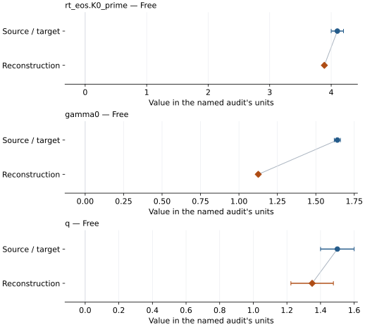

# Wadsleyite: EOS reconstruction reports

<!-- Generated by scripts.generate_reconstruction_reports; edit EOSMAT instead. -->

[All reconstruction reports](index.md) · [Material and EOS parameters](../material-summaries/wadsleyite.md)

These reports explain the assessments already stored in EOSMAT. Generating
this page does not refit observations, change classifications or replace source coefficients.

Use [scientific label definitions](../eos-labels.md) to distinguish coefficient
agreement, source verification, author-workflow reproduction and recommendation for use.

| EOS record | Recorded outcome | Coefficient comparison |
| --- | --- | --- |
| [Katsura et al. (2009), high-temperature BM3-MGD](#record-wadsleyite_katsura_2009_bm3_1) | Parity not achieved for this comparison | Graph and table |

## Katsura et al. (2009), high-temperature BM3-MGD

Record: `wadsleyite_katsura_2009_bm3_1` · Model: `BM3`

**Outcome: Parity not achieved for this comparison.**

**Scope:** Comparison with the source parameterization.
**Comparison basis:** Current wadsleyite default on hold and not recommended pending source/model mapping review. This does not establish an error in the publication; no replacement default is selected.

[Stored EOS coefficients and source](../material-summaries/wadsleyite.md#record-wadsleyite_katsura_2009_bm3_1)

### What this result establishes

**Separate source-review status:** deferred.
**Usage recommendation:** on\_hold\_not\_recommended\_pending\_source\_mapping\_review

- Usage recommendation: on\_hold\_not\_recommended\_pending\_source\_mapping\_review
- Pressure calibration and MGD reference-state/Debye convention mapping remain unresolved.
- Direct replay of all 85 source rows gives 1.89443 GPa pressure RMS and 3.46380 GPa maximum residual.
- Current wadsleyite default on hold and not recommended pending source/model mapping review. This does not establish an error in the publication; no replacement default is selected.
- This named numerical assessment alone does not establish author-workflow reproduction, physical accuracy or recommendation for use.

### Data and reconstruction method

- **Dataset identifiers:** wadsleyite\_katsura\_2009\_table1\_pvt
- **Observations:** 85
- **Fit kind:** joint\_pvt
- **Selection:** all rows
- **Objective:** errors\_in\_variables
- **Absolute sigma:** True
- **Free parameters:** rt\_eos.K0\_prime; gamma0; q
- **Fixed parameters:** V0; K0; Tr; theta0; n

Unspecified selections, weights, fixed values or error conventions remain unknown; they have not been inferred for this report.

### Source versus reconstruction

This is a **coefficient comparison**, not an observation or residual plot.
Each panel uses its coefficient's audit units and includes zero. Markers show
stored central values only. Error widths are retained in the table below;
no confidence interval or uncertainty band is inferred. Fixed/adopted values are constraints.

| Parameter | Source / target | Source error | Reconstruction | Reconstruction error | Fit role |
| --- | --- | --- | --- | --- | --- |
| rt\_eos.K0\_prime | 4.1 | 0.1 | 3.888761512406301 | 0.014542856299232937 | Free |
| gamma0 | 1.64 | 0.02 | 1.1256734922260556 | 0.007530848061539662 | Free |
| q | 1.5 | 0.1 | 1.3501388010178152 | 0.12641294516741897 | Free |

Values and reported errors are copied without rounding or conversion from the named audit. Missing errors mean unknown, not zero. Parameter names and volume conventions follow that audit; error widths do not imply a confidence convention.

Recorded diagnostics, covariance and additional protocol

- **Columns:**
    - **Pressure:** pressure\_gpa
    - **Temperature:** temperature\_k
    - **Volume:** normalized\_volume
- **Observed pressure range gpa:** \[11.07, 20.07\]
- **Observed temperature range k:** \[304.0, 2100.0\]
- **Observed volume range:** \[492.826048, 517.0580980000001\]
- **Degrees of freedom:** 82
- **Solver success:** True
- **Solver message:** \`ftol\` termination condition is satisfied.
- **Rmse gpa:** 0.07093795439857531
- **Published rmse gpa:** 1.894431691290464
- **Reduced chi square:** 11.012035125978011

### Detailed evidence and existing plots

- [Earlier detailed record investigation](../primary-eos-refits.md#investigation-wadsleyite_katsura_2009_bm3_1).
- [Supporting source report: eos-recommendation-dispositions-2026-10-17](../research/eos-recommendation-dispositions-2026-10-17.md).
- [Record-by-record numerical ledger](../primary-eos-refits.md#records).
- [Source-audit reports](../source-audits.md).

Observation curves and residual plots are provided by the supporting reports where available. Their absence is not filled by a reconstructed curve presented as measured data.

[Machine-readable comparison ledger](https://github.com/CPrescher/peritheos/blob/main/docs/data/primary-eos-refits.json) — look up `wadsleyite_katsura_2009_bm3_1`.
[Complete native EOSMAT file](https://github.com/CPrescher/peritheos/blob/main/peritheos/data/materials/wadsleyite.eosmat).
