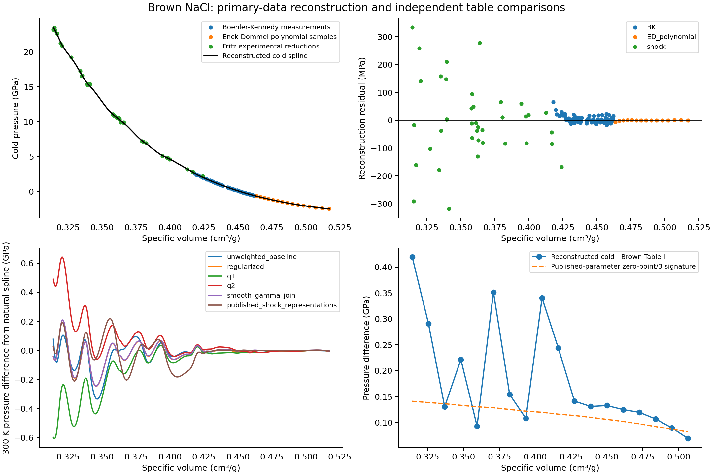
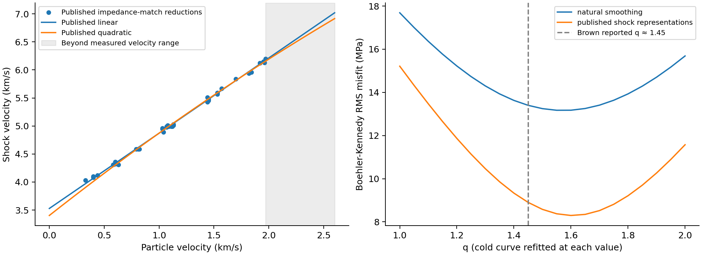
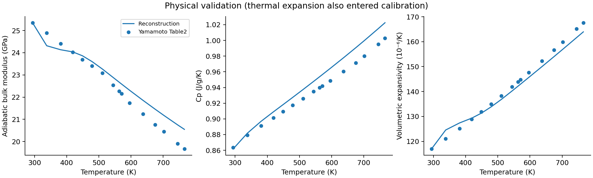

# Brown (1999) NaCl: unreproducible published EOS and independent reconstruction

Investigation date: 16 October 2026. Status: **the published Brown (1999)
EOS cannot be reproduced from the available published material; a separate
historical-data reconstruction is provided**. No catalog EOS, runtime,
registry, calibration ledger, or existing ferrous-ringwoodite file was changed.
No correspondence was sent. Nothing was committed or pushed.

The original experimental reductions and published shock representations can
be recovered. A quasiharmonic cold-curve reconstruction can fit the
Boehler–Kennedy data at approximately Brown's reported level, depending on
the treatment of shock data and spline smoothing. This does **not** identify
Brown's original numerical calculation. His calculated Tables I and II are
also internally inconsistent under the standard thermal Debye convention.
Neither table is used to determine the reconstructed cold curve.

**Author correspondence update, supplied 16 October 2026:** Brown has
acknowledged a bug in his published calculations and attributes it to an
omitted factor of three in an energy term for the three vibrational modes
per ion, amid different versions of Debye code. This changes the status
from an unexplained discrepancy to an **author-acknowledged calculation
error**. The precise affected term, scope of the error across tables and
derived properties, and corrected numerical results are still unavailable.
The original reconstruction and source tables remain unchanged.

## Separate reconstructed EOS

**The EOS of Brown (1999) cannot be reproduced from the available published
material. Brown has confirmed an error in the vibrational-energy calculation.
We therefore provide a separately identified NaCl EOS reconstructed from the
available historical experimental sources used in that work. It is an
independent refit, rather than a reproduction or an author-approved correction
of Brown's published EOS.**

The new candidate is **NaCl B1 historical-data reconstruction (2026)**,
identifier `nacl_b1_historical_data_2026_refit`, with `record_kind: refit`.
Its complete numerical specification is
[`nacl_b1_historical_data_2026_refit.json`](assets/brown-nacl-1999/nacl_b1_historical_data_2026_refit.json).
The file stores the cold-spline knots and coefficients, thermal equations and
settings, constants, checksummed inputs, fitting protocol, validation and
limitations. It can be loaded and evaluated without refitting or reading the
source tables. A companion `.pvt.csv` gives calculated states; those values
are model outputs, not additional observations.

This candidate uses all 82 Boehler–Kennedy rows, all 43 Fritz experimental
velocity reductions, and 15 explicitly identified samples of Enck–Dommel's
published expansion polynomial. Brown's calculated Tables I/II enter neither
fitting nor model selection. To avoid the derivative oscillations of the
diagnostic natural-spline case below, the new candidate uses a deliberately
low-dimensional cubic spline with six coefficients and two internal knots,
with smoothing coefficient $10^{-6}$ in the documented normalized-volume
objective. These are analyst choices, not recovered Brown settings. The
initial measured pressure, specific volume and temperature are constrained
exactly. The exponent $q$ is fitted conditionally to the BK pressure residuals,
refitting the cold curve at each trial, giving **$q=1.50352$**. The fixed
thermal inputs and smooth gamma join retain their stated source/analyst
provenance; no whole-energy factor-of-three adjustment is introduced.

Source-group pressure RMS residuals are **15.11 MPa** for BK, **8.67 MPa**
for expansion-polynomial samples, and **186.67 MPa** for the shock reductions.
The initial-state pressure error is below $10^{-12}$ GPa. The cold bulk
modulus remains positive over the fitted volume interval, and its sampled
pressure derivative spans approximately **3.18–6.42**, without the strong
oscillations of the natural-spline diagnostic. This numerical check does not
establish phase stability or experimental accuracy over a full pressure and
temperature rectangle.

Held-out comparisons differ from Yamamoto's adiabatic bulk moduli by up to
**4.87%**, and from solid JANAF heat capacities by up to **2.07%** between
298 and 1000 K. Consequently this remains a **staged independent EOS**,
with no claim to Brown's reported accuracy or to a validated replacement
pressure standard. It retains historical calibrations, lacks an anharmonic
term, and has no defensible coefficient covariance. Fixed-$q$ variations of
basis count and smoothing are saved as structural sensitivities, not
confidence intervals. No catalog/default record is replaced.

Build the candidate with
`python scripts/brown_nacl_1999_independent_eos.py` using the repository's
environment. For evaluation, import `load_eos` from
`scripts.brown_nacl_1999_independent_eos`, load the saved JSON, and call
`pressure(v, T)`, `volume(P, T)` or `properties(P, T)` in the units above.
The evaluator rejects volume extrapolation and temperatures outside
293–1023.15 K; these are numerical bounds, not a validated stability field.

## Recovered evidence and provenance

All PDFs are preserved in
`output/material-candidates/brown-nacl-1999/sources/`. SHA-256 hashes are in
`output/material-candidates/brown-nacl-1999/recovery-manifest.json`.
The new CSV names below have the prefix `brown-nacl-1999-` under
`peritheos/data/datasets/`.

| Source | Recovered numbers and classification | Remaining limitation |
| --- | --- | --- |
| Brown (1999), *The NaCl pressure standard*, Journal of Applied Physics **86**, 5801–5808, [DOI 10.1063/1.371596](https://doi.org/10.1063/1.371596) | Full paper; Table I: 21 rows/126 numerical cells; Table II: 63 rows/571 populated calculated pressures, including all blank cells. `brown-table1-comparison.csv`, `brown-table2-comparison.csv` | These are calculated model outputs, not experimental observations or cold-curve fitting inputs. No spline coefficients or program are supplied. |
| F. D. Enck and J. Gerald Dommel (1965), *Behavior of the Thermal Expansion of NaCl at Elevated Temperatures*, Journal of Applied Physics **36**, 839–844, [DOI 10.1063/1.1714229](https://doi.org/10.1063/1.1714229) | Eqs. (3), (5)–(7), polynomial coefficients, definition of expansion coefficient, measurement range, and error statement. `published-coefficients.json` | The 77 individual results from 12 heating curves/3 specimens are **not tabulated**. Figures 2/3 show averaged symbols; no curve or symbol was relabeled as an original numerical observation. Reconstruction uses explicitly labeled samples of the published polynomial. |
| R. Boehler and G. C. Kennedy (1980), *Equation of state of sodium chloride up to 32 kbar and 500°C*, Journal of Physics and Chemistry of Solids **41**, 517–523, [DOI 10.1016/0022-3697(80)90183-3](https://doi.org/10.1016/0022-3697%2880%2990183-3) | All 82 Table 1 entries from 19 runs, pp. 519–520: original NaCl/WC lengths, temperature, pressure, volume ratio. `boehler-kennedy-1980-table1.csv` | These are measurements reduced with a WC standard, not raw electrical contact traces. Table 3 contains **calculated integrated fitted isotherms** and is not used as observations. Brown describes eight isotherms; the printed Table 1 recovered here contains six temperature levels (25, 100, 200, 300, 400, 500°C). His exact input selection is unknown. |
| J. N. Fritz, S. P. Marsh, W. J. Carter and R. G. McQueen, *The Hugoniot Equation of State of Sodium Chloride in the Sodium Chloride Structure*, in E. C. Lloyd, ed., *Accurate Characterization of the High-Pressure Environment*, NBS Special Publication **326**, 201–208 | Full [NBS volume](https://nvlpubs.nist.gov/nistpubs/Legacy/SP/nbsspecialpublication326.pdf); all 43 Table 1 rows, p. 202, plus Table 2 thermodynamic inputs and both published shock-velocity fits. `fritz-1971-table1.csv`, `published-coefficients.json`. Selected Table 4 calculated states are separately retained in `fritz-1971-table4-checkpoints.csv`. | Brown's reference 7 says **1972**. The retrieved volume title page says **issued March 1971**, following the October 1968 symposium. Both dates are recorded. Brown also mentions private computer-generated extended tables; those exact files are unavailable. |
| H. Spetzler, C. G. Sammis and R. J. O'Connell (1972), *Equation of state of NaCl: Ultrasonic measurements to 8 kbar and 800°C and static lattice theory*, Journal of Physics and Chemistry of Solids **33**, 1727–1750, [DOI 10.1016/S0022-3697(72)80468-2](https://doi.org/10.1016/S0022-3697%2872%2980468-2) | Full paper; 18 (K_S) values in Table 4 at 300/550/800 K and 0–10 kbar; Table 6 uncertainties. `spetzler-1972-table4-ks.csv` | Table 4 is calculated from polynomial fits to ultrasonic frequency measurements, not 18 independent raw observations. Entries at 10 kbar extend beyond the stated 8 kbar measurement range. The article title says 800°C, while the experimental discussion and table range are 300–800 K; the latter is used here. |
| S. Yamamoto, I. Ohno and O. L. Anderson (1987), *High temperature elasticity of sodium chloride*, Journal of Physics and Chemistry of Solids **48**, 143–151, [DOI 10.1016/0022-3697(87)90078-3](https://doi.org/10.1016/0022-3697%2887%2990078-3) | All 16 Table 2 rows, 294–766 K, including elastic stiffnesses, bulk/shear moduli, expansion, specific volume and JANAF heat capacity; printed endpoint errors separately. `yamamoto-1987-table2.csv`, `yamamoto-1987-table2-errors.csv` | Elastic constants come from resonance inversion. (K_T), volume and related quantities are derived; (C_P) and expansion reproduce older sources. The printed first volume, 0.4701 cm³/g, conflicts with the measured density 2.160 g/cm³ on p. 143 (reciprocal 0.462963 cm³/g). It is preserved and flagged, never silently repaired or used to anchor the reconstruction. |
| R. Boehler (1981), *Adiabats (∂T/∂P)s and Grüneisen parameter of NaCl up to 50 kilobars and 800°C*, Journal of Geophysical Research **86**(B8), 7159–7162, [DOI 10.1029/JB086iB08p07159](https://doi.org/10.1029/JB086iB08p07159) | All five Table 1 polynomial coefficient sets and reported fit standard deviations. `boehler-1981-table1.csv` | Polynomial values are a published representation of measurements, not individual temperature-pulse observations. Pressure in this polynomial is kbar, and its output is K/kbar. |
| D. R. Stull and H. Prophet, eds. (1971), *JANAF Thermochemical Tables*, 2nd edition, NSRDS–NBS **37**, [DOI 10.6028/NBS.NSRDS.37](https://doi.org/10.6028/NBS.NSRDS.37) | Original 1150-leaf scanned PDF; NaCl(cr) table on **PDF leaf 548**, dated September 30, 1964; 17 (C_P) entries and original historical molar mass. `janaf-1971-nacl-cr-cp.csv` | Evaluated thermochemical values, not raw calorimeter observations. Above the melting point (1073.8 K), the crystalline table is a metastable extension. These rows are labeled and excluded from ambient solid validation. |

The supplied retrieval site was used to obtain the journal PDFs through the
browser's download function after ordinary publisher retrieval failed. Failed
HTTP responses have HTML/text extensions; no error page is retained as a PDF.
Every retained PDF's signature is checked by the recovery script.

### What is primary in the shock table

Fritz explicitly says direct shock/particle-velocity measurements could not be
made using their assembly technique. NaCl shock velocity and the standard's
shock velocity were measured. Particle velocity, pressure and density were
obtained by **impedance matching**. Thus (U_p) is experimental reduction,
not an independently measured velocity. The source standard EOS assumptions
must remain attached to these data:

* 2024 aluminium: density 2.785 g/cm³, (U_s=5.328+1.338U_p) km/s;
  $(\partial E/\partial P)_V=0.19$ cm³/g for its release calculation.
* Copper: density 8.93 g/cm³, (U_s=3.940+1.489U_p) km/s;
  $(\partial E/\partial P)_V=0.057$ cm³/g.

The CSV retains both measured velocity columns, reduced (U_p), printed
pressure/density, crystallographic orientation and the standard identity.
There are five copper-standard rows. The footnote identifying one nominal
(100) row as (110) is retained. Page-image inspection resolves OCR errors
`5.69` → printed `5.59`, and a dropped printed `5.94`; this repairs the
**transcription**, not the source table. Printed pressures/densities remain
unchanged even when Rankine–Hugoniot values from rounded velocity columns differ.

The published fits, kept separate from new regressions, are

$$
U_s=3.528+1.343U_p,
\qquad U_s=3.403+1.5422U_p-0.07345U_p^2.
$$

The linear coefficients have printed uncertainties 0.012 and 0.009; their
covariance is not supplied. The quadratic intercept was constrained by the
bulk sound speed. An explicit unweighted regression of the recovered 43
velocity pairs gives approximately 3.531965 + 1.338666 (U_p), RMS 0.028581
km/s. A fixed-intercept quadratic regression gives 3.403 + 1.551406 (U_p)
− 0.078383 (U_p^2), RMS 0.039040 km/s. These are **new fits to rounded
published reductions**, not replacements for Fritz's coefficients. Treating
(U_p) as exact is a stated conditional regression assumption.

Fritz's Table 3 is a calculated 293 K isotherm based on the quadratic fit;
Table 4 gives the preferred high-pressure isotherm from the linear fit.
Neither those isotherms nor their calculated Hugoniot temperatures enters the
new cold-curve fit. The sensitivity case using published shock curves switches
from quadratic to linear when the quadratic **Hugoniot pressure** reaches
23 GPa. This is a documented numerical choice, not a recovered author switch.
The synthetic curve samples are labeled separately from the 43 experimental
reductions. Their small residuals measure curve representation, not improved
experimental precision. The shock figure shades extrapolation beyond the
largest observed $U_p=1.97$ km/s.

## Units, reference states and thermal model

All new calculations use specific volume $v$ in cm³/g, pressure in GPa,
energy $e$ in J/g, and temperature in kelvin. The conversions are

$$
1\ {\rm GPa\,cm^3/g}=1000\ {\rm J/g},\qquad
1\ {\rm kbar}=0.1\ {\rm GPa},\qquad
1\ {\rm erg/g}=10^{-7}\ {\rm J/g}.
$$

The baseline adopts Fritz's $M=58.443$ g/mol and initial density
2.1645 g/cm³, hence $v_i=0.462000462$ cm³/g; $T_i=293$ K and
$P_i=1.01325\times10^{-4}$ GPa. The gas constant is the modern
8.31446261815324 J/mol/K. Historical JANAF retains its printed
58.448 g/mol and is converted with 4.184 J/cal. The separate Brown table
arithmetic diagnostic uses 58.44 g/mol to reproduce the explicit earlier
comparison convention. No molar mass is adjusted by fitting.

NaCl has **two atoms per formula unit**, so $n=2$ when $R$ is per mole
NaCl. The B1 conventional cell contains four formula units (eight atoms).
If lattice constants are used later,

$$
v=a^3\,10^{-24}N_A/(4M)
$$

for $a$ in Å. The present fit uses specific volumes directly and needs no
lattice-to-volume normalization or assumed atom count for a unit cell.

The thermal energy excludes zero-point energy:

$$
e_D(v,T)=\frac{9nRT}{M}\left(\frac{T}{\theta}\right)^3
\int_0^{\theta/T}\frac{x^3}{e^x-1}\,dx,
\qquad P(v,T)=P_0(v)+\frac{\gamma(v)e_D(v,T)}{1000v}.
$$

The baseline γ model is $\gamma_0(v/v_i)^q$ for compression and a
constant $\gamma_0$ for expansion. Adopted $\gamma_0=1.63$ is the
rounded independent Spetzler Table 4 value 1.6275 at 300 K, consistent with
Yamamoto's quoted high-temperature value 1.64 ± 0.03. It is **not estimated
from Brown Table I**. $q=1.45$ is Brown's explicitly reported optimum,
used as a fixed published parameter in the first reconstruction; new
conditional profiles assess it independently. $\theta(v_i)=276$ K is
Fritz Table 2's thermodynamic input. A 285 K sensitivity case is separate.

Brown describes a spline join in γ but supplies no knots or smoothing
parameter. A separate smooth-join reconstruction uses

$$
z=\ln(v/v_i),\qquad
\gamma(v)=\gamma_0\exp\{-qw\ln[1+\exp(-z/w)]\},\quad w=0.025.
$$

This is an **adopted smooth join**, not recovered Brown coefficients.
It is asymptotically constant in expansion and a power law in compression;
near $v_i$ its value is below the asymptotic plateau. Its Debye temperature
is obtained from

$$
\theta(v)=276\exp\left[-\int_{v_i}^{v}\gamma(s)\,ds/s\right].
$$

The differential identity $d\ln\theta/d\ln v=-\gamma$ is checked
numerically. Interpolated Brown gamma/theta columns are never substituted
into this reconstruction.

### Enck–Dommel reduction

For $t$ in °C, the published piecewise coefficients are

$$
\alpha_L=3.836\times10^{-5}+2.979\times10^{-8}t+1.167\times10^{-11}t^2,
$$
$$
\alpha_H=6.594\times10^{-5}-7.499\times10^{-8}t+1.100\times10^{-10}t^2.
$$

The source recommends the low expression through 550°C and the high
expression above it. Its coefficient is an interval expansion
$\Delta L/(L_R\Delta T)$, using room-temperature length $L_R$.
Define $I(t)=\int_{25}^{t}\alpha(t')dt'$; then the reconstruction uses

$$
v(T)=v_i\left[\frac{1+I(T-273.15)}{1+I(293-273.15)}\right]^3.
$$

This distinguishes the source's room-length normalization from the
instantaneous $d\ln L/dT$ convention. An explicit alternative integrates
the coefficient exponentially, permitting the consequence of the other
interpretation to be evaluated without overwriting source coefficients.
Using the low-temperature polynomial between room temperature and the lowest
measurement at 50°C is a small **extrapolation**. The source fit's 50 K
interval character and unpublished averaging prevent an exact inverse
recovery of length traces.

Fifteen polynomial-derived ambient points are sampled at 50, 100, …, 750°C
and reduced using $P_0(v)=P_i-P_D(v,T)$. These are not 15 independent
measurements. The source's actual maximum is 765°C; no claim is made to
measurements at 1200°C. Brown's introductory temperature-range wording does
not override the original source range.

## Hugoniot reduction and cold-curve fitting

For each recovered velocity pair, the new RH values are

$$
P_h=P_i+\rho_iU_sU_p,\qquad
v_h=v_i(1-U_p/U_s),\qquad
e_h=\tfrac12(P_h+P_i)(v_i-v_h)\,1000.
$$

These are stored as **new reductions**, alongside the unchanged printed
source pressure/density. Recalculating from rounded velocities is explicit;
it is not an attempt to reperform the unavailable raw impedance matching.

Set the **initial total energy to zero**. The cold energy must then satisfy

$$
e_0(v_i)=-e_D(v_i,T_i),\qquad
e_0(v)=-e_D(v_i,T_i)-1000\int_{v_i}^{v}P_0(s)\,ds.
$$

Consequently, the iteratively reduced shock target is

$$
y_h=P_h-\frac{\gamma(v_h)}{1000v_h}[e_h-e_0(v_h)].
$$

Brown Eqs. (5)–(6) leave this integration constant implicit. Setting
$e_h$ relative to the initial 293 K state while setting $e_0(v_i)=0$
would omit the initial thermal energy; those conventions cannot both hold.
The deliberately inconsistent reference sensitivity gives approximately
64 MPa BK RMS and 0.624 GPa RMS relative to Brown Table II, illustrating
the importance of stating the energy reference. Zero-point energy is already
absorbed in a cold curve defined by $F(T=0)$; it is not added to the
thermal energy in the baseline.

### Explicit objective, weights and constraints

Write $x=v/v_i-1$ and $f(x)=P_0(v)$. At each iteration solve

$$
\min_f\ \sum_j w_j[f(x_j)-y_j]^2+
\lambda_x\int_{x_{\min}}^{x_{\max}}[f''(x)]^2dx.
$$

All residuals are **pressure residuals in GPa**, not a mixture of volume and
velocity residuals. For BK and expansion, $y_j=P_j-P_D(v_j,T_j)$.
For shock targets, $y_j$ is recomputed using the previous cold curve's
integral. No Brown calculated pressure is a $y_j$.

1. **Unweighted baseline:** every $w_j=1$, λ = 0, 18 clamped cubic
   B-spline basis functions with uniformly spaced interior knots over the
   data domain. No zero-pressure, derivative, modulus or shape constraint
   is imposed. A finite basis is essential to distinguish least squares from
   interpolation of scattered shock points.
2. **Finite-basis regularization:** the same basis and weights,
   λ = $10^{-6}$. The roughness integral uses 180-point Gauss quadrature;
   this is documented reconstruction regularization.
3. **Natural smoothing spline:** cubic natural-endpoint smoothing spline
   through all distinct data abscissae, with λ = $10^{-7}$, all original
   row weights one, and the smooth γ join above. Repeated abscissae are
   combined by weighted means and summed weights, preserving their least
   squares multiplicity. This reproduces the *class* of objective used by
   MATLAB CSAPS; it does not recover Brown's particular smoothing parameter.
4. **Junction sensitivity:** a finite-basis case reduces weights to 0.1 for
   $0.445<v<0.477$ and $0.412<v<0.427$ cm³/g. These masks/weights are
   deliberately declared choices; Brown only says that junction points
   received lower weights. They are not claimed to be his masks.

MATLAB's conventional $p\sum w r^2+(1-p)\int[f''(v)]^2dv$ cannot be
compared to λ without its coordinate and unit conventions. With identical
weights, our normalization implies
$\lambda_v=\lambda_x v_i^3=(1-p)/p$.
The code records knots and fitted coefficients. Natural endpoints impose
$f''=0$ there; the finite-basis cases have no such endpoint constraint.
Positive bulk modulus is checked after fitting rather than imposed.

The cold targets and spline are iterated until their largest change at any
input volume is less than $10^{-10}$ GPa, maximum 200 iterations. These
cases converge in about 10–11 iterations. Cold-energy integrals use exact
B-spline antiderivatives. This is an **iterative reduced-data smoother**, not
a claim that the final solution minimizes a single simultaneous nonlinear
objective in unreduced experimental variables.

## Reconstruction results and what they establish

Representative results from `reconstruction.json`:

| Reconstruction | BK RMS (MPa) | Expansion polynomial RMS (MPa) | Shock target RMS (MPa) | RMS versus Brown Table II (GPa) |
| --- | ---: | ---: | ---: | ---: |
| Unweighted 18-basis baseline | 20.16 | 5.60 | 164.51 | 0.1425 |
| Finite-basis regularization | 20.07 | 6.24 | 170.37 | 0.1098 |
| Finite basis + smooth γ join | 17.28 | 2.14 | 170.42 | 0.1102 |
| Natural smoothing spline + smooth γ join | 13.40 | 1.75 | 132.79 | 0.1279 |
| Published quadratic/linear shock representations + smooth γ join | 8.90 | 2.45 | **13.17 for synthetic curve samples** | 0.0849 |

Brown reports 10 MPa BK misfit. Both the 13.4 MPa fit to individual shock
reductions and the 8.9 MPa fit using published shock representations approach
that scale. The latter's small shock residual is not experimental validation:
the input is an already fitted velocity curve, sampled at an adopted spacing.

The Brown-table comparison covers **563** populated cells within the actual
reconstruction volume domain; no reconstruction extrapolation is used to
inflate that count. All **571** cells enter the independent Table I/II
arithmetic check below. A low calibration residual does not determine the
correct high-order derivatives or establish identity with Brown's cold curve.
Weakly smoothed fits show visible derivative and inter-point oscillations.

The natural reconstruction's Table I checks quantify this limitation:
the RMS cold-pressure difference is 0.208 GPa, KT differs by 8.49 GPa
RMS and K-prime by 14.19 RMS over common tabulated volumes. The high-order
derivative representation is therefore **not reproduced**. Conditional on
the adopted thermal parameters and join width, gamma and theta are much
closer (RMS differences 0.00423 and 0.292 K). That closeness is a consistency
check on the chosen thermal representation, not recovery of Brown's
unpublished gamma-join settings.

An additional ODE calculation isolates extrapolated shock curvature with
both representations anchored to the same cold energy at
v = 1/3.023 cm³/g (the published 20 GPa Hugoniot density). It integrates
de0/dv = -1000 P0 while evaluating RH states from the published velocity
coefficients. At the volume where the linear-based 300 K isotherm reaches
30 GPa (0.300311 cm³/g), the quadratic-based result is lower by **0.809
GPa**. This confirms substantial sensitivity to the high-pressure shock
representation; it does not exactly recover Brown's stated >1 GPa
difference between the historical reduced isotherms. Both branches at this
point extrapolate beyond the measured shock pressure range, and the common
cold-energy anchor is a reconstruction assumption.

The $q$ profiles refit the cold curve at every trial and score the BK
pressure residuals. On the 0.05 grid, the minimum is approximately **1.55**
for the natural spline and **1.60** for the published-shock representation
case. Thus the reconstructed settings do not independently recover Brown's
reported optimum 1.45. The full curves, rather than an invented confidence
interval, are retained. Separate cases vary $q=1,2$, Debye normalization,
expansion interpretation, smoothing, junction weights and shock representation.





### Independent Table I/II arithmetic check

At the **printed common volume** 0.3709 cm³/g, Table I gives $P_0=8.57$
GPa, γ = 1.19 and θ = 375 K. With the stated standard thermal Debye
energy, $n=2$ and $M=58.44$ g/mol:

| Temperature | Recomputed from Table I (GPa) | Printed Table II (GPa) |
| --- | ---: | ---: |
| 300 K | 9.069532 | 9.19 |
| 1200 K | 11.487479 | 11.60 |

**No interpolation is involved in this example.** Across all 571 populated
cells, a not-a-knot cubic interpolation of Table I gives 0.124643 GPa RMS
disagreement. Adding the diagnostic energy $e_{ZP}/3$, with
$e_{ZP}=9nR\theta/(8M)$, lowers that RMS to 0.010971 GPa. This confirms
the earlier numerical signature using independently recovered comparison
tables. The added term remains a **numerical diagnostic, not an adopted
correction**. Brown has now supplied an explanation at the level of a
missing vibrational-mode factor, as documented below. His reply does not
identify the exact erroneous term or algebraically connect it to this
one-third-zero-point signature. A temperature-independent energy term can
be traded against the definition of the cold curve; a numerical pressure
match alone does not recover the original calculator or identify which
published quantities need revision.

### Author confirmation and its numerical scope

Clemens supplied Brown's reply in this chat on 16 October 2026. The incoming
message's own date header was not supplied and no inbox was accessed.
The normalized reply body and its provenance are preserved locally in
`output/material-candidates/brown-nacl-1999/sources/brown-author-reply-2026-10-16.json`.
This is **private author correspondence**, not a supplied published erratum
or a validated replacement calibration.

Brown states that he discovered the same bug while replicating and revising
his work. He attributes it to using different versions of Debye routines,
with a factor of three omitted from an energy term representing the three
vibrational modes for each ion. He describes the intended calculation as
accounting for zero-point energy and all vibrational modes. He also reports
preparing a new manuscript with modern data and a better anharmonic
representation, which he offers to share after further vetting. No revised
manuscript, routine or corrected table accompanied the supplied reply.

His wording does **not** establish that the entire thermal energy in the
printed EOS should be multiplied by three. The standard expression used
here already includes three modes per atom: its high-temperature limit is
3nRT per mole, hence 6RT for NaCl with n = 2. To test the whole-energy
interpretation, pressure increments within each Table II isochore are
compared to the standard model using the printed/interpolated gamma and
theta. Subtracting each row's first populated temperature cancels cold
pressure and any temperature-independent zero-point offset.

Across 508 such increments, the best uniform multiplier is **1.000585**.
The RMS increment residuals are **0.00501 GPa** for the standard energy,
**0.98290 GPa** for one-third of it and **2.94521 GPa** for three times it.
These calculated-table checks are conditional on the printed thermal
parameters and their rounding; they are not an experimental measurement
of atom count. They nevertheless rule out a simple global factor-three
rescaling as an explanation of the table mismatch at those parameters.

The supported conclusion is therefore: **the author confirms a
vibrational-mode bookkeeping bug; its exact mapping to the published
energy reference, zero-point term and cold curve remains to be recovered.**
Neither the factor-three statement nor the observed zero-point/3 signature
is used to silently alter source values, reinterpret the printed P0, or
publish a corrected calibration. A correction requires the affected
equation/routine and revised benchmarks, including which of Tables I/II
and the thermodynamic fits were affected.

## Uncertainty and physical validation

Source accuracy statements are retained without converting them silently
to independent Gaussian sigmas:

* Enck–Dommel estimate a maximum relative error of approximately 1.5% in
  their expansion results; rowwise sigmas/covariances and the 77 values are
  unpublished.
* BK estimate 0.4% absolute pressure accuracy, 0.7% relative accuracy in
  **compression/volume change**, 0.3 K temperature uniformity and 0.001 mm
  length accuracy. The 0.7% is not 0.7% of the whole specific volume.
  Runwise length and WC corrections can produce correlated errors.
* Fritz's approximately 1% pressure accuracy is conditional on the standard
  EOS. A typical velocity fit spread is stated at approximately 0.05 km/s;
  complete row covariance, especially for reduced $U_p$, is unavailable.

The baseline is intentionally unweighted. The report maps BK accuracy
bounds into pressure units using $K_T|\delta v|/v$ and
$(\partial P/\partial T)_v|\delta T|$, alongside 0.004 $P$, and gives
their linear sum as a conservative first-order diagnostic. These are
**accuracy-bound conversions**, not formal standard errors or 68% confidence
intervals. Printed volume-ratio rounding and shared run/standard systematics
remain distinct from scatter. Brown's own 0.5/1.5/3% calibration uncertainty
claims are source statements; this work has not reproduced an author
covariance calculation.

For the natural-spline model, derivatives give

$$
K_T=-vP_v,\quad \alpha=P_T/K_T,\quad
C_V=(\partial e_D/\partial T)_v,\quad
C_P=C_V+1000\alpha^2 K_TvT,\quad K_S=K_TC_P/C_V.
$$

The identities $\gamma=1000\alpha K_Sv/C_P$ and
$K_S/K_T=C_P/C_V$ are checked independently. The associated bulk sound
speed is $\sqrt{K_Sv}$ km/s and the adiabat is
$(\partial T/\partial P)_S=T\gamma/K_S$ K/GPa. A scalar pressure EOS
does not predict shear modulus or separate $V_P,V_S$ without additional
elastic input; the source $C_{11},C_{12},C_{44}$ and Voigt/Reuss moduli
are preserved for that purpose, not fitted into the scalar EOS.

Using Yamamoto's independently measured density 2.160 g/cm³ at 294 K
(rather than silently correcting the inconsistent volume column) gives a
derived bulk sound speed of 3.42580 km/s, versus 3.42158 km/s from the
reconstruction. The same source stiffnesses give [100] longitudinal and
transverse speeds of 4.79535 and 2.43242 km/s. These last two values are
derived elastic checks, not additional raw sound-velocity observations or
predictions of a fitted shear model.

Yamamoto's $K_S$ and JANAF $C_P$ are held-out checks. Expansion is
partly the same Enck–Dommel evidence used in calibration, so its agreement
is not independent validation. Over the 16 Yamamoto temperatures, the
present natural reconstruction has maximum absolute relative deviations
of approximately **4.47% in $K_S$**, **2.03% in $C_P$** and **2.87%
in the printed expansion column**. It therefore does **not** recover
Brown's reported 1% ambient $K_S$ agreement. Spetzler's table surfaces
provide a further pressure/temperature validation, with a comparable
several-percent discrepancy for this reconstruction. The malformed
Yamamoto volume column is not used to rescale either the data or the fit.

The original JANAF(cr) values from PDF leaf 548 are compared directly at
298–1000 K with their own historical molar mass. Values above melting are
preserved but excluded. A modern JANAF HTML table was also retrieved for
context, but does not replace the original 1971 volume in validation.

Boehler's five published adiabat polynomials are evaluated independently at
1–5 GPa (the 800°C case stops at 4 GPa here). Their input/output kbar units
are converted explicitly. The reconstruction shows pressure- and
temperature-dependent deviations, including high-temperature differences
of order 20%; it does not reproduce a uniform offset or Brown's entire
Figure 11. Spline derivatives and the pressure-limited calibration domain
matter substantially. The polynomial fit scatter is not treated as the
complete experimental uncertainty.



## Reproducibility boundary and deliverables

The optional `natural_smoothing` diagnostic requires SciPy 1.10 or newer,
which [introduced `make_smoothing_spline`](https://docs.scipy.org/doc/scipy/release/1.10.0-notes.html).
The finite-basis reconstruction, independent saved refit and base Peritheos
library retain the declared SciPy 1.9.3 minimum. On an older installation,
requesting natural smoothing raises an explicit error; the calculation never
substitutes a different fitting method. Use the locked development environment
to replay every research variant.

What is established:

* Recovery of the published BK measurement table and Fritz experimental
  reduction table, independently checked against their page images.
* Recovery of Enck–Dommel's published expansion representation and its
  actual coefficient convention, without inventing unavailable raw rows.
* Deterministic RH/cold-energy/Debye reduction with a consistent initial
  energy reference, explicit fitting objective and equal-weight baseline.
* Sensitivity to smoothing, shock representation, γ junction,
  $q$, θ and expansion convention; independent thermodynamic checks.
* Reconfirmation that standard Table I arithmetic cannot reproduce
  Table II as printed.

What prevents exact author-fit reproduction:

1. Brown's original numerical source arrays and exact selection of shock
   points/representations are unavailable; his description of eight BK
   isotherms does not identify the six-level printed table as his exact file.
2. The 77 individual Enck–Dommel values and their original averaging are
   unpublished in the recovered paper; Brown's resampling/integration is
   unspecified.
3. CSAPS smoothing parameters, units/scaling, spline coefficients,
   γ-join knots, junction weights and masks are not supplied.
4. Exact original constants, zero-K energy reference implementation and
   Table II thermal calculator are not recovered. Brown now confirms a
   missing factor of three in a vibrational-energy term, but the precise
   affected expression, scope across published results and mapping to the
   Table I/II offset are not supplied.
5. Standard EOS uncertainty and experimental error covariance are
   insufficient for an exact independent uncertainty propagation.

The diagnostic spline cases below are a reproducibility investigation.
The separately named refit above is an executable standalone reconstruction.
Neither is promoted as a replacement pressure calibration or a production
catalog record.

Reproduce from the repository root:

```sh
.venv/bin/python scripts/brown_nacl_1999_recover.py
.venv/bin/python scripts/brown_nacl_1999_reconstruct.py
.venv/bin/python scripts/brown_nacl_1999_independent_eos.py
.venv/bin/python -m pytest -q -W error tests/test_brown_nacl_1999_reconstruction.py tests/test_brown_nacl_1999_independent_eos.py
```

The main machine-readable report is
`output/material-candidates/brown-nacl-1999/reconstruction.json`. Each case
contains settings, source-group residuals, spline knots/coefficients,
convergence and Brown comparison metrics. Separate CSVs retain the reduced
natural-spline data, calculated shock temperatures/energies and per-cell
comparison values. Figures are in its `figures/` subdirectory. Numerical
checks cover independent Debye quadrature, heat-capacity derivatives,
γ/θ consistency, the cold work integral, thermodynamic identities,
source-row footnotes and the absence of Brown-table reads during fitting.
The numerical tests pass with warnings treated as errors.

All eight main references have been added with imported PDF attachments to
**My Library → Methods → EOS Library** in Zotero. Verification, item keys
and attachment keys are in `zotero-verification.json` in the output directory.
The Fritz record includes the full NBS volume and a note preserving the
1971/1972 citation distinction. The Boehler 1981 mathematical title was
cleaned after import. The local Zotero skill
was used for the library imports; source metadata and import responses are
preserved locally. No email, contact request or message to another chat was
sent.
