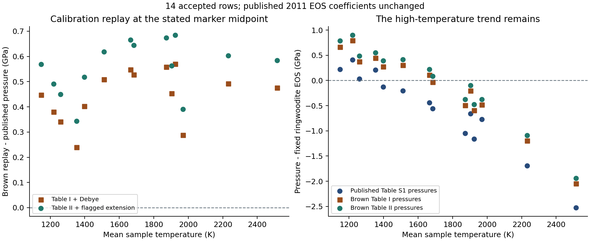
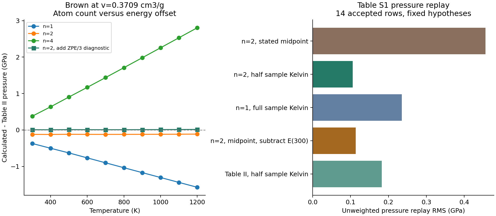

# Fe2SiO4 ringwoodite: static integration and staged thermal audit

Integration update: 2026-10-19. **The derived Finger (1979) static record is now integrated** as `ferrous_ringwoodite`, with its measured ambient cell, unchanged published K0, source structure and all three observations. It is restricted to 296.15 K and 0–4 GPa. The 2011 thermal candidate remains outside the executable catalog. [Parameters](../material-summaries/ferrous_ringwoodite.md) · [Curves, residuals and uncertainty comparison](../reconstruction-reports/ferrous_ringwoodite.md).

The installed package exposes the accepted static record through the public API:

```python
from peritheos import get_eos_record

static = get_eos_record(
    "ferrous_ringwoodite_finger_1979_bm2_ambient_cell_reconstruction"
)
print(static.volume(2.0, 296.15, check_validity=True))  # ų/conventional cell
```

The following dated investigation and staged two-record card are preserved as the original handoff.

Audit date: 2026-10-16. The material identifier is `ferrous_ringwoodite`.
The proposed file is
`output/material-candidates/ferrous-ringwoodite/ferrous_ringwoodite.eosmat`;
its eventual destination would be
`peritheos/data/materials/ferrous_ringwoodite.eosmat`. It is not installed in
the catalog. The static reconstruction is ready for integration; the 2011
thermal candidate must retain its qualifications until the acceptance
conditions below are resolved.

The staged card contains two separate records: a source-validated **derived
static ambient-cell reconstruction** from Finger et al. (1979), which is the
default, and an explicitly qualified 2011 thermal research candidate with
`scientific_validation.status: not_reproduced`,
`catalog_access: explicit_selection`, and no default designation. Published
bulk moduli are unchanged. There is no installed or staged independent-refit
record. The subset fits below are diagnostic results only. No runtime changes,
shared ledger edits, calibration registry changes, commits or author contacts
are part of this addition.

## Scientific decision

The missing Fe-endmember can be added now with a deliberately labeled static
reconstruction. Finger et al. (1979) explicitly identifies BM2 with K0 prime
fixed at 4 and reports K0=1.96(6) Mbar. Combining that unchanged coefficient
with the paper's measured ambient cell gives a reproducible derived record at
23 C (296.15 K). Both compressed primary states agree within their reported
coordinate errors. This verifies the construction; it does not establish the
authors' original fitted intercept or objective.

The [2011 primary article](https://doi.org/10.1029/2011GL046949) directly
supports the coefficients, composition label, experimental methods and adopted
constraints. All new numerical measurements in its official Table S1 have been
recovered, together with paired NaCl readings and original uncertainties.
Independent evaluation of the conventional BM2-MGD interpretation agrees with
the published Figure 1 curves within the declared graphical tolerance.

Acceptance of the **2011 thermal record** as an unqualified source-validated EOS
remains deferred. The 2011
ringwoodite article and its three PDF supplements do not explicitly write its
cold compression equation or its volume-dependent gamma/theta equations. The
author's now-recovered dissertation prints the conventional BM3-MGD equations
in its earlier Os chapter. The cited Dorogokupets-Dewaele (2007) paper also
explicitly derives the integrated theta law in its constant-q limit. The
equation mapping therefore has primary-citation support and passes the
thermodynamic identity below. Applying the Os implementation to ringwoodite
remains an inference until its original code or explicit prescription is found.
The recovered plot alone cannot identify the theta law.

The complete historical 2011 combined fit is also unrecovered: four upstream
observation tables, their normalization, exact row masks, fit weights,
uncertainty reduction and covariance are missing. Figure S1 resolves the rounded
mean temperatures for all nine second-cycle measurements. Conditional subset
agreement does not close the remaining gaps. This is why the thermal record requires explicit
acceptance and does not claim `primary_source_validated`.

## Identity, diffraction and volume basis

This is nominal gamma-Fe2SiO4, the pure ferrous spinel endmember, commonly called
ahrensite; it is separate from Mg2SiO4 ringwoodite and fayalite olivine.
The 2011 specimen was synthesized by laser heating single-crystal fayalite.
Its hydrogen content was not established in that paper. A later
[Wang et al. (2025) study](https://doi.org/10.1029/2024GL109666) suggests possible
hydration as an explanation for the low inferred expansion. That is a later
hypothesis, not a measured hydration correction or proof that the 2011 sample
has a particular water content. No coefficients or sites from the different
Fe-rich 2025 sample are substituted here.

The diffraction model has separate primary provenance:
[Finger, Hazen and Yagi (1979), American Mineralogist 64, 1002-1009](https://hazen.carnegiescience.edu/sites/default/files/043-FH-SiSpinels.pdf).
Table 1 on page 1004 gives the pure Fe-endmember oxygen parameter
`u=0.2409(1)`, at 23 C and 0.001 kbar. The accompanying text explains that full
cation ordering was assumed after occupancy refinement differed little from
complete ordering. The conventional cubic F cell is Fd-3m, number 227, origin
choice 2, with these standard Wyckoff representatives:

| Element | Site | x=y=z | Occupancy | Atoms per cell |
|---|---|---:|---:|---:|
| Fe | 16d | 0.5 | 1 | 16 |
| Si | 8a | 0.125 | 1 | 8 |
| O | 32e | 0.2409 | 1 | 32 |

The composition is Fe16Si8O32, hence `Z=8` and seven atoms per formula unit.
Table 2, page 1005, gives mean cubic `a=8.236 A` and a separately refined
triclinic volume `558.7(2) A^3`. The stored cubic cell has volume
`8.236^3=558.661848 A^3`. All three Fe rows, all triclinic lattice parameters
and their estimated standard deviations are retained in the structural CSV.
This ordered Fe structure does not reuse the Mg card's partial Mg-Si disorder.

The static reconstruction adopts the **measured** Table 2 volume 558.7(2) A^3
as its fixed intercept. That 0.2 A^3 is a measurement esd, not an EOS-fit error.
It preserves the source's K0=196(6) GPa and fixed K0 prime=4, and uses 296.15 K.
Its pressures are relative to an approximate zero-pressure ambient reference;
the measured ambient 0.001 kbar is 0.0001 GPa, negligible at the source precision.
This is declared `record_kind: derived`, with a full `derivation` object, rather
than presenting the measured ambient volume as a recovered fitted intercept.
The valid static data span is only 0-4 GPa at 296.15 K. No conversion to 300 K
or thermal behavior is inferred for this record.

The separate 2011 preferred reference volume is molar, per Fe2SiO4 formula unit:

```text
Vcell [A^3] = Vm [cm^3/mol] * Z * 10^24 / NA
NA = 6.02214076e23 mol^-1 (exact)
V0 = 42.03 cm^3/mol = 558.3396559465342 A^3/conventional cell
```

The structural and EOS reference cells belong to different experiments and
legitimately differ. The source reports no uncertainty or clear original
optimization constraint for V0; neither an invented error nor a claimed
source-fixed flag is added. Conditional replays explicitly hold V0 fixed.
The native thermal evaluator's internal volume is `0.1*Vm`; the material API
handles that scaling. Independent SI evaluation uses the physical molar volume
and converts `J/cm^3` to GPa with a factor of `10^-3`.

## Published coefficients and proposed equation mapping

| Quantity | Published value | Source and assessment |
|---|---:|---|
| V0 | 42.03 cm^3/mol | Abstract and paragraph 5; preferred value; uncertainty and original optimization constraint unspecified |
| K0 | 202(4) GPa | Paragraph 5; combined static-data anchor |
| K0 prime | 4 | Explicitly fixed; BM3 would reduce to BM2 |
| gamma0 | 1.08(6) | Preferred thermal fit at fixed q=2 |
| q | 2 | Preferred fixed choice; narrow pressure span does not constrain it well |
| theta0 | 685 K | Fixed adoption attributed to Stixrude-Lithgow-Bertelloni (2005) |
| Tr | 300 K | Static isotherm reference for the proposed mapping |
| n | 7 | Atoms per Fe2SiO4 formula; no hidden normalization |

The printed error widths on K0 and gamma0 are preserved; a confidence level,
covariance and weighting convention are not supplied. For q=1, 2 and 3, the
paper reports gamma0=1.06(6), 1.08(6) and 1.10(6). These are alternative
conditional fits, not bounds on q.

The article and Figure S2 give `K0=214.3-3.2*K0_prime`; at 4 that yields
201.5 GPa. The preferred rounded value remains **202(4) GPa**, rather than
silently replacing it with 201.5.

The executable candidate declares the following hypothesis explicitly, with
`x=V/V0` and `gamma=gamma0*x^q`:

```text
Pcold = (3 K0 / 2) * [(V0/V)^(7/3) - (V0/V)^(5/3)]
theta = theta0 * exp[(gamma0/q) * (1 - x^q)]
Pthermal = gamma / Vm * [EDebye(V,T) - EDebye(V,300 K)] / 1000
EDebye = 9*n*R*T*(T/theta)^3 * integral_0^(theta/T) z^3/(exp(z)-1) dz
```

The division by 1000 assumes Vm in cm^3/mol and E in J/mol. Zero-point terms
cancel at fixed volume; no absolute-zero pressure baseline is introduced.

The supporting author source is
[Armentrout's 2012 UCLA dissertation](https://escholarship.org/uc/item/387964f3),
preceding Os chapter pages 9-10, Equations 1-5. Its ringwoodite chapter pages
23-28 repeats the preferred coefficients and generic MGD citation but does not
repeat the explicit equations. Its Appendix A Table A2, page 57, matches all
18 official Table S1 rows. The complete university PDF is now recovered,
checksummed and visually inspected. In the version with the repository cover,
printed pages 9, 10, 31 and 57 are PDF pages 18, 19, 40 and 66 respectively.

The independently cited
[2005 primary paper](https://doi.org/10.1111/j.1365-246X.2005.02642.x) is now
recovered from its coauthor's public copy. Table A1, page 631, gives the Fe
endmember V0=42.03 cm3/mol and **theta0=685(100) K**. The italic theta entry
denotes an estimate from systematics; Appendix page 630 describes elastic-Debye
scaling when entropy constraints are unavailable for an endmember. This is
an adopted model estimate, not a direct Fe Debye-temperature measurement.
All nine Fe-row parameters, reported error widths and italic/systematics flags
are preserved in `ferrous-ringwoodite-stixrude-2005-table-a1.csv`.
Its K0=218(7), gamma0=1.30(24) and q0=2.8(10) remain separate from the 2011
fit. Likewise, the upstream 100 K uncertainty is **not** inserted as an error
on the fixed 2011 685 K constraint.

### Exact thermal-law follow-up

The recovered [Dorogokupets-Dewaele (2007) primary
paper](https://doi.org/10.1080/08957950701659700), Equations 14-17 on pages
433-434, gives

```text
gamma = gamma_inf + (gamma0-gamma_inf)*x^beta
theta = theta0*x^(-gamma_inf)*exp[(gamma0-gamma_inf)/beta*(1-x^beta)]
q = d ln(gamma) / d ln(V)
```

Setting gamma_inf=0 gives constant q=beta and exactly the candidate's
integrated theta law. This selects the classical limit; no anharmonic or
electronic terms from the expanded model are added without Fe parameters.
The mathematical identity `gamma=-d ln(theta)/d ln(V)` supplies a stronger
check than graphical agreement. The alternative `theta0*x^[-gamma(x)]`
instead implies `gamma(x)*(1+q*ln(x))` and is inconsistent with the stated
gamma law away from x=1 for nonzero q. At x=0.8 the expected gamma is 0.6912,
whereas this alternative implies 0.38272635. Its graphical similarity does
not make it an equivalent thermodynamic prescription.

There is a printed normalization problem: the 2007 paper's Equation 5 and the
dissertation's page-10 prose put `(theta/T)^3` before the Debye integral.
The normalized function requires `3*(T/theta)^3` times that integral.
The dissertation's independent Bernoulli series, Equation 4, has the correct
high-temperature limit and agrees with quadrature. The replay now implements
both independently. For all 43 recovered accepted-new/Liu states, truncation
after B4, B8 and B12 changes pressure by at most 0.0021961, 0.000029211 and
0.00000043714 GPa respectively; B40 agrees within 4.4e-14 GPa. The original
truncation order is still unknown. These tested truncations cannot account for
the several-GPa hot-data residuals.

The dissertation's **Figure 9, page 31**, explicitly acknowledges systematic
pressure residuals above about 1500 K. Two isolated hot-row symbols were
digitized as independent checks: Fay025heat gives about -2.46 GPa versus our
measured-minus-model -2.52460 GPa; Fay028heat gives about -1.62 versus
-1.68969 GPa. Both pass a declared 0.10 GPa graphical tolerance. This is
agreement with published residuals, not a claim that the measurements fit the
EOS within their errors or that the complete author regression is reproduced.
The two residual symbols are never regression inputs.

### Upstream-table access follow-up

The publisher's original [1976 issue contents](https://www.oldcitypublishing.com/journals/hthp-electronic-archive-home/hthp-electronic-archive-issue-contents/hthp-volume-8-number-3-1976/)
now locates the exact Wilburn-Bassett article and its Full Text (IP) link.
That link returns an explicit institutional access denial. Trieste's additional
Nestola repository record has no attached file; ScienceDirect remains blocked
by a CAPTCHA. The Bearworks index's apparent Plymate PDF search snippet was a
misleading association with the next entry: the actual download labels belong
to other articles. The original four observation tables remain missing.
Mao (1969)'s official abstract is readable and confirms 8-396 C expansion
measurements, but its ePDF presents an access denial.

An official [USGS assessment](https://pubs.usgs.gov/of/1992/0267/report.pdf),
Table 7.08, provides a search aid: eight Sato (1977) states at 298 K to 78 kbar,
nine Wilburn-Bassett **1978** states at 298 K to 154 kbar, and eight Mao
expansion states at 281-669 K. These are secondary inventory counts, not
recovered coordinates or the 2011 row mask. The 1978 source is the later
Am. Mineral. overview, which must not silently replace the cited 1976 dataset.
Brown (1999)'s primary Tables I/II have now been recovered from the supplied
full paper and all 18 NaCl readings replayed below. The primary Table I value
at 0.3595 cm^3/g is 10.70 GPa; a commented-out PDIndexer transcription says
10.07. No third-party implementation was copied or used for the replay.

## Recovered primary data and uncertainty definitions

All resources have SHA-256 checksums, column definitions and source locations
in the staged card and `peritheos/data/datasets/ferrous-ringwoodite-source.json`.

| Resource suffix after `ferrous-ringwoodite-` | Rows | Meaning |
|---|---:|---|
| `armentrout-2011-table-s1-raw.csv` | 18 | Original numerical fields, parentheses and exclusion footnotes |
| `armentrout-2011-table-s1.csv` | 18 | Original coordinates/errors plus explicitly calculated cell volumes and assumed mean temperatures |
| `liu-2008-table1.csv` | 29 | All ten original columns, including densities, travel times, sample lengths, velocities and elastic moduli |
| `suzuki-1979-table2-calculated.csv` | 10 | Fe solution II expansion/alpha calculations, 95% confidence halfwidths and extrapolation flags |
| `finger-1979-table2.csv` | 3 | Independent structural specimen; all Fe cell refinements and esds |
| `armentrout-2011-figure1-checkpoints.csv` | 12 | Digitized calculated curves, not measurements |
| `armentrout-2011-figure-s1-temperatures.csv` | 9 | All printed cycle-2 temperature labels, independently confirming rounded arithmetic means |
| `stixrude-2005-table-a1.csv` | 9 parameters | Fe-endmember parameter row, upstream errors and systematics flags; not observations |
| `armentrout-2012-figure9-checkpoints.csv` | 2 | Digitized published residual symbols; never fit inputs |
| `brown-1999-table1.csv` | 21 | All six published zero-K compression/thermal parameter columns; calculated model values, not observations |
| `brown-1999-table2.csv` | 63 | Published calculated pressure grid, 571 populated pressures; leading blank cells preserved |

Table S1 excludes Fay008heat because of a large temperature gradient, and
Fay014quench, Fay019preheat and Fay029quench because of deviatoric stress.
All four remain in the data; 14 rows have no printed exclusion flag.
Lattice errors are standard deviations according to paragraph 4. Pressure
parentheses are retained as reported uncertainty widths with unspecified
confidence convention. No rowwise temperature error or covariance is invented
from the general prose estimates of 200 K and 0.25-0.5 GPa.

For a cubic lattice, derived volume is `a^3` and its linearized standard
deviation is `3*a^2*sd(a)`. Both are marked as derived. Upstream and downstream
temperatures remain separate. Official Figure S1 labels all nine second-cycle
temperatures as the rounded arithmetic mean of the two surface readings:
1398, 1872, 1925, 1666, 1685, 2515, 1970, 1903 and 2232 K. The stored
calculations use unrounded means. The same first-cycle averaging remains a
consistent inference; the NaCl midpoint prescription is explicit in the source
prose. Accepted new rows span 9.75-11.48 GPa and means 1148-2515 K.
Fay025heat's printed surface readings are 2806 and 2224 K; the independent
Figure S1 label is 2515 K. Choosing only the lower surface would contradict
that source checkpoint. No rowwise temperature uncertainty or covariance is
inferred from the agreement.

The source's column headed **Density (cm^3/mol)** is internally inconsistent.
For example, Fay009heat has `a=8.1565 A`, hence
`Vm=40.84815421 cm^3/mol`, while its printed column says `43.24(4)`.
The values vary approximately inversely with lattice-derived molar volume;
their product is about 1766.08 with standard deviation 0.12 across the 18
rows. This numerical clue does not establish the authors' intended formula.
The source column is preserved verbatim and is used for neither volume nor
mass density in the reproduction.

[Liu et al. (2008)](https://doi.org/10.1080/08957950802296287) Table 1 has no
rowwise P, T or density errors. Its densities are printed to 0.001 g/cm^3.
The replay conversion uses explicitly chosen molar mass 203.77 g/mol, so
derived volumes cannot recover the unrounded original XRD volumes. Its
reference `V0=42.053 cm^3/mol`, alpha(T), q=1 and gamma about 1.29-1.30 belong
to the original Liu elasticity reduction. They do not replace the 2011
preferred coefficients. In particular, its adiabatic Ks values are not K0T
measurements to be directly inserted into the 2011 BM2 record.

[Suzuki et al. (1979)](https://doi.org/10.4294/jpe1952.27.53) experimentally
measured Mg-ringwoodite expansion, but separately fitted Fe-ringwoodite
expansion from Mao et al. (1969). Its Fe values here come from that explicitly
identified reanalysis; this does not touch the existing Mg-ringwoodite audit.
The Fe Table 2 entries are calculations, with confidence intervals on the
solution, and several are extrapolated beyond the original measurements to
400 C. They are not ten new independent Fe observations. Table 1 gives the
Fe solution II reference 8 C, fixed theta=636 K and k=2, Q0=(6.63+/-0.33)*10^6
J/mol, a-1=(0.315+/-0.043)*10^-2, and derived gamma=1.30. These differ from
the 2011 adopted thermal parameters and remain source metadata rather than
substitutions. The 2011 thermal-data list includes Suzuki; the 2012 dissertation
ringwoodite chapter omits it.

## Calibration assessment

The new laser-heated data use NaCl B1 and
[Brown (1999), The NaCl pressure standard](https://doi.org/10.1063/1.371596).
The paired NaCl lattice readings/errors and Brown's primary tables are now
recovered. The 2011 reduction assumes the marker is halfway between the
hotspot and 300 K. Both published Brown representations are replayed below;
their discrepancy and the original temperature/uncertainty reduction remain
unresolved. No Decker, Dorogokupets or other NaCl EOS is substituted.
The card retains `reference_eos_not_bundled` because a selectable runtime
calibrant record is not installed, and combined calibration provenance remains
partially resolved. Its metadata separately identifies the completed diagnostic
replay; this status no longer means the NaCl readings have not been evaluated.

Liu's pressures come from the sample's finite-strain/elasticity reduction
(Equations 7-12, pages 408-409), rather than from secondary NaCl calibration.
The thermocouples were W3%Re-W25%Re. Treating all combined pressures as
Brown-NaCl pressures would erase their provenance. Suzuki's calculated
expansion is at ambient pressure. Exact pressure scales and paired marker
readings for the other unrecovered upstream tables remain unknown.

### Brown primary-table recovery and pressure replay

The supplied [Brown (1999) paper](https://doi.org/10.1063/1.371596),
pages 5802-5805, gives Eqs 1-4 and explicitly prescribes MATLAB `SPLINE`
interpolation of Table I to reproduce Table II. Both complete pages were
rendered and visually inspected. A PDF-text check verifies all 126 Table I
numeric cells, all 571 populated Table II pressures, both volume columns and
all leading blanks. The same author's
[Brown-Journaux (2020) supplement](https://www.mdpi.com/2075-163X/10/2/92)
independently republishes all 84 Table I V/P0/K/Kprime entries unchanged in
`NaCldata.mat`. That corroboration does not import their 2020 refit or provide
the original 1999 calculator.

`scripts/ferrous_ringwoodite_brown_replay.py` independently evaluates:

\[
 v=\frac{a^3\,10^{-24}N_A}{4M},\qquad
 E_D(T,\theta)=18RT\left(\frac{T}{\theta}\right)^3
 \int_0^{\theta/T}\frac{z^3}{e^z-1}\,dz,
\]
\[
 P_I(v,T)=P_0(v)+\frac{\gamma(v)E_D[T,\theta(v)]}{1000\,vM}.
\]

Here `a` is in angstroms, B1 has four NaCl formula units per cell, `v` is in
cm^3/g, `M=58.44 g/mol`, `N_A=6.02214076e23 /mol`, and
`R=8.31446261815324 J/mol/K`. NaCl has two atoms per formula unit, so the
high-temperature limit is `E_D -> 6RT`. Energy is in J/mol of NaCl and pressure
in GPa. Not-a-knot cubic splines match MATLAB's default interpolation boundary
convention. No ambient lattice parameter is needed. No zero-point energy is
added to the table labeled zero-K pressure.

**The published representations do not exactly agree under this normalized
Debye interpretation.** At `v=0.3709 cm^3/g`, Table I gives
`P0=8.57 GPa`, `gamma=1.19`, `theta=375 K`; the calculated 300 K pressure is
`9.069532 GPa`, whereas Table II prints `9.19 GPa`. Across all 571 populated
cells, the maximum discrepancy is `0.161849 GPa`. It is mostly independent
of temperature: anchoring the thermal increment at Table II's 300 K pressure
reduces the maximum discrepancy over complete rows to `0.015865 GPa`.
The cause is unresolved. Neither table is silently repaired and neither
reconstruction is labeled recovery of the exact author calculator.

The second reconstruction directly interpolates the printed Table II pressure
surface. Its temperature range is 300-1200 K. For Fay025heat and Fay028heat,
the inferred marker temperatures are 1407.5 and 1265.75 K: these two rows use
an explicitly flagged extension from the 1200 K boundary using Table I's
Debye thermal increment. They are not in-grid Table II reproduction. All NaCl
volumes are interpolated within the printed range.

For both representations, use `Tsample=(Tu+Td)/2` and the stated
`Tmarker=(Tsample+300)/2`. The outputs retain all 18 original observations,
the four exclusion flags and all published pressures/errors. Statistics below
use only the 14 unflagged rows and unchanged published ringwoodite coefficients.
The residual convention is `Pmarker - Pringwoodite(Vsample,Tsample)`.

| Quantity (GPa) | Published S1 | Table I + Debye | Table II + flagged extension |
|---|---:|---:|---:|
| Mean pressure shift relative to S1 | 0 | +0.4452 | +0.5571 |
| Accepted-row residual RMS | 0.9831 | 0.7605 | 0.7477 |
| Fay025heat, 2515 K: pressure | 11.4800 | 11.9553 | 12.0645 |
| Fay025heat: residual | -2.5246 | -2.0493 | -1.9401 |
| Fay028heat, 2231.5 K: pressure | 11.1300 | 11.6216 | 11.7329 |
| Fay028heat: residual | -1.6897 | -1.1981 | -1.0868 |

Worked example: Fay025heat has `aNaCl=5.2439 A`, giving
`v=0.3714872454 cm^3/g`. Table I interpolation gives `P0=8.46820849 GPa`,
`gamma=1.19290957`, `theta=374.298776 K` (the exact values are retained by the
script). With `Tmarker=1407.5 K`, the thermal contribution is approximately
`3.48709467 GPa`, giving `11.95530 GPa`. The fixed ringwoodite EOS gives
`14.00460 GPa` at its measured sample volume and 2515 K. The residual is
therefore still about `-2.05 GPa`. Calibration replay accounts for part of
the discrepancy but does not remove the temperature trend.

One additional **temperature-convention diagnostic** is informative:
setting the heated marker to `Tsample/2`, 150 K below the stated midpoint,
lowers the pressure-replay RMS against S1 from `0.4560` to `0.1055 GPa`
for Table I, and from `0.5664` to `0.1821 GPa` for Table II. This is a
numerical hypothesis, not a measured gradient, correction, or established
author implementation. In the other direction, forcing the two hottest
points onto the fixed ringwoodite EOS would require Table-II-based marker
temperatures around 2117 and 1664 K, corresponding to fractions 0.82 and
0.71 of the sample-to-diamond temperature rise rather than 0.5. These inverse
temperatures depend on both models and do not independently validate either.

Only `abs(dP/da)*sd(a)` is propagated as a lattice-only uncertainty. No
temperature/calibration covariance or rowwise temperature errors are invented;
the reported source pressure parentheses have an unspecified confidence
convention. RMS values summarize central-value discrepancies and are not
chi-square tests or proof of physical model error. Excluded stress/gradient
states remain excluded. The thermal candidate remains `not_reproduced`.

The complete row replay, method definitions, all 571 source-table checks and
diagnostic inverse temperatures are saved under
`output/material-candidates/ferrous-ringwoodite/ferrous-ringwoodite-brown-replay.{json,csv}`.



### Temperature convention, atom count and Brown energy offset follow-up

The next diagnostic is in `scripts/ferrous_ringwoodite_brown_hypotheses.py`,
with complete results in
`output/material-candidates/ferrous-ringwoodite/ferrous-ringwoodite-brown-hypotheses.{json,csv}`.
It tests all 18 rows under 13 fixed hypotheses; the numerical comparisons
below use only the same 14 accepted observations. Every objective is an
**unweighted pressure difference in GPa**. The coefficient fits described here
characterize reduction hypotheses, not the historical combined EOS fit, and
do not change source values or any material coefficients.

**Table S1 favors half the sample Kelvin temperature among the tested simple
fixed-temperature choices, but this is not a unique reconstruction.** Using
Brown Table I as printed gives:

| NaCl reduction hypothesis | Free parameters | Pressure replay RMS (GPa) |
|---|---:|---:|
| n=2, stated `(Tsample+300)/2` | 0 | 0.45597 |
| n=2, `Tsample/2` during heating | 0 | 0.10548 |
| n=2, stated midpoint but additionally subtract `E_D(300)` from zero-K baseline | 0 | 0.11379 |
| n=1, full sample temperature with formula molar volume | 0 | 0.23498 |
| n=1, stated midpoint with formula molar volume | 0 | 0.77553 |
| n=4, stated midpoint with formula molar volume | 0 | 2.86404 |
| n=2, halve Celsius temperature then convert back to Kelvin | 0 | 0.42041 |

For heating-only alternatives, the three cold preheat/quench states remain
at 300 K. A literal halving of every temperature, including room-temperature
states, is not assumed. The extra `E_D(300)` subtraction is deliberately an
**error hypothesis**: it is inconsistent with Table I's stated zero-K P0 if
that baseline is used unchanged. Applying it globally underpredicts the three
cold, excluded states by 0.53-0.59 GPa. That argues against one global erroneous
routine, but cannot exclude a distinct heating-only routine; the cold stress
states are not promoted into fit observations. The two close heated-row RMS
values differ by only 0.00831 GPa, much less than the printed rowwise pressure
widths of 0.23-0.82 GPa. No significance calculation is justified without the
original temperature/error covariance.

The half-temperature model performs similarly in both heating cycles
(RMS 0.09444 and 0.11114 GPa). Allowing `Tmarker=f*Tsample` gives
`f=0.4904475`, RMS 0.09542 GPa and leave-one-row-out RMS 0.10219 GPa.
At fixed half slope, a fitted additive offset is -14.08 K, rather than the
stated +150 K. These are conditional fits to central values, not thermometer
measurements or formal parameter uncertainties. Allowing both slope and
intercept gives `0.4670177*Tsample+41.77 K`, but its leave-one-row-out RMS
0.10439 GPa gives no useful predictive improvement over a simple half slope.
Keeping the stated midpoint and fitting only the thermal scale gives an
effective `n=1.63444`, RMS 0.11097 GPa; a noninteger scale does not redefine
NaCl's atom count. At high temperature, n and temperature scaling are partly
confounded through the leading `3nRT` term. Thus the wrong-n possibility
cannot be judged solely from an apparent factor of two in temperature.

The printed Table II representation gives a half-temperature replay RMS
0.18212 GPa rather than Table I's 0.10548 GPa. Preserving the Brown baseline
ambiguity is therefore material to claims of historical reproduction. None
of these alternatives reproduces all pressures at their printed 0.01 GPa
precision. The evidence supports a missing-temperature-offset hypothesis,
but does **not establish that the authors actually used it**.

**A constant wrong n does not explain Brown's Table I/II discrepancy.** With
all other printed parameters fixed, the required n at the same
`v=0.3709 cm^3/g` would change from 2.48232 at 300 K to 2.07714 at 1200 K.
Conversely, fitting only within-volume temperature slopes across the grid,
which eliminates any constant pressure offset at each volume, gives
`n=2.0007386`. NaCl has two atoms per formula unit. A conventional B1 cell
has eight atoms and four formula units: using n=8 with four times the formula
molar volume is exactly equivalent, and is not an atom-count mistake. The
same distinction applies to Fe2SiO4: n=7 per formula or n=56 per conventional
cell with eight times the formula molar volume.

As a separate check of whether the **ringwoodite** implementation used a wrong
n, hold its published gamma0/q/theta0 and static coefficients fixed and vary
only the atom-count multiplier. All nine digitized Figure 1 thermal-curve
checkpoints agree within the declared 0.002 V/V0 tolerance for n=7 (maximum
difference 0.00117). None passes for n=1, 2 or 4; n=4's maximum mismatch is
0.01120. This supports the existing n=7 reconstruction against the published
calculated curves. It does not recover original code, establish a physical
atom-count fit, or turn calculated curves into observations.

There is a more specific numerical signature. Define the full Debye
zero-point energy per formula mole as

\[
 E_{ZP}=\frac98 nR\theta,\qquad
 \Delta P_{1/3}=\frac{\gamma}{1000V_m}\frac{E_{ZP}}3.
\]

For all **571** populated Table II cells, adding this fixed `E_ZP/3` term to
the normalized Table I reconstruction reduces RMS from 0.12464 to
**0.01097 GPa**, with maximum absolute mismatch 0.03264 GPa. Fitting only
its coefficient gives 0.336237, close to 1/3. A joint fit of thermal scale and
offset gives effective `n=1.999366` and coefficient 0.337725 relative to the
n=2 zero-point energy. A fit using temperatures through 700 K predicts the
800-1200 K cells with RMS 0.01158 GPa. These fits describe **published calculated
grid values**, not experimental constraints or a revised physical calibration.
A generic fitted constant pressure shift of 0.12310 GPa gives RMS 0.01957 GPa;
a fitted constant molar-energy offset of 2218.53 J/mol gives 0.02395 GPa.
The fixed one-third-zero-point shape describes the volume dependence more
closely, but that comparison still cannot identify the historical mistake.

The independent Bernoulli expansion makes the potential arithmetic error
explicit:

\[
 D_3(y)=1-\frac38y+\frac1{20}y^2-\frac1{1680}y^4+\cdots,
 \qquad y=\theta/T,\quad E_D=3nRTD_3(y).
\]

Adding `E_ZP/3` is algebraically equivalent to adding `y/8` to D3: its linear
coefficient becomes **-1/4 instead of -3/8**, while all other terms remain
the same. Series and independent quadrature verify this pressure identity
to better than `1.2e-12 GPa` on the complete grid. It could reflect a
factor-of-three error confined to a zero-point term, a different energy
reference, or a related error in generating one table. It is **not evidence
of a wrong constant n multiplying the whole thermal energy**.

At `v=0.3709 cm^3/g`, the added term is 0.12838 GPa. The resulting 300 K
pressure is 9.19791 GPa versus Table II's 9.19 GPa, and at 1200 K it is
11.61586 GPa versus 11.60 GPa. The remaining deviations are near the scale
of table/interpolation precision, but do not constitute exact reproduction.
The added term is temperature independent at fixed volume, so it cancels in
proper same-volume thermal pressure differences. Adding it to an already
zero-K pressure without redefining the baseline is not a thermodynamically
justified correction and has not been adopted here.

Brown's public [institutional Publications/Papers listings](https://earthweb.ess.washington.edu/brown/resources/), four public tool
archives and the larger example archive, and the public `jmichaelb` repository
[repository trees](https://github.com/jmichaelb) were checked. The identified NaCl code concerns aqueous solutions;
the 1999 solid-NaCl calculator was not found within these sources. No author
was contacted. The **numerical structure** of the offset is now substantially
explained; its historical cause and the original Table S1 temperature routine
remain unconfirmed. Both original Brown tables and all source observations
remain unchanged, and the thermal material record remains qualified.



## Numerical results

The deterministic report is
`output/material-candidates/ferrous-ringwoodite/ferrous-ringwoodite-reproduction.json`.
For the static record the two primary compressed states give:

| Source P (GPa) | Source V (A^3) | Calculated P (GPa) | Calculated V at source P (A^3) |
|---|---|---|---|
| 2.0(1) | 553.5(7) | 1.867379 | 553.139753 |
| 4.0(1) | 547.7(8) | 4.055608 | 547.843709 |

Both residuals are inside combined reported P/V coordinate error widths.
With the measured 558.7 A^3 intercept held fixed, an independent unweighted
two-row pressure fit gives K0=196.217587 GPa, within the published 196(6).
The record preserves **196**, not that conditional refit. Exact author
weighting, covariance and intercept handling remain unrecovered. This
distinguishes validation of the derived source-equation construction from
conditional coefficient agreement and exact fit reproduction.

For the qualified thermal record the report uses independent SciPy quadrature
in physical units, then checks the native
Peritheos model loaded explicitly from the staged card. At 24 GPa and 2000 K,
the independent volume is `518.753150593098 A^3`; native evaluation agrees to
better than `3e-8 A^3`. The same check covers several other states, inversion,
zero thermal increment at 300 K and the exact conventional-cell conversion.
Those internal mathematical checks do not by themselves validate the
historical equation choice.

The independent primary-source benchmark is Figure 1. Twelve raw raster
coordinates are retained for the black 300 K and red 1000/1500/2000 K curves
at 15, 20 and 25 GPa. The volume-ratio tolerance 0.002 accounts for two raster
pixels and axis/cross-section rounding; it is not a statistical error bar.
All twelve pass, with maximum difference about 0.00117. The 25 GPa curves
are published calculations beyond the recovered 24 GPa experimental maximum.
The alternative variable-exponent theta law also passes at this graphical
precision: the plot provides consistency, not unique equation identification.

The following are separate **conditional** gamma0 fits, fixing V0=42.03,
K0=202, K0 prime=4, theta0=685, q=2, n=7 and Tr=300:

| Recovered input and explicit objective | gamma0 | Source-coefficient P RMSE (GPa) | Subset-fit P RMSE (GPa) |
|---|---:|---:|---:|
| New 14, unweighted pressure residual | 0.940257 | 0.98309 | 0.59493 |
| New 14, reported pressure-error weighted | 0.984689 | 0.98309 | 0.64489 |
| Liu 29, unweighted pressure residual | 1.304090 | 0.33005 | 0.09422 |
| New 14 + Liu 29, unweighted | 0.982591 | 0.62300 | 0.52771 |
| New 14 + Liu 29 + seven Suzuki calculated entries, including extrapolations | 1.034403 | 0.62512 | 0.60369 |

The final diagnostic includes Suzuki temperatures >=100 C and explicitly
rebases its 20 C expansion to 300 K by interpolation of the 20/100 C entries.
It is not a reconstruction of the authors' row selection or an endorsement of
treating correlated fitted expansion values as independent observations.
Only that diagnostic falls within the published gamma0 error width of 0.06;
the other recovered-subset optima do not. The maximum published-model residual
among accepted new rows is about 2.525 GPa. No original covariance, reduced
chi-square, confidence interval or exact author workflow is claimed.

## Missing upstream inputs and acceptance conditions

| Source | Evidence obtained | Exact gap |
|---|---|---|
| Sato (1977), pp307-323 | Cited primary chapter identified | Original Fe P-V rows, uncertainty, calibrant and normalization |
| Wilburn-Bassett (1976), HTHP 8,343-348 | Exact publisher Full Text link found; institutional access denied | Original hydrostatic rows to 75 kbar, uncertainty, calibrant and baseline |
| Nestola et al. (2010), DOI 10.1016/j.pepi.2010.09.007 | Author repository abstract: ten pressures to 10.2 GPa, 559.44(6),187.3(1.7),5.5(4) | Ten original observations and reduction; repository has no attached PDF and publisher access was CAPTCHA-blocked |
| Plymate-Stout (1994), DOI 10.1007/BF00203300 | Publisher/author abstracts: thirteen 673.15 K spectra to 24 GPa | Original thirteen observations/errors/calibrant; distinguish those observations from its combined modeled P-V-T surface |
| Mao et al. (1969) | Underlying Fe expansion source identified by Suzuki/Liu | Original Fe thermal rows, errors and pressure reference |
| Stixrude-Lithgow-Bertelloni (2005) | Full primary Table A1 recovered: 685(100) K, systematics flag and all nine Fe parameters | Upstream adoption verified; 2011 still holds 685 K fixed, without propagating this upstream width |
| Brown (1999) | Full primary Tables I/II and all18 paired NaCl readings replayed; independent same-author2020 table corroboration | Published TableI/II offset and original temperature/error reduction remain unresolved; two marker temperatures need extension beyond TableII |

Minimum acceptance work for the 2011 thermal record is to establish its cold and thermal
equations from a source explicitly applicable to that fit, and to resolve
enough of the data/normalization and calibration reduction to assess the
new-row residuals. A recovered original input/calculator or explicit author
clarification could address several gaps; no contact was made or authorized.
Full author-fit reproduction additionally requires the complete original
tables, mask, objective/weights, fitting order, numerical settings and
covariance. Missing licensing is not one of the exclusion reasons.

The thermal candidate's numerical evaluation envelope is restricted to 0-24 GPa and
300-2000 K for checked public API calls. It describes a reviewed calculation
window, not a rectangular experimental domain or a phase-stability guarantee.
It contains no phase boundary, high-pressure polymorph, spin-state,
magnetic-order or dissociation treatment. The unqualified source assumption
should not be promoted into a default merely because schema and numerical
tests pass.

## Reproduction and integration handoff

```bash
uv run python -m scripts.ferrous_ringwoodite_recover --check
uv run python -m scripts.ferrous_ringwoodite_recover --check \
  --source-dir output/material-candidates/ferrous-ringwoodite/sources
uv run python -m scripts.ferrous_ringwoodite_reproduce \
  --output output/material-candidates/ferrous-ringwoodite/ferrous-ringwoodite-reproduction.json \
  --residual-plot output/material-candidates/ferrous-ringwoodite/ferrous-ringwoodite-residuals.png
uv run python -m scripts.ferrous_ringwoodite_brown_replay \
  --source-dir output/material-candidates/ferrous-ringwoodite/sources \
  --plot output/material-candidates/ferrous-ringwoodite/ferrous-ringwoodite-brown-replay.png
uv run python -m scripts.ferrous_ringwoodite_brown_hypotheses \
  --plot output/material-candidates/ferrous-ringwoodite/ferrous-ringwoodite-brown-hypotheses.png
uv run pytest -q -W error tests/test_ferrous_ringwoodite.py tests/test_ferrous_ringwoodite_brown_replay.py tests/test_ferrous_ringwoodite_brown_hypotheses.py
cargo test -p peritheos --test ferrous_ringwoodite --locked
```

Validation on 2026-10-16: **24 Python tests and 1 Rust test passed**. Scoped
Ruff checks and formatting checks passed. The optional original-PDF comparison
passed for every Table S1 field, every Liu Table 1 cell and all nine SLB Fe
parameter values, error widths and italic/systematics flags. Validation was
scoped to this material; shared catalog and complete integration checks belong
to the parent integration pass.

The new Brown checks additionally verify all 126 Table I numeric cells and
571 Table II pressures plus blanks, the independent normalized Debye limit,
both reconstructions, explicit extrapolation boundaries and retained exclusions.
The Rust test result predates this calibration-only follow-up; no Rust/runtime
code changed here.

The optional PDF check compares every Table S1 raw field and every Liu Table 1
cell against the downloaded originals. Finger/Suzuki tables were transcribed
and checked visually. Local source hashes are recorded; publisher files are
not proposed package data and are not covered by the contributor CC0
dedication. Source numerical terms remain unspecified where not supplied.
The limited contributor dedication and source terms are in
`peritheos/data/datasets/ferrous-ringwoodite.LICENSE.md`.

The material-prefixed CSVs, manifest, license, four scripts, three Python tests, Rust
test and this note are ready for review. The card remains at the staged path.
The derived static record can be integrated now as the default with its
296.15 K/0-4 GPa restrictions and visible reconstruction label. The thermal
candidate must remain nondefault and explicit-selection; do not promote it to
source-validated until the acceptance decision changes. If including the full
card, it adds one material, one validated derived static record and one
qualified thermal candidate; API loading with primary validation enabled
exposes only the static record. Shared manifest, audit/refit ledger, coverage
and navigation updates belong to the parent integration pass. This chat has
not edited those files. No Mg-ringwoodite card or Katsura normalization code
has been changed.
